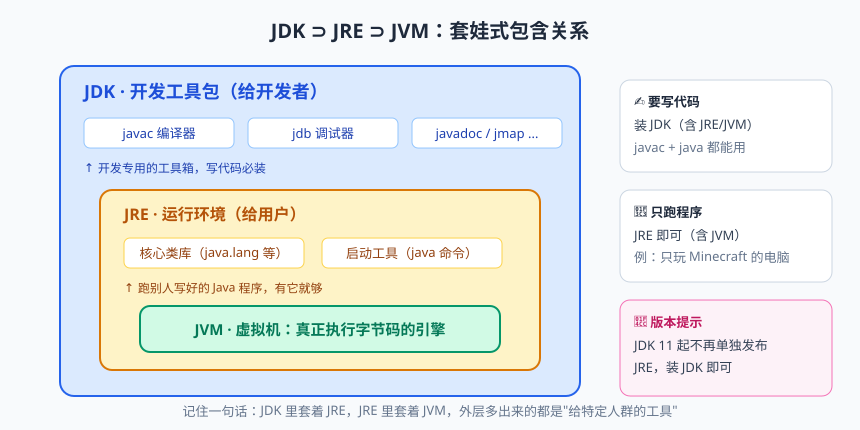
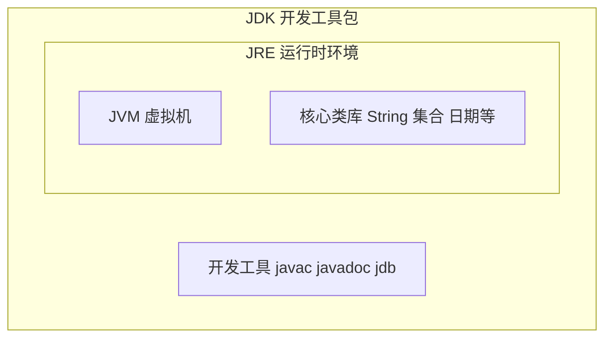
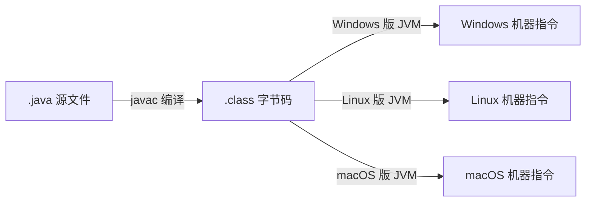

# Hello Java：从一杯咖啡到一个世界

朋友们，欢迎来到《Java 从零到专家》系列的第一课。开讲之前，我想请你先做一件事：抬头看看你手边有没有咖啡（没有的话，白开水也行，枸杞水就先放一放）。三十多年前，大洋彼岸有一群工程师，就是盯着这样一杯冒着热气的咖啡，给一门改变了整个软件世界的编程语言起了名字——Java，本意是印尼爪哇岛产的咖啡。

你可能想不到，这门如今统治着企业级开发、安卓应用、大数据生态半壁江山的语言，最初的使命是给机顶盒、烤面包机这类家用电器写控制程序。对，你没听错：一个想"控制烤面包机"的项目，最后烤出了全球几百万开发者饭碗里的"大面包"。命运的走向，有时候比最烂的代码还难预测。

自我介绍一下：我是在 IT 培训行业摸爬滚打十余年的 Java 讲师，带过的学生里有厨师转行的，有会计转行的，还有一位六十岁的大爷纯粹想给孙子写个小游戏。他们最后都学有所成，所以请相信：他们能行，你也能。好了，寒暄到此结束，系好安全带，发车。

## 一、Java 的前世今生：一杯咖啡引发的"血案"

1991 年，Sun 公司（Sun Microsystems，太阳微系统公司）启动了一个代号 Green Project 的项目，目标是给下一代智能家居设备开发控制系统。项目的灵魂人物叫 James Gosling（詹姆斯·高斯林），江湖人称"高司令"。一开始团队打算用 C++ 干这活儿，结果写着写着发现不对劲：C++ 的指针满天飞、内存要手动管理，一个不小心程序就"原地爆炸"。给家电写程序，稳定压倒一切，于是高司令一咬牙：自己造个语言！

新语言最初叫 Oak（橡树），因为高司令办公室窗外正好立着一棵橡树——是的，程序员起名字的随意程度，从祖师爷那辈就开始了。后来准备注册商标时才发现 Oak 这个名字早就被人占了。据说工程师们当时正捧着爪哇岛咖啡开会，一拍大腿：就叫 Java！所以今天 Java 的官方图标是一杯冒着热气的咖啡。以后别人问你为什么学 Java，你可以理直气壮地回答：我这是投身咖啡事业。

再往后的发展，我给你捋一条幽默版时间线：

- 1995 年：Java 1.0 横空出世，口号 Write Once, Run Anywhere（一次编写，到处运行），直接把当时的老大哥 C++ 干得坐立不安；
- 2004 年：Java 5 发布（注意是 5 不是 1.5，Sun 也觉得小数点版本号不够排面），泛型、枚举、增强 for 全在这一版亮相，堪称 Java 的"成人礼"；
- 2014 年：Java 8 发布，Lambda 表达式、Stream 流、新日期 API 三件套上线。到今天它依然是企业界的"钉子户"，无数十年老项目还稳稳跑在 8 上；
- 2018 年：Java 11 发布，LTS（Long Term Support，长期支持）版本；
- 2021 年：Java 17 发布，同为 LTS，是 Spring Boot 3 的最低门槛，如今新项目的标配。

一句话总结这三十年：语言排行榜上风云变幻，Java 虽然被喊了无数次"老了、要凉了"，但在企业级开发的牌桌上始终稳坐主位——各种编程语言排行榜常年前三，不是白给的。

> 💡 **老鸟忠告**：别纠结"学哪个版本会不会过时"。Java 8 / 11 / 17 的核心语法一脉相承，先把 8 的地基打牢，再了解 8 到 17 的新特性，这是企业招人时最认可的技术画像。

## 二、JVM、JDK、JRE：一家三口到底谁是谁？


> 🖼️ **图解**：JDK ⊃ JRE ⊃ JVM 的套娃关系与"装哪个"的选型

初学者第一次见到这三个缩写，基本和第一次进丈母娘家一样——都姓 J，谁也分不清谁是谁。来，我用一张表和一张图给你彻底讲明白。先说结论：这三者是"套娃"关系——JDK 包含 JRE，JRE 包含 JVM。

| 名字 | 全称 | 是什么 | 什么时候需要它 |
|---|---|---|---|
| JVM | Java Virtual Machine，Java 虚拟机 | 负责执行字节码的"虚拟电脑"，Java 跨平台的第一功臣 | 理论上只运行 Java 程序时 |
| JRE | Java Runtime Environment，Java 运行时环境 | JVM + Java 核心类库（String、集合这些"官方零件"） | 只想跑程序、不想写代码 |
| JDK | Java Development Kit，Java 开发工具包 | JRE + 开发工具（编译器 javac、文档工具 javadoc、调试器 jdb 等） | 要写代码的你 |

用做菜打个比方：JVM 是灶台，真正开火做饭的地方；JRE 是"灶台 + 一整套基础厨具和调料"；JDK 则是"JRE + 菜刀、砧板和菜谱笔"。你不打算做菜（不开发），装个 JRE 就够；要下厨写代码，必须上 JDK。



> 📌 **划重点**：开发装 JDK 就万事大吉。另外从 Java 11 起，Oracle 不再单独提供 JRE 安装包，JDK 就是全家桶——套娃的最后一代目。

## 三、一次编写，到处运行：Java 的独门绝技

"Write Once, Run Anywhere"这句口号是 Java 的立身之本，但它到底是怎么做到的？这就要请出 Java 编译的核心三板斧：源文件、字节码、虚拟机。

先看 C 语言为什么做不到。C 语言的编译器直接把源码翻译成当前平台的机器码（比如 Windows 上的 .exe 文件）。机器码和操作系统、CPU 指令集深度绑定，Windows 上编译出来的程序拿到 macOS 上就是一堆"乱码天书"，根本无法运行，这叫"平台相关"。

Java 的做法聪明就聪明在，它在源码和机器码之间加了一层"中间商"——字节码（bytecode）。整个流程分两步走。第一步，javac 编译器把 .java 源文件翻译成 .class 字节码文件；注意，字节码不面向任何具体操作系统，它只面向 JVM 这个"标准接口"。第二步，各平台各自的 JVM 把字节码翻译成本平台的机器指令去执行：Windows 版 JVM 翻译成 Windows 指令，Linux 版 JVM 翻译成 Linux 指令。

打个比方：字节码是一张"世界通用船票"，而 JVM 是各个码头上会说当地方言的翻译官。你只管拿票上船（编译一次），到哪个码头都有人给你翻译（到处运行）。真正跨平台的不是 .class 文件本身，而是"每个平台都装了对应版本的 JVM"这件事。



> ⚠️ **踩坑实录**：曾有学员用 JDK 17 编译出 .class 文件，拷到一台只装了 Java 8 的电脑上运行，直接报 UnsupportedClassVersionError（不支持的类版本）。原因：高版本 JDK 编译出的字节码，低版本 JVM"看不懂"。记住：字节码能跨平台，但不能"穿越到过去"——跨平台的前提是运行环境的 JVM 版本要兼容。编译时加参数 `--release 8` 可以指定目标版本。

## 四、人生第一行代码：Hello World 逐行解剖

好了，激动人心的时刻到了。翻开任何一本编程书的第一页，都是这行祖传代码：

```java
public class HelloWorld {
    // JVM 的入口方法，整个程序的"总闸门"
    public static void main(String[] args) {
        System.out.println("Hello, Java!"); // 向世界打个招呼
    }
}
```

别看它只有寥寥几行，信息量堪比一套小户型。来，我们把每个关键词挨个"过堂"：

- **public class HelloWorld**：class（类）是 Java 世界的"户型图"，Java 规定所有代码必须住在类里，不允许"露宿街头"（不存在类外部的独立函数）。public 表示这个类公开可见。这里有个硬性规定：文件名必须与 public 类名完全一致——HelloWorld 类必须放在 HelloWorld.java 文件里，一个字母、一个大小写都不能差。
- **public**：main 方法要被 JVM 从"外部"调用，JVM 可不是你这个类的熟人，所以门必须敞开，否则 JVM 进不了门。
- **static**（静态）：这是最容易被问"为什么"的关键词。JVM 启动程序时，内存里还没有创建任何一个对象，如果想调用非 static 方法，得先 new 一个对象出来——可谁来执行这个 new 呢？鸡生蛋、蛋生鸡，死循环。static 方法属于类本身，不需要对象就能调用，完美解决了"先有鸡还是先有蛋"的问题。
- **void**：方法执行完不需要给任何人交代结果，所以返回值为空。
- **main**：方法名，是 JVM 认死的"入口暗号"，拼写必须分毫不差。写成 mian 的话编译能过，运行时 JVM 会冷冰冰地告诉你：在类中找不到 main 方法。
- **String[] args**：命令行参数，一个字符串数组。比如执行 `java HelloWorld 张三 18`，args 里就装着 {"张三", "18"}。初学阶段用不上，但考试和面试特别爱问。

再看输出那一行 System.out.println()。System 是 JDK 自带的系统类，out 是它持有的标准输出对象（你的屏幕），println 是"打印并换行"的方法。整句话翻译成人话就是："System 同学，借你的 out 喇叭喊一嗓子，喊完顺便换个行。"

> 📌 **划重点**：main 方法的完整签名 `public static void main(String[] args)` 属于"祖传配方"，背也要背下来。面试手写代码时写错一个词，第一印象分直接归零。

## 五、环境搭建：磨刀不误砍柴工

工欲善其事，必先利其器。搭环境是新手遇到的第一只"拦路虎"，我给你一套最省事的方案。

第一步，下载 JDK。推荐两个渠道：Oracle 官网（版本最新，但商用许可条款要看清楚）或者开源的 Eclipse Temurin（免费无坑，社区口碑极好）。版本按前面说的选 8 或 17 皆可。Windows 安装时记得勾选"将 JDK 加入 PATH"；Mac 用 Homebrew 或者直接装安装包都行。

第二步，验证。打开终端（Windows 是 cmd 或 PowerShell），输入：

```bash
java -version   # 查看运行环境版本
javac -version  # 查看编译器版本
```

两行命令都能正常输出版本号，环境就算通了。如果提示"不是内部或外部命令"，九成是 PATH 环境变量没配好。PATH 是操作系统找程序的"通讯录"，把 JDK 的 bin 目录写进去，系统才知道 javac 这个人住在哪。

第三步，装编辑器。强烈推荐 IntelliJ IDEA（JetBrains 出品，Java 圈的顶流 IDE）。社区版（Community）免费，学习阶段完全够用；旗舰版（Ultimate）收费，多了 Web 开发、数据库工具等企业级功能，学生和教师可以申请免费教育授权。

在命令行里体验一次最原始的编译运行，是每个 Java 新手的成人礼：

```bash
javac HelloWorld.java   # 编译：生成 HelloWorld.class 文件
java HelloWorld         # 运行：注意不带 .class 后缀
```

> 💡 **老鸟忠告**：初学的前两周，建议用记事本（或 VS Code）加命令行写两三个小程序，再切到 IDEA。原因很简单：IDE 的自动补全太贴心，贴心到很多学了半年的人离开 IDE 连 `System.out.println` 都拼不全。先学会走路，再坐车。

## 六、编译期错误 vs 运行时错误：第一次翻车初体验

写代码不可能不报错。报错不是灾难，是程序在和机器"吵架再和好"的过程。Java 的错误大致分两个阶段，早点搞明白，翻车时才能心平气和。

**编译期错误（compile-time error）**：javac 在编译阶段就给你拦下来的问题，基本都是"语法错误"，比如少个分号、大括号没配对、类名和文件名不一致。看例子：

```java
public class TypoDemo {
    public static void main(String[] args) {
        int age = 18      // 编译报错：缺少分号，javac 拒绝生成 class 文件
        System.out.println(age);
    }
}
```

**运行时错误（runtime error）**：语法全对，编译通过，程序跑起来半路"翻车"。最经典的就是除零：

```java
public class CrashDemo {
    public static void main(String[] args) {
        int a = 10;
        int b = 0;
        System.out.println(a / b); // 运行时抛出 ArithmeticException: / by zero
    }
}
```

打个比方：编译器像严格的语文老师，病句一个不放过，改不好别想及格（拿不到 .class 文件）；运行时像物理老师，你句子写得再通顺，"10 除以 0"违反了数学定律，照样让你挂科。

| 对比项 | 编译期错误 | 运行时错误 |
|---|---|---|
| 发现时机 | javac 编译阶段 | 程序运行阶段 |
| 典型例子 | 缺分号、括号不匹配、拼写错误 | 除零、数组越界、空指针 |
| 报错形式 | 编译失败，无法生成 .class | 抛出异常（Exception），程序中断 |
| 防范手段 | 按编译器提示逐个修正 | 靠经验、靠测试、靠异常处理机制 |

> ⚠️ **踩坑实录**：一位学员曾满脸委屈地找我："老师，我代码没问题啊，怎么运行一点反应没有？"过去一看，他把 main 写成了 Main。Java 严格区分大小写，main 是 JVM 的入口，Main 只是又一个普通方法名。编译器不报错（因为语法上没错），但 JVM 找不到入口暗号，程序直接"罢工"。这类"不报错的错"最气人——遇到"编译过了但运行没结果"，先检查 main 方法签名。

## 七、给初学者的三句心里话

第一句：报错不可怕，报错是 JVM 在跟你聊天。把报错信息从头到尾读一遍，它往往直接告诉你是哪一行、什么问题。新手最大的敌人不是错误本身，而是不敢面对错误。

第二句：不要背 API。System、String、集合这些类，用的时候查文档、让 IDE 补全就好。你要背的是概念和原理，比如"static 为什么存在"，而不是"println 有几个重载"。

第三句：动手永远大于眼睛。看懂了不等于会写，就像看了一百集做菜视频，你可能还是煎不好一个蛋。每篇文章的课后练习，请务必亲手敲一遍——肌肉记忆才是程序员真正的记忆。

## 本篇小结

- Java 诞生于 1991 年 Sun 公司的 Green Project，之父是 James Gosling，名字来源于爪哇咖啡；
- 版本里程碑：Java 5 是成人礼，Java 8 / 11 / 17 是三大 LTS 主力版本；
- JDK ⊃ JRE ⊃ JVM，套娃关系，开发装 JDK 一步到位；
- 跨平台的核心是"字节码 + 各平台 JVM"：一次编译，到处运行；
- 代码生命周期：.java 源文件经 javac 编译成 .class 字节码，再由 JVM 翻译执行；
- main 方法签名是固定配方：public static void main(String[] args)，static 的存在是为了绕开"先有对象还是先有方法"的死循环；
- 编译期错误是语法问题，运行时错误是逻辑问题，一个管"写得对"，一个管"跑得对"；
- 学习心法：多动手、敢读报错、不背 API。

## 课后思考 & 动手练习

1. 用自己的话（不超过三句）向一位完全不懂编程的朋友解释 JVM、JDK、JRE 三者的关系。
2. 为什么 main 方法必须是 static 的？如果去掉 static，JVM 启动时会遇到什么困境？
3. 分别举出一个"编译期错误"和一个"运行时错误"的例子，并说明它们在发现时机上的本质区别。
4. 【编程题】编写 PersonalCard.java：定义类 PersonalCard，在 main 方法中用 5 次 System.out.println 依次输出你的姓名、所在城市、爱好、一句座右铭，以及"我为什么要学 Java"。要求：先用命令行 javac 编译、java 运行成功，再移植到 IDEA 中跑一遍，体会两种方式的区别。
5. 【探索题】在你的电脑上分别执行 `java -version` 与 `javac -version`，观察输出是否一致，并查一查：什么情况下两者会不一致？不一致时可能导致什么问题？

下一篇预告：程序的世界里全是"数据"，而数据得先上个"户口"才能干活——下一篇《变量与数据类型：8 大基本类型排排坐》，我们聊聊撑起 Java 半边天的 8 个基本类型，以及一个让无数面试者折戟沉沙的 Integer 缓存池陷阱。不见不散！
