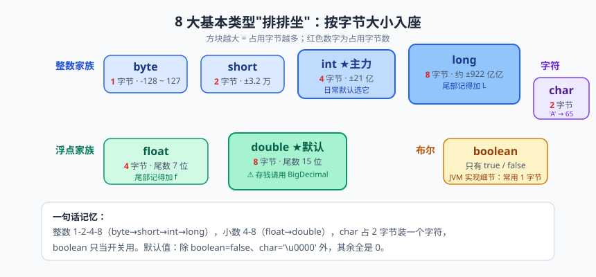
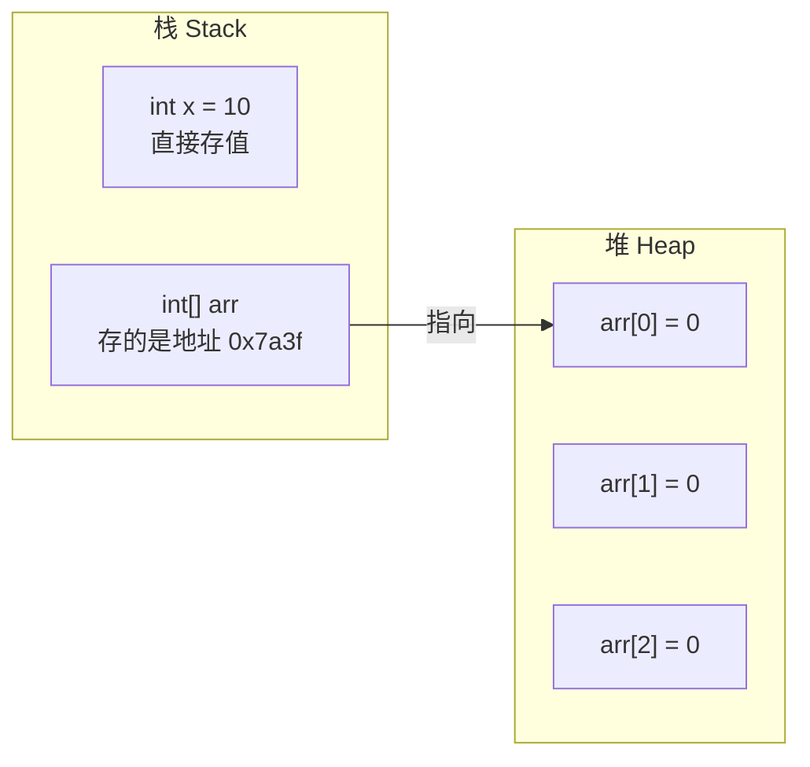

# 变量与数据类型：8 大基本类型排排坐

去超市存过包裹吧？扫一下码，"叮"的一声，一个储物柜弹开。你把东西塞进去，小票上打出一个编号。内存的世界和这一模一样：柜子是内存空间，你放的包裹是数据，小票上的编号就是变量名——凭"票"取件，随存随用。

再打个比方：计算机的内存像一家巨型酒店，几亿个房间一眼望不到头。你不能跟前台说"给我个房间"就完了，前台会反问你三个问题：住几口人（占几个字节）？房号贴谁的名（变量叫什么）？住到什么时候（生命周期）？这三个问题的答案，就是今天的主角——变量与数据类型。

这一篇是整个 Java 大厦的地基，别看名字朴素，坑却多得像秋天的落叶：整型会溢出、浮点会撒谎、Integer 会"精神分裂"。我们一个一个来排排坐。

## 一、变量的本质：栈上一块贴了标签的内存

先看最朴实的一行代码：

```java
int age = 18; // 向 JVM 申请一块 4 字节内存，贴上标签 age，放进值 18
```

这一行干了三件事，对应变量的三要素：**类型**（int，告诉编译器开多大的房间、按什么格式解读里面的 0 和 1）、**名字**（age，这块内存的标签，以后凭它访问）、**值**（18，实际存放的数据）。

变量必须先声明再使用，这是 Java 和一些弱类型脚本语言的重要区别——Java 是静态强类型语言，类型在编译期就定死，想临时把字符串塞给 int？编译器一巴掌拍回来。这种"死板"换来的好处是：大量低级错误在编译期就被拦截，而不是上线后在生产环境半夜炸给你看。

> 💡 **老鸟忠告**：变量命名用"小驼峰"（首单词小写、后续单词首字母大写，如 maxRetryCount），并且要见名知意。别用 a、b、c、temp 这类名字——三个月后回看自己的代码，你会以为公司招了个实习生顶替你写的。

## 二、八大基本类型排排坐：四类八种


> 🖼️ **图解**：8 大基本类型按字节大小"排排坐"，方块越大越占内存

Java 把基本类型（primitive type）分为四类八种，念起来像一套组合拳：**整数四兄弟、浮点两姐妹、字符独苗、布尔一根筋**。表格奉上，这张表建议存进手机相册：

| 分类 | 类型 | 占用字节 | 取值范围 | 默认值（成员变量） |
|---|---|---|---|---|
| 整数 | byte | 1 字节 | -128 ~ 127 | 0 |
| 整数 | short | 2 字节 | -32768 ~ 32767 | 0 |
| 整数 | int | 4 字节 | 约 -21.4 亿 ~ 21.4 亿 | 0 |
| 整数 | long | 8 字节 | 约 -922 亿亿 ~ 922 亿亿 | 0L |
| 浮点 | float | 4 字节 | 约 ±3.4E38，有效数字约 6~7 位 | 0.0f |
| 浮点 | double | 8 字节 | 约 ±1.7E308，有效数字约 15 位 | 0.0d |
| 字符 | char | 2 字节 | 0 ~ 65535（无符号） | '\u0000' |
| 布尔 | boolean | 规范未严格定义 | true / false | false |

几个高频细节必须交代清楚。

三个高频细节必须交代清楚。第一，整数字面量默认是 int，小数字面量默认是 double，所以给 long 赋值要加 L、给 float 赋值要加 F，否则编译器直接翻脸。第二，Java 7 之后数字可以用下划线分隔，专治"零数不清"：`int salary = 1_000_000;`，编译器自动忽略下划线。第三，char 是个"两面派"：它存的是字符，骨子里是个无符号 16 位整数（Unicode 编码），这意味着 `'中'` 合法，也意味着字符可以参与数学运算。一段代码，后两个细节现场验证：

```java
long population = 140000000000L;             // 不加 L：整数太大，超出 int 范围，编译报错
float price = 9.9F;                          // 不加 F：9.9 默认是 double，装不进 float，报错

char letter = 'A';                           // char：单引号，只能放一个字符
System.out.println(letter + 1);              // 66：'A' 的编码是 65，加 1 变整数 66
System.out.println((char)(letter + 1));      // B：强制转回 char 才按字符解读
```

> 📌 **划重点**：默认值只属于成员变量（类里、方法外）。局部变量（方法里）没有默认值，不初始化就使用，编译器直接报错 "variable might not have been initialized"——这是新手第一天就会撞上的墙。

## 三、基本类型 vs 引用类型：两套户口

八大家族之外，Java 还有一大门派：引用类型（reference type），比如 String、数组和所有对象。两者的核心区别在于**值放在哪**：

- 基本类型：变量里直接装着"值本身"，比如 `int x = 10;`，栈（stack）上那块 4 字节内存里就躺着 10；
- 引用类型：变量里装的是"地址"，对象本体住在堆（heap）里，栈上的变量只存了一串"门牌号"。



这个区别会引发一个著名的现象：赋值时，基本类型拷贝的是值，引用类型拷贝的是地址。把一个数组变量赋给另一个变量，俩变量管的是同一个对象——一处修改，处处可见。

> ⚠️ **踩坑实录**：我带过的学员几乎人人都写过这个方法——`swap(int a, int b)`，想在方法里交换两个数，结果调用完纹丝不动。原因：Java 只有值传递，传进方法的是变量的"复印件"。基本类型复印的是值，改复印件不影响原件；引用类型复印的是地址，所以方法里改数组元素、改对象字段能生效。搞懂"复印的是什么"，这类题就再也不会错。

## 四、类型转换：小房间搬大房间随便，大房间搬小房间要签字

不同类型之间能不能混？能，但讲究方向。

**自动类型转换（隐式转换）**：小容量的值放进大容量变量，编译器自动放行，方向是 byte → short → int → long → float → double，另外 char 可以自动转 int。就像从标间搬进总统套房，行李随便放。

**强制类型转换（显式转换）**：大容量往小容量塞，必须手动写 `(目标类型)`，相当于签字画押："丢了数据我负责"。比如 `(int) 3.99` 结果是 3——注意是直接**截断**，不是四舍五入，小数部分直接扔掉。

强制转换最刺激的地方是**整型溢出**。数据太大装不下会怎样？不是报错，而是"绕一圈从负数重新开始"，因为底层是二进制补码，最高位溢出后符号位被顶成了 1：

```java
int max = Integer.MAX_VALUE;
System.out.println(max);      // 2147483647
System.out.println(max + 1); // -2147483648：一个 int 的极限加 1，直接穿越到最小值

byte b = (byte) 130;         // 130 超出 byte 范围
System.out.println(b);       // -126：高位溢出，"岁月史书"倒转
```

还有一个隐蔽规则：byte、short、char 参与算术运算时，会先自动提升为 int 再计算，所以两个 byte 相加的结果是 int，想存回 byte 又得强转。

> ⚠️ **踩坑实录**：真实项目事故——文件下载进度计算。文件 3GB，字节数用 int 接收，3GB 超过 21.4 亿直接溢出成负数，进度条当场表演"倒着走"，用户以为电脑中邪。凡是可能超 21 亿的量（大文件字节数、时间戳毫秒值、销量累计），一律用 long。`System.currentTimeMillis()` 返回 long 就是为了这个。

## 五、浮点数的百年老坑：0.1 + 0.2 为什么不等于 0.3

先上代码，眼见为实：

```java
System.out.println(0.1 + 0.2);         // 0.30000000000000004
System.out.println(0.1 + 0.2 == 0.3);  // false，当场社死
```

为什么？因为计算机只认识二进制。十进制的 0.1 换算成二进制是无限循环小数（0.0001100110011...），就像十进制永远写不准 1/3（0.3333...）一样。double 采用 IEEE 754 标准的科学计数法存储（符号位 + 指数位 + 尾数位），只有 52 位尾数，装不下无限循环，只能截断——于是存进内存的那一刻，0.1 就已经变成了 0.1000000000000000055511151231257827...，误差从出生就带着。

单次误差小到看不见，但金融系统一天几百万笔累加下来，账目就能差出一顿火锅钱——这不是玩笑，是真实发生过的生产事故。

正确姿势是 BigDecimal（java.math 包）：

```java
BigDecimal a = new BigDecimal("0.1"); // 必须用字符串构造！
BigDecimal b = new BigDecimal("0.2");
System.out.println(a.add(b));                                  // 0.3
System.out.println(a.add(b).compareTo(new BigDecimal("0.3"))); // 0：比较大小用 compareTo
```

> 📌 **划重点**：涉及金额，一律 BigDecimal（或者用 long 存"分"）。两个铁律：第一，`new BigDecimal(0.1)` 这种 double 构造方式本身就把误差带进场了，必须用字符串构造或 `BigDecimal.valueOf()`；第二，BigDecimal 比较大小用 `compareTo` 而不是 `equals`——equals 会连精度一起比，1.0 和 1.00 用 equals 是不相等的。

> 💡 **老鸟忠告**：数据库的金额字段要用 DECIMAL 类型，Java 侧对应 BigDecimal，两侧都别用 float/double。浮点类型留给科学计算和图形渲染，那里"差不多"就是精确。

## 六、自动装箱拆箱与 Integer 缓存池：面试绞肉机

Java 5 之后，基本类型和对应的包装类（wrapper class）可以自动互转：int 变 Integer 叫**装箱（boxing）**，Integer 变 int 叫**拆箱（unboxing）**，编译器在背后帮你调 `Integer.valueOf()` 和 `intValue()`。集合泛型只认包装类（`List<Integer>`），所以装箱拆箱无处不在。

然后就是那道流传了十几年的经典面试题，请先自己猜答案再看注释：

```java
Integer a = 127;
Integer b = 127;
Integer c = 128;
Integer d = 128;
System.out.println(a == b); // true：127 在缓存池里，a 和 b 是同一个对象
System.out.println(c == d); // false：128 超出缓存，new 了两个不同对象，== 比较地址
System.out.println(c.equals(d)); // true：equals 比较"内容"，这才是正解
```

玄机在 `Integer.valueOf()` 的内部实现：Java 对 -128 到 127 之间的整数做了缓存（IntegerCache），这个区间的值装箱时直接返回同一个缓存对象，超出区间才真正新建对象。所以 127 岁月静好，128 当场翻脸。同理，`Integer` 与 `int` 用 == 比较时会自动拆箱按值比较，又是另一套结果——一个符号三种命运，怪不得是面试绞肉机。

> 📌 **划重点**：包装类型的比较，一律使用 `equals()`，把 == 留给基本类型。这不是技巧，是纪律。

> ⚠️ **踩坑实录**：真实生产事故——同事用 Integer 接收数据库里可为空的字段，另一个接口把它当 int 参与运算，字段为 null 时拆箱直接抛 NullPointerException，系统在凌晨三点集体报警。记住：包装类型可能是 null，用之前判空；三元运算符两个分支一边是 int 一边是 Integer 时会强制拆箱，也是 NPE 高发区。

## 七、运算符优先级与短路运算：记不住就加括号

运算符优先级不用死记，记住一条祖训：**记不住就加括号**。括号永远是最高的优先级，还能让读代码的人感谢你。大致顺序心里有个数即可：

| 优先级（高到低） | 运算符举例 | 说明 |
|---|---|---|
| 1 | ()、[]、. | 括号、下标、成员访问 |
| 2 | !、~、++、--、强转 | 一元运算符 |
| 3 | *、/、% | 乘除模 |
| 4 | +、- | 加减 |
| 5 | <<、>>、>>> | 移位 |
| 6 | <、>、<=、>=、instanceof | 大小比较 |
| 7 | ==、!= | 相等比较 |
| 8 | &&、\|\| | 逻辑与、逻辑或 |
| 9 | ? : | 三元 |
| 10 | =、+=、*= 等 | 赋值 |

比优先级更重要的是**短路运算**。`&&` 和 `||` 是"聪明"的逻辑运算符：`&&` 左边是 false 时右边直接不执行（结果已注定是 false）；`||` 左边是 true 时右边也不执行。而 `&` 和 `|` 是"老实人"，两边都会执行，同时还身兼位运算的职位。

```java
String s = null;
// 正确顺序：先判空再取长度，&& 前半段 false 后直接短路，后半段根本不执行
if (s != null && s.length() > 0) {
    System.out.println("非空字符串");
}
// 如果把顺序反过来：s.length() 先执行，null 调方法，当场 NullPointerException
```

顺嘴一提 `i++` 与 `++i`：前者先用后加（表达式的值是旧值），后者先加后用（表达式的值是新值）。单行使用时两者没区别，混进表达式里就是考题。宁可拆成两行，也别炫技。说到这里插播一个企业级的真实观察：代码评审（Code Review）中被打回最多的，往往不是什么高深架构问题，而是 `=` 与 `==` 写混、`&&` 顺序写反、`i++` 放错位置这类"小学题"。越基础的地方翻车，排查成本越高——因为没人怀疑那里会出错。所以别嫌这些细节琐碎，它们是程序员的"握筷姿势"。

## 八、final 关键字：给变量贴上"一次性封印"

final 修饰变量，意味着它只能被赋值一次，赋完就"封印"，再改就编译报错：

```java
final double TAX_RATE = 0.13; // 常量：命名全大写，单词间下划线分隔
// TAX_RATE = 0.15;           // 编译报错：cannot assign a value to final variable

final int[] arr = {1, 2, 3};
arr[0] = 99;    // 合法：final 锁的是"地址"，不是对象内容
// arr = new int[5]; // 报错：不能换一个新数组
```

这里藏着 final 最容易被误解的一点：final 修饰**基本类型**，值不可变；修饰**引用类型**，锁的是引用（地址）不可变，对象内部的内容照样能改。就像你把行李箱的提取牌塑封了——牌子不能换，但箱子里装什么你随便。

常量在工程里的意义是"单一事实来源"：税率、重试次数、超时时间这类魔法数字（magic number），写成 `static final` 常量集中管理，改配置只改一处，而不是在两千行代码里玩"大家来找茬"。

## 本篇小结

- 变量三要素：类型、名字、值；本质是一块贴了标签、约定了格式的内存；
- 八大基本类型：整数 byte/short/int/long，浮点 float/double，字符 char，布尔 boolean；整数默认 int、小数默认 double，long 加 L、float 加 F；
- 基本类型栈上存值，引用类型栈上存地址、对象在堆上；
- 自动转换方向"小到大"，强制转换"大到小"会截断或溢出，溢出不报错只变值；
- 0.1 + 0.2 != 0.3 的根因是二进制无法精确表示多数十进制小数，金额必须用 BigDecimal（字符串构造）；
- Integer 缓存池 -128~127：包装类型比较一律 equals；
- && 和 || 有短路特性，判空逻辑的顺序就是生死线；
- final 锁基本类型的值、锁引用类型的地址，常量命名全大写。

## 课后思考 & 动手练习

1. 不看资料，默写 8 大基本类型的名称、占用字节数，并说明哪些类型有默认值、哪些场景下没有。
2. 解释下面代码的输出并说明原因：`Integer a = 128; Integer b = 128; System.out.println(a == b); System.out.println(a.equals(b));`
3. 为什么 `0.1 + 0.2 == 0.3` 返回 false？如果让你设计一个记账模块，你会怎么存储金额？
4. 【编程题】编写 BMI 计算器：用 Scanner 输入身高（米）和体重（千克），用 double 计算 BMI = 体重 / (身高 × 身高)，用 `System.out.printf` 保留 1 位小数输出，并按区间输出建议（低于 18.5 偏瘦、18.5~23.9 正常、24~27.9 偏胖、28 及以上肥胖——顺便预习下一篇的 if-else）。
5. 【读代码题】预测以下代码的输出结果并亲手验证，解释每一行为什么：`final int[] nums = {1, 2, 3}; nums[0] = 100; System.out.println(nums[0]);` 以及 `char c = 'a'; System.out.println(c + 1); System.out.println((char) (c + 1));`

下一篇预告：有了数据和运算，程序还只是个"计算器"，下一步要让它学会"自己做选择、自己转圈圈"——下一篇《流程控制与数组：程序的岔路口》，if、switch、三大循环全员登场，还有那个让新手闻风丧胆的 ArrayIndexOutOfBoundsException。我们岔路口见！
