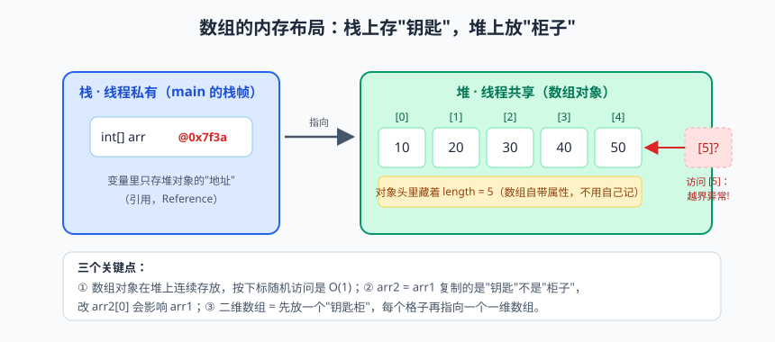
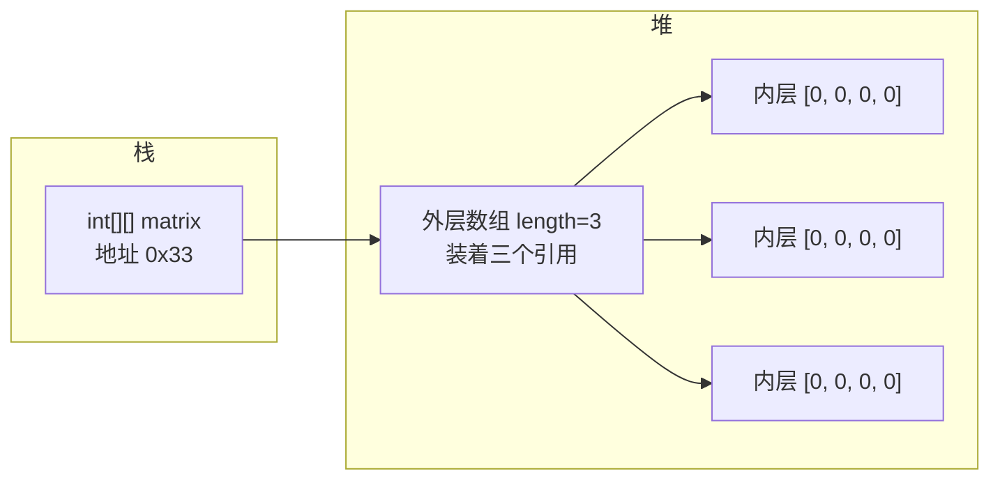

# 流程控制与数组：程序的岔路口


> 🖼️ **图解**：数组内存布局：栈上存引用（钥匙），堆上放数据（柜子）

你有没有想过，为什么导航软件从来不慌？前方明明有无数个路口——直行、左转、掉头、进服务区，它总能根据路况做出选择：堵了就绕，封了就换，一路把你"控制"到终点。程序也是一样：直线走的代码只是"计算器"，会拐弯的代码才是"程序"。拐弯靠什么？靠流程控制（control flow）。

如果说变量和运算符是程序的"食材"，那流程控制就是"颠勺的手法"：什么时候大火（条件判断）、什么时候翻炒（循环）、什么时候出锅（跳转）。而数组，则是后厨那一排贴了编号的储物格——一排同样大小、连续摆放、统一管理的空间。

这一篇信息量不小：if 与 switch 的爱恨情仇、三大循环的选型之道、九九乘法表的祖传手艺，还有 Arrays 工具类里那个坑了无数人的 asList。深呼吸，我们出发。

## 一、if/else：程序的第一岔路口

if（如果）是所有语言里最经典的分支：条件成立走这条路，不成立走那条。直接上成绩分级的例子：

```java
int score = 86;

if (score >= 90) {
    System.out.println("优秀");
} else if (score >= 80) {        // else if 可以串无数个，从上往下依次判断
    System.out.println("良好");   // 命中一个分支后，后面的全部跳过
} else if (score >= 60) {
    System.out.println("及格");
} else {
    System.out.println("下次一定");
}
```

if 家族没什么难的，但有两个高频翻车点必须点名。第一个是把 `==` 写成 `=`：`if (isVip = true)` 是赋值，条件永远为 true，属于"看着人畜无害实则后患无穷"的写法，惯用解法是布尔变量直接写 `if (isVip)`，连 == 都省了。第二个是"悬空 else"：多层 if 不加大括号时，else 默认配对离它最近的那个 if，而不是你缩进暗示的那个——所以铁律是：**哪怕只有一行，也把大括号写上**。

> ⚠️ **踩坑实录**：一位学员的会员判断逻辑 `if (level = 3)`，编译不报错（因为 int 赋值表达式有值），运行时所有人都是 VIP3 待遇，优惠多发了三万块才被发现。一个符号，一部惊悚片。

## 二、switch 的三十年进化：从啰嗦大叔到优雅绅士

当一个变量要对多个离散值做判断（比如菜单 1/2/3/4），if-else 串一长串就很啰嗦，这时 switch 登场。先看传统写法，再对比 Java 14 之后的箭头新语法，一场三十年的进化尽收眼底：

```java
int menu = 2;

// ---------- 传统 switch：case + break，忘写 break 就"穿透" ----------
switch (menu) {
    case 1:
        System.out.println("查询余额");
        break;                   // 不写 break 会"穿透"到下一个 case 继续执行
    case 2:
        System.out.println("转账");
        break;
    case 3:
        System.out.println("退出");
        break;
    default:
        System.out.println("输入有误");
}

// ---------- 箭头语法（Java 14+）：天然无穿透，还支持多值合并 ----------
switch (menu) {
    case 1 -> System.out.println("查询余额");
    case 2 -> System.out.println("转账");
    case 3, 4 -> System.out.println("退出或返回"); // 多个值共用一个分支
    default -> System.out.println("输入有误");
}

// ---------- switch 表达式：switch 直接"有返回值"，多行分支用 yield ----------
String result = switch (menu) {
    case 1, 2 -> "业务办理";
    case 3 -> {
        System.out.println("做一些额外处理...");
        yield "已退出";           // yield：分支有多行语句时用它交出返回值
    }
    default -> "输入有误";
};
System.out.println(result);       // 业务办理
```

传统 switch 最大的坑就是**穿透（fall-through）**：case 后面不写 break，执行完这个分支会"滑"到下一个 case 继续执行。历史上确实有少数场景故意利用穿透（比如 1 到 5 都走同一逻辑），但 99% 的穿透都是忘了写 break 的 bug。菜单选了 2，结果转账完直接退出了——用户一脸懵，程序员两行泪。而箭头语法从根上拆除了这颗地雷：天然无穿透、多值一行合并，switch 还升级成了"表达式"——自己就有返回值，分支里有多行语句时用 yield 交出结果。

新旧两种写法的对比一目了然：

| 对比项 | 传统 switch | 箭头 switch（Java 14+） |
|---|---|---|
| 穿透风险 | 忘 break 就穿透，bug 高发 | 天然无穿透 |
| 多值分支 | 需要利用穿透实现 | `case 1, 2 ->` 一行搞定 |
| 能否返回值 | 不能，只是语句 | 可以，是表达式，支持 yield |
| 冒号/箭头 | 冒号 + break | 箭头，无需 break |

> 📌 **划重点**：新项目、新代码一律用箭头语法，把"忘写 break"这个历史遗留地雷永久拆除。另外从 Java 17 开始 switch 还支持模式匹配，能直接按类型分支，属于"高级武器"，后面讲密封类和记录类时再展开。

## 三、三大循环：for、while、do-while 的工种分工

程序界有三大循环工种，长得像，分工却很明确。先看对比表，再逐个上代码：

| 循环 | 判断时机 | 典型场景 | 一句话人设 |
|---|---|---|---|
| for | 先判断后执行 | 循环次数明确已知 | 有明确工期的合同工 |
| while | 先判断后执行 | 次数未知，只看条件 | 干到老板喊停的计件工 |
| do-while | 先执行后判断 | 至少要执行一次 | 先斩后奏的莽夫 |

次数已知用 for（遍历 1 到 100 求和）；次数未知用 while（用户不断输入，直到输入 0 停止）；至少执行一次用 do-while（先问用户要不要继续，再决定下轮）：

```java
// for：已知跑 100 圈
int sum = 0;
for (int i = 1; i <= 100; i++) { // 初始化; 条件; 步进，分号分隔，三段都可按需省略
    sum += i;
}
System.out.println(sum); // 5050

// while：不知道用户什么时候输入 0
Scanner sc = new Scanner(System.in);
System.out.print("请输入数字（0 结束）：");
int n = sc.nextInt();
while (n != 0) {                  // 条件不成立就退出
    System.out.println("你输入了：" + n);
    System.out.print("请继续输入（0 结束）：");
    n = sc.nextInt();             // 千万记得更新条件变量，否则原地转圈到天荒地老
}

// do-while：至少问一次
int choice;
do {
    System.out.println("1. 开始游戏  2. 退出");
    choice = sc.nextInt();
} while (choice != 1 && choice != 2); // 不管三七二十一先执行一轮
```

> 💡 **老鸟忠告**：两个工程习惯。第一，for 循环内部尽量不要修改循环变量 i（初学者爱在循环里 i++ 又 i--，人为制造死循环）；第二，while 循环务必确认条件变量会被更新。判断循环写对没有，就问自己一句话：**这个循环靠什么停下来？**答不上来，它八成停不下来。

## 四、break、continue 与带标签的跳转

循环里还有两位"交通警察"：break 直接终止整个循环，continue 只跳过本轮、马上进入下一轮。单层循环它们轻车熟路，但嵌套循环里 break 默认只能跳出"最内层"——想在二维数组里找到目标值后里外两层一起停，还得请出**带标签的跳转**。三段代码连着看：

```java
// ---------- break：找到第一个能被 7 整除的三位数就收工 ----------
for (int i = 100; i < 1000; i++) {
    if (i % 7 == 0) {
        System.out.println(i); // 105
        break;                 // 找到即停，后面的 895 个数看都不看
    }
}

// ---------- continue：打印 1~10 中的奇数 ----------
for (int i = 1; i <= 10; i++) {
    if (i % 2 == 0) {
        continue;              // 偶数跳过本轮，回到 i++ 进入下一轮
    }
    System.out.print(i + " "); // 1 3 5 7 9
}

// ---------- 带标签的 break：双层循环一次性全退 ----------
int[][] grid = {{3, 8}, {15, 42}, {7, 9}};
int target = 42;

outer:                                  // 标签：给外层循环起个名字，写在循环前面
for (int i = 0; i < grid.length; i++) {
    for (int j = 0; j < grid[i].length; j++) {
        if (grid[i][j] == target) {
            System.out.println("找到 " + target + "，位置 [" + i + "][" + j + "]");
            break outer;                // 直接冲出外层循环，双层全停
        }
    }
}
```

标签 goto 的名声不好，很多语言直接禁了它，但 Java 只保留了 break/continue + 标签这种极受限的形式，专门救嵌套循环的场。用的时候克制一点，一层标签是良药，层层标签是毒药。

## 五、经典案例实战：九九乘法表与水仙花数

学循环不练乘法表，等于吃火锅不蘸料。九九乘法表是嵌套循环的入门仪式：

```java
for (int i = 1; i <= 9; i++) {          // 外层控制行
    for (int j = 1; j <= i; j++) {      // 内层控制列，注意条件 j <= i：第 i 行只打 i 个
        System.out.print(j + "×" + i + "=" + (i * j) + "\t"); // \t 制表符对齐
    }
    System.out.println();               // 每打完一行换行
}
```

第二个祖传案例是水仙花数（narcissistic number）：三位数中等于"各位数字立方和"的数，比如 153 = 1³ + 5³ + 3³。核心是"拆位"三板斧——除法取高位、取模取低位：

```java
for (int num = 100; num <= 999; num++) {
    int hundreds = num / 100;        // 百位：除以 100 取整
    int tens = num / 10 % 10;        // 十位：先砍掉百位，再取个位
    int units = num % 10;            // 个位：对 10 取模
    if (hundreds * hundreds * hundreds
            + tens * tens * tens
            + units * units * units == num) {
        System.out.println(num + " 是水仙花数"); // 153、370、371、407
    }
}
```

"拆位"这个手法后面到处都是：拆手机号、拆身份证、做数字加密，请务必练到肌肉记忆。

## 六、死循环不是罪：while(true) 的正当用途

很多人一听死循环就色变，其实 `while (true)` 在工程里是堂堂正正的写法——只要它有体面的出口。服务器等连接、游戏主循环、消息轮询，本质都是"一直转，直到被命令停止"：

```java
// 简易菜单：反复服务，直到用户选择退出
while (true) {
    showMenu();
    int choice = sc.nextInt();
    if (choice == 0) {
        System.out.println("欢迎下次光临");
        break;                      // 唯一的出口：体面退出
    }
    handle(choice);                 // 处理业务
}
```

> 💡 **老鸟忠告**：写 while(true) 前先想清楚两件事：出口在哪（break / return / 外部中断）？循环体会不会把 CPU 打满（无 IO 等待的空转会 100% 占核，轮询场景记得 sleep 片刻）。没有出口的死循环上生产，等于给服务器判了无期徒刑。

## 七、数组：一排连续编号的储物柜

现在请你存 100 个学生的成绩。按前面的写法，要声明 score1 到 score100 一百个变量——写完你的手和编译器至少有一个会先疯。数组（array）就是解药：同类型数据、固定长度、连续内存、下标访问。

数组的声明和初始化有三种姿势：

```java
int[] scores1 = {90, 75, 88, 62};          // 静态初始化：声明同时给值，最常用
int[] scores2 = new int[5];                // 动态初始化：只定长度，元素自动给默认值
int[] scores3;                             // 先声明
scores3 = new int[]{100, 66};              // 后分配，注意此时 new int[] 里要写全
```

四个必知细节：第一，**下标从 0 开始**，`scores1[0]` 是 90，最后一个元素下标是 `length - 1`——下标本质是"相对于首地址的偏移量"，首元素偏移为 0，这是历史传统也是效率选择；第二，`length` 是数组的**属性**（不带括号），而字符串的 `length()` 是方法（带括号），这俩天天有人搞混；第三，动态初始化的默认值沿用类型默认值：int 是 0、double 是 0.0、boolean 是 false、引用类型是 null；第四，遍历首选增强 for（for-each），拿不到下标但代码干净：

```java
for (int s : scores1) {   // 把每个元素依次取出来交给 s
    System.out.print(s + " ");
}
```

> ⚠️ **踩坑实录**：两个连环坑。坑一：循环条件写成 `i <= arr.length`，最后一个元素下标是 length-1，这个 <= 让程序直接抛 ArrayIndexOutOfBoundsException（数组越界），新手调试一小时、真相就一个字符。坑二：想用 for-each 给数组元素统一乘 2，写 `for (int s : arr) s = s * 2;`——毫无效果，因为 s 只是元素的**副本**，改副本不惊动原件。要修改元素，老老实实用带下标的普通 for。

## 八、数组内存布局：一维与二维

一维数组在内存里是"栈上的引用指向堆上的一排连续空间"，上一篇画过。二维数组更有意思：Java 的二维数组本质是**"数组的数组"**——外层是一个数组，里面装的不是 int，而是三个"内层数组的引用"：



正因为"内层也是独立数组"，Java 天然支持**锯齿数组**（不规则数组）——每一行长度可以不同：

```java
int[][] jagged = new int[3][];  // 只定行数，内层先留空
jagged[0] = new int[2];         // 第 0 行 2 列
jagged[1] = new int[5];         // 第 1 行 5 列
jagged[2] = new int[1];         // 第 2 行 1 列
```

这个设计在存"参差不齐"的数据（比如每章词数不同的文本）时非常省内存。理解了二维数组的真面目，你也就理解了为什么 `matrix.length` 是行数、`matrix[i].length` 是第 i 行的列数。

## 九、Arrays 工具类：数组的瑞士军刀

java.util.Arrays 是 JDK 送的数组工具箱，几个高频方法一次讲透，重点讲最后那个坑：

```java
int[] arr = {5, 2, 9, 1, 7};

System.out.println(Arrays.toString(arr)); // [5, 2, 9, 1, 7]：直接打印数组名只会得到地址，toString 才是人看的

Arrays.sort(arr);                         // 升序排序，底层对 int 是双轴快排，效率在线
System.out.println(Arrays.toString(arr)); // [1, 2, 5, 7, 9]

int idx = Arrays.binarySearch(arr, 7);    // 二分查找：返回下标 3
int miss = Arrays.binarySearch(arr, 8);   // 找不到：返回 -(插入点) - 1，即 -5
                                         // 注意：二分查找必须先排序，否则结果不可信

int[] part = Arrays.copyOf(arr, 3);       // 复制前 3 个元素，长度可扩可缩，扩出来的部分补默认值
int[] range = Arrays.copyOfRange(arr, 1, 4); // 复制下标 [1, 4) 的片段，含头不含尾

Arrays.fill(arr, 0);                      // 全部填充为 0，重置数组时好用
```

最后是重点关照对象 asList：

```java
List<Integer> list = Arrays.asList(1, 2, 3);
list.set(0, 99);        // 可以：修改元素没问题
list.add(4);            // 抛 UnsupportedOperationException！
list.remove(0);         // 同样炸！
```

> 📌 **划重点**：`Arrays.asList` 返回的不是 java.util.ArrayList，而是 Arrays 内部一个**定长**的 List 视图——它背后直接引用原数组，长度被焊死，add/remove 一律抛 UnsupportedOperationException。另一个暗坑：传基本类型数组 `Arrays.asList(new int[]{1,2,3})`，它会整个数组当成**一个元素**，得到的 List 大小是 1。想要能增删的真正列表：`new ArrayList<>(Arrays.asList(1, 2, 3))`，或者一步到位 `List.of(1, 2, 3)`（不可变列表）。

## 十、数组 vs 集合：谁才是正宫

学完数组，马上有人问：既然有集合（ArrayList 之流），还要数组干嘛？看对比表：

| 对比项 | 数组 | 集合（如 ArrayList） |
|---|---|---|
| 长度 | 定长，创建即焊死 | 动态扩容，随便加 |
| 存储类型 | 基本类型 + 引用类型都行 | 只能引用类型（泛型，基本类型靠自动装箱） |
| 效率 | 连续内存，读写极快 | 有封装开销，但足够快 |
| 方法 | 只有 length 属性，工具靠 Arrays | add/remove/contains 等丰富 API 一条龙 |
| 典型场景 | 定长数据、底层开发、性能敏感场景 | 业务开发中绝大多数动态数据管理 |

一句话选型：**长度固定、追求极致性能、或写底层框架，用数组；长度不定、业务为主，用集合**。集合的底层就是数组——ArrayList 增加了"自动扩容"的包装，扩容的秘密（1.5 倍增长、数组拷贝搬家）等我们讲到集合篇再拆。你可以把两者的关系理解成"毛坯房"和"精装房"：毛坯房（数组）什么都要自己动手，但空间利用率高、想怎么改怎么改；精装房（集合）拎包入住、设施齐全，代价是物业费（封装开销）和装修限制（只能存引用类型）。绝大多数业务开发者住精装房就够了，但看懂毛坯房的管线走向，出了问题你才知道找谁。

多说一句越界异常的"变体"：除了 `<=` 写错，还有一种常见姿势是循环里数组被并发修改，或者下标来自外部输入没做校验——`arr[input]` 这种写法等于把方向盘交给用户。工程上凡是拿外部数据当下标，先做一次范围检查：`if (index >= 0 && index < arr.length)`，三秒钟的谨慎，换半夜不报警。

> 💡 **老鸟忠告**：业务开发里 90% 的场景用集合，但数组必须先学扎实——因为集合是数组造的，不懂原材料就谈不懂数据结构。面试里"ArrayList 底层是什么"的标准答案，正是"Object 数组"。

## 本篇小结

- if-else 适合区间和复杂条件，switch 适合对离散值的分派；
- 箭头 switch（Java 14+）天然无穿透、支持多值分支，新代码的首选；yield 用于多行分支返回值；
- for 次数已知、while 次数未知、do-while 至少执行一次；写循环先想好"靠什么停下来"；
- break 终止整层循环，continue 跳过本轮；嵌套循环全退用"标签 + break"；
- 数组：定长、连续内存、下标从 0 开始，length 是属性不是方法；二维数组是"数组的数组"，支持锯齿数组；
- 越界异常 ArrayIndexOutOfBoundsException 多半是 `<=` 写错或下标减一忘了；
- Arrays.asList 返回定长视图，不能增删；binarySearch 前必须先 sort；
- 数组胜在定长高效，集合胜在动态和 API，业务开发优先集合。

## 课后思考 & 动手练习

1. 传统 switch 的"穿透"是怎么回事？箭头语法为什么能从根源上避免这个坑？
2. for、while、do-while 分别适合什么场景？请各举一个生活中的类比。
3. `Arrays.binarySearch(arr, key)` 找不到时返回什么？为什么这样设计（提示：这个返回值怎么反推插入位置）？
4. 【编程题】统计成绩：从控制台录入 10 个学生成绩存入数组，用循环求最高分、最低分、平均分，再用 Arrays.sort 排序后正序和倒序各打印一遍，最后统计高于平均分的人数。
5. 【编程题·选做】打印杨辉三角（打印 8 行即可）。提示：每行首尾是 1，中间元素等于上一行相邻两数之和，二维数组 or 滚动一维数组皆可。

下一篇预告：到目前为止我们写的都是"过程式"代码——变量一堆、方法一排，项目一大就乱成一锅粥。是时候请出 Java 的灵魂了——下一篇《面向对象（上）：封装、继承、多态三巨头》，我们从"做一盘红烧肉"聊起，看看三巨头如何把散乱的代码调教得服服帖帖。不见不散！
