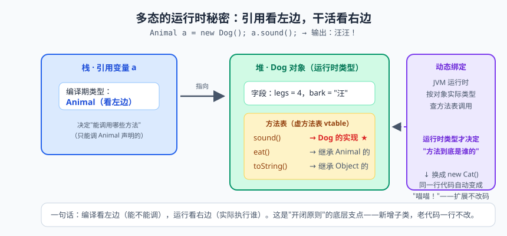
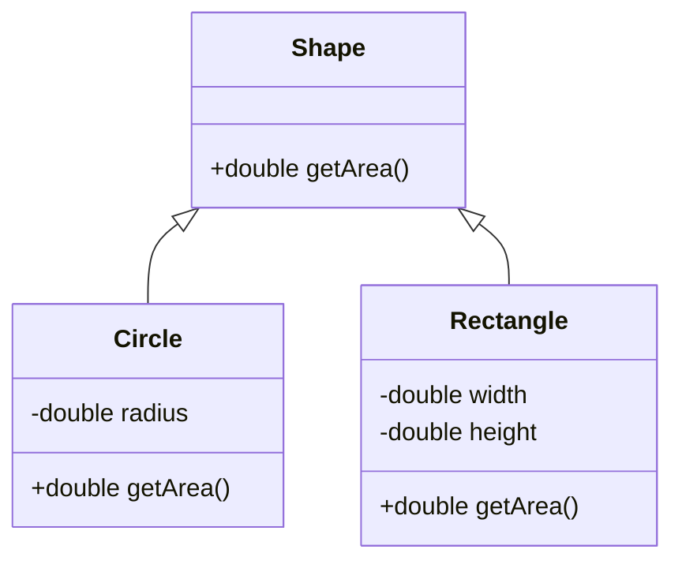

# 面向对象（上）：封装、继承、多态三巨头


> 🖼️ **图解**：多态的运行时绑定：编译看左边，运行看右边

先聊个生活场景。你想吃红烧肉，有两种活法：第一种，自己照着菜谱从头干——买肉、切块、炒糖色、控火候，锅碗瓢盆摆满一桌，油点子溅一身；第二种，走进饭店喊一嗓子"来份红烧肉"，十分钟后端上桌，后厨怎么炒的、糖色怎么熬的，你一概不管。第一种叫过程式编程（procedural programming），第二种叫面向对象编程（Object-Oriented Programming，OOP）——你面对的是"对象"（厨师、饭店、菜品），而不是一步步的"过程"（菜谱）。

我刚入行那会儿，也觉得面向对象是"脱裤子放屁"：明明三行代码能解决的事，非要建个类、写个方法、再 new 个对象？直到我维护了一个三千行的"面条式"项目——所有变量挤在一个文件里，谁都能改，改一处、崩三处，排查 bug 排到怀疑人生。那一刻我悟了：面向对象不是让你多写代码，是让代码"分而治之"。

这一篇是 Java 的灵魂篇章：封装、继承、多态三巨头全员登场。篇幅较长，含金量也最高，建议泡杯咖啡慢慢看。

## 一、过程式的痛：一盘散沙的红烧肉

用代码对比一下两种思路。过程式做法大致长这样：一堆零散的变量（肉、盐、糖、火候），一堆各自为政的函数（切肉、调味、翻炒），函数之间靠参数传来传去，"火候"这个变量谁都能伸手改一改：

```java
// 过程式：数据和操作是分离的，全局变量像公共调料台，谁都能来一勺
double fire = 1.0;    // 火候
double sugar = 2.0;   // 糖量

void cook(double meat) {
    fire = 5.0;       // 炒糖色需要大火
    fry(meat, sugar, fire);
}
void fry(double meat, double sugar, double fire) { /* ... */ }
```

项目一大，问题全冒出来了：fire 是谁改的？什么时候改的？为什么是 5.0 不是 3.0？三百个函数里查三个小时。根本病因就一句话：**数据和行为分离，数据无人看守**。面向对象的药方也一句话：**把数据和操作这份数据的方法打包进同一个"类"，数据私有化，行为公开化**——肉、糖、火候全部锁进后厨，外界只能通过"点菜"（公开方法）来交互。

## 二、类与对象：图纸与房子

类（class）和对象（object）的关系，是 OOP 第一课也是面试第一题：**类是图纸，对象是按图纸盖出来的房子**。图纸只有一份，房子可以盖 N 栋，每栋住着不同的住户（各自独立的属性值）。

```java
public class Student {
    // 成员变量（实例变量）：每个对象各存一份
    String name;
    int age;

    // 成员方法：对象的行为
    void study(String course) {
        System.out.println(name + " 正在学习 " + course);
    }

    void show() {
        System.out.println("我是 " + name + "，今年 " + age + " 岁");
    }
}

public class School {
    public static void main(String[] args) {
        Student s1 = new Student();  // 按图纸施工第一栋：在堆中开辟对象空间
        s1.name = "张三";            // s1 在栈上，存的是堆中对象的地址
        s1.age = 20;
        s1.show();                   // 我是 张三，今年 20 岁

        Student s2 = new Student();  // 第二栋，与 s1 互不干扰
        s2.name = "李四";
        s2.show();                   // 我是 null，今年 0 岁：成员变量有默认值！
    }
}
```

注意 `new Student()` 的内存动作：堆里开辟对象空间、成员变量赋默认值、执行构造器、把地址返回给栈上的 s1。s1 和 s2 各自指向各自的房子，改 s1 的 name 不影响 s2——这就是"图纸一份、房子多栋"。

成员变量和局部变量是新人最容易混的哥俩，表格伺候：

| 对比项 | 成员变量（实例变量） | 局部变量 |
|---|---|---|
| 定义位置 | 类中、方法外 | 方法内、参数、代码块内 |
| 内存位置 | 随对象在堆中 | 在栈中 |
| 默认值 | 有（int 为 0、引用为 null 等） | 没有，必须手动初始化 |
| 生命周期 | 随对象生灭 | 随方法调用结束而出栈 |

> 📌 **划重点**：`s2.show()` 输出"我是 null，今年 0 岁"——成员变量有默认值是 Java 的承诺，也是隐蔽 bug 的温床：忘了赋值的字段不报错，只在运行时输出 null 或 0。创建对象后立刻检查必填字段，或者干脆用构造器强制初始化。

## 三、构造器与 this：对象的出生证明

构造器（constructor）是"创建对象时自动执行的特殊方法"，负责把对象以合法状态带到人间。它的签名很有个性：**方法名与类名完全相同，且没有返回值类型——连 void 都不许写**（写了就变成普通方法，编译器不再当它是构造器）：

```java
public class Student {
    String name;
    int age;

    // 无参构造器：不写的话编译器免费赠送这一个；写了有参的，赠品立刻取消
    public Student() {
        this("无名氏", 18);   // this(...)：调用兄弟构造器，必须在第一行，实现逻辑复用
    }

    public Student(String name) {
        this(name, 18);
    }

    public Student(String name, int age) { // 构造器重载：同名不同参
        this.name = name;   // this.name 是成员变量，name 是参数，this 用于"撕标签"
        this.age = age;
    }
}
```

this 关键字两个用法要分清：`this.字段` 指"当前对象的字段"，专治构造器参数名和字段名相同的"重名纠纷"——参数就近原则下，不写 this 的 name 永远指参数自己，赋值等于自己给自己，字段永远是 null；`this(...)` 指"调用本类另一个构造器"，且必须写在第一行。

> ⚠️ **踩坑实录**：学员给实体类只写了有参构造器，配 MyBatis 框架时死活报错——框架底层通过反射调用无参构造器创建对象，找不到就抛异常。血泪教训：**只要写了有参构造器，就手动补一个无参的**，这是和各类框架的"社交礼仪"。

## 四、封装：private + getter/setter 绝不是脱裤子放屁

新手对封装（encapsulation）最大的质疑是："把字段设为 private，再写 public 的 getter/setter 绕一圈访问，这不是脱裤子放屁吗？"来，看一段代码你就闭嘴了：

```java
public class Account {
    private double balance;   // 余额私有：外面的手不许直接伸进来

    public double getBalance() {
        return balance;
    }

    public void setBalance(double balance) {
        if (balance < 0) {                        // 入口校验：不合格的数据直接拒收
            throw new IllegalArgumentException("余额不能为负数");
        }
        this.balance = balance;
    }

    public void withdraw(double amount) {
        if (amount > balance) {
            System.out.println("余额不足，交易失败");
            return;
        }
        this.balance -= amount;                   // 业务规则内聚在对象内部
    }
}
```

如果 balance 是 public 的，任何一行代码都能写 `account.balance = -999999`，你连凶手都找不到。而封装之后：第一，**入口统一**，所有修改必须过 setter 这道安检，脏数据进不来；第二，**实现自由**，哪天你想把余额从"元"改成"分"存储、或者加个汇率换算，只改类内部，外界调用 getBalance 的十万行代码一行不动；第三，**按需暴露**，只想读不让改的字段，只提供 getter。所谓"脱裤子放屁"，是把字段直接 public；封装这"绕的一圈"，是防火墙。

> 📌 **划重点**：封装 = 字段私有（private）+ 按需提供公开访问方法。它买到的不是"安全"两个字，而是：数据校验的关卡、修改实现的自由、对外承诺的稳定。

## 五、包与访问修饰符：四级门禁卡

类一多就得分文件夹管理，这就是包（package），对应磁盘上的目录结构，命名惯例是倒写的域名加项目名，如 `com.company.order`。而类内部的成员（字段、方法、构造器）对外开放到什么程度，由访问修饰符（access modifier）决定，一共四级门禁：

| 修饰符 | 同一个类 | 同一个包 | 不同包的子类 | 不同包的其他类 |
|---|---|---|---|---|
| private | ✅ | ❌ | ❌ | ❌ |
| 不写（默认/default） | ✅ | ✅ | ❌ | ❌ |
| protected | ✅ | ✅ | ✅ | ❌ |
| public | ✅ | ✅ | ✅ | ✅ |

记忆口诀：private 是"自留地"（只有自己家的类能进），默认是"小区"（同包随便进），protected 是"家族"（同包加不同包的子孙类能进），public 是"广场"（全世界随便进）。

> 💡 **老鸟忠告**：工程默认配置——字段一律 private，方法按"最小可见范围"原则从默认开始放，真需要跨包再升 protected/public。public 是一种承诺：一旦公开，别人就会依赖它，以后想改就要掂量"破坏别人代码"的代价。权限放得越克制，将来重构越自由。

## 六、继承：extends 与 super

继承（inheritance）解决"重复代码"问题：多个类有公共部分，抽个父类出来装公共代码，子类通过 `extends` 白捡。就像猫和狗都有名字、都会吃饭，这些共性放进 Animal，猫狗只写自己特有的"抓老鼠""看家"：

```java
public class Animal {
    protected String name;   // protected：专门留给子类用的字段

    public Animal(String name) {
        this.name = name;
    }

    public void eat() {
        System.out.println(name + " 在吃东西");
    }
}

public class Cat extends Animal {     // 猫是动物：is-a 关系才配继承
    public Cat(String name) {
        super(name);                  // 调用父类构造器，必须在第一行
    }

    public void catchMouse() {        // 子类特有技能
        System.out.println(name + " 在抓老鼠");
    }
}
```

四条铁律请背下来：第一，Java 是**单继承**（一个类只能 extends 一个父类），多层继承（爷爷-爸爸-儿子）可以；第二，子类继承父类的字段和方法，但**私有成员只是"拥有"却不能直接访问**，构造器不能被继承；第三，子类构造器第一行默认藏着 `super()``，若父类只有有参构造器，子类必须显式写 `super(参数)`，否则编译报错；第四，super 和 this 一样有三个用法——`super.字段`、`super.方法()`、`super(参数)`，分别访问父类的字段、方法和构造器。

> ⚠️ **踩坑实录**：学员在父类只写了 `Animal(String name)` 有参构造器，Cat 的构造器里没写 `super(name)`，编译器自动加的 `super()` 找不到父类无参构造，直接红字报错。看到 "Implicit super constructor Animal() is undefined" 这句报错，条件反射就想到：父类构造器没对上。

## 七、方法重写：两同两小一大

子类对父类的方法"重新实现"，叫方法重写（override）。比如猫觉得父类的 eat 太敷衍，要加上"细嚼慢咽"：

```java
@Override                        // 注解：请编译器帮我检查这真是重写，写错签名立刻报错
public void eat() {
    System.out.println(name + " 在细嚼慢咽吃小鱼干");
}
```

重写规则总结成七个字：**两同两小一大**：

- 两同：方法名相同、参数列表相同；
- 两小：返回值类型小于等于父类（相同，或是其子类，即协变返回类型）、抛出的异常小于等于父类（更少或更窄）；
- 一大：访问权限大于等于父类（父类 protected，子类可以升 public，但不能降 private）。

另外三条禁区：private 方法（子类根本看不见，谈不上重写）、static 方法（属于类不属于对象，子类同名只是"隐藏"）、final 方法（字面意思，最终版，不许动）。

> 📌 **划重点**：@Override 不是装饰品，是保险丝。手写重写最容易把参数类型写错，写成了"重载"而浑然不觉——程序安安静静跑了个寂寞，父类方法照样执行。加上 @Override，编译器立刻揪出这种"假重写"。所有重写方法，无条件加 @Override。

## 八、多态：一个引用，多种形态

三巨头压轴登场。多态（polymorphism）的前提是继承加重写，形态是"父类引用指向子类对象"：

```java
Animal a = new Cat("Tom");   // 向上转型：猫装进"动物"的口袋里，自动、安全
a.eat();                     // 调用的是 Cat 重写后的 eat！
// a.catchMouse();           // 编译报错：动物口袋里掏不出"抓老鼠"
```

这段代码的两个现象就是多态的全部考点。现象一：`a.eat()` 明明是 Animal 类型的引用，执行的却是 Cat 的方法——**编译看左边，运行看右边**：编译器按引用类型（Animal）检查"有没有这个方法"，JVM 按实际对象类型（Cat）决定"执行谁的实现"。现象二：a 调不到 catchMouse——向上转型会"缩窄视野"，父类引用看不见子类特有成员。

想用回子类特有方法，就得**向下转型**（强制转换），转之前必须用 `instanceof` 验明正身，否则类型对不上就抛 ClassCastException：

```java
if (a instanceof Cat) {           // 先检查再转型，工程铁律
    Cat cat = (Cat) a;            // 向下转型：把"动物"口袋里的猫还原成猫
    cat.catchMouse();             // 子类特有方法回来了
}
// Java 16+ 模式匹配一步到位：if (a instanceof Cat cat) { cat.catchMouse(); }
```

为什么运行时能自动找到 Cat 的 eat？这就是**动态绑定（dynamic binding）**：JVM 为每个类维护一张虚方法表（vtable），表里记录各方法的实际入口；子类重写了某方法，子类方法表里该位置的指针就指向子类实现。调用 `a.eat()` 时，JVM 不看引用类型，而是顺着 a 指向的对象找到它真实类型的方法表，按表索引取出真正的实现执行。一句话：**方法调用看对象的"血统"，不看引用的"户口"**。

经典案例再上一个：图形面积计算，体会多态在工程里的杀伤力：

```java
public class Shape {
    public double getArea() {
        return 0;
    }
}

public class Circle extends Shape {
    private double radius;
    public Circle(double radius) { this.radius = radius; }

    @Override
    public double getArea() { return Math.PI * radius * radius; }
}

public class Rectangle extends Shape {
    private double width, height;
    public Rectangle(double w, double h) { this.width = w; this.height = h; }

    @Override
    public double getArea() { return width * height; }
}

public class Demo {
    public static void main(String[] args) {
        Shape[] shapes = { new Circle(2), new Rectangle(3, 4) }; // 父类引用统一收纳
        double total = 0;
        for (Shape s : shapes) {
            total += s.getArea();   // 同一句代码，各自执行各自的实现——这就是多态
        }
        System.out.println("总面积：" + total); // 约 28.57
    }
}
```



> 💡 **老鸟忠告**：多态的工程价值是"新增不改旧"：for 循环那行代码一行不改，明天新加 Triangle、Hexagon，把对象扔进数组就自动生效。所有设计模式里的一半以上，地基都是它。另外注意：**成员方法有多态，成员变量没有**——变量按引用类型（编译期）决定，父子类有同名字段时不会"动态绑定"，这是面试送分变送命题的常客。

## 九、Object 类：万物之祖的三大法宝

Java 里所有类，不管你写没写 extends，都默认继承 java.lang.Object。Object 有三个方法出场率奇高，必须拿下。

**toString()**：直接打印对象时自动调用，默认输出"类名@十六进制哈希码"，比如 `Student@1b6d3586`——对人毫无意义。所以业务类应重写它，输出有意义的内容（IDEA 里按 Cmd+N / Alt+Insert 一键生成）。

**equals() 与 ==**：== 比较基本类型的值，或两个引用是否指向同一个对象（比地址）；equals 默认就是 ==，但 String、Integer 等类已重写为"内容相等"。自定义类想按内容比较，必须自己重写：

```java
public class OrderItem {
    private String orderId;
    private double amount;
    // 构造器、getter/setter 省略

    @Override
    public boolean equals(Object o) {
        if (this == o) return true;              // 同一对象，直接相等（性能优化）
        if (o == null || getClass() != o.getClass()) return false; // 空值或类型不同，直接不等
        OrderItem that = (OrderItem) o;
        return orderId.equals(that.orderId) && amount == that.amount;
    }

    @Override
    public int hashCode() {                       // 与 equals 必须成对出现！
        return Objects.hash(orderId, amount);
    }
}
```

**hashCode() 的约定**：equals 相等的两个对象，hashCode 必须相等；反过来，hashCode 相等，equals 未必相等（哈希冲突，正常现象）。为什么是死规定？因为 HashSet、HashMap 按"哈希值分组 + equals 精确比对"的流程找对象——只重写 equals 不重写 hashCode，两个"相等"的对象会拿到不同的哈希值，被分进不同的桶，HashMap 里就出现"明明 put 进去了却 contains 不到"的灵异事件。

> ⚠️ **踩坑实录**：真实事故复盘——同事给实体类重写了 equals 忘了 hashCode，去重后的 Set 里躺着两个"一模一样"的用户，下游短信发送重复触达，客诉一片。规则记死：**equals 和 hashCode 永远成对重写，谁单独出场谁惹祸**。

> 💡 **老鸟忠告**：工程里 equals/hashCode/toString 三件套交给 IDE 的 Generate 生成，或者用 Java 16+ 的 record（一行定义不可变数据类，三件套全送）；手写是面试的基本功，但生产代码里手写，除了炫技只剩风险。

## 本篇小结

- 面向对象的核心：数据和行为打包进类，数据私有、行为公开，与过程式"数据裸奔"形成本质区别；
- 类是图纸、对象是房子，new 在堆中建房、栈上变量存地址；成员变量在堆中有默认值，局部变量在栈中必须手动初始化；
- 构造器与类同名、无返回值；写了有参构造器务必补无参的；this(...) 复用兄弟构造器必须在第一行；
- 封装 = private 字段 + 按需 getter/setter，买到的是校验关卡和修改自由；
- 访问修饰符从窄到宽：private < 默认 < protected < public；
- 继承单继承，子类构造器第一行默认 super()；重写口诀"两同两小一大"，@Override 必加；
- 多态"编译看左、运行看右"，动态绑定靠虚方法表；向下转型先 instanceof；
- equals 与 hashCode 成对重写，== 比地址、equals 比内容。

## 课后思考 & 动手练习

1. 为什么 Java 只允许单继承？如果一个类同时继承两个有相同方法签名的父类，会发生什么尴尬？（顺便查查别的语言怎么解决这个问题。）
2. 默写方法重写的"两同两小一大"，并说明哪些方法不能被重写、为什么。
3. "编译看左边，运行看右边"怎么理解？成员变量有没有多态？请写一段代码验证你的结论。
4. 只重写 equals 不重写 hashCode，在什么场景下会出问题？请具体描述一次"翻车过程"。
5. 【编程题】多态图形系统：定义 Shape 类（含 getArea 方法），派生 Circle、Rectangle、Triangle 三个子类并重写 getArea；在 main 方法中创建 Shape 数组装 5 个随机图形，循环求总面积并打印每个图形的面积；再用 instanceof 统计圆形的个数。加分项：重写 toString 并尝试把 Shape 改成 abstract，体会两种写法的差别（看不懂没关系，下一篇的主角就是它）。

下一篇预告：Shape 那个 `return 0` 的 getArea 是不是很别扭？总感觉"这个方法在父类里根本不该有实现"。你的直觉完全正确——下一篇《面向对象（下）：接口、抽象类与内部类的爱恨情仇》，我们把这种"别扭"连根拔掉，还会迎来这几年最火的 Lambda 表达式。压轴大戏，不见不散！
