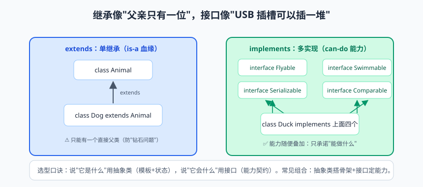
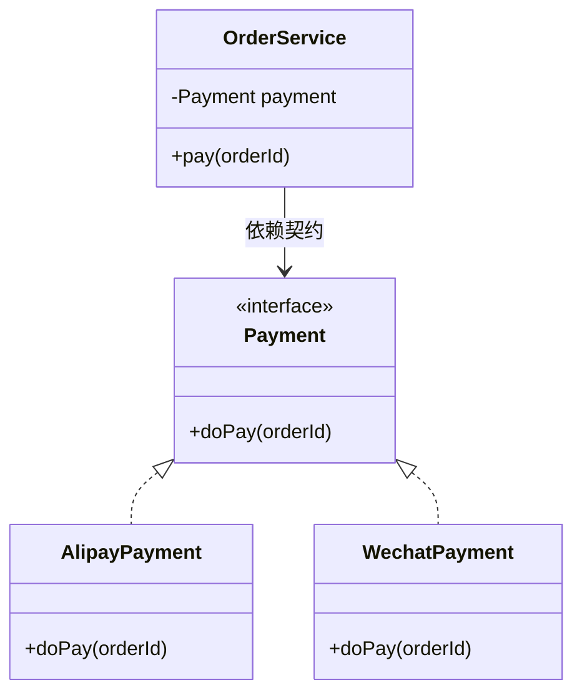

# 面向对象（下）：接口、抽象类与内部类的爱恨情仇

上一篇结尾，Shape 类的 getArea 返回了个 0，我当时说"很别扭"。这就好比一家餐厅的菜单上写着"红烧肉：待定"——客人没法点，厨师也没法做，但这个"待定"的位置又必须留着。今天要讲的抽象类，就是专门安放"待定"的正规编制：父类把方法签名钉死，具体实现交给子类补齐。

如果说上一篇是三巨头的正剧，这一篇就是精彩的番外篇：抽象类和接口这对"欢喜冤家"争了几十年宠，内部类四兄弟各怀绝技，还有一位 2014 年空降的新贵——Lambda 表达式，把匿名内部类打得节节败退。爱恨情仇，就此展开。

放心，虽然人物众多，但我会按"是什么、为什么、怎么用、怎么选"的路线稳稳推进。上一集跟上队的同学，这一集顶多是快走，不会是赛跑。

## 一、抽象类：只画了一半的图纸

先解决上一集的遗留问题。Shape 的 getArea 为什么别扭？因为"图形"本身算不出面积——圆形要 πr²，矩形要长乘宽，连"面积公式"都取决于具体是什么图形。父类里这个方法写任何实现都是错的，唯一正确的做法是：**只声明方法签名，不写方法体，逼着子类来补**。这就是抽象方法（abstract method），含抽象方法的类就是抽象类（abstract class）：

```java
public abstract class Shape {           // 有抽象方法的类必须声明为 abstract
    protected String name;

    public Shape(String name) {
        this.name = name;
    }

    public abstract double getArea();  // 抽象方法：没有方法体，以分号结尾，"菜单上的待定"

    public void print() {              // 抽象类里照样可以有普通方法、字段、构造器
        System.out.println(name + " 的面积是 " + getArea()); // 模板里调用待定步骤
    }
}

public class Circle extends Shape {
    private double radius;

    public Circle(double radius) {
        super("圆形");
        this.radius = radius;
    }

    @Override
    public double getArea() {          // 子类必须补齐所有抽象方法，否则自身也得是抽象类
        return Math.PI * radius * radius;
    }
}
```

三条规则：抽象类**不能被实例化**（new Shape 直接编译报错，"待定"的菜当然不能上桌）；抽象类**可以有构造器**——不是给自己用的，是给子类 super() 用的；子类继承抽象类必须实现所有抽象方法，实现不了就得把自己也声明成抽象类，把锅继续往下传。

抽象类最漂亮的应用是**模板方法模式（Template Method Pattern）**：把固定不变的流程钉死在父类，把可变的步骤留白给子类。做菜的流程永远是"备菜 → 烹饪 → 摆盘"，但"烹饪"这一步各有各的做法：

```java
public abstract class AbstractCook {
    // 模板方法：final 防止子类篡改流程——菜可以换，工序不能乱
    public final void cookDish() {
        prepare();     // 第一步：备菜（公共实现）
        doCook();      // 第二步：烹饪（抽象，子类实现）
        plate();       // 第三步：摆盘（公共实现）
    }

    private void prepare() { System.out.println("洗菜、切菜、热锅"); }
    private void plate()   { System.out.println("装盘、撒葱花"); }

    protected abstract void doCook();  // 留白：怎么做，看厨师
}

public class TomatoEggCook extends AbstractCook {
    @Override
    protected void doCook() {
        System.out.println("先炒鸡蛋再下西红柿，大火翻炒"); // 番茄炒蛋派
    }
}
```

> 📌 **划重点**：抽象类 = "半成品图纸 + 施工规范"。它把"不变的流程"钉死（模板方法），把"可变的步骤"留白（抽象方法）。父类管节奏，子类管细节，这就是模板思想。

## 二、接口：纯粹的能力契约

接口（interface）走的是另一条路线：它压根不关心"你是什么"，只关心"你能干什么"。接口声明的是一份**能力契约**：签了约（implements），就必须兑现所有条款（实现所有抽象方法）：

```java
public interface Flyable {
    void fly();                      // 接口方法默认 public abstract，写不写修饰符都一样

    default void land() {            // Java 8+：默认方法，有方法体，实现类白捡
        System.out.println("缓慢降落");
    }

    static void checkWeather() {     // Java 8+：静态方法，属于接口自己，用接口名直接调
        System.out.println("检查天气状况");
    }

    private void log() {             // Java 9+：私有方法，给 default 方法复用内部逻辑
        System.out.println("[日志] 飞行状态更新");
    }
}

public class Bird implements Flyable {
    @Override
    public void fly() {              // 契约条款：必须实现
        System.out.println("扑扇翅膀，飞上天");
    }
}
```

接口的演进史值得单独讲讲。Java 8 之前，接口是"纯血统"：方法全是公开抽象的，字段全是 public static final 常量，一个方法体都不许有。Java 8 要给集合库加 Lambda 支持，必须给 List、Collection 这些接口补新方法——如果接口还是"纯血统"，全世界亿万实现类当场崩盘。于是 default 方法（默认方法）诞生：带方法体的接口方法，实现类不重写也能用，老代码零成本获得新能力。Java 9 又补了 private 方法，让 default 方法之间能复用内部逻辑。这是一次经典的"语言进化不砸老用户饭碗"的教科书操作。

还有一条和抽象类不同的关键设定：**一个类只能继承一个类，却能实现多个接口**——这给了 Java "多继承能力"的平替：

```java
public class Duck extends Animal implements Flyable, Swimmable {
    // 鸭子：既是动物（血缘），又会飞、会游泳（两份能力契约）
}
```

> ⚠️ **踩坑实录**：两个接口有同名同签名的 default 方法，一个类同时实现它们时，编译器直接报错 "inherits unrelated defaults"。解决方案：类里必须重写这个方法，需要时可以用 `接口名.super.方法名()` 指定沿用某一家：`Flyable.super.land();`。多继承的便利不是白给的，"撞名"就是它收的税。

## 三、抽象类 vs 接口：is-a 还是 can-do


> 🖼️ **图解**：extends 只能一个爹，implements 可以插一堆"USB"

这俩长得像、常被混，选型问题面试年年考。先上对比表，再给一句口诀：

| 对比项 | 抽象类 | 接口 |
|---|---|---|
| 继承机制 | extends 单继承 | implements 可多实现 |
| 构造器 | 有 | 没有 |
| 成员变量 | 任意（可实例字段） | 只能 public static final 常量 |
| 方法 | 抽象 + 普通皆可 | 抽象 + default + static + private（Java 8/9+） |
| 语义 | is-a：是什么（血缘） | can-do：能做什么（技能） |
| 典型用途 | 模板/骨架代码复用 | 能力契约、解耦、规范 |

选型口诀：**问"是什么"用抽象类，问"能干什么"用接口**。鸟（Bird）和飞机（Plane）都会飞，但鸟 is-a 动物、飞机 is-a 机器——血缘不同没法共用父类；可"会飞"这个能力是共通的，于是抽成 Flyable 接口，鸟和飞机各自实现。再比如 AbstractList 是"列表骨架"（血缘），Comparable 是"可比较"（能力）、Runnable 是"可执行任务"（能力）。

实际工程里还有个出场率参考：接口的登场次数远高于抽象类，因为它天生为"解耦"而生——依赖一份契约，比依赖一个血缘灵活得多。

> 💡 **老鸟忠告**：JDK 源码里两者配合的范例遍地都是：AbstractList（抽象类）提供骨架实现，List（接口）定义契约，ArrayList 既继承前者又实现后者——接口定义"做什么"，抽象类解决"怎么做一部分"，组合拳才是完全体。

## 四、从匿名内部类到 Lambda：一次漂亮的瘦身

需求很简单：开一个线程，打印一句话。我们用四种写法实现，见证一次历时十年的代码进化史：

```java
// 版本 1：传统外部类——为打印一句话专门建个类，杀鸡用了牛刀厂
public class PrintTask implements Runnable {
    @Override
    public void run() {
        System.out.println("线程执行中...");
    }
}
new Thread(new PrintTask()).start();

// 版本 2：匿名内部类——不建类文件了，当场"即兴发挥"
new Thread(new Runnable() {
    @Override
    public void run() {
        System.out.println("线程执行中...");
    }
}).start();

// 版本 3：Lambda 表达式——只留"参数 -> 做什么"，其余全靠编译器推导
new Thread(() -> System.out.println("线程执行中...")).start();

// 版本 4：方法引用——连接口的形状都不写了，直接指认现成的方法
Runnable task = System.out::println;
```

从版本 2 到版本 3，五行变一行，省掉的恰恰全是"废话"：new Runnable、方法名 run、大括号——这些编译器看一眼就知道的东西，凭什么让人类重复？Lambda 的语法结构是 `参数 -> 方法体`：参数类型可推导就能省，方法体只有一句就不用大括号和分号，多语句才用 `{ }` 并写 return。

Lambda 能不能随便用在任何地方？不能。它的类型必须是**函数式接口（functional interface）**——**有且仅有一个抽象方法的接口**。Runnable 只有一个 run，所以能用 Lambda；接口里有两个抽象方法，Lambda 当场罢工。为了防止后来人手滑多加方法破坏这个约定，Java 提供了 @FunctionalInterface 注解，编译器帮你把关。default 和 static 方法有方法体，不算抽象方法，不影响这个"唯一"。

JDK 内置了四大函数式接口，覆盖了绝大多数场景，建议直接背下来：

| 接口 | 抽象方法 | 语义 | 使用示例 |
|---|---|---|---|
| Function<T, R> | R apply(T t) | 输入 T，产出 R（加工） | `Function<String, Integer> f = String::length;` |
| Consumer<T> | void accept(T t) | 输入 T，不返回（消费） | `Consumer<String> c = s -> System.out.println(s);` |
| Supplier<T> | T get() | 无输入，产出 T（生产） | `Supplier<Integer> s = () -> new Random().nextInt(100);` |
| Predicate<T> | boolean test(T t) | 输入 T，输出布尔（判断） | `Predicate<String> p = s -> s != null && !s.isEmpty();` |

> 📌 **划重点**：Lambda 的本质是"函数式接口的匿名实现"——它看起来像函数，类型上仍然是接口，变量类型、方法参数该写 Runnable 还是写 Runnable。理解了这一点，后面学 Stream 流的 filter（Predicate）、map（Function）、forEach（Consumer）时会有强烈的既视感。

## 五、方法引用：Lambda 的极致简写

当 Lambda 体里只是"转手调用一个现成方法"时，连 `参数 ->` 都可以省，直接用 `::` 指认那个方法，这就是方法引用（method reference）。四种形态各看一眼：

```java
Function<String, Integer> f1 = String::valueOf;      // 类名::静态方法，等价 s -> String.valueOf(s)
Supplier<String> f2     = "hello"::toUpperCase;      // 对象::实例方法，等价 () -> str.toUpperCase()
Function<String, Integer> f3 = String::length;       // 类名::实例方法：第一个参数成为调用者
Supplier<ArrayList<String>> f4 = ArrayList::new;     // 类名::new：构造器引用
```

第三种 `String::length` 最烧脑：怎么"类的实例方法"还能用类名引用？因为 apply 的参数 String 恰好是 length 的调用者，编译器把它翻译成 `s -> s.length()`。方法引用不用死记，认准一条：**Lambda 体恰好只有一句"现成方法调用"，且参数对得上，就能换**——换不成就老老实实用 Lambda，代码清晰永远优先于代码短。

## 六、内部类四兄弟：各怀绝技，各有暗坑

定义在类内部的类叫内部类（inner class），按位置和修饰符分四兄弟，性格迥异。

**老大，成员内部类**：像实例字段一样住在类里、方法外，天然持有外部类对象的引用，所以能直接访问外部私有成员，代价是创建时必须先有外部对象：

```java
public class Outer {
    private String msg = "外部类的私有数据";

    public class Inner {                       // 成员内部类：没有 static
        public void show() {
            System.out.println(msg);           // 直接摸到外部类私有字段，亲儿子的待遇
        }
    }
}

Outer outer = new Outer();
Outer.Inner inner = outer.new Inner();         // 语法别扭指数五颗星：外部对象.new
inner.show();
```

**老二，静态内部类**：加了 static 的内部类，不持有外部引用、访问不了外部实例成员，但胜在"独立自主"，创建语法清爽，是工程中最推荐的一种：

```java
public class Outer2 {
    private static String shared = "共享常量";

    public static class StaticInner {
        public void show() {
            System.out.println(shared);        // 只能访问外部类的静态成员
        }
    }
}

Outer2.StaticInner si = new Outer2.StaticInner(); // 不需要外部对象，直接 new
```

JDK 源码里 HashMap 的 Node、ArrayList 的 Itr 都是这一挂，Builder 模式也偏爱它。

**老三，局部内部类**：定义在方法体里，出了方法就没人认识，几乎绝迹，知道有这号人物即可。

**老四，匿名内部类**：没有名字、当场声明当场 new、用完即弃，是四兄弟里的顶流——本文第四节的版本 2 就是它。适合"只用一次"的临时实现：按钮点击事件、临时 Comparator、回调。在函数式接口场景，它已被 Lambda 大面积取代；但接口抽象方法不止一个、或需要继承抽象类时，仍非它莫属。

四兄弟共同的经典考题：**为什么匿名内部类/ Lambda 访问局部变量，变量必须是 final 或"事实上的 final"（effectively final，即赋值后从未改过）？**

原理掰开讲：局部变量住在栈帧里，方法一结束栈帧销毁，变量尸骨无存；但匿名内部类的对象在堆里，完全可能活过方法的寿命（比如异步任务跑在别的线程）。所以编译器让内部类**拷贝一份**局部变量的值带走。问题来了：拷贝是复印件，如果原件还能被修改，内部类手里的复印件就和外部世界"精神分裂"了——你以为改的是同一个变量，其实是两份数据各过各的。Java 的解决方案简单粗暴：被捕获的局部变量干脆不许改，从制度上消灭精神分裂。

> ⚠️ **踩坑实录**：学员写多线程计数器，想在 Lambda 里 `count++`，编译器红字："local variables referenced from a lambda expression must be final or effectively final"。他想了个歪招：用 `int[] count = {0}` 数组包一层——能编译通过，因为数组变量本身没变、变的是数组内容，但这是在钻语义的空子。正解是改用 AtomicInteger 或成员变量。

> 💡 **老鸟忠告**：非静态内部类持有外部类引用是把双刃剑。Android 开发史上的经典内存泄漏：非静态 Handler 内部类长期持有 Activity，Activity 关闭了也销毁不掉，内存一路飘红。原则：**不依赖外部实例就用静态内部类**；Lambda 捕获外部变量后，警惕它在异步线程里读到"过期快照"。

## 七、设计原则入门：三大黄金法则

工具讲完了，讲点"心法"。面向对象发展几十年沉淀出一套设计原则（SOLID），先啃最常用的三条：

**单一职责原则（Single Responsibility Principle，SRP）**：一个类只做一件事，只有一个变化理由。反例遍地：一个 OrderService 又算价格、又发短信、又写日志、又导 Excel——需求一改，五个功能跟着重新测试。就像饭店的大厨不兼职洗碗工：菜谱变了归大厨，洗碗流程变了归洗碗工，互不连坐。

**开闭原则（Open-Closed Principle，OCP）**：对扩展开放，对修改关闭。加新功能时，理想状态是"新增类"，而不是"掏开老代码动刀"。上一篇的多态图形系统就是范本：新增 Triangle 只加类，`for` 循环里的求和代码一行不改。改老代码的风险在于：你不知道全系统有多少地方在依赖它原有的行为，"手起刀落"的下一秒可能就是生产事故。

**里氏替换原则（Liskov Substitution Principle，LSP）**：任何父类出现的地方，子类都能无损顶上，且不破坏程序预期。经典反例"正方形继承长方形"：长方形有 setWidth、setHeight 两个独立方法，业务代码假设"改宽不动高"；正方形继承后被逼实现"改宽必须连高一起改"，假设崩塌，调用方计算全乱。子类可以增强父类，但不能"反骨"——鸵鸟是鸟（is-a），但不会飞，硬塞进"鸟都会飞"的体系，就让父类契约形同虚设。

> 📌 **划重点**：设计原则不是法律，是导航路线——绕一点路没关系，方向对就行。新手不必强行套用，先记住这三条，写代码时偶尔停下来问自己一句"这个类管的事是不是太多了"，就已经赢过一半同行。

## 八、面向接口编程：把"变"关进笼子

把今天的知识串起来打一场收官战。场景：订单支付，目前只支持支付宝。新手代码长这样：

```java
public class OrderService {
    public void pay(String orderId) {
        // 直接 new 具体实现：OrderService 和 AlipayPayment 焊死了
        AlipayPayment payment = new AlipayPayment();
        payment.doPay(orderId);
    }
}
```

三个月后要加微信支付、再三个月加银联——每加一家，就掏开 OrderService 动一次刀，改四次炸四次的概率不小。面向接口编程（interface-oriented programming）的姿势是：**依赖契约，不依赖具体实现**：

```java
public interface Payment {
    void doPay(String orderId);        // 契约：不管哪家支付，都得能"支付一笔订单"
}

public class AlipayPayment implements Payment {
    @Override
    public void doPay(String orderId) { System.out.println("支付宝支付订单 " + orderId); }
}

public class WechatPayment implements Payment {
    @Override
    public void doPay(String orderId) { System.out.println("微信支付订单 " + orderId); }
}

public class OrderService {
    private final Payment payment;          // 只认接口，不认具体实现

    public OrderService(Payment payment) {  // 外部注入用哪个实现，业务代码不掺和选择
        this.payment = payment;
    }

    public void pay(String orderId) {
        payment.doPay(orderId);             // 新增支付方式：零改动
    }
}

public class Demo {
    public static void main(String[] args) {
        new OrderService(new AlipayPayment()).pay("1001"); // 支付宝
        new OrderService(new WechatPayment()).pay("1002"); // 微信：只换注入对象
    }
}
```



这就是"把变关进笼子"：变化的支付方式被关在实现类的笼子里，核心业务稳定地依赖接口。顺便剧透：Spring 框架的核心魔法"依赖注入（Dependency Injection，DI）"，干的就是"自动把实现类塞进构造器"这件事——你现在理解的每一行，都是将来学 Spring 的地基。

> 💡 **老鸟忠告**：日常编码的落地习惯——变量声明、方法参数、返回值，能用接口类型就用接口类型：`List<String> list = new ArrayList<>();`。今天存取多用 ArrayList，明天性能优化要换 LinkedList，调用方一行不用改。会用接口收口的，是 Java 工程师；只会 new 具体类的，还只是 Java 爱好者。

## 本篇小结

- 抽象类 = 半成品图纸：抽象方法只定签名不定实现；不能 new 但有构造器；模板方法模式把"流程钉死、步骤留白"；
- 接口 = 能力契约：implements 可多实现，天然解耦；Java 8 起 default/static、Java 9 起 private 方法陆续解禁；
- 选型口诀：is-a（是什么）用抽象类，can-do（能做什么）用接口；两者常配合使用；
- Lambda 只能赋给函数式接口（有且仅有一个抽象方法），@FunctionalInterface 由编译器把关；四大内置函数式接口：Function 加工、Consumer 消费、Supplier 生产、Predicate 判断；
- 方法引用四种形态，本质是"Lambda 体只有一句现成方法调用"的简写；
- 内部类四兄弟各有用途，工程首选静态内部类；非静态内部类持有外部引用，小心内存泄漏；
- 匿名内部类捕获的局部变量必须 effectively final，根因是"拷贝副本 + 防止数据分裂"；
- 三大设计原则：单一职责（一个类一件事）、开闭原则（加功能靠新增不靠修改）、里氏替换（子类不破坏父类契约）；
- 面向接口编程：依赖契约而非实现，既是日常编码习惯，也是 Spring 依赖注入的思想源头。

## 课后思考 & 动手练习

1. 抽象类和接口各适合什么场景？用"is-a 与 can-do"分析：手机和相机都能拍照、猫和狗都是哺乳动物，这两个需求分别该怎么设计？
2. Java 8 为什么要给接口引入 default 方法？如果当时不加，升级集合库 API 会发生什么？
3. 解释"effectively final"：为什么匿名内部类和 Lambda 访问的局部变量不能修改？用自己的话讲清"栈帧销毁"和"副本分裂"两个概念。
4. 【编程题】支付系统实战：定义 Payment 接口（doPay 方法与 default 的 printReceipt 打印小票方法），实现 AlipayPayment、WechatPayment 两个实现类；编写 OrderService 面向接口完成支付；再定义 `Predicate<Order> bigOrder`（金额大于 100 返回 true），用它过滤一个订单数组，只对大额订单执行支付。
5. 【思考题】四大内置函数式接口分别对应什么语义？请为下面每个场景选出合适的接口并写出 Lambda：把字符串转成大写、打印一行日志、生成一个随机验证码、判断邮箱格式是否合法。

下一篇预告：写到这里，你有没有发现我们一直在跟一个类打交道却没正式介绍过它——String。`"hello"` 到底存在哪、为什么 String 不可变、字符串拼接用 + 号和 StringBuilder 差在哪、还有著名的字符串常量池面试连环问。下一篇《字符串详解：String 的前世今生》，我们把这个最熟悉的陌生人查个底朝天。不见不散！
