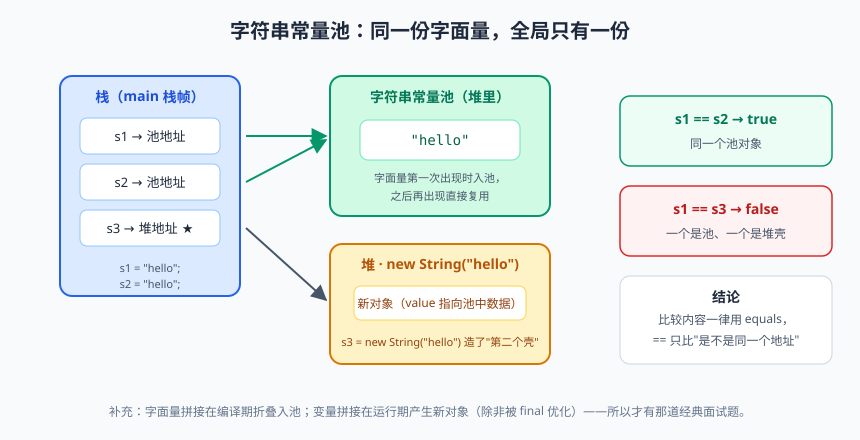
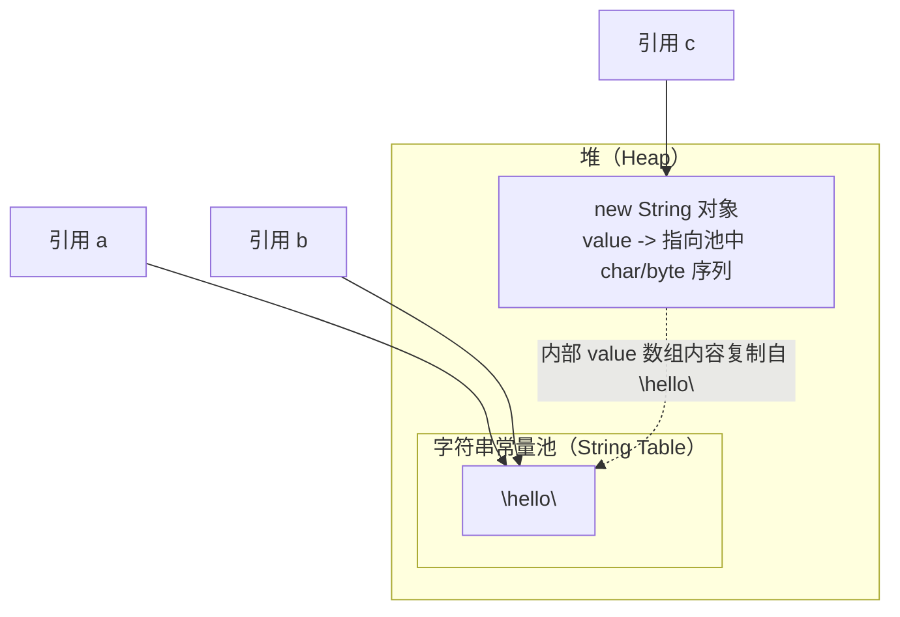

# String 全解析：最熟悉的陌生人

各位同学，大家好！今天咱们聊一位老朋友——`String`。

你有没有过这种同事：天天见，天天打招呼，脸熟得不行，可人家问你"他老家哪儿的、属什么的、家里几口人"，你瞬间哑火。`String` 就是 Java 界的这位同事。每个人写的第一行代码八成是 `System.out.println("Hello, World")`，跟 `String` 打交道的日子比跟对象（both meanings）都长。但要我说说 `String` 底下那点事儿——不可变？常量池？`intern()`？不少同学就开始眼神飘忽、顾左右而言他了。

更要命的是，面试官特别爱拿 `String` 开刀。"String 为什么不可变？"`new String("abc")` 创建了几个对象？""循环里用 `+` 拼接字符串为什么会被 Code Review 打回来？"——这些问题看着家常，答起来全是坑。今天这一篇，咱们就把这位"最熟悉的陌生人"的老底掀个底朝天。看完这篇，下次面试聊到 `String`，你可以翘着二郎腿说："这题我熟，听我给你唠。"

## 一、String 到底是什么：一个"铁面无私"的不可变对象

先看一眼 `String` 的定义（JDK 8 版本）：

```java
public final class String implements java.io.Serializable, Comparable<String>, CharSequence {
    /** The value is used for character storage */
    private final char value[];  // JDK 8：真正存字符的数组，final 修饰
    /** Cache the hash code for the string */
    private int hash; // Default to 0  // hash 值缓存，懒加载
    // ...
}
```

注意三个关键细节：

1. 类被 `final` 修饰——不许继承，谁也别想通过子类重写方法来"篡改"字符串；
2. 内部的 `value` 数组被 `private final` 修饰，且 JDK 8 之后**没有任何公开方法会修改这个数组**；
3. 所有看起来像"修改"的操作（`replace`、`substring`、`concat`、`toUpperCase`……），返回的全是**新字符串对象**，原串纹丝不动。

这就是**不可变性（immutability）**：字符串一旦出生，内容终生不变。你以为的"修改"，其实是"分身"。

```java
String s = "hello";
s.toUpperCase();          // 产生新对象 "HELLO"，但没接收
System.out.println(s);    // 还是 hello —— 分身已死，本体还在

s = s.toUpperCase();      // 这才叫"改"：让引用 s 指向新对象 "HELLO"
System.out.println(s);    // HELLO —— 旧对象 "hello" 没被改，只是被抛弃了
```

> 📌 **划重点**：`String` 的不可变 = 类 `final` + 字段 `private final` + 所有"修改"方法都返回新对象。`s = s.toUpperCase()` 改的不是字符串，是引用的指向。

### 为什么要把 String 设计成不可变？

这是面试高频题，也是真正体现设计功力的地方。我给你四个理由，每个都能讲出一个故事。

**理由一：字符串常量池的前提。** Java 为了省内存，搞了个字符串常量池（String Pool），相同字面量在池里只存一份。想想看，如果 `String` 可变，我把 `"hello"` 改成 `"bye"`，全程序所有引用 `"hello"` 的地方都被殃及——这叫"一个字符串改，整个程序乱"。不可变是常量池能够安全共享的基石。这个咱们下面细说。

**理由二：线程安全的天然选手。** 不可变对象天生线程安全，因为没人能改它，多个线程共享同一个 `String`，谁也不用加锁，谁也不会把谁的数据改坏。多线程篇咱们会展开讲"不可变对象是并发编程的最爱"，`String` 就是教科书案例。

**理由三：HashCode 可以缓存。** `String` 是 HashMap 最常见的 key。如果 `String` 可变，你拿它当 key 存进去，回头一改内容，hash 变了，再取的时候按新 hash 找，桶都找错了——数据"人间蒸发"。而不可变的 `String` 可以放心地把 hash 算一次存起来（就是源码里那个 `hash` 字段），下次直接用，性能白赚。你每次 `map.put("name", xxx)`，都在享受这个缓存红利。

**理由四：安全性。** 文件路径、网络连接地址、类名、数据库 SQL……这些全靠 `String` 传递。假如可变，黑客可以在安全校验**之后**、实际使用**之前**的空档偷偷改掉字符串内容，这叫"检查时检查、使用时掉包"（TOCTOU 漏洞）。不可变从根上堵死了这条路。

> 💡 **老鸟忠告**：面试答"为什么不可变"，把"常量池共享的前提、天生线程安全、hashCode 缓存、安全性"四点说出来，再补一句"不可变是这些特性成立的前提条件"，层次感立刻就有了。背结论不如讲逻辑。

### 内部存储演进：JDK 9 的 compact strings

JDK 8 之前，`String` 内部是 `char[]`，一个 `char` 占 2 个字节（Java 的 char 是 UTF-16 编码）。但统计发现，绝大多数字符串内容是英文、数字这类 Latin-1 字符，一个字节就够，用 `char[]` 存等于一半内存白瞎了。

于是 JDK 9 搞了个大动作——**紧凑字符串（Compact Strings）**：

```java
// JDK 9+ 的 String 内部（示意）
private final byte[] value;  // 存数据的数组，可能是 Latin-1（1 字节/字符）也可能是 UTF-16（2 字节/字符）
private final byte coder;    // 编码标记：LATIN1(0) 或 UTF16(1)
```

纯英文字符串用 1 字节一个字符存（省一半内存），包含中文等字符时自动升级为 UTF-16。据官方统计，这一改动平均给堆内存省了约三分之一到一半的字符串开销。对咱们使用者来说完全无感，API 没变——这就是"闷声干大事"的典范。

> ⚠️ **踩坑实录**：有学员在 JDK 8 上用反射拿到了 `String.value` 字段的类型是 `char[]`，换到 JDK 17 再跑，直接 `ClassCastException`——因为字段已经变成 `byte[]` 了。教训：任何依赖 JDK 内部实现的代码，升级 JDK 时都是雷区。反射撬开别人家抽屉，别人搬家你就抓瞎。

## 二、字符串常量池：字面量与 new String 的爱恨情仇


> 🖼️ **图解**：常量池与堆对象：s1==s2 为 true、s1==s3 为 false 的原因

常量池（String Pool / String Table）是堆里的一块特殊区域（JDK 7 之后从方法区挪到了堆），专门存放字符串字面量，核心使命就一个字：**省**。

```java
String a = "hello";         // 字面量：JVM 先去常量池找 "hello"，有就直接引用，没有就创建并放进池子
String b = "hello";         // 又来一个 "hello"？池里有，直接复用
System.out.println(a == b); // true —— a 和 b 是同一个对象，指向常量池里同一个 "hello"

String c = new String("hello"); // new：在堆里（池外）强行 new 一个新对象
System.out.println(a == c);     // false —— c 是堆里的新对象，跟池里的不是一个
System.out.println(a.equals(c));// true —— 内容一样，equals 比的是内容
```

一张图看懂它们住在哪儿（JDK 7+）：



所以经典面试题"`new String("abc")` 创建了几个对象"的严谨答案是：**最多两个**。如果 `"abc"` 不在池中，先在池里创建一个，再在堆里 new 一个，共 2 个；如果池里已有 `"abc"`，只在堆里 new 1 个。（在栈上还创建了一个引用变量 c，但引用不是对象。）

### intern()：手动把字符串塞进池子

`intern()` 是个很有意思的方法：调用时先看池里有没有相等（equals）的字符串，有就返回池里的那个；没有就把这个对象（JDK 7 起，堆中对象直接登记引用）放进池并返回。

```java
String s1 = new String("hello");   // 堆里新对象
String s2 = s1.intern();           // 池里已有 "hello"（字面量编译期已入池），返回池中对象
System.out.println(s1 == s2);      // false

String s3 = new StringBuilder("ja").append("va_").toString();
// 假设 "java_" 不是程序里已有的字面量（注意 "java" 本身在 JDK 内部已入池）
String s4 = s3.intern();           // 池里没有，s3 登记入池
System.out.println(s3 == s4);      // true（JDK 7+：登记的就是 s3 这个堆对象的引用）
```

实际开发中 `intern()` 用得不多，但某些场景（比如海量重复字符串，如城市名、状态码）能显著省内存。用之前先做内存分析，别乱用。

> 📌 **划重点**：字面量自动入池、相同字面量全局复用；`new String` 永远在堆里造新对象；`==` 比较的是引用（是不是同一个对象），`equals` 比较的是内容。判断字符串内容相等，永远用 `equals`，没有例外。

## 三、`+` 拼接的真相：编译器的"善意的谎言"

先来几道"送分还是送命"取决于你有没有认真听课的题：

```java
// 题目一：字面量拼接
String a = "hello" + "world";
String b = "helloworld";
System.out.println(a == b);        // ? 

// 题目二：变量拼接
String c = "hello";
String d = c + "world";
System.out.println(d == b);        // ?

// 题目三：final 变量拼接
final String e = "hello";
String f = e + "world";
System.out.println(f == b);        // ?
```

答案是：`true`、`false`、`true`。为什么？关键就在**编译期常量折叠**和**运行期 StringBuilder** 的区别。

**题目一**：`"hello" + "world"` 两个都是编译期常量，编译器直接折叠成 `"helloworld"` 一个字面量，跟 `b` 指向池中同一个对象。看，编译器比你想的勤快。

**题目二**：`c` 是变量，编译器没法在编译期确定它的值，只能生成运行期拼接的代码。JDK 8 里 `c + "world"` 实际被编译成等价于 `new StringBuilder().append(c).append("world").toString()` 的逻辑——`toString()` 会 new 一个新 String，所以 `==` 是 false。

**题目三**：`e` 被 `final` 修饰且编译期就能确定值，它就是个"常量变量"（constant variable），编译器又把它折叠了，效果同题目一。

怎么验证？**反编译**。用 `javap -c` 看字节码：

```bash
javap -c StringDemo.class
```

题目一的字节码里你会看到 `ldc #2 // String helloworld`——一行直接加载折叠好的常量；题目二的字节码里则会看到 `new StringBuilder`、`invokevirtual append`、`invokevirtual toString` 的三连击。眼见为实，比背八股文踏实一百倍。

> ⚠️ **踩坑实录**：有学员拿 `final` 局部变量拼接做实验，结果跟预期不一样，百思不得其解。原因是他写了 `final String x = method();`——方法返回值编译期算不出来，`final` 也救不了，照样走 StringBuilder。记住：`final` 只有在**赋的是编译期常量**时才触发折叠。

### 循环拼接：`+` 的滑铁卢

单次拼接，`+` 和 StringBuilder 差别不大（编译器已经帮你转了）。但**循环**里就是灾难现场：

```java
// 反面教材：循环里用 +
String result = "";
for (int i = 0; i < 10000; i++) {
    result += i;   // 每次循环都 new 一个 StringBuilder + new 一个 String
                    // 1万次循环 = 2万个临时对象，GC 直呼顶不住
}

// 正确姿势：循环外建一个 StringBuilder，循环内 append
StringBuilder sb = new StringBuilder();
for (int i = 0; i < 10000; i++) {
    sb.append(i);   // 复用同一个 builder，偶尔内部扩容
}
String result2 = sb.toString();
```

`result += i` 每执行一次，就完整地"new StringBuilder → 拼接 → toString 新 String"走一遍，而且前一轮拼接的成果被当作废料抛弃。数据量一大，时间复杂度退化成 O(n²)，内存里堆满短命对象。这种代码上了生产，Code Review 被打回来都是轻的。

> 💡 **老鸟忠告**：记一条简单规则——**单行拼接用 `+`（可读性最好），循环/递归/流式拼接用 `StringBuilder`**。多线程场景才考虑 `StringBuffer`，而实际开发中多线程拼字符串的场景少之又少，别为了"安全感"到处用 StringBuffer，白白损失性能。

## 四、String vs StringBuilder vs StringBuffer：三兄弟对比

| 对比维度 | String | StringBuilder | StringBuffer |
|---|---|---|---|
| 可变性 | 不可变 | 可变 | 可变 |
| 线程安全 | 天生安全（不可变） | 不安全 | 安全（方法加了 synchronized） |
| 性能 | 拼接差（产生大量临时对象） | 最快 | 比 Builder 慢（锁开销） |
| 适用场景 | 少量拼接、常量、作 Map key | 单线程拼接（绝大多数场景） | 多线程拼接（罕见） |
| 引入版本 | JDK 1.0 | JDK 5 | JDK 1.0 |

一句话记忆：**String 是定妆照，StringBuilder 是草稿纸，StringBuffer 是带锁的草稿纸**。日常 99% 的拼接用 StringBuilder；JDK 8 编译器也正是把 `+` 翻译成它。

顺带一提 StringBuilder 的扩容：无参构造初始容量 16，append 时不够用就扩成 `2n + 2`（约 2 倍），底层靠 `Arrays.copyOf` 搬家。如果你能预估最终长度，`new StringBuilder(1024)` 一次性给够，能避免多次扩容拷贝——老司机的小习惯。

## 五、常用 String API 盘点：工具箱巡礼

`String` 的方法有六十多个，常用的就下面这些，过一遍眼熟：

```java
String s = "  Hello, Java World!  ";

// ---- 判断类 ----
s.equals("hello");            // 内容比较（大小写敏感）
s.equalsIgnoreCase("  hello, java world!  "); // 忽略大小写比较
s.isEmpty();                  // 长度是否为 0，"  " 不算空！
s.isBlank();                  // JDK 11+：是否全是空白，"  " 为 true
s.contains("Java");           // 是否包含
s.startsWith("  He");         // 前缀
s.endsWith("!");              // 后缀

// ---- 查找类 ----
s.indexOf("Java");            // 首次出现位置，找不到返回 -1
s.lastIndexOf("o");           // 最后一次出现位置
s.charAt(3);                  // 取指定位置字符，越界抛 StringIndexOutOfBoundsException

// ---- 截取与拆合 ----
s.substring(2, 7);            // [2, 7) 左闭右开，得 "Hello"
s.split(",\\s*");             // 按正则拆分，注意参数是正则表达式
String.join("-", "a", "b", "c");  // 静态方法拼接，得 "a-b-c"

// ---- 替换与修剪 ----
s.replace("Java", "Java17");  // 替换所有匹配字面量
s.replaceAll("\\s+", " ");    // 参数是正则，替换所有
s.strip();                    // JDK 11+ 修剪空白，比 trim 更懂 Unicode
s.trim();                     // 老牌修剪，只处理 <= U+0020 的字符
s.toUpperCase();              // 转大写（新对象）
s.toLowerCase();              // 转小写（新对象）

// ---- 流式处理（JDK 8+）----
s.chars()                     // 返回 IntStream，字符流
 .filter(c -> c > 'A' && c < 'Z')
 .count();
s.lines();                    // JDK 11+：按行拆成 Stream<String>，处理多行文本神器
"5".repeat(3);                // JDK 11+：得 "555"
```

几个容易翻车的点：`split` 的参数是正则，`split(".")` 会得到空数组（`.` 在正则里是通配符），要写 `split("\\.")`；`substring` 是左闭右开；`replace` 是替换**所有**，跟某些语言里只替换第一个不一样。

> ⚠️ **踩坑实录**：线上日志解析模块用 `line.split("|")` 拆分隔符，结果拆出来一堆单字符，数据全乱。因为 `|` 在正则里是"或"，得写 `split("\\|")`。凡是 `.` `|` `*` `+` `?` 这些正则元字符，当分隔符用一律先转义。又或者干脆用不会正则的 API：`String.valueOf`、`String.join`、`Pattern.quote(".")` 都能绕坑。

## 六、字符串判等的最佳实践

最后说说判等，这是新手 NPE（NullPointerException）和逻辑 bug 的重灾区。

**第一原则：内容判等用 `equals`，永远别用 `==`。** `==` 在字符串比较时比的是引用，碰巧相同（常量池复用）时返回 true，一换到 `new` 出来的或拼接出来的字符串就 false——这种"时灵时不灵"的 bug 最阴险。

**第二原则：常量放前面，防 NPE。**

```java
String name = getNameFromDb();      // 可能返回 null

// 反面教材：name 为 null 时直接 NPE
if (name.equals("admin")) { ... }

// 正确姿势一：常量在前，null 也能安全比较（结果 false）
if ("admin".equals(name)) { ... }

// 正确姿势二：Objects.equals，语义最清晰
if (Objects.equals(name, "admin")) { ... }
```

`"admin".equals(name)` 之所以安全，是因为 `String.equals` 源码的第一行就做了 `instanceof String` 检查——null 不是任何类的实例，直接返回 false。而 `name.equals(...)` 当 name 是 null 时，等于对 null 调方法，NPE 当场表演。

**第三原则：忽略大小写比较用 `equalsIgnoreCase`**，别自己 `toLowerCase()` 再 equals——土耳其语等 locale 下 `toLowerCase` 有惊喜，`equalsIgnoreCase` 专为比较而生，不踩 locale 坑。

> 📌 **划重点**：字符串判等三件套——`equals` 比内容、常量在前或 `Objects.equals` 防 NPE、忽略大小写用 `equalsIgnoreCase`。把这三条焊死在肌肉记忆里。

## 本篇小结

- `String` 不可变：类 final + 字段 final + 所有"修改"操作返回新对象；
- 不可变的四大价值：常量池共享的前提、天生线程安全、hashCode 可缓存、安全防篡改；
- JDK 9 起 `char[]` 改为 `byte[] + coder`，纯 Latin-1 字符串内存省一半，对使用者无感；
- 字面量入常量池并复用，`new String` 一定在堆里造新对象，`intern()` 手动入池；
- `==` 比引用、`equals` 比内容，判等永远用 `equals` 系；
- 编译期常量拼接会被折叠，变量拼接运行期走 StringBuilder——`final` 常量变量可触发折叠；
- 循环内拼接必须用 StringBuilder，用 `+` 会产生大量临时对象，复杂度退化 O(n²)；
- 防御性判等：常量在前（`"x".equals(s)`）或 `Objects.equals(s, "x")`。

## 课后思考 & 动手练习

1. **概念题**：`String s = new String("abc");` 这行代码在什么情况下创建 1 个对象，什么情况下创建 2 个对象？对象分别在哪里？
2. **分析题**：请解释为什么 `String` 适合做 HashMap 的 key，而 `StringBuilder` 不适合？（提示：从可变性与 hashCode 缓存角度想）
3. **辨析题**：`String`、`StringBuilder`、`StringBuffer` 三者各自的使用场景是什么？为什么 JDK 8 编译器把 `+` 拼接翻译成 StringBuilder 而不是 StringBuffer？
4. **编程题**：统计一段英文文本中每个单词出现的次数并按次数降序输出。要求：不用 `split` 之外的正则，注意使用 `StringBuilder`、`Map` 的正确姿势，并与"逐字符手写解析"版对比代码量。（进阶：尝试用 `lines()` + `chars()` 的流式写法再来一遍）
5. **动手验证题**：写一段包含循环拼接与 StringBuilder 拼接各 10 万次的代码，用 `System.nanoTime()` 对比耗时，再用 `javap -c` 反编译查看循环 `+=` 的字节码，找到 `new StringBuilder` 出现的位置。

下一篇预告：**《集合框架（上）：容器选型地图》**——数组的"七大罪"，List/Set/Queue/Map 四大家族的选型心法，以及"LinkedList 查询慢增删快"这个流传甚广的说法到底错在哪儿，咱们下期见。
