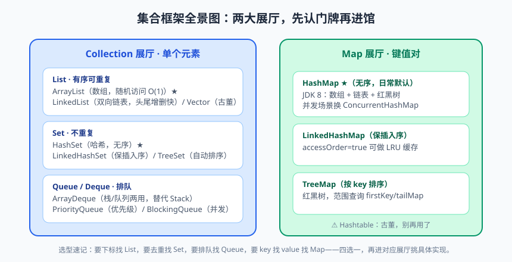
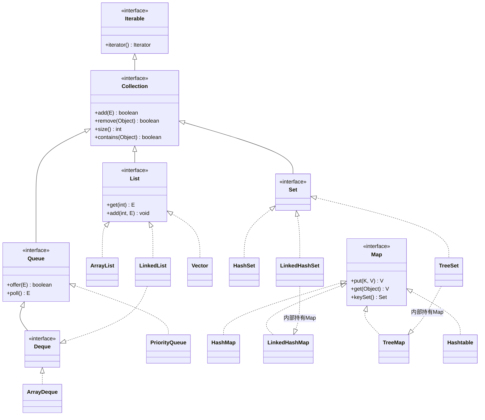
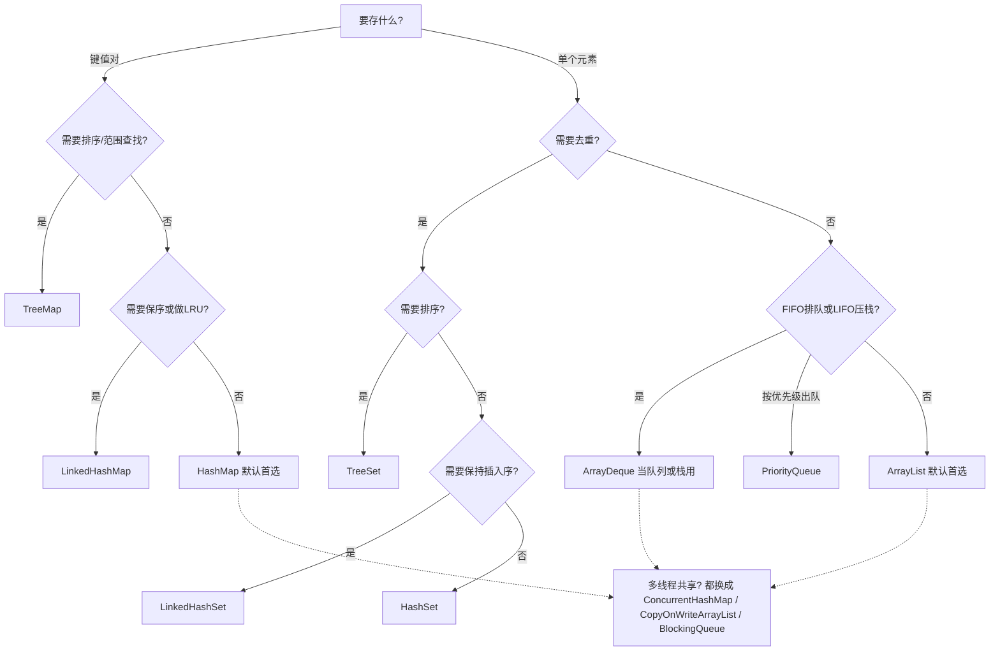

# 集合框架（上）：容器选型地图

同学们，想象一下这个场景：你开了家奶茶店，一开始用一张固定格子的小柜子放原料——10 个格子，编号 0 到 9。生意好了想加第 11 种原料？对不起，柜子是焊死的，要么整个柜子扔了换大的，要么别加。更抓狂的是，"把珍珠挪到椰果前面"这种操作，你得把中间的格子挨个搬一遍。这就是数组：定容、查快、挪死人。

Java 集合框架（Java Collections Framework，JCF）就是给这个柜子来了一场工业革命：能自动扩容的柜子（ArrayList）、前后都能进出的传送带（Deque）、自动去重的分拣机（Set）、按键取货的智能货架（Map）、还能自动排序的强迫症货架（TreeMap）。今天这节课，咱们不抠源码（源码大餐留到下一篇炖 HashMap），先把**选型地图**画明白——什么时候掏哪个容器，三秒内做决定。

为啥先讲选型？因为我带过太多学员，代码写出来全是 ArrayList 一把梭，存键值对也用两个 ArrayList 对着下标配对（我亲眼见过，血压当场拉满）。工具箱里十几种工具，只会用锤子，看啥都是钉子——这不行。选型是内功，源码是招式，内功先练。

## 一、为什么需要集合：数组的"七大罪"

数组的罪状，我给数落数落，大家边听边对照自己写过的代码：

1. **长度固定**：生下来多长就多长，容量不够只能 `Arrays.copyOf` 手动搬家；
2. **没有现成的增删方法**：中间插一个元素、删一个元素，全得自己写搬移逻辑；
3. **无法动态感知元素个数**：只能靠额外维护一个 size 变量，`array.length` 是容量不是元素数，一不留神就遍历出一堆 null；
4. **只能存同一种类型且不支持键值对**：想存"学号→学生"的映射？自己开两个数组手动对齐下标吧，对不齐就是 bug 温床；
5. **不支持去重、排序等通用算法**：想去重？自己写双层循环；想排序？自己写快排（当然 `Arrays.sort` 能救一点）；
6. **类型不安全（配合协变的历史包袱）**：`Object[]` 啥都能塞，取出来强转，`ClassCastException` 在暗处冷笑；
7. **API 贫瘠**：contains、indexOf、遍历删除……统统没有，全都手搓。

集合框架就是官方对这七宗罪的总回应：一套统一的接口（`Collection`、`Map`、`Iterator`）+ 一堆各怀绝技的实现类 + 配套的算法工具类（`Collections`、`Arrays`）。**用了集合，你的关注点从"怎么存"升级到"存什么、怎么取"**——这才是工程师该操心的层次。

## 二、集合框架总览：先看地图再上路


> 🖼️ **图解**：Collection 与 Map 两大展厅，先认门牌再挑实现

整个 JCF 就两棵树：`Collection` 一族（装单个元素）和 `Map` 一族（装键值对）。注意 **Map 不继承 Collection**，它是独立门派，这个面试也爱考。



看图记住三个冷知识：`LinkedList` 是双面间谍（既实现 List 又实现 Deque）；`LinkedHashSet` 和 `TreeSet` 底层其实是穿着 Set 马甲的 `LinkedHashMap`/`TreeMap`；`Vector` 和 `Hashtable` 是 JDK 1.0 的远古化石，方法全加 `synchronized`，性能拉胯，新代码别碰。

## 三、List 三兄弟：ArrayList、LinkedList 与老古董 Vector

List 的特点是**有序（按插入顺序）、可重复、可按索引访问**。三兄弟的底细先上对比表：

| 对比维度 | ArrayList | LinkedList | Vector |
|---|---|---|---|
| 底层数据结构 | 动态数组 `Object[]` | 双向链表 | 动态数组 |
| 扩容 | 1.5 倍（`oldCap + oldCap>>1`） | 无需扩容（链表随意长） | 2 倍 |
| 随机访问 get(i) | O(1)，数组的看家本领 | O(n)，得从头数 | O(1) |
| 中间插入/删除 | O(n)，要搬移后面元素 | O(1) 改指针，**但定位要先 O(n)** | O(n) |
| 线程安全 | 否 | 否 | 是（全方法 synchronized） |
| 额外开销 | 尾部预留空间 | 每个节点两个指针 + 对象头 | 同 ArrayList 外加锁开销 |
| 使用建议 | 默认首选 | 极少使用（当 Deque 用还行） | 别用，要线程安全上并发包 |

重点来了，我要纠正一个**流传甚广的误导性说法**："LinkedList 查询慢、增删快，所以频繁增删用 LinkedList。"这话半对半错，错的那半坑了无数人。

正确的理解是：LinkedList 的**增删动作本身是 O(1)**（改两个指针嘛），但增删前你得先**找到那个位置**，定位是 O(n)。所以"在中间某处插入"这个完整操作，LinkedList 是 O(n) 定位 + O(1) 插入 = O(n)；ArrayList 是 O(1) 定位 + O(n) 搬移 = O(n)。**打平了！** 甚至因为数组内存连续、缓存友好（CPU 缓存行一次加载一片，链表节点散落堆里各处，缓存老 miss），实际跑起来 ArrayList 的搬移经常比 LinkedList 的指针跳转还快。

再加上链表每个节点的指针开销和 GC 压力，结论很反直觉但很明确：**几乎一切场景 ArrayList 都不输，绝大多数场景它更优**。LinkedList 真正的用武之地是当 Deque（队列/栈）用。

> 📌 **划重点**："LinkedList 增删快"是不完整的表述。它的增删快仅限于**已经拿到节点位置**的场景；完整操作要算上 O(n) 的定位成本。日常开发无脑 ArrayList 即可，有 benchmark 数据再换不迟。

### ArrayList 使用速览

```java
List<String> list = new ArrayList<>();     // 接口类型声明，实现随时可换
list.add("Java");                          // 尾插，平均 O(1)
list.add(0, "Hello");                      // 指定下标插入，后面元素整体后移
list.get(1);                               // 随机访问 O(1)
list.set(1, "Java17");                     // 替换
list.remove(0);                            // 按下标删除，后面元素前移
list.contains("Java");                     // 查存在，O(n) 线性查找
list.size();                               // 元素个数（不是容量！）

// 已知大概规模时，给初始容量，减少扩容拷贝
List<Integer> nums = new ArrayList<>(1024);  // 预期存 1000 个，直接给 1024

// 一把梭的工厂方法（JDK 9+），返回不可变集合
List<String> immutable = List.of("a", "b", "c");
```

> 💡 **老鸟忠告**：声明集合一律用接口类型（`List<String> list = new ArrayList<>()`），别用 `ArrayList<String> list`。哪天想换实现，只改 new 那一行；用具体类型声明，调用处可能偷偷用了 ArrayList 特有方法，换实现就是全文件大手术。

## 四、Set 三兄弟：去重分拣机的三种性格

Set 的特点是**不重复、无索引**。三兄弟性格迥异：

| 对比维度 | HashSet | LinkedHashSet | TreeSet |
|---|---|---|---|
| 底层实现 | HashMap（值当 key 存） | LinkedHashMap | TreeMap（红黑树） |
| 元素顺序 | 无序（哈希散布） | 插入顺序 | 排序顺序（自然序或 Comparator） |
| 增删查性能 | O(1) 平均 | O(1) 平均 | O(log n) |
| 是否允许 null | 允许 1 个 | 允许 1 个 | 不允许（比较会 NPE） |
| 适用场景 | 通用去重 | 去重且保持插入序 | 去重且要排序/范围查找 |

### 去重的原理：hashCode + equals 联合办案

HashSet 判断"重复"不是靠 `==`，而是**先比 `hashCode`，再比 `equals`**，像安检先看证件号（hashCode 快筛），对不上的直接放行不同的；证件号撞了再人脸比对（equals 精确确认）。这里埋个伏笔：如果只重写 `equals` 不重写 `hashCode`，两个"逻辑相等"的对象 hashCode 不同，安检直接判为不同的人——去重失效。这个坑咱们在第八节现场爆破演示。

```java
Set<String> set = new HashSet<>();
set.add("Java");
set.add("Java");              // 第二次 add 返回 false，没塞进去
System.out.println(set.size()); // 1

// 经典操作：用 HashSet 给 List 去重（不保序）
List<Integer> dup = Arrays.asList(1, 2, 2, 3, 3, 3);
Set<Integer> unique = new HashSet<>(dup);   // [1, 2, 3]，顺序不保证

// 保序去重：LinkedHashSet
Set<Integer> ordered = new LinkedHashSet<>(dup);  // [1, 2, 3]，保持出现顺序

// 排序去重：TreeSet
Set<Integer> sorted = new TreeSet<>(dup);    // [1, 2, 3]，天然升序
SortedSet<Integer> top = ((TreeSet<Integer>) sorted).headSet(3); // [1, 2]：比 3 小的
```

## 五、Queue 与 Deque：排队的艺术

队列（Queue）是先进先出 FIFO，双端队列（Deque）是两端都能进出。这家族在业务里的出场率被严重低估：消息缓冲、任务池、限流滑动窗口、撤销/重做栈……到处是它们。

**第一件事：把 Stack 扔出工具箱。** `java.util.Stack` 继承自 Vector，它最大的罪是**你不但能 push/pop，还能用父类的 add/insert 干预中间元素**——一个"栈"能被从腰上捅一刀，这就不是栈了。替代品是 `ArrayDeque`：基于循环数组，两端操作均摊 O(1)，且严格只暴露双端操作。下面是它的两副面孔：

```java
// 当栈（LIFO）用：后进先出
Deque<String> stack = new ArrayDeque<>();
stack.push("第一页");       // push = addFirst
stack.push("第二页");
stack.pop();                // pop = removeFirst，弹出"第二页" —— 浏览器后退就这么实现
stack.peek();               // 看栈顶不弹出

// 当队列（FIFO）用：先进先出
Queue<String> queue = new ArrayDeque<>();
queue.offer("用户A");       // offer = addLast，队尾进
queue.offer("用户B");
queue.poll();               // poll = removeFirst，队头出，取走"用户A" —— 排队叫号

// PriorityQueue：优先队列，出队顺序看优先级而不是先来后到
Queue<Integer> pq = new PriorityQueue<>();       // 默认小顶堆，最小的先出
pq.addAll(Arrays.asList(5, 1, 3));
pq.poll();   // 1 —— 不是最早进队的 5！
pq.poll();   // 3
// 大顶堆：传比较器
Queue<Integer> maxHeap = new PriorityQueue<>(Comparator.reverseOrder());
```

> ⚠️ **踩坑实录**：学员用 `ArrayDeque` 存任务，某处误调了 `add(index, element)`——编译报错才想起来 ArrayDeque 根本没有这个方法（Deque 接口没这 API），他悻悻换成 LinkedList 才编译过。但另一组学员用 Stack 时，`stack.add(0, "x")` 从中间插数据，编译器一声不吭，上线后任务顺序错乱查了半天。这就是 Stack 的设计缺陷：它没有"防呆"。工具选不对，编译器都救不了你。

另外注意 `remove()`/`poll()` 的区别：队列空时 `remove()` 抛 `NoSuchElementException`，`poll()` 返回 null。生产代码里 `offer/poll/peek` 这套"温柔型"API 更好控场。

## 六、Map 四巨头：键值对的四个门派

Map 存键值对，key 不重复，一个 key 对应一个 value。四个门派对比：

| 对比维度 | HashMap | LinkedHashMap | TreeMap | Hashtable |
|---|---|---|---|---|
| 底层结构 | 数组+链表+红黑树 | HashMap + 双向链表串序 | 红黑树 | 数组+链表（老结构） |
| 顺序 | 无序 | 插入序或访问序（LRU 神器） | 按 key 排序 | 无序 |
| null key/value | 都允许（key 一个） | 都允许 | 都不允许 | 都不允许（直接 NPE） |
| 性能 | O(1) 平均 | O(1) 平均 + 链表维护小开销 | O(log n) | O(1) 但有锁开销 |
| 线程安全 | 否 | 否 | 否 | 是（全表锁，性能差） |
| 使用建议 | 默认首选 | 要保序/做 LRU 缓存 | 要排序/范围查询 | 别用，换 ConcurrentHashMap |

```java
Map<String, Integer> scores = new HashMap<>();
scores.put("张三", 90);
scores.put("李四", 85);
scores.getOrDefault("王五", 0);        // 不存在给默认值，防 null
scores.putIfAbsent("赵六", 70);        // 没有才放
scores.merge("张三", 5, Integer::sum); // 统计计数的神器：95 = 90 + 5
scores.computeIfAbsent("分组A", k -> new ArrayList<>()).add("张三"); // 多值映射

// 统计词频一行流
Map<String, Integer> freq = new HashMap<>();
for (String w : words) {
    freq.merge(w, 1, Integer::sum);   // 出现一次加 1，比 get+put 判空优雅一百倍
}

// LRU 缓存：访问序 LinkedHashMap，三行造一个
Map<String, String> lru = new LinkedHashMap<>(16, 0.75f, true) {
    @Override
    protected boolean removeEldestEntry(Map.Entry<String, String> eldest) {
        return size() > 100;          // 超过 100 个自动淘汰最久未访问的
    }
};
```

> 💡 **老鸟忠告**：`Hashtable` 是 1996 年的遗产，连命名都没驼峰（Hashtable 而不是 HashTable）。要线程安全用 `ConcurrentHashMap`（下篇细讲）；它 null 都不让存的设计也不贴合现代开发习惯。面试问"HashMap 和 Hashtable 区别"，答完表面差异，补一句"实际开发中两者都不该直接用 Hashtable"，才显得真懂。

## 七、遍历方式盘点与"删除悬案"

集合遍历姿势不少，以 List 和 Map 为例：

```java
List<String> list = new ArrayList<>(Arrays.asList("a", "b", "c"));

// 姿势一：普通 for + 下标 —— 只有 List 支持，需要下标时用
for (int i = 0; i < list.size(); i++) { ... }

// 姿势二：增强 for —— 最常用，底层是 iterator
for (String s : list) { ... }

// 姿势三：显式迭代器 —— 需要边遍历边删除时用
for (Iterator<String> it = list.iterator(); it.hasNext(); ) {
    if (it.next().startsWith("a")) {
        it.remove();                  // 唯一安全的删除方式
    }
}

// 姿势四：forEach + Lambda（JDK 8+）
list.forEach(s -> System.out.println(s));

// 姿势五：removeIf —— 删除条件元素的最佳姿势（JDK 8+）
list.removeIf(s -> s.startsWith("a")); // 内部就是迭代器删除，安全又简洁

// Map 的遍历（entrySet 最高效，一次拿到 k 和 v）
Map<String, Integer> map = new HashMap<>();
for (Map.Entry<String, Integer> e : map.entrySet()) {
    System.out.println(e.getKey() + " = " + e.getValue());
}
map.forEach((k, v) -> System.out.println(k + " = " + v));  // Lambda 版
```

**遍历悬案：ConcurrentModificationException（CME）。** 先看案发现场：

```java
// 翻车现场：增强 for 里直接调 list.remove
for (String s : list) {
    if ("b".equals(s)) {
        list.remove(s);   // 抛 ConcurrentModificationException！
    }
}
```

原理：ArrayList 内部有个 `modCount` 修改计数器，迭代器创建时记住一个快照 `expectedModCount`，每次 `next()` 都检查两者是否相等，`list.remove` 只加了 modCount 没同步 expectedModCount，一检查对不上，立刻抛 CME——这是** fail-fast（快速失败）机制**，故意让你早点炸，而不是让数据悄悄错乱。名字带 Concurrent，但和并发没必然关系，单线程遍历时删也一样炸（有趣的是删倒数第二个元素有时不炸，那是 `next()` 检查时机漏过去了，纯属侥幸，别赌）。

正确姿势三选一：`iterator.remove()`、`removeIf(predicate)`（内部就是前者，最推荐）、或者 `CopyOnWriteArrayList`（并发场景专用，读多写少才划算）。

> 📌 **划重点**：遍历中删除元素只认三招——迭代器的 `remove()`、`removeIf()`、并发容器。其余姿势（增强 for 里 remove、forEach 里 remove、stream 里动源集合）都是 CME 预定席。

## 八、equals 与 hashCode：去重世界的契约

前面 Set、Map 都靠 `hashCode` + `equals` 认人，现在正式立规矩。Java 官方约定的核心条款：

1. **相等对象必须有相等的 hashCode**（硬性要求）；
2. equals 满足自反、对称、传递、一致，且 `x.equals(null)` 返回 false；
3. 反过来**不要求**：hashCode 相等的对象不一定 equals（哈希碰撞，正常现象）。

为什么"重写 equals 必须重写 hashCode"？上爆破现场：

```java
class Student {
    private String id;
    Student(String id) { this.id = id; }

    @Override
    public boolean equals(Object o) {
        if (this == o) return true;
        if (!(o instanceof Student)) return false;
        return id.equals(((Student) o).id);   // 按 id 判等，逻辑合理
    }
    // 故意不重写 hashCode！
}

Set<Student> set = new HashSet<>();
set.add(new Student("S001"));
set.contains(new Student("S001"));  // false！明明"相等"，却说不包含
set.add(new Student("S001"));       // 成功塞入！Set 竟然出现俩"S001"
```

原因：两个 Student 的 equals 说相等，但 Object 继承来的 hashCode 是基于对象内存地址的，几乎必然不同。HashSet 先看 hashCode 定桶——两个对象 hash 不同，进了**不同的桶**，`equals` 根本没机会被调用，直接判定"不是同一个人"。于是去重失效、contains 失灵，整套哈希体系对你这个类形同虚设。

修复也很简单，现代写法一行工具搞定：

```java
@Override
public int hashCode() { return Objects.hash(id); }   // JDK 7+ 的 Objects.hash

// 或者直接让 IDE / Record 完成全部工作：
record Student(String id) {}   // JDK 16+：equals/hashCode/toString 全自动
```

> ⚠️ **踩坑实录**：某学员把 `Student` 存进 `HashMap<Student, Score>` 后，顺手 `student.setName("新名字")` 改了参与 hashCode 计算的字段，之后再 `map.get(student)` 永远返回 null——hash 变了，进错桶了。教训：**参与 equals/hashCode 的字段应当不可变**，或者对象放进哈希容器后绝不动这些字段。这也是 String 被设计成不可变的深层原因之一，上一篇的伏笔在这接上了。

## 九、选型决策树：三秒做决定

学了这么多容器，实战中最重要的是"掏哪个"。我画了张决策树，照着走：



口诀版：**键值排序 TreeMap，去重排序 TreeSet，保序 Linked 前缀，其余无脑 Hash；单列排队 ArrayDeque，默认兜底 ArrayList；有线程安全问题，并发包里找替换。**

## 本篇小结

- 数组七宗罪：定容、无增删 API、无 size、无键值对、无算法、不安全、API 贫瘠，集合框架逐条反杀；
- Map 与 Collection 是两个独立体系，Map 不继承 Collection；
- ArrayList 几乎全面胜过 LinkedList："链表增删快"漏了 O(n) 定位成本，加上缓存不友好，日常无脑选 ArrayList；
- Set 去重靠 hashCode 定桶 + equals 精判；LinkedHashSet 保序，TreeSet 排序；
- Stack 已过时，用 ArrayDeque 替代（可当栈也可当队列）；优先级出队用 PriorityQueue；
- HashMap 无序、LinkedHashMap 保序可做 LRU、TreeMap 排序支持范围查询、Hashtable 是化石别用；
- 遍历中删除只认 iterator.remove()、removeIf()、并发容器三招，其他姿势等着吃 CME；
- 重写 equals 必须重写 hashCode，且参与判等的字段放进哈希容器后不要动。

## 课后思考 & 动手练习

1. **概念题**：为什么说"LinkedList 增删快"是误导性说法？请从"定位成本 + 操作成本"的完整视角解释，并说明 ArrayList 为何常常反超。
2. **分析题**：HashSet 如何判断两个元素"重复"？如果只重写 `equals` 不重写 `hashCode`，把对象放入 HashSet 会发生什么？请描述内部执行路径。
3. **辨析题**：`ArrayDeque` 相比 `Stack` 有哪些优势？为什么说 Stack 的设计是"防不住呆"的？
4. **编程题**：实现一个简易 LRU 缓存类 `LruCache<K, V>`，支持 `put`/`get`/`size` 上限淘汰最久未访问的条目。要求用 `LinkedHashMap(accessOrder=true)` 实现，并尝试再手写一个"HashMap + 双向链表"版本对比。
5. **编程题（附加）**：给定一个 List<String>，用三种安全方式删除其中所有长度小于 3 的字符串（迭代器、removeIf、Stream 过滤生成新集合），并思考哪种在什么场景下最合适。

下一篇预告：**《集合框架（下）：HashMap 源码炖着吃》**——选型地图有了，该下后厨看后勺了。ArrayList 的懒加载、HashMap 的扰动函数、树化阈值为什么偏偏是 8，咱们拿着源码小火慢炖，一篇给你炖烂糊。
