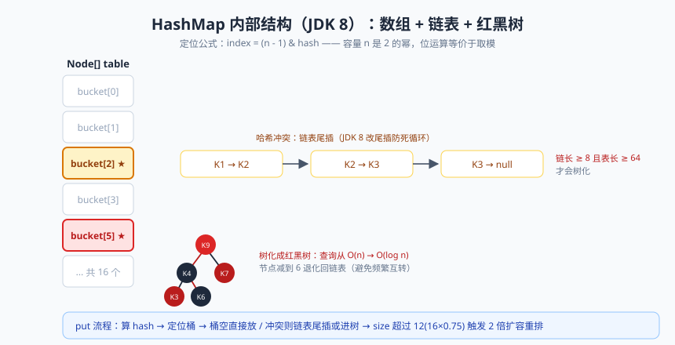
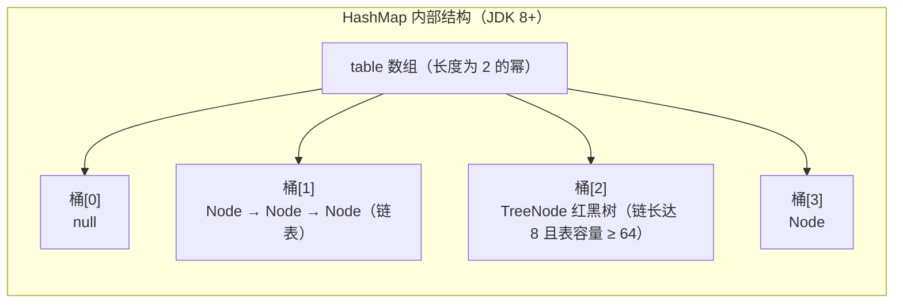

# 集合框架（下）：HashMap 源码炖着吃

上节课咱们画完了选型地图，这节课进后厨。

我知道，一说"读源码"，不少同学腿就软了：那玩意儿是不是得十年功力才配看？打住！我先给你做个心理按摩——**源码也是人写的，写源码的那哥们儿写的时候也得查文档、也会写注释、也怕后人看不懂**。HashMap 的源码，注释比代码还多，Doug Lea 大爷生怕你看不明白，掰开揉碎地给你讲。而且读源码的正确姿势不是从第一行读到最后一行，而是**带着问题去**：`put` 一个元素到底发生了什么？容量为什么必须是 2 的幂？把这几个问题当线头，抽着抽着整个毛衣就解开了。

HashMap 是 Java 集合框架的 C 位，没有之一。业务代码里出现频率最高，面试被盘得最狠，理解了它，HashSet、ConcurrentHashMap 都是买一送三。今天咱们把 ArrayList 先快速过一遍热身，然后主菜上 HashMap，小火慢炖，炖到脱骨。

## 一、热身菜：ArrayList 源码要点

ArrayList 的源码是清汤挂面，十分钟看完，但它有几个"反直觉"的知识点，面试很爱考。

### 核心字段与懒加载的真相

```java
public class ArrayList<E> extends AbstractList<E>
        implements List<E>, RandomAccess, ... {

    private static final int DEFAULT_CAPACITY = 10;      // 默认容量 10
    private static final Object[] DEFAULTCAPACITY_EMPTY_ELEMENTDATA = {};
    transient Object[] elementData;   // 真正存元素的数组，transient 表示不参与默认序列化
    private int size;                 // 元素个数，注意区分：size 是个数，length 是容量
}
```

**默认容量 10 的真相**：`new ArrayList<>()` 的时候，数组**并没有真正分配长度 10**，`elementData` 指向一个空数组 `{}`，容量是 0！直到第一次 `add`，才扩到 10。这叫**懒加载（lazy initialization）**——你不放元素，我就不占内存，主打一个勤俭持家。

### add 与扩容：1.5 倍的精打细算

```java
public boolean add(E e) {
    ensureCapacityInternal(size + 1);  // 先确保装得下
    elementData[size++] = e;           // 尾部赋值，size 后移
    return true;
}

private void grow(int minCapacity) {
    int oldCapacity = elementData.length;
    int newCapacity = oldCapacity + (oldCapacity >> 1);  // 新容量 = 旧容量 * 1.5（右移一位即除2）
    if (newCapacity - minCapacity < 0)
        newCapacity = minCapacity;    // 1.5 倍还不够（如 addAll 大批量），直接用需求值
    ...
    elementData = Arrays.copyOf(elementData, newCapacity); // 搬家：新数组 + System.arraycopy 拷贝
}
```

三句话总结：**add 前先问"装得下吗"，装不下就 1.5 倍扩容，扩容靠 `Arrays.copyOf` 整体搬家**。所以随机访问 O(1)、尾部追加均摊 O(1)，但中间插入和删除要 `System.arraycopy` 搬移后面的元素，是 O(n)——这正好验证了上篇说的"ArrayList 中间增删也是 O(n)"。

> 📌 **划重点**：ArrayList 默认容量 10 是**第一次 add 时才生效的懒加载**；扩容 1.5 倍，靠 `Arrays.copyOf` 搬家。已知数据量时用 `new ArrayList<>(n)` 一次性给够，能省掉多次扩容拷贝——这就是上篇老鸟忠告的源码依据。

## 二、主菜上场：HashMap 核心字段


> 🖼️ **图解**：HashMap 内部结构：数组定位、链表接冲突、树化保查询

先认识几个关键角色，看不懂没关系，混个脸熟，下面走读流程时它们会轮番登场（JDK 8 源码）：

```java
public class HashMap<K,V> extends AbstractMap<K,V> implements Map<K,V>, ... {

    static final int DEFAULT_INITIAL_CAPACITY = 1 << 4;   // 默认初始容量 16，必须是 2 的幂
    static final float DEFAULT_LOAD_FACTOR = 0.75f;       // 默认负载因子 0.75
    static final int TREEIFY_THRESHOLD = 8;               // 链表树化阈值：链长到 8 尝试树化
    static final int UNTREEIFY_THRESHOLD = 6;             // 红黑树退化阈值：拆分后树节点 <= 6 退化回链表
    static final int MIN_TREEIFY_CAPACITY = 64;           // 树化还要求表容量 >= 64，否则先扩容

    transient Node<K,V>[] table;   // 哈希桶数组，也叫哈希表，真正存数据的地方，长度是 2 的幂
    transient int size;            // 键值对个数
    int threshold;                 // 扩容阈值 = capacity * loadFactor，size 超过它就 resize
    final float loadFactor;        // 负载因子

    static class Node<K,V> implements Map.Entry<K,V> {
        final int hash;            // key 的 hash，final：定位桶用的，不许变
        final K key;
        V value;
        Node<K,V> next;            // 链表下一个节点（哈希冲突时拉链）
    }
}
```

 HashMap 的整体长相：一个 `Node` 数组（table），每个槽位叫一个**桶（bucket）**；hash 冲突的元素在桶里用链表串起来（拉链法）；链太长（到 8）就长成红黑树。数组 + 链表 + 红黑树，三态合一。



## 三、putVal 全流程走读：一次 put 的一生

`map.put(key, value)` 背后是 `putVal` 方法，我把它翻译成人话，一步步走：

```java
// JDK 8 putVal 核心逻辑（有删减，注释是重点）
final V putVal(int hash, K key, V value, boolean onlyIfAbsent, boolean evict) {
    Node<K,V>[] tab; Node<K,V> p; int n, i;
    if ((tab = table) == null || (n = tab.length) == 0)
        n = (tab = resize()).length;               // ① 表还没建（懒加载！），先 resize 初始化
    if ((p = tab[i = (n - 1) & hash]) == null)     // ② 用 (n-1)&hash 定位桶
        tab[i] = newNode(hash, key, value, null);  //    桶是空的，直接放，收工
    else {
        Node<K,V> e; K k;
        if (p.hash == hash &&
            ((k = p.key) == key || (key != null && key.equals(k))))
            e = p;                                  // ③ 桶头就是同一个 key：准备覆盖 value
        else if (p instanceof TreeNode)
            e = ((TreeNode<K,V>)p).putTreeVal(this, tab, hash, key, value); // ④ 是红黑树：走树插入
        else {
            for (int binCount = 0; ; ++binCount) {  // ⑤ 是链表：从头到尾找
                if ((e = p.next) == null) {
                    p.next = newNode(hash, key, value, null); // 尾插！挂在链表末尾
                    if (binCount >= TREEIFY_THRESHOLD - 1)    // 链长达到 8
                        treeifyBin(tab, hash);      //    尝试树化（表容量 < 64 时优先扩容）
                    break;
                }
                if (e.hash == hash &&
                    ((k = e.key) == key || (key != null && key.equals(k))))
                    break;                           // ⑥ 链上找到了同 key：准备覆盖
                p = e;
            }
        }
        if (e != null) {                             // 覆盖逻辑：旧 value 返回，新 value 上位
            V oldValue = e.value;
            if (!onlyIfAbsent || oldValue == null)
                e.value = value;
            afterNodeAccess(e);                      // LinkedHashMap 的钩子（上篇 LRU 的伏笔）
            return oldValue;
        }
    }
    ++modCount;
    if (++size > threshold)                          // ⑦ 元素数超过阈值：扩容
        resize();
    afterNodeInsertion(evict);
    return null;
}
```

判断"同一个 key"的条件值得单独看：`hash 相等 && （== 或 equals）`。先比 hash（快），再比引用（更快），最后才 equals（慢但准）。这也解释了为什么 key 的 hashCode 和 equals 必须配套——任何一环出问题，key 就认不出来。

### 扰动函数：为什么 hash 要右移 16 位？

定位桶用的是 `(n - 1) & hash`，而 `putVal` 收到的 hash 并不是 key 的 `hashCode()`，而是先过了一道**扰动函数（spreading）**：

```java
static final int hash(Object key) {
    int h;
    return (key == null) ? 0 : (h = key.hashCode()) ^ (h >>> 16);  // 高 16 位异或低 16 位
}
```

为什么要异或一下？假设表长 16，`(n-1) & hash` 只用到 hash 的**低 4 位**，高 28 位完全没参与！如果两个 key 的 hashCode 只有高位不同，低位相同，它们必然撞进同一个桶，冲突率飙升。扰动函数把高 16 位的信息"掺"进低 16 位，让高位也能影响定位，**用一次异或的成本换冲突率下降**，这是性价比极高的设计。

顺便看到了：`key == null` 时 hash 为 0，所以 **HashMap 允许一个 null key**，它永远待在 0 号桶（n-1 & 0 = 0）。

### 尾插法：JDK 8 对 JDK 7 的一次自我救赎

JDK 7 的 HashMap 在**扩容时用头插法**迁移链表：把旧桶链表逐个摘下来插到新桶头部，迁移完链表顺序**反转**。单线程没事，但两个线程同时 resize 时，A 线程挂起、B 线程完成了反转迁移，A 恢复后继续按"反转前的记忆"搬节点——指针指来指去可能形成**环形链表**。之后一次 `get` 遍历这个环，CPU 100% 死循环，服务假死。这就是 JDK 7 经典的"扩容死循环"事故。

JDK 8 改成**尾插法**，迁移时保持节点原顺序，不再反转，链表成环的土壤就没了。（注意：JDK 8 的 HashMap 依然线程不安全，只是死循环这个具体病灶治了，下面第九节细说。）

### 树化阈值 8 与退化阈值 6：为什么偏偏是这俩数？

链表长度到 **8** 触发树化，扩容拆分后树节点降到 **6** 退化回链表。为什么不树化用 8、退化也用 8？为什么不 4、不 16？

先看 8 的来历。理想哈希下节点分布服从泊松分布（源码注释里真给了概率表），一个桶里链长达到 8 的概率约为 **0.00000006**——两千万分之一。也就是说正常情况你根本见不到树，链长到 8 基本意味着 hash 质量出了问题（比如 key 的 hashCode 写得太烂），这时候才值得动用红黑树这个"重型装备"。红黑树节点（TreeNode）内存约是普通 Node 的两倍，不能轻易上。

至于为什么退化用 6 不用 8：**留缓冲带，防止抖动**。如果阈值都是 8，一个桶里元素在 7、8 之间反复横跳（插一个删一个），链表和红黑树就会来回转换，每次都是 O(n) 甚至 O(log n) 的结构重建，性能抖成心电图。6 和 8 之间留 2 的缓冲，结构转换频率大幅下降。这种"上下限错开"的设计思想在工程里到处都是（比如 TCP 拥塞控制、消息积压告警），值得细细品。

还有一个细节：链长到 8 时**不一定真树化**，`treeifyBin` 会先看表容量是否 >= 64（`MIN_TREEIFY_CAPACITY`），不够就先扩容——容量小时冲突多半是因为桶太少，加桶比上树便宜。

> ⚠️ **踩坑实录**：学员面试时回答"链表长度到 8 就变成红黑树"，面试官追问"那容量是 16、链长 8 的时候呢？"当场卡壳。完整答案要带条件：**链长 8 且表容量 ≥ 64 才树化，容量不足优先扩容**。半句真理和谬误只差半句。

## 四、容量为什么必须是 2 的幂：位运算的浪漫

定位桶那行 `tab[(n - 1) & hash]` 是 HashMap 的灵魂。取模定位本能写法是 `hash % n`，为什么用 `(n - 1) & hash`？

因为**当 n 是 2 的幂时，`hash % n == hash & (n - 1)`**，而位运算比除法取模快得多。原理看二进制：n = 16 即 `10000`，n-1 = 15 即 `01111`，任何数 & 01111 相当于把高位全清零、只留低 4 位——结果恰好落在 0~15，等价于取模。但这个等价**只在 n 是 2 的幂时成立**（否则 n-1 的二进制会出现 0 和 1 相间隔，与运算后结果分布不均匀）。所以 HashMap 内部有个贴心方法：

```java
// 不管你传什么容量，都向上取到最近的 2 的幂
static final int tableSizeFor(int cap) {
    int n = -1 >>> Integer.numberOfLeadingZeros(cap - 1);
    return (n < 0) ? 1 : (n >= MAXIMUM_CAPACITY) ? MAXIMUM_CAPACITY : n + 1;
}
// 例如传 10 → 16，传 17 → 32，传 1000 → 1024
```

所以你 `new HashMap<>(10)`，实际容量是 16；`new HashMap<>(17)`，实际容量是 32。源码已经帮你把"2 的幂"焊死了，想传个奇怪的容量都传不进去（除非超过 MAXIMUM_CAPACITY 的边界情况）。

> 💡 **老鸟忠告**：初始化 HashMap 时别想着"传 10 就是 10"。记住 `tableSizeFor` 会向上取 2 的幂，预估容量时按这个规则报数，代码意图和实际行为才能对上。

## 五、resize 扩容：高低位拆分的神来之笔

扩容由 `resize()` 负责，触发时机有两个：初始化空表，或 `size > threshold`。流程是：新容量翻倍（旧容量 << 1）、新阈值翻倍、开新数组，然后把旧桶里的节点搬过去。

关键来了——搬节点时怎么算新位置？旧容量是 16，扩到 32 后，一个 hash 会被重新映射到哪？看源码里的核心逻辑（JDK 8，链表部分）：

```java
// resize 中链表迁移的核心（简化）：用 hash & oldCap 判断去高位桶还是低位桶
Node<K,V> loHead = null, loTail = null;   // 低位链：留在原索引位置
Node<K,V> hiHead = null, hiTail = null;   // 高位链：去"原索引 + oldCap"位置
do {
    next = e.next;
    if ((e.hash & oldCap) == 0) {         // hash 在 oldCap 那一位（新增的最高位）是 0
        // 挂到低位链，新位置 = 原索引（不变）
        if (loTail == null) loHead = e; else loTail.next = e;
        loTail = e;
    } else {                              // 那一位是 1
        // 挂到高位链，新位置 = 原索引 + oldCap
        if (hiHead == null) hiHead = e; else hiTail.next = e;
        hiTail = e;
    }
} while ((e = next) != null);
```

高明在哪？容量从 16 扩到 32 后，`(n-1) & hash` 多用了一位（第 5 位）。**每个节点的新位置只有两种可能：要么不动，要么移动 oldCap（16）个位置**——完全取决于 hash 在新增那一位上是 0 还是 1。所以 JDK 8 的迁移**不需要重新计算 hash**，只需遍历链表把节点分成"高"、"低"两条链，一次链表遍历就完成搬家。JDK 7 则要逐个节点 rehash 重新定位，高下立判。

顺便说，这也是退化阈值 6 出场的地方：一条长度 8 的链扩容拆分后，平均拆成两条长度 4 的链，树节点拆出的链若长度 ≤ 6 就退化回普通链表，内存能省则省。

## 六、loadFactor 0.75 与初始容量设置

负载因子（load factor）= 元素数 / 容量，代表"桶装满的程度"。0.75 是**空间与时间的折中**：调大了（如 1.0）空间利用率高，但冲突变多，链表变长，查询变慢；调小了（如 0.5）冲突少、查询快，但内存浪费多、扩容频繁。0.75 附近是官方给出的甜点值，配合泊松分布让树化基本不发生。没有特殊理由别动它。

真正高频的实际问题是：**预期存 1000 个元素，初始容量该设多少？**

错误答案：`new HashMap<>(1000)`。因为 tableSizeFor 把容量取到 1024，阈值 = 1024 × 0.75 = 768 < 1000，存到第 769 个就触发扩容——你精心设置的容量白给了。

正确答案：让"容量 × 0.75 ≥ 1000"且结果向上取 2 的幂，即容量应取 2048（1024×0.75=768 不够；2048×0.75=1536 ≥ 1000）。或者偷懒写法：`new HashMap<>((int) (1000 / 0.75f) + 1)`，tableSizeFor 会帮你取整到 2048。

> 📌 **划重点**：预期存 N 个元素，推荐初始容量 = 大于 N/0.75 的最小 2 的幂。Guava 的 `Maps.newHashMapWithExpectedSize(N)` 和 JDK 19+ 的 `HashMap.newHashMap(N)` 内部就是这么算的，生产可以直接用。

## 七、HashMap 线程不安全的表现

"HashMap 线程不安全"不是一句空话，它有两种典型病灶：

**病灶一：JDK 7 扩容死循环**（前面尾插法一节已详述）——头插法 + 并发 resize 导致环形链表，get 时 CPU 飙满。JDK 8 改尾插后此病根治。

**病灶二：数据覆盖（丢数据）**，JDK 8 依然存在。两个线程同时 put，都算出定位到同一个空桶，线程 A 刚把 `tab[i]` 判空、还没来得及赋值就被挂起，线程 B 抢先完成了写入，A 恢复后直接 `tab[i] = newNode(...)`——**B 的数据被 A 无声覆盖**，没有任何异常，你的数据就这么没了。还有 size 的 `++` 非原子、迭代时 modCount 变化抛 CME 等并发毛病。

> ⚠️ **踩坑实录**：某电商库存服务在秒杀场景用 HashMap 缓存商品计数，多线程并发 put，上线后偶发"库存对不上"，查了三天才发现是数据覆盖。换 ConcurrentHashMap 后天下太平。教训：**并发写共享 Map，HashMap 连"侥幸"的资格都没有**，而且数据覆盖是无声的，日志都不给你留。

## 八、ConcurrentHashMap 概览：点到为止

并发场景的正解是 `ConcurrentHashMap`。JDK 7 时代它用**分段锁（Segment）**，把整表切成 16 段，每段一把锁，并发度 16。JDK 8 大刀阔斧改革：

- 抛弃 Segment，锁粒度细化到**单个桶头节点**：写操作时 `CAS` 尝试设置空桶（无竞争时完全无锁），桶非空则 `synchronized` 锁住**桶头节点**——不同桶的写操作互不影响，并发度大幅提升；
- `size()` 用 `baseCount + CounterCell[]` 分散计数（借鉴 LongAdder 思想），避免计数也成为瓶颈；
- 读操作全程无锁，依赖 `volatile` 保证可见性。

一句话总结：**JDK 8 的 ConcurrentHashMap = CAS 抢空桶 + synchronized 锁桶头 + volatile 可见性**，细粒度到几乎"谁也不挡谁"。它的完整源码是并发编程的大菜，等咱们多线程系列开专栏再炖，今天先记结论。

| 对比维度 | HashMap | Hashtable | JDK 7 ConcurrentHashMap | JDK 8+ ConcurrentHashMap |
|---|---|---|---|---|
| 线程安全 | 否 | 是 | 是 | 是 |
| 加锁策略 | 无 | 全表一把锁 | 分段锁（16 段） | CAS + synchronized 锁桶头 |
| null key/value | 允许 | 不允许 | 不允许 | 不允许 |
| 并发性能 | 高（但会丢数据） | 极差 | 中 | 高 |
| 推荐度 | 单线程场景 | 淘汰 | 旧项目遗留 | 并发场景首选 |

## 九、HashMap 面试高频题清单

最后按惯例，把这章相关的面试高频题汇总一遍，每道题本文都有答案，自查一下：

1. `new ArrayList<>()` 时数组分配了吗？默认容量什么时候生效？（懒加载，第一次 add）
2. ArrayList 扩容机制？为什么是 1.5 倍？（grow + 右移，平衡扩容频率与空间浪费）
3. HashMap 的 put 流程？越细越好。（putVal 走读一节，①~⑦）
4. 为什么容量是 2 的幂？`tableSizeFor` 干嘛的？（位运算取模 + 向上取 2 的幂）
5. 扰动函数为什么右移 16 位异或？（高位参与低位运算，降冲突）
6. 链表什么时候树化？为什么阈值是 8 和 6？（泊松分布 8，缓冲带防抖动 6，且容量 ≥ 64）
7. JDK 8 为什么改尾插？（JDK 7 头插并发扩容成环死循环）
8. 扩容时元素怎么迁移？（高低位拆分，hash & oldCap 判定，不重算 hash）
9. 预期存 1000 个元素初始容量设多少？（2048，或 N/0.75 向上取 2 的幂）
10. HashMap 线程不安全的具体表现？（JDK 7 成环；JDK 8 数据覆盖、size 非原子）
11. ConcurrentHashMap JDK 8 怎么实现线程安全？（CAS + synchronized 锁桶头）

> 💡 **老鸟忠告**：面试答 HashMap，按"字段 → put 流程 → 扩容机制 → 线程安全"的顺序讲，一层套一层，像剥洋葱。讲到任何一处能延伸到底层原理（比如从树化延伸到泊松分布），你就把"背过"和"理解"的界限亮出来了。

## 本篇小结

- ArrayList 默认容量 10 是懒加载，第一次 add 才生效；扩容 1.5 倍，靠 Arrays.copyOf 搬家；
- HashMap = 数组 + 链表 + 红黑树，核心字段 table/size/threshold/loadFactor；
- put 流程：算扰动 hash → (n-1)&hash 定桶 → 空桶直放 / 同 key 覆盖 / 链表尾插 / 树插入 → 超阈值扩容；
- 扰动函数（hashCode 高 16 位异或低 16 位）让高位参与定位，降低冲突；
- 链长 8 且容量 ≥ 64 才树化，退化阈值 6 留缓冲防结构抖动；
- 容量必须 2 的幂，让 (n-1)&hash 等价取模还更快，tableSizeFor 自动向上取整；
- 扩容用高低位拆分迁移（hash & oldCap），不重算 hash，一次遍历完成；
- 预期存 N 个元素，初始容量取大于 N/0.75 的最小 2 的幂；并发场景换 ConcurrentHashMap（CAS + 锁桶头）。

## 课后思考 & 动手练习

1. **分析题**：假设某个自定义类的 `hashCode()` 恒返回 42，把它大量实例放进 HashMap 会发生什么？哪个机制会出来兜底？性能表现如何？
2. **推演题**：HashMap 容量从 16 扩到 32 后，hash 值二进制为 `...10010` 的节点新位置下标是多少（相对原位置）？请用 `hash & oldCap` 手工推演一遍。
3. **概念题**：为什么树化阈值 8、退化阈值 6 要错开？如果都用 8 会出现什么现象？请举一个生活中"上下限错开"的类似设计。
4. **编程题**：写代码验证 `tableSizeFor` 的行为：反射或断点观察 `new HashMap<>(10)`、`new HashMap<>(17)`、`new HashMap<>(1000)` 各自的真实容量，再写一个 `bestCapacity(int expected)` 方法，输入预期元素数，返回应设置的初始容量（大于 expected/0.75 的最小 2 的幂）。
5. **实验题**：开两个线程对一个共享 HashMap 各并发 put 1 万个不同的 key，结束后比较 `map.size()` 与期望值 2 万，观察数据丢失现象（多跑几次）；换 ConcurrentHashMap 重跑对比，并用文字解释丢数据的代码位置（putVal 的判空与赋值间隙）。

下一篇预告：**《异常处理：优雅地搞砸事情》**——程序总会出错，区别在于高手炸得体面、菜鸟炸得难看。Throwable 家族树、finally 的千层套路、try-with-resources 的优雅退场，咱们下期见。
