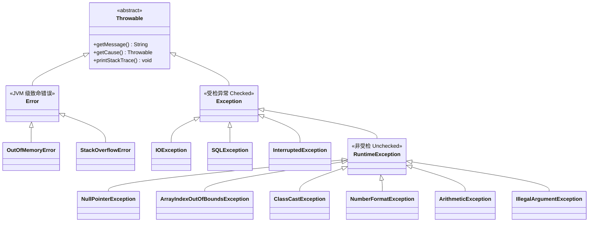
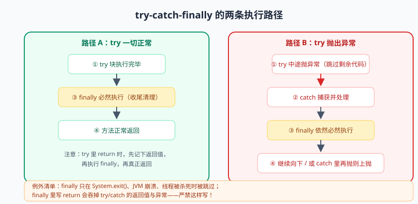

# 异常处理：优雅地搞砸事情

各位同学，先聊个人生话题：搞砸事情不可怕，可怕的是搞砸的方式。同样是摔跤，有人一个驴打滚起身拍拍灰顺便看眼周围有没有人；有人直接脸刹，还滑出去三米远。程序也一样——没有不出错的程序，只有出错时体面与狼狈之分。Java 的异常机制，就是教你的程序"摔得体面"的武术教程：摔了（抛出）、知道为啥摔（异常信息）、摔了之后原地爬起来还是进医院（捕获或上抛）、以及事发现场要保护好（资源释放、日志留底）。

很多学员对异常的态度是两个极端：要么怕得要死，见到红线就 `try-catch` 包一层求平安；要么横得要死，`catch (Exception e) {}` 吞了就当无事发生。这两种姿势，一个叫过度医疗，一个叫隐瞒病情，上了生产都是大坑。今天这节课，咱们把 Java 异常体系从头到尾捋顺：异常家族族谱、try-catch-finally 的千层套路、try-with-resources 的优雅退场、自定义异常的正确姿势，最后送你一份生产级最佳实践清单。

## 一、没有异常的世界：错误码的地狱

要理解异常的好，得先看看没有异常的世界有多惨。C 语言就是这个世界：函数出错只能靠**返回错误码**。比如一个"解析用户年龄"的函数：

```c
// C 语言风格：返回值既当数据又当错误码，灾难现场
int parseAge(const char* input, int* outAge) {
    if (input == NULL) return -1;      // -1 表示空指针
    if (!isdigitStr(input)) return -2; // -2 表示不是数字
    int v = atoi(input);
    if (v < 0 || v > 150) return -3;   // -3 表示范围不对
    *outAge = v;
    return 0;                           // 0 表示成功
}
```

这种写法的七宗罪：调用方**必须**检查返回值，但编译器不强制，忘了检查就埋雷；错误码和正常返回值挤同一个通道，语义靠猜；-1、-2、-3 是什么意思全靠注释和记忆力；错误无法携带上下文（哪里错的、原始输入是啥）；一层层向上传递错误码，业务代码被 if-return 淹没；多级调用拼错误码冲突（A 库 -1 是内存错，B 库 -1 是参数错）；没有调用栈信息，出了错不知道错在哪条路径上。

Java 的设计者说：正常逻辑和错误处理，凭啥挤一条道？于是有了异常机制——**错误走专门的高速通道（throw），正常代码保持清爽，错误信息自带全套上下文（类型、消息、堆栈）**，而且编译器还会强制你处理一部分异常（checked exception）。这就是"关注点分离"在错误处理上的胜利。

## 二、Throwable 家族树：认清每一个亲戚

Java 所有"能被抛出的东西"的老祖宗是 `java.lang.Throwable`，往下分两大支：`Error` 和 `Exception`。Exception 再分两支：受检异常（Checked）和非受检异常（Unchecked，即 RuntimeException 一系）。



三个分支，三种性格：

- **Error**：JVM 级的病危通知，比如 `OutOfMemoryError`（内存耗尽）、`StackOverflowError`（栈溢出，递归没写终止条件的经典结局）。这是"天灾"，应用程序**捕获了也救不了**，别 catch，让它死得干脆，然后去改根本原因。
- **受检异常（Checked Exception）**：`IOException`、`SQLException`、`InterruptedException` 这类**可预期、可恢复**的外部问题：文件不存在、网络断了、数据库挂了。编译器强制你 try-catch 或 throws 声明，不处理编译不过——父亲的关爱，虽然啰嗦但出发点是好的。
- **非受检异常（Unchecked Exception / RuntimeException）：**NPE、越界、类型转换失败这类**程序 bug**，理论上写对了代码就不该发生。编译器不强制处理，因为这是你自己的锅，修 bug 比到处 catch 更对。

> 📌 **划重点**：Error 别 catch（救不了）；Checked 异常要么处理要么上抛（编译器逼你）；RuntimeException 是代码 bug 的信号灯（修代码，别打补丁）。一句话——**天灾不救、外患要防、家丑要修**。

三大分支对比表，一张表认清三兄弟：

| 对比项 | Error | 受检异常 Checked | 非受检 Unchecked |
|--------|-------|------------------|------------------|
| 代表 | OOM、StackOverflowError | IOException、SQLException | NPE、越界、ClassCastException |
| 编译器态度 | 不管 | **强制处理**，不 try/throws 编译不过 | 不管，运行时才炸 |
| 性质 | 天灾（JVM 级故障） | 外患（外部环境问题） | 家丑（代码 bug） |
| 处理姿势 | 别 catch，改根本原因 | try-catch / throws，能恢复就恢复 | 修代码，而不是捕获了事 |

## 三、常见异常盘点：五大金刚逐个抓捕

这五位是你们日后生产日志里的常客，现在认识一下，混个脸熟，将来在堆栈里偶遇不至于叫不出名字：

```java
// 1. NullPointerException —— 空指针，Java 界第一大异常
String s = null;
s.length();                      // NPE！对 null 调用任何方法都会炸
Map<String, String> map = new HashMap<>();
map.get("name").length();        // get 返回 null，再调 length —— NPE 连环雷

// 2. ArrayIndexOutOfBoundsException —— 数组越界
int[] arr = new int[3];
arr[3] = 1;                      // 有效下标 0~2，访问 3 直接越界

// 3. ClassCastException —— 类型转换失败
Object obj = "I am a String";
Integer num = (Integer) obj;     // String 和 Integer 没有继承关系，强转炸！

// 4. NumberFormatException —— 数字格式错误
Integer.parseInt("12abc3");      // 不是纯数字（前后空格也不行），炸

// 5. ArithmeticException —— 算术异常（基本只有整数除零）
int r = 10 / 0;                  // 整数除以 0，炸！
double d = 10.0 / 0;             // 注意：浮点除 0 不炸，结果是 Infinity（IEEE 754 规范）
```

特别注意第五位：**浮点数除以零不抛异常**，返回 `Infinity` 或 `NaN`，这是个反直觉冷知识，多少人在这栽过跟头。还有第三位 ClassCastException，多半发生在从集合取元素强转时（`List` 没用泛型约束时高发），等下一篇泛型展开。

## 四、try-catch-finally：执行细节大起底


> 🖼️ **图解**：正常/异常两条执行路径，finally 永远在中间站岗

基础语法大家都会，咱们直接上"细节修罗场"——这几个问题面试考过无数人，答对了才算真懂。

**细节一：finally 一定执行吗？** 答：正常路径、异常路径、try 里 return，finally 都会执行；唯一的"逃生舱"是 `System.exit()`（JVM 直接退出，finally 拜拜）以及 JVM 崩溃、线程被杀这类极端情况。所以 finally 的定位是**资源释放的保底位置**。

**细节二：try 里 return，finally 还执行吗？** 执行，而且顺序有讲究：

```java
static String demo() {
    try {
        return "try 的返回值";
    } finally {
        System.out.println("finally 执行了");  // 会打印！在 return 之前
    }
}
// 输出：finally 执行了，然后方法返回 "try 的返回值"
// 执行顺序：try 的 return 表达式先求值并暂存 → 执行 finally → 用暂存值返回
```

**细节三：finally 里写 return——吞掉返回值的重罪。** 看反例：

```java
static int wrong() {
    try {
        return 1;
    } finally {
        return 2;      // 编译器只给警告，但这是灾难：finally 的 return 会"劫持"返回值！
    }
}
// wrong() 永远返回 2，try 里的 1 被无声吞掉

static int worse() {
    try {
        int x = 1 / 0;     // 抛 ArithmeticException
        return 1;
    } finally {
        return 2;          // 更狠：连 try 里抛出的异常都被吞了！
    }
}
// worse() 返回 2，异常凭空消失，排查问题时你会怀疑人生
```

**finally 里的 return / throw 会覆盖 try-catch 的一切**：覆盖正常返回值、吞掉异常。IDEA 会对 `finally` 里的 return 给 "finally block doesn't complete normally" 警告，看到这个警告请立刻消灭它。

**细节四：finally 修改返回值，基本类型和引用类型结局不同。**

```java
static int primitiveDemo() {
    int x = 1;
    try {
        return x;          // x 的值 1 已被复制暂存
    } finally {
        x = 99;            // 改的是局部变量，改不到暂存的那份
    }
}                          // 返回 1，不是 99！

static List<Integer> refDemo() {
    List<Integer> list = new ArrayList<>(List.of(1));
    try {
        return list;       // 暂存的是"引用"
    } finally {
        list.add(2);       // 通过引用改堆里的对象，改的是同一个对象！
    }
}                          // 调用方拿到 [1, 2]，改成功了！
```

原理一句话：**return 暂存的是"值"，基本类型暂存的是值的拷贝，引用类型暂存的是地址**。所以 finally 里改局部基本变量白改，通过引用改对象内容实改。这种代码谁写谁挨打——不是行为不对，是太绕，正常人读不懂。

> ⚠️ **踩坑实录**：学员写了个关闭连接的方法，在 finally 里 `return conn != null && conn.close() == 0;`，结果 try 里抛的 SQLException 被吞了，上游以为一切正常，数据根本没落库，排查了一整天。请把这条焊死在脑门上：**finally 里永远不要 return，也尽量不要 throw**，它只配干一件事——清理资源。

## 五、throws 与 throw：声明与抛出，一字母之差

这俩是双胞胎单词，作用完全不同，别混：

```java
/** throw：动词，方法体内"真的抛出去"一个异常对象，一次抛一个 */
static void checkAge(int age) {
    if (age < 0 || age > 150) {
        throw new IllegalArgumentException("年龄不合法: " + age);  // 此处起爆
    }
}

/** throws：声明，方法签名上"打招呼"：我可能抛这些异常，调用方你们看着办 */
static void readConfig(String path) throws IOException {
    Files.readString(Path.of(path));   // 可能抛 IOException，受检异常必须声明或捕获
}

/** 调用方两条路：接着 throws 往上传，或者 try-catch 就地处理 */
static void caller() {
    try {
        readConfig("/etc/app.conf");
    } catch (IOException e) {
        throw new RuntimeException("读取配置失败: /etc/app.conf", e);  // 包装上抛，注意带上 e
    }
}
```

记忆法：**throw 是"扔"这个动作，throws 是"预告片"**。另外注意 `new RuntimeException("...", e)` 的第二个参数——把原始异常作为 cause（原因）链上，堆栈不打断，排查能追根溯源。丢掉 cause 的包装等于毁尸灭迹，是常见大坑。

## 六、try-with-resources：优雅退场的正确姿势

资源（文件、数据库连接、网络套接字）用完必须关闭，老写法是 finally 里 close：

```java
// ---------- 老写法：又臭又长，还有坑 ----------
BufferedReader br = null;
try {
    br = new BufferedReader(new FileReader("app.conf"));
    return br.readLine();
} catch (IOException e) {
    throw new RuntimeException("读文件失败", e);
} finally {
    if (br != null) {
        try {
            br.close();          // close 自己也可能抛 IOException，还得再包一层 try
        } catch (IOException e) {
            throw new RuntimeException("关闭失败", e);  // 这里抛异常会吞掉上面的异常
        }
    }
}

// ---------- 新写法（try-with-resources）：声明在括号里，自动关闭 ----------
try (BufferedReader br2 = new BufferedReader(new FileReader("app.conf"))) {
    return br2.readLine();
} catch (IOException e) {
    throw new RuntimeException("读文件失败", e);
}
// 退出 try 块时（正常或异常），自动按声明**相反顺序**调用 close()

// JDK 9+ 还支持直接引用 effectively final 的变量
BufferedReader reader = Files.newBufferedReader(Path.of("app.conf"));
try (reader) {
    return reader.readLine();
}
```

它为什么能自动关闭？因为资源类实现了 `java.lang.AutoCloseable` 接口（`close()` 方法），编译器只是帮你生成了 finally 里调用 close 的代码。而且当 try 块和 close **都**抛异常时，close 的异常会被标记为 suppressed（受抑制异常）附在主异常上（可用 `e.getSuppressed()` 取出），不像手写 finally 那样互相覆盖。多个资源时，关闭顺序与声明顺序**相反**——后开的先关，跟栈一样，符合资源依赖逻辑。

> 💡 **老鸟忠告**：项目代码里凡是手写 `finally { xxx.close(); }` 的，一律重构成 try-with-resources；自己写的工具类如果持有资源，也实现 AutoCloseable，让调用方享受同等待遇。这是代码 Review 的硬标准之一。

## 七、自定义异常：业务异常体系设计

系统异常描述"技术故障"，业务异常描述"业务不行"——余额不足、库存不够、优惠券过期。这些用 IllegalArgumentException 表达就乱了套，正规军做法是**设计一套业务异常体系**：

```java
/** 异常体系基类：继承 RuntimeException（非受检），携带错误码 */
public class BaseException extends RuntimeException {
    private final String errorCode;

    public BaseException(String errorCode, String message) {
        super(message);
        this.errorCode = errorCode;
    }
    public BaseException(String errorCode, String message, Throwable cause) {
        super(message, cause);          // 保留 cause，别毁尸灭迹
        this.errorCode = errorCode;
    }
    public String getErrorCode() { return errorCode; }
}

/** 按业务域派生子类，见名知义 */
public class OrderException extends BaseException {
    public OrderException(String code, String msg) { super(code, msg); }
}
public class StockNotEnoughException extends OrderException {
    public StockNotEnoughException(String sku, long need, long left) {
        super("STOCK_001",
              String.format("库存不足: sku=%s, 需要=%d, 剩余=%d", sku, need, left)); // 异常信息带足上下文
    }
}

/** 业务代码里用起来 */
public void deductStock(String sku, long qty) {
    long left = stockRepo.count(sku);
    if (left < qty) {
        throw new StockNotEnoughException(sku, qty, left);  // 消息自带 sku 和数量，日志直接可查
    }
    stockRepo.deduct(sku, qty);
}
```

为什么基类继承 `RuntimeException` 而不是 `Exception`？因为业务异常在现代分层架构（Controller→Service→Dao）里注定要穿透 Service 直达全局处理器，如果继承 Checked 异常，每一层方法签名都得挂 `throws`，污染所有接口——Spring 全家桶的异常体系（`DataAccessException` 等）也全是 RuntimeException 一脉，跟随主流即可。

## 八、异常最佳实践清单：老鸟的七条铁律

最后上硬菜，这七条是我十年 Code Review 换来的，条条带血泪：

1. **不要吞异常。** `catch (Exception e) {}` 空捕获等于把报警器电池抠了——出事了没人知道，日志里一片祥和，线上炸成烟花。哪怕是暂时不处理，也至少 `log.warn("...", e)` 留个案底。
2. **不要 catch (Exception e) 一把梭。** 只捕获你能处理、打算处理的异常类型。捕获过宽会把本该暴露的 bug（NPE、越界）也捂在怀里，程序带病狂奔。
3. **异常信息要带上下文。** 别只 `throw new RuntimeException("失败")`——谁失败了？参数是什么？失败时状态如何？消息里把关键参数拼进去（如上面 StockNotEnoughException 的写法），排查时不用回放现场。
4. **throw 之后不要重复记日志。** 在一个方法里 `log.error` 又 throw，上层捕获后又 log 一遍——同一个异常在日志里刷屏 N 次，告警系统直接狼来了。惯例：**抛出方不记（或只 debug），最终捕获方记一次**。
5. **不要用异常控制流程。** 有人拿 `NumberFormatException` 当"是否为数字"的判断工具，循环里 try-catch 上百万次。异常对象构造要填堆栈（`fillInStackTrace` 是 native 方法，开销不小），性能远低于一次正则或判断。异常是"异常路径"，不是 if-else 的替代品。
6. **不要在 finally 里 return/throw**（第四节已鞭尸），以及优先 try-with-resources 释放资源。
7. **异常链要完整**：包装异常时把原始异常传进去当 cause，`throw new BizException("xx失败", e)`，别 `new BizException(e.toString())` 这种伪包装。

> ⚠️ **踩坑实录**：见过一段支付回调代码，catch 里写了 `catch (Exception e) { return "success"; }`——为了"不让上游重试"直接吞异常返回成功。结果第三方没收到货，钱退了，货发了，双向奔赴的血亏。吞异常不是稳定，是定时炸弹换了个更长的引线。

> 📌 **划重点**：异常处理的终极心法就八个字——**该抛就抛，该记就记**。底层抛具体异常，上层统一兜底转换，日志只在最终处理点记一次，资源交给 try-with-resources。做到这四点，你的程序摔得就比大多数人体面。

顺便预告一下：这套思想在 Spring 里进化成了**全局异常处理**——`@RestControllerAdvice` + `@ExceptionHandler` 一个类接管全项目异常，Controller/Service 里从此告别成片的 try-catch，输出统一的错误响应结构。等咱们到 Spring 篇时手把手写一个，这里先种个草。

## 本篇小结

- 错误码方案有七大罪，异常机制让正常逻辑与错误处理分离，还自带堆栈上下文；
- Throwable 三分支：Error（天灾别救）、Checked（受检要处理或声明）、RuntimeException（bug 要修代码）；
- 五大常见异常：NPE、数组越界、ClassCastException、NumberFormatException、ArithmeticException（浮点除零不炸，返回 Infinity）；
- finally 在正常、异常、try-return 路径都会执行，唯一大逃生舱是 System.exit；
- finally 里的 return 会吞掉 try 的返回值和异常，是重罪；finally 改基本类型返回值无效、改引用指向的对象有效；
- throw 是真抛，throws 是声明；包装异常必须带上原始 cause，保住异常链；
- try-with-resources 基于 AutoCloseable，自动逆序关闭、suppressed 机制不丢异常，完胜手写 finally close；
- 业务异常体系：BaseException 继承 RuntimeException + 错误码 + 子类按业务域派生，消息必须带上下文。

## 课后思考 & 动手练习

1. **概念题**：Error、Checked Exception、RuntimeException 三者分别对应什么性质的问题？为什么业务异常基类通常继承 RuntimeException 而不是 Exception？
2. **执行推演题**：写出下面方法的输出和返回值，然后运行验证：`try { return "A"; } finally { System.out.println("B"); }`；再改成 finally 里 `System.out.println` 之后 `return "C"`，返回值变成什么？try 里抛异常时后者又会发生什么？
3. **分析题**：为什么 `finally` 中修改基本类型局部变量不影响返回值，而修改对象内容却影响？请从"return 暂存的是什么"角度解释。
4. **编程题**：设计一个简易自定义异常体系：`BizException(String errorCode, String message)` 基类 + `UserNotFoundException`、`PasswordWrongException` 子类；写一个 `login(String username, String password)` 方法在登录失败时抛出对应异常，再写一个 `main` 用 try-catch-multi-catch 分别捕获并打印错误码和消息。
5. **编程题（进阶）**：实现一个 `LineCounter` 类（实现 AutoCloseable）统计文本文件行数，用 try-with-resources 使用它，在 `close()` 里故意抛一个 RuntimeException，验证 try 块正常时 close 的异常行为，并用 `getSuppressed()` 打印受抑制异常。

下一篇预告：**《泛型与反射：类型的编译期与运行时》**——编译器当保安的泛型、运行时透视镜的反射，框架世界的两块基石。类型擦除的真相、PECS 口诀、手写迷你依赖注入，咱们下期见。
