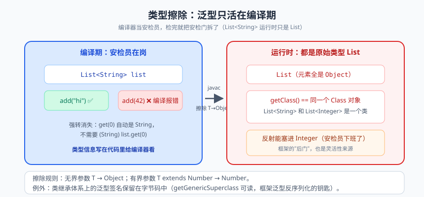
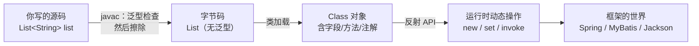

# 泛型与反射：类型的编译期与运行时

今天这两位主角，堪称 Java 世界里的"冰与火之歌"。

**泛型（Generics）** 是编译期的守护神：它站在编译器身边，盯着你别把 `String` 塞进 `List<Integer>`，天一黑（编译结束）它就下班回家了。**反射（Reflection）** 是运行时的透视镜：程序跑起来之后，它能把任何一个对象扒得明明白白——你 private 的字段、你藏起来的方法，它都能看见，甚至能改。

更有意思的是，这俩看似对立的技术，联手撑起了 Java 生态的半壁江山：Spring 的依赖注入、MyBatis 的 Mapper、Gson/Jackson 的 JSON 序列化、JUnit 的测试方法发现……背后全是"泛型擦除 + 运行时反射"的组合拳。学完这篇，你看框架的眼神都会变得清澈起来——原来所谓的"魔法"，不过如此。

---

## 一、泛型：编译期的安检员

### 1.1 没有泛型的世界有多惨

Java 5 之前没有泛型，集合里装的都是 `Object`。想用？先强转：

```java
List list = new ArrayList();      // 里面什么都能装，像个杂货铺
list.add("张三");
list.add(18);                     // 编译器：不关我事，反正都是 Object

String name = (String) list.get(0);  // 取出来必须强转
String age = (String) list.get(1);   // 第 2 个是 Integer，这里直接爆炸！
// 运行时：ClassCastException: java.lang.Integer cannot be cast to java.lang.String
```

注意看，这段代码**编译完全通过**，炸弹埋到了运行时才炸。而泛型的价值就是把这颗雷提前到编译期引爆：

```java
List<String> list = new ArrayList<>();
list.add("张三");
list.add(18);       // 编译器直接画红线：不兼容的类型
String name = list.get(0);  // 不用强转，类型安全
```

> 📌 **划重点**：泛型把类型检查从运行时提前到编译期，本质是"参数化类型"——把元素的类型当成参数传给容器，让编译器替你把关。

### 1.2 泛型类、泛型接口、泛型方法

```java
// 泛型类：T 是类型参数（Type 的首字母，约定俗成）
public class Box<T> {
    private T content;
    public void put(T item) { this.content = item; }
    public T get() { return content; }
}

Box<String> box = new Box<>();   // 菱形语法：右边尖括号可以留空，编译器自己推
box.put("Hello");

// 泛型接口：典型代表就是 Comparable<T>
public interface Comparable<T> {
    int compareTo(T other);
}

// 泛型方法：类型参数写在返回值前面，调用时自动推断
public static <K, V> Map<K, V> zip(List<K> keys, List<V> values) {
    Map<K, V> map = new HashMap<>();
    for (int i = 0; i < keys.size(); i++) {
        map.put(keys.get(i), values.get(i));
    }
    return map;
}

Map<String, Integer> m = zip(List.of("a", "b"), List.of(1, 2));  // 自动推断 K=String, V=Integer
```

常见类型参数命名约定：`T`（Type）、`E`（Element，集合用）、`K/V`（Key/Value，Map 用）、`R`（Result，返回值用）。这不是语法强制，是程序员的江湖默契。

三种泛型用法对比：

| 对比项 | 泛型类 | 泛型接口 | 泛型方法 |
|--------|--------|---------|---------|
| 声明位置 | 类名后 `class Box<T>` | 接口名后 `interface Comparable<T>` | 返回值前 `<K, V> Map<K,V> zip(...)` |
| 类型参数何时确定 | 创建实例时 `new Box<String>()` | 实现接口时 / 实现类继续泛型化 | **调用时自动推断** |
| 作用范围 | 整个类的成员 | 实现类的成员 | 仅方法内部（连静态方法也能用） |
| JDK 代表 | `ArrayList<E>`、`Optional<T>` | `Comparable<T>`、`List<E>` | `Collections.swap(List<?>, int, int)` |

### 1.3 类型擦除：泛型只活在编译期


> 🖼️ **图解**：泛型擦除：编译期严格安检，运行时都是裸 List

重点来了，也是面试最爱：**泛型信息在编译后会被"擦除"（Type Erasure）**。编译器编译完 `List<String>` 和 `List<Integer>`，它们在字节码里是**同一个类**。

不信？看证据：

```java
List<String> a = new ArrayList<>();
List<Integer> b = new ArrayList<>();
System.out.println(a.getClass() == b.getClass());   // true！同一个 Class 对象

// 编译器只会做"替换"：把 T 替换为限定类型（无限定时是 Object）
// Box<String> 和 Box<Integer> 的字节码里，content 字段的类型都是 Object
```

擦除规则可以概括为一句话：**无界类型参数擦成 `Object`，有界参数擦成边界类型**（如 `<T extends Number>` 擦成 `Number`）。所有对泛型的检查，都发生在编译期"擦除之前"；运行时 JVM 根本不知道 `List<String>` 这回事。

> ⚠️ **踩坑实录**：正因擦除的存在，下面这些代码统统编译不过——
> ```java
> new T();                        // 不知道 T 是谁，无法创建
> if (obj instanceof List<String>) {}  // 运行时分不清 List 里装什么
> List<int> list;                 // 泛型只能用引用类型，基本类型不行（得用 Integer）
> class Box<T> { static T field; }    // 静态成员属于类，不能引用类的泛型参数
> ```
> 想创建 T 的实例？老老实实把 `Class<T>` 传进来，用反射：`clazz.getDeclaredConstructor().newInstance()`。

### 1.4 通配符与 PECS：泛型里的"送花难题"

泛型不支持协变：`List<Object>` 不是 `List<String>` 的父类（因为擦除后它俩根本是同一个类，谈不上父子）。但有时我们确实需要"能装任何元素的 List"这种模糊表达，于是有了通配符 `?`：

```java
public static double sum(List<? extends Number> list) {   // 生产者：只读不写
    double total = 0;
    for (Number n : list) {
        total += n.doubleValue();
    }
    // list.add(1);  // 编译报错！不知道具体类型，不能写入
    return total;
}

public static void fill(List<? super Integer> list) {     // 消费者：只写不读（读出来只能当 Object）
    for (int i = 0; i < 10; i++) {
        list.add(i);   // 可以写 Integer：Integer 一定是 ? super Integer 的子类
    }
}
```

这就是著名的 **PECS 原则（Producer Extends, Consumer Super）**：

- 如果这个参数是**生产者**（往外掏数据给你读）：用 `? extends T`；
- 如果这个参数是**消费者**（你往里塞数据）：用 `? super T`。

> 💡 **老鸟忠告**：PECS 记不住就记场景——JDK 里 `Collections.copy(List<? super T> dest, List<? extends T> src)` 就是标准答案：src 是数据来源（生产者，extends），dest 是数据去处（消费者，super）。源码即教材。

---

## 二、反射：运行时的透视镜

### 2.1 什么是反射

普通调用是"正向"的：写代码时就知道要 new 谁、调哪个方法。**反射是"逆向"的：程序运行中，拿到一个类名或对象，动态地获取它的结构、调用它的方法、修改它的字段。**

好比参观工厂：普通方式是跟着导游走固定路线；反射是拿到了工厂的全套图纸，想去哪个车间去哪个车间，连仓库里上锁的房间（private）都能打开——`setAccessible(true)` 就是那把万能钥匙。

### 2.2 Class 对象：每个类的"身份证"

JVM 加载每个类时，都会在堆里创建一个对应的 `java.lang.Class` 对象，它是反射的入口。获取方式有三种：

```java
// 方式一：类名.class（编译期已知类型时用）
Class<String> c1 = String.class;

// 方式二：对象.getClass()（运行期拿到对象时用）
String s = "hello";
Class<?> c2 = s.getClass();

// 方式三：Class.forName("全限定名")（只有类名字符串时用，JDBC 驱动加载的经典写法）
Class<?> c3 = Class.forName("java.lang.String");

System.out.println(c1 == c2 && c2 == c3);  // true：一个类在同一个类加载器里只有一个 Class 对象
```

### 2.3 反射核心 API 走读

以一个普通的实体类为例，把反射的家底全过一遍：

```java
public class User {
    private String name;
    private int age;

    public User() {}                  // 无参构造
    public User(String name, int age) { this.name = name; this.age = age; }

    public String getName() { return name; }
    private void secret() { System.out.println("我是私有方法，也能被反射调用"); }
}
```

```java
// ① 拿构造器，创建对象
Class<User> clazz = User.class;
Constructor<User> ctor = clazz.getDeclaredConstructor(String.class, int.class);
User user = ctor.newInstance("张三", 25);   // 相当于 new User("张三", 25)

// ② 读写字段（包括 private）
Field nameField = clazz.getDeclaredField("name");
nameField.setAccessible(true);              // 突破 private 限制，"万能钥匙"
nameField.set(user, "李四");                 // 相当于 user.name = "李四"

// ③ 调用方法（包括 private）
Method secret = clazz.getDeclaredMethod("secret");
secret.setAccessible(true);
secret.invoke(user);                        // 输出：我是私有方法，也能被反射调用

// ④ 批量获取结构信息
Field[] fields = clazz.getDeclaredFields();        // 所有字段
Method[] methods = clazz.getDeclaredMethods();     // 所有方法
for (Field f : fields) {
    System.out.println(f.getName() + " : " + f.getType().getSimpleName());
}
```

### 2.4 实战：手写一个 30 行的"迷你依赖注入"

反射真正的威力在于写"通用框架"。咱们用泛型 + 反射模拟一下 Spring 依赖注入的核心原理，给框架"祛魅"：

```java
// 自定义注解，模拟 @Autowired
@Retention(RetentionPolicy.RUNTIME)   // 关键：运行期保留，反射才能读到
@Target(ElementType.FIELD)
public @interface Inject {}

// 迷你容器：扫描 → 实例化 → 注入
public class MiniIoc {
    private static final Map<Class<?>, Object> BEANS = new HashMap<>();

    public static <T> T getBean(Class<T> clazz) throws Exception {
        if (BEANS.containsKey(clazz)) return clazz.cast(BEANS.get(clazz));

        T instance = clazz.getDeclaredConstructor().newInstance();  // 反射创建实例
        BEANS.put(clazz, instance);                                  // 先放入容器（简化处理，忽略循环依赖）

        for (Field field : clazz.getDeclaredFields()) {              // 遍历字段找 @Inject
            if (field.isAnnotationPresent(Inject.class)) {
                Class<?> fieldType = field.getType();
                Object dependency = getBean(fieldType);              // 递归获取依赖
                field.setAccessible(true);
                field.set(instance, dependency);                     // 反射注入字段
            }
        }
        return instance;
    }
}

// 使用：OrderService 里注入 UserService，一行代码都不用手动 new
class OrderService {
    @Inject private UserService userService;
    public void createOrder() { System.out.println("下单时调用：" + userService.hello()); }
}
// MiniIoc.getBean(OrderService.class).createOrder();
```

Spring 的 IoC 容器比这复杂一万倍，但**灵魂就这三步：反射创建 Bean、扫描注解、反射注入依赖**。所谓框架，不过是用反射替你干了"体力活"。

### 2.5 泛型 + 反射的经典配合：TypeReference 套路

类型擦除说泛型运行时拿不到，那 `new TypeReference<List<User>>(){}` 为什么能拿到泛型？秘密在于：**类的泛型签名（父类、接口的泛型参数）会被写进字节码，通过匿名子类 + `getGenericSuperclass()` 就能读到**：

```java
public abstract class TypeReference<T> {
    private final Type type;

    public TypeReference() {
        // getGenericSuperclass() 拿到带泛型信息的父类型 ParameterizedType
        Type superClass = getClass().getGenericSuperclass();
        this.type = ((ParameterizedType) superClass).getActualTypeArguments()[0];
    }
    public Type getType() { return type; }
}

// 匿名子类：编译器会把 List<User> 这个签名固化到字节码里
TypeReference<List<User>> ref = new TypeReference<List<User>>() {};
System.out.println(ref.getType());   // java.util.List<com.example.User>

// Jackson/Retrofit/fastjson 的泛型反序列化，全靠这一招：
// JSON 字符串 → List<User>，泛型信息一个都不丢
```

> 📌 **划重点**：泛型擦除擦的是"字段、方法参数上的泛型"；**类的继承体系上的泛型签名会保留在字节码中**，可通过 `getGenericSuperclass()` / `getGenericInterfaces()` 在运行时获取。这就是各大框架泛型操作的底层密码。

### 2.6 反射的代价：能力越大，责任越大

- **性能开销**：反射调用比直接调用慢（方法查找、装箱拆箱、安全检查），高频调用场景（每秒百万次）要谨慎。框架的做法是"反射一次，缓存 Method 对象"，或者像 Spring 那样用字节码增强（CGLIB、反射元数据缓存）摊薄成本；
- **破坏封装**：`setAccessible(true)` 绕过 private 访问控制，等于跳过了类的自我保护；
- **模块化限制**：JDK 9+ 引入模块系统后，反射访问 JDK 内部 API 会收到警告甚至被拒绝（`--add-opens` 是常见的绕行方式）；
- **与泛型的边界**：反射也拿不到被擦除的字段级泛型（只能拿通配的 Object），除非走 2.5 的继承签名路线。

---

## 三、一张图收尾：编译期与运行时的分工



泛型管编译期安全，反射管运行时灵活，一个负责"锁门"，一个负责"万能钥匙"——门锁是防小人的，钥匙是防自己没辙的。

---

## 本篇小结

- 泛型把类型检查提前到编译期，本质是参数化类型；编译后泛型信息被**擦除**，`List<String>` 与 `List<Integer>` 运行时是同一个类；
- 通配符遵循 **PECS 原则**：生产者用 `? extends T`，消费者用 `? super T`；
- 擦除导致 `new T()`、`instanceof 泛型`、基本类型泛型参数都不可行；
- 反射通过 `Class` 对象在运行时透视类结构：Constructor / Method / Field 三大件 + `setAccessible(true)` 突破私有；
- 框架的核心套路 = 反射创建对象 + 扫描注解 + 反射注入，30 行就能写个迷你 IoC；
- 类继承体系上的泛型签名保留在字节码中，`getGenericSuperclass()` 是运行时获取泛型的标准姿势；
- 反射有性能开销且破坏封装，高频路径要缓存 Method、慎用 setAccessible。

## 课后思考 & 动手练习

1. （概念）为什么 `List<String>` 不能赋值给 `List<Object>`？这和数组的协变（`String[]` 可以赋给 `Object[]`）有什么不同？
2. （概念）PECS 原则中，`? extends` 和 `? super` 分别为什么不能写入、不能按具体类型读取？
3. （找茬）`new ArrayList<?>()`、`static T field`、`if (x instanceof Box<String>)` 三段代码，哪些编译不过？为什么？
4. （动手）用反射写一个 `ObjectPrinter`：接收任意对象，打印其所有字段名与字段值（含 private 字段），用 User 类和 Book 类各测试一次。
5. （动手·进阶）给本篇的 MiniIoc 增加"单例"和"构造器注入"支持：扫描构造器参数类型，递归创建依赖后调用构造器生成实例。测试 OrderService → UserService → MailService 三层注入。

> 下一篇预告：基础篇到此圆满收官！接下来进入**进阶篇**——第一炮《多线程（一）：万物皆可 Thread》。你的 CPU 有好几个核，而你写的代码只用了其中一个，是时候唤醒它们了。系好安全带！
