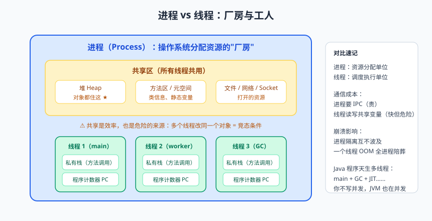
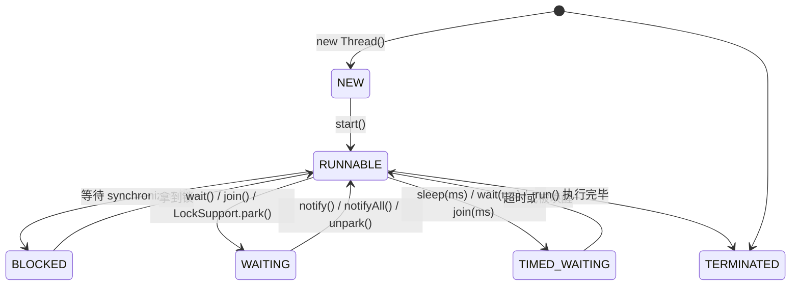

# 多线程（一）：万物皆可 Thread

先讲个真事。早年间我在一家公司做报表导出，一张 Excel 要导 5 万行数据，代码写完一跑——用户界面上那个小圈圈转了 40 秒。我盯着 CPU 监控一看，好家伙：**服务器 16 个核，15 个在睡觉，就 1 个核累得满头大汗**。后来改成 8 个线程分片导出，5 秒搞定。

这个故事想说明一件事：**并发（Concurrency）不是面试官发明的酷刑，而是把硬件榨出油的现实手段。** 从这篇开始，咱们正式进入 Java 进阶篇的第一座大山——多线程。它是初级工程师和中级工程师的分水岭，也是面试修罗场的常驻嘉宾。

别慌，山要一座座爬。今天这篇是热身：搞懂线程是什么、怎么创建、什么状态、以及"线程安全"这四个字到底在说什么。

---

## 一、为什么需要多线程？

理由千千万，归根结底就两条：

1. **提速**：现代 CPU 都是多核的。单线程程序就像只有一个服务员的餐厅，CPU 的其他核心全在嗑瓜子。多线程能把任务拆给多个核同时干；
2. **避免浪费**：程序经常在"等"——等数据库返回、等网络响应、等磁盘读写。等待时线程会阻塞（Block），CPU 就闲了。多线程可以让 A 线程等待时，B 线程顶上，**让 CPU 别闲着**。

打个比方：烧水泡茶。单线程的做法是——烧水（干等 10 分钟）→ 洗茶壶 → 洗茶杯 → 泡茶。多线程的做法是——点火烧上水（水壶自己干它的），同时去洗壶洗杯，水开了直接泡。**时间被"等待"摊薄了**，这就是并发最朴素的价值。

### 进程 vs 线程：先分清两位主角


> 🖼️ **图解**：进程=厂房、线程=工人：共享堆与私有栈的边界

| 对比项 | 进程（Process） | 线程（Thread） |
|--------|----------------|----------------|
| 本质 | 操作系统**资源分配**的基本单位 | CPU **调度执行**的基本单位 |
| 内存 | 拥有独立的内存空间 | 共享所属进程的内存（堆、方法区） |
| 通信 | 需要 IPC（管道/消息队列等），成本高 | 直接读写共享变量，简单但危险 |
| 崩溃影响 | 一个进程挂了，别的进程一般没事 | 一个线程崩了（如 OOM），整个进程陪葬 |
| 类比 | 一栋厂房 | 厂房里的一个工人 |

一句话：**进程是房子，线程是住户。多个住户共享房子里的客厅（堆内存），但每人有自己的卧室（栈内存）。** Java 程序天生就是多线程的——哪怕你一行多线程代码都没写，JVM 启动时就有一堆线程在跑（main 线程、GC 线程、JIT 编译线程……）。

---

## 二、创建线程的三种姿势

### 2.1 姿势一：继承 Thread

```java
public class MyThread extends Thread {
    @Override
    public void run() {                       // 重写 run：线程要干的活写在这里
        System.out.println(Thread.currentThread().getName() + " 正在干活");
    }
}

MyThread t = new MyThread();
t.start();                                    // 注意：是 start，不是 run！
```

简单直接，但缺点明显：Java 单继承，你的类继承了 Thread 就不能再继承别的类了。**不推荐。**

### 2.2 姿势二：实现 Runnable（推荐）

```java
public class MyTask implements Runnable {
    @Override
    public void run() {
        System.out.println(Thread.currentThread().getName() + " 正在干活");
    }
}

Thread t = new Thread(new MyTask(), "worker-1");
t.start();
```

或者用 Lambda 更清爽（Runnable 是函数式接口）：

```java
Thread t = new Thread(() -> System.out.println("干活"), "worker-1");
t.start();
```

推荐它的理由：**任务（Runnable）和执行者（Thread）解耦**——同一个任务可以交给不同的线程执行，也可以扔给线程池复用。

### 2.3 姿势三：实现 Callable + FutureTask（带返回值）

Runnable 的 `run()` 是 void，干完活拿不到结果。想拿返回值、想感知异常，用 `Callable`：

```java
// Callable<V>：V 是返回值类型，call() 可以抛受检异常
Callable<Integer> task = () -> {
    Thread.sleep(1000);                       // 模拟耗时计算
    return 42;
};

FutureTask<Integer> futureTask = new FutureTask<>(task);
new Thread(futureTask, "calculator").start();

Integer result = futureTask.get();            // 阻塞等待结果（最多等 1 秒）
System.out.println("计算结果：" + result);
```

### 三种姿势对比

| 方式 | 返回值 | 异常 | 继承限制 | 推荐度 |
|------|--------|------|---------|--------|
| 继承 Thread | 无 | run 只能抛运行时异常 | 占用唯一继承名额 | ⭐⭐ |
| 实现 Runnable | 无 | 同上 | 无 | ⭐⭐⭐⭐⭐ |
| 实现 Callable | 有（Future.get） | call 可抛受检异常 | 无 | ⭐⭐⭐⭐⭐（需要结果时） |

> 📌 **划重点**：实际开发里几乎不会手动 new Thread，而是把 Runnable/Callable 交给**线程池**（第三篇细讲）。但无论哪种方式，最终执行任务的载体都是 Thread——所以这三种写法是理解一切并发工具的地基。

### 2.4 start() vs run()：天壤之别

新手必踩的第一坑：

```java
Thread t = new Thread(() -> System.out.println("干活"), "worker-1");
t.run();   // ❌ 这只是普通方法调用！在当前线程（main）里同步执行，根本没有新线程
t.start(); // ✅ 向 JVM 申请启动新线程，由新线程去执行 run()
```

`start()` 做的事是：请求 JVM 创建新线程、新线程做好准备工作后再调用 run()。**一个 Thread 对象只能 start 一次**，第二次 start 会抛 `IllegalThreadStateException`。

> ⚠️ **踩坑实录**：曾有同学排查"多线程没生效"排查了一下午，最后发现调的是 run()。控制台打印的线程名都是 main，代码却在"并发"，性能毫无变化——因为压根就是单线程串行跑。**判断线程有没有真开起来，看 `Thread.currentThread().getName()` 的输出，别靠感觉。**

---

## 三、Thread 常用 API 速览

```java
Thread t = new Thread(() -> {...}, "worker-1");

t.getName();                  // 获取线程名，排查问题时非常有用
t.setName("worker-2");        // 改名
t.setPriority(Thread.NORM_PRIORITY);  // 优先级 1~10，只是"建议"，别依赖
t.setDaemon(true);            // 设为守护线程，必须在线程 start 之前设置
t.join();                     // 等待 t 执行结束（当前线程阻塞）
t.interrupt();                // 中断 t（协作式，不是强杀）
Thread.sleep(1000);           // 当前线程睡 1 秒（静态方法，睡的是"当前"线程）
Thread.yield();               // 当前线程让出 CPU（建议，不保证）
```

几个容易考的细节：

- **`interrupt()` 是"拍肩膀"不是"枪毙"**：它只是设置线程的中断标志位。如果线程正在 sleep/wait/join，会被"叫醒"并抛出 `InterruptedException`。**终止线程的正确姿势是"请求 + 响应"**：

```java
Thread worker = new Thread(() -> {
    while (!Thread.currentThread().isInterrupted()) {   // 每轮检查中断标志
        System.out.println("干活中...");
        try {
            Thread.sleep(500);
        } catch (InterruptedException e) {
            // sleep 被中断会清除标志位并抛异常，这里重新设置，让循环条件生效
            Thread.currentThread().interrupt();
            System.out.println("收到中断信号，收拾东西下班");
        }
    }
});
worker.start();
Thread.sleep(2000);
worker.interrupt();   // 主线程"拍肩膀"：兄弟，该下班了
```

- **守护线程（Daemon）**：为其他线程服务的线程（典型如 GC 线程）。**当所有用户线程结束，守护线程会随 JVM 一起消亡**——所以千万别把要写数据的任务放守护线程里，写到一半 JVM 撤了，数据就废了。

---

## 四、线程生命周期：六种状态



对应 `Thread.State` 枚举的六种状态：

| 状态 | 含义 | 进入方式 |
|------|------|---------|
| NEW | 创建了但没 start | `new Thread()` |
| RUNNABLE | 可运行（就绪/运行中，Java 把俩合在一起了） | `start()` |
| BLOCKED | 等待拿 synchronized 锁 | 进入 synchronized 块但锁被占 |
| WAITING | 无限期等待，等人唤醒 | `wait()` / `join()` / `LockSupport.park()` |
| TIMED_WAITING | 限时等待 | `sleep(ms)` / `wait(ms)` / `join(ms)` |
| TERMINATED | 运行结束 | run() 结束（正常或异常） |

注意两个易错点：**`Thread.sleep()` 不释放锁**（抱着锁睡觉，别人干瞪眼）；**`wait()` 会释放锁**（必须写在 synchronized 块里，且由锁对象调用）。

### wait/notify vs sleep 对比（高频面试题）

| 对比项 | wait()/notify() | Thread.sleep() |
|--------|-----------------|----------------|
| 所属 | Object 的方法 | Thread 的静态方法 |
| 释放锁 | **释放** | **不释放** |
| 前提 | 必须在 synchronized 内，由锁对象调用 | 无要求 |
| 唤醒 | notify/notifyAll/超时 | 时间到 |

---

## 五、线程安全初体验：经典卖票事故

多线程的"爽"到此为止，接下来看看它的"毒"。多个线程共享变量时，**读-改-写**不是原子的，事故就来了：

```java
public class TicketSeller implements Runnable {
    private int tickets = 100;                       // 所有线程共享的变量

    @Override
    public void run() {
        while (true) {
            if (tickets <= 0) break;
            try { Thread.sleep(10); }                // 放大问题：模拟出票耗时
            catch (InterruptedException e) { return; }

            System.out.println(Thread.currentThread().getName()
                    + " 卖出第 " + tickets-- + " 张票");   // 卖票 + 减一
        }
    }
}

public static void main(String[] args) {
    TicketSeller seller = new TicketSeller();        // 一个卖票员，四个窗口
    new Thread(seller, "窗口1").start();
    new Thread(seller, "窗口2").start();
    new Thread(seller, "窗口3").start();
    new Thread(seller, "窗口4").start();
}
```

跑几轮你就会看到灵异事件：**同一张票卖给了两个窗口，甚至卖出"第 0 张票"、"第 -1 张票"**。

原因：`tickets--` 这行代码在字节码层面是三步——读取 tickets、减 1、写回内存。窗口 1 刚读完 100 还没写回，窗口 2 也读到了 100，俩窗口都把"100 号票"卖出去了。这就是**竞态条件（Race Condition）**。

### 解药：synchronized 初见

最直接的解法是给代码块上锁——同一时刻只允许一个线程进入：

```java
public class TicketSeller implements Runnable {
    private int tickets = 100;
    private final Object lock = new Object();        // 专门的锁对象

    @Override
    public void run() {
        while (true) {
            synchronized (lock) {                    // 拿到锁才能进，其他人阻塞排队
                if (tickets <= 0) break;
                System.out.println(Thread.currentThread().getName()
                        + " 卖出第 " + tickets-- + " 张票");
            }
            // 锁外面的耗时代码不占锁，其他线程还能干活（锁粒度要小）
        }
    }
}
```

synchronized 有三种用法：**同步代码块**（锁指定对象，推荐）、**同步方法**（非静态锁 this，静态锁 Class 对象）、**静态同步方法**。细节原理（monitor、锁升级）咱们下一篇细讲，今天记住一句话：

> 📌 **划重点**：多个线程读写同一个共享可变变量时，就可能发生竞态条件。解决思路无非两条路：**互斥访问**（synchronized/Lock，排队来）或 **避免共享**（ThreadLocal/不可变对象/无锁 CAS）。

> 💡 **老鸟忠告**：判断"要不要考虑线程安全"，灵魂三问——①有没有多个线程？②它们是否共享同一个变量？③有线程要"写"吗？三问全"是"才需要处理。别一上来就无脑加锁，锁是性能杀手，加错了还容易死锁。

---

## 本篇小结

- 多线程的两大价值：榨干多核 CPU、让 CPU 在等待时不闲着；
- 进程是资源分配单位，线程是调度执行单位；线程共享进程的堆，拥有独立栈；
- 创建线程推荐实现 Runnable/Callable（解耦、可进线程池），start() 才会真正开新线程，run() 只是普通方法调用；
- interrupt 是协作式中断："设置标志 + 线程自查"，不强杀；守护线程随 JVM 消亡，别放关键任务；
- 六种线程状态要能画出来；sleep 不放锁，wait 放锁；
- 共享变量的"读-改-写"不是原子的，会产生竞态条件；synchronized 互斥是第一解药。

## 课后思考 & 动手练习

1. （概念）为什么调用 start() 之后再调用一次会抛异常，而一个 Runnable 可以交给多个 Thread 使用？
2. （概念）守护线程和用户线程的区别是什么？什么场景用守护线程？
3. （概念）sleep 和 wait 有哪三个本质区别？
4. （动手）起 3 个线程分别打印 "A"、"B"、"C" 各 10 次，观察输出的乱序；再用 join() 让它们严格按 A→B→C 顺序执行。
5. （动手·进阶）复现本文的卖票事故，故意放大 sleep 时间观察负数票；分别用"同步代码块"和"同步方法"修复它，并思考：如果把 `while(true)` 整个包进 synchronized，性能会有什么变化？为什么？

> 下一篇预告：《多线程（二）：JMM、volatile 与锁升级》——为什么你的线程"看不见"另一个线程修改的变量？volatile 到底有没有用？synchronized 的锁竟然会"膨胀"？咱们潜入 Java 内存模型的水底看看。
