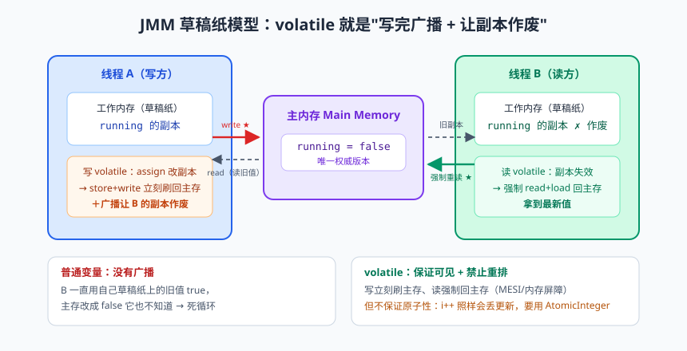
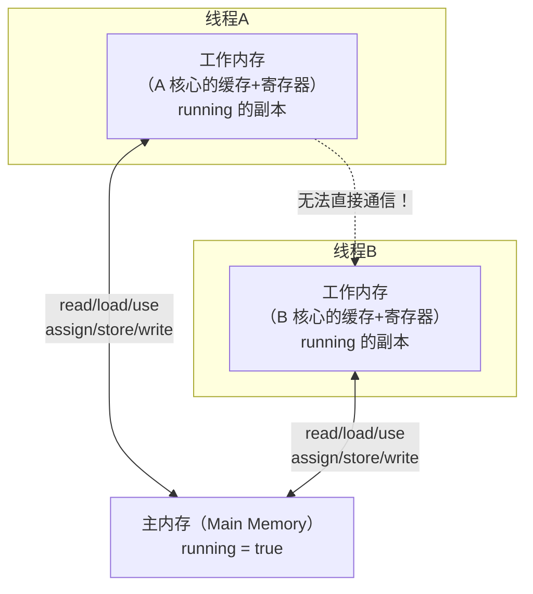
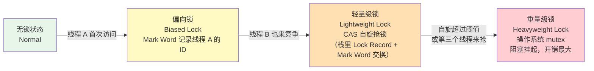

# 多线程（二）：JMM、volatile 与锁升级

先看一段"灵异代码"：

```java
public class GhostDemo {
    static boolean running = true;                 // 一个普普通通的开关

    public static void main(String[] args) throws Exception {
        Thread worker = new Thread(() -> {
            while (running) {                       // 主线程改了 running，它却"看不见"
                // 空转
            }
            System.out.println("worker 结束");
        });
        worker.start();
        Thread.sleep(1000);
        running = false;                            // 主线程：把开关关了
        System.out.println("main 已把 running 置为 false");
        // 大概率的现象：main 打印完，worker 还在疯狂空转，程序不退出！
    }
}
```

main 线程明明把 `running` 改成了 false，worker 线程就像瞎了一样死循环。这不是 bug，这是**特性**——JMM（Java 内存模型）的"剧本"就是如此。今天这篇，咱们就把这个"灵异事件"的原理彻底搞明白，顺便拿下三个面试高频：**volatile、锁升级、CAS**。

---

## 一、JMM：主内存与工作内存的"草稿纸模型"


> 🖼️ **图解**：主内存/工作内存草稿纸模型与 volatile 的"写后广播"

现代 CPU 的速度和内存的速度差着几个数量级，为了填补这个鸿沟，CPU 和内存之间架了好几层**缓存（Cache）**。每个 CPU 核心都有自己的高速缓存，于是问题来了：



Java 内存模型（Java Memory Model，JMM）把这个硬件现实抽象成了两条规则：

1. 所有共享变量都存在**主内存**；
2. 每个线程有自己的**工作内存**（可理解为 CPU 缓存 + 寄存器的抽象），线程对变量的操作必须在工作内存进行：先从主内存拷贝副本 → 改副本 → 刷回主内存。**线程 A 和线程 B 不能直接访问对方的工作内存。**

回到开头的灵异事件：worker 线程把 `running` 读进自己的工作内存后，JIT 编译器发现循环里没人动它，干脆一直用工作内存里的副本（true），再也不去主内存看一眼。main 改的是自己的副本再刷回主内存，worker 压根不知道。这就是**可见性问题（Visibility）**。

### 并发 bug 的三大来源

| 问题 | 含义 | 通俗版 |
|------|------|--------|
| 原子性（Atomicity） | 操作不可分割，中途不能被打扰 | `i++` 实际是"读-加-写"三步，两线程同时 i++ 会丢一次 |
| 可见性（Visibility） | 一个线程的修改，另一个线程能立刻看到 | 你改了会议室白板，我在小黑屋看的是旧照片 |
| 有序性（Ordering） | 代码执行顺序符合预期 | CPU/编译器会指令重排，单线程结果不变，多线程可能翻天 |

三者由谁保证，一张表说清：

| 目标 | 手段 |
|------|------|
| 原子性 | synchronized、Lock、CAS（AtomicXxx）、long/double 外的基本类型读写天然原子 |
| 可见性 | volatile、synchronized、final（正确发布）、Lock |
| 有序性 | volatile、synchronized、Lock |

### happens-before：判断可见性的"法律条文"

JMM 不要求你背下所有底层细节，它给了一套用户视角的规则——**happens-before（hb）**：如果操作 A happens-before 操作 B，那么 A 的结果对 B 可见。常用的几条：

1. **程序顺序规则**：单线程内，前面的操作 hb 后面的操作（看着是顺序执行的效果）；
2. **监视器锁规则**：解锁 hb 后续对同一把锁的加锁；
3. **volatile 规则**：对 volatile 变量的写 hb 后续对它的读；
4. **线程启动规则**：`Thread.start()` hb 该线程内的所有操作（所以启动前设置的变量，子线程一定看得见）；
5. **传递性**：A hb B，B hb C，则 A hb C。

> 📌 **划重点**：happens-before 不是"时间上先发生"，而是"结果上保证可见"。有了这五条规则，你不用研究 CPU 缓存协议也能推理多线程代码的正确性——这是 JLS（Java 语言规范）跟程序员签的合同。

---

## 二、volatile：轻量级的"广播电台"

给 `running` 加上 volatile，灵异事件立刻消失：

```java
static volatile boolean running = true;   // 加一个关键字
```

volatile 的语义：**一个线程修改 volatile 变量后，新值立刻刷回主内存并让其他线程的副本失效；其他线程读取时必须去主内存拿最新值。** 相当于每次写都拿着大喇叭广播："各位，值变了，都来重新抄！"

volatile 提供两个保证：

1. **可见性**：写立即对其他线程可见；
2. **禁止指令重排**：编译器和 CPU 不许把 volatile 前后的代码"乱序"到影响语义的程度（底层靠内存屏障 Memory Barrier 实现）。

### volatile 不保证原子性（必考！）

```java
public class VolatileNotAtomic {
    static volatile int count = 0;

    public static void main(String[] args) throws Exception {
        Runnable task = () -> {
            for (int i = 0; i < 10000; i++) {
                count++;                        // volatile 也救不了它
            }
        };
        Thread t1 = new Thread(task), t2 = new Thread(task);
        t1.start(); t2.start();
        t1.join(); t2.join();
        System.out.println(count);              // 期望 20000，实际几乎必然小于 20000
    }
}
```

为什么？`count++` 是三步舞：读最新值（比如 5）→ 加 1 → 写回 6。两个线程可以同时读到 5，各自加出 6，写回两次 6——一次更新白白蒸发。volatile 只保证每次"读"都拿到最新值、每次"写"都立刻广播，但它管不住"两步之间被人插队"。

> ⚠️ **踩坑实录**：volatile 的适用场景是**一个线程写、多个线程读**的状态标志位（如开关、配置热更新标记）。多人同时写一个 volatile 计数器，是新手最经典的误用。要原子自增，用 `AtomicInteger`（下面讲 CAS）或者锁。

### volatile 的巅峰应用：DCL 双重检查锁单例

volatile 禁止重排的特性，在"双重检查锁（Double-Checked Locking）单例"里是**保命的**：

```java
public class Singleton {
    private static volatile Singleton instance;    // 没有 volatile，这个单例就是半成品！

    private Singleton() {}

    public static Singleton getInstance() {
        if (instance == null) {                    // 第一次检查：没锁，快速通过（已创建时零开销）
            synchronized (Singleton.class) {
                if (instance == null) {            // 第二次检查：拿到锁后再确认一次
                    instance = new Singleton();
                }
            }
        }
        return instance;
    }
}
```

为什么必须 volatile？因为 `new Singleton()` 不是一步到位，它分三步：

1. 分配内存；
2. 调用构造器初始化对象；
3. 把内存地址赋给 instance。

CPU 可能**把 2 和 3 重排**（先赋地址再初始化）。线程 A 执行到"3 已完成、2 还没做"的瞬间，线程 B 在第一次检查处看到 instance != null，兴冲冲拿走一个**"半成品对象"**——字段全是默认值，用它就是玄学 bug。volatile 禁止这个重排，杜绝半成品出厂。

> 📌 **划重点**：单例的完整答案链——饿汉（类加载即创建，简单粗暴）→ 懒汉（用时再创建，但要防并发）→ **DCL（volatile + 双重检查，高性能懒加载）** → 静态内部类（JVM 类加载机制天然保证线程安全，推荐）→ 枚举（《Effective Java》钦定，还能防反射攻击）。面试按这个演进讲，分数拉满。

---

## 三、synchronized 的真面目：monitor 与锁升级

上一篇我们把 synchronized 当黑盒用，现在拆开看。synchronized 的底层依赖每个对象自带的 **monitor（监视器锁）**，字节码层面表现为 `monitorenter` / `monitorexit` 指令。monitor 依赖操作系统的**互斥量（Mutex Lock）**实现——这意味着一个线程拿不到锁时，要被"挂起 → 恢复"，涉及用户态/内核态切换，**成本很高**（重量级锁的名字就这么来的）。

JDK 6 的工程师为了优化，搞出了"锁升级"机制——锁的信息藏在**对象头（Object Header）的 Mark Word** 里，状态从乐观到悲观逐级退化：



| 锁状态 | 适用场景 | 原理 | 开销 |
|--------|---------|------|------|
| 偏向锁 | 只有一个线程反复拿锁（实际多数锁属于这种情况） | Mark Word 记下线程 ID，下次同一线程来了直接进，连 CAS 都省了 | 最小 |
| 轻量级锁 | 少量线程交替拿锁，竞争不激烈且持锁时间短 | 线程在自己的栈帧里建 Lock Record，CAS 把 Mark Word 指向它；抢不到就**自旋**（空转重试）等一会儿 | 自旋耗 CPU，但不涉及内核切换 |
| 重量级锁 | 竞争激烈、持锁时间长 | 自旋是浪费（CPU 空转不如让给别人），升级为 monitor，抢不到的线程挂起排队 | 最大 |

几个要点：

- 升级是**单向的**，不能降级（有批量重偏向、批量撤销等补丁机制，了解即可）；
- JDK 15 起**默认废弃了偏向锁**（默认轻量级起步）——因为维护成本高、收益在现代高并发场景变小。面试提一句这个演进，加分；
- 自适应自旋：JVM 会根据上一次自旋是否成功，动态调整自旋次数，越用越聪明。

---

## 四、CAS：无锁编程的基石

synchronized 是"悲观派"：先假设人人跟我抢，进门先上锁。还有一派"乐观派"：先干活，提交时看看有没有人抢先——这就是 **CAS（Compare And Swap，比较并交换）**。

CAS 是一条 CPU 级别的原子指令（x86 的 `cmpxchg`），语义是三件事一步完成：**"我认为变量 V 的值应该是 A，如果是，就把它改成 B；如果不是，说明有人抢先了，告诉我现在的值，我重试。"**

JDK 里由 `Unsafe` 类提供入口，`AtomicInteger` 就是靠它实现无锁原子自增：

```java
public class AtomicIntegerDemo {
    static AtomicInteger count = new AtomicInteger(0);

    public static void main(String[] args) throws Exception {
        Runnable task = () -> {
            for (int i = 0; i < 10000; i++) {
                count.incrementAndGet();   // CAS 循环：拿旧值→+1→CAS 写回，失败就重试
            }
        };
        Thread t1 = new Thread(task), t2 = new Thread(task);
        t1.start(); t2.start();
        t1.join(); t2.join();
        System.out.println(count.get());   // 稳定输出 20000，volatile 版本做不到
    }
}
```

手写一个 CAS 风格的重试（感受思想）：

```java
public static int casAdd(AtomicInteger atomic) {
    int oldVal, newVal;
    do {
        oldVal = atomic.get();         // 读旧值
        newVal = oldVal + 1;           // 算新值
    } while (!atomic.compareAndSet(oldVal, newVal));  // CAS 失败说明被人抢先，重读重试
    return newVal;
}
```

### CAS 的三大软肋

1. **ABA 问题**：线程 1 读到 A，线程 2 把 A 改成 B 又改回 A。线程 1 CAS 时发现"还是 A"，成功写入——但它错过了"A 曾经变过"这个事实。数值版无关痛痒，**引用版可能出大事**（对象内部已被改得面目全非，指针却"没变"）。解法：带版本号——`AtomicStampedReference`（比较"值+版本戳"）；
2. **自旋开销**：竞争激烈时 CAS 一直失败一直重试，CPU 空转烧得发红。高写入竞争场景，`LongAdder`（分段累加，空间换时间）比 `AtomicLong` 更合适；
3. **只能保证单个变量**：CAS 一次只盯一个变量，多个变量要原子更新只能锁，或者把它们打包成一个对象用 `AtomicReference`。

> 💡 **老鸟忠告**：J.U.C（java.util.concurrent）的半壁江山建立在 CAS + volatile 之上：AQS 的锁状态、并发容器的增删、原子类，全是这俩的组合。把 CAS 的思想和 ABA 记牢，后面读 AQS 源码会顺得像滑梯。

---

## 本篇小结

- JMM 抽象了"主内存 + 线程工作内存"模型，线程间不能直接通信，可见性问题因此产生；
- 并发三大问题（原子性/可见性/有序性）及各自保证手段，是并发知识的主干；
- happens-before 是判断可见性的规则合同，重点记：程序顺序、锁、volatile、start、传递性五条；
- volatile = 可见性 + 禁止重排，**不保证原子性**；典型场景是状态标志位和 DCL 单例；
- synchronized 底层是 monitor，JDK 6 后有锁升级：无锁→偏向→轻量级→重量级，单向不可逆；
- CAS 是乐观的 CPU 原子指令，AtomicInteger 无锁自增靠它；软肋是 ABA（用 AtomicStampedReference）、自旋开销、只能单变量。

## 课后思考 & 动手练习

1. （概念）运行本文开头的 GhostDemo，观察 worker 停不下来的现象；给 running 加 volatile 后再次运行。尝试解释加 volatile 前后各发生了什么。
2. （概念）为什么 DCL 单例去掉 volatile 在测试环境"从来没出过错"？这种 bug 为什么最可怕？
3. （概念）偏向锁为什么在 JDK 15 被默认废弃？从"维护成本 vs 收益"角度谈谈你的理解。
4. （动手）用 2 个线程各累加 100 万次：分别用 `volatile int`、`AtomicInteger`、`synchronized` 三种方式实现，对比最终值与耗时。
5. （动手·进阶）写一个可运行的 ABA 演示：主线程用 `AtomicReference<Integer>` 从 100 改到 200 再改回 100，干扰线程在中间"做了手脚"；再用 `AtomicStampedReference` 修复，验证第二次 CAS 失败。

> 下一篇预告：《多线程（三）：AQS、显式锁与线程池》—— synchronized 已经这么智能了，为什么还要有 ReentrantLock？传说中的 AQS 到底是个什么神仙设计？以及程序员必备的线程池，七大参数背后是一整套"公司用工哲学"。
