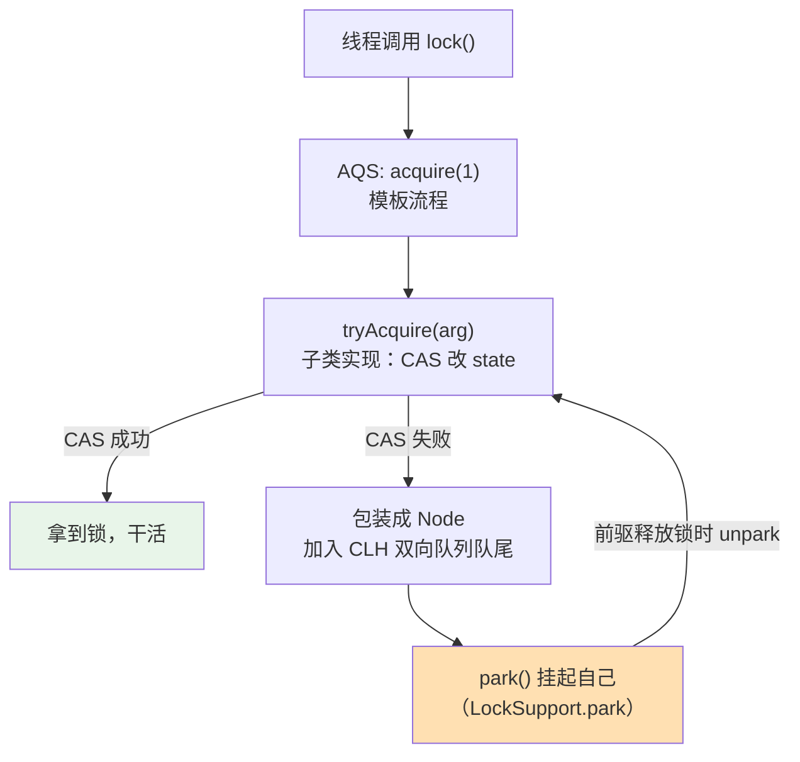
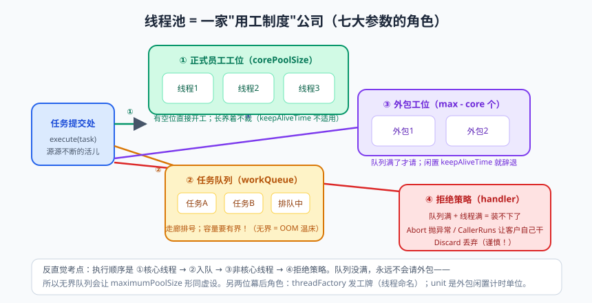
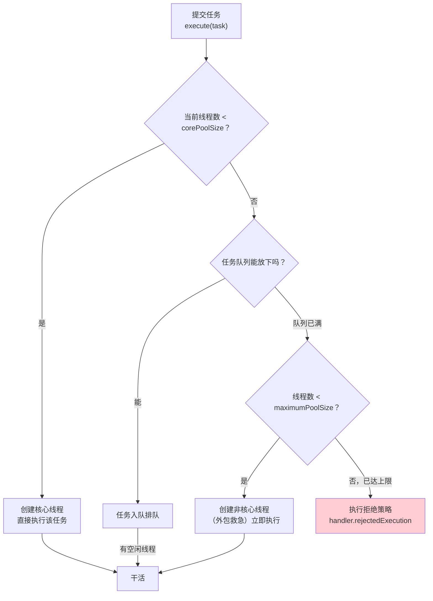

# 多线程（三）：AQS、显式锁与线程池

上篇结尾留了个悬念：synchronized 都有锁升级这么智能的优化了，JDK 为啥还费劲搞一套 ReentrantLock？

这就像自动挡汽车已经很好用，但赛车手还是要手动挡——**需要更精细的控制时，自动化帮不了你**。tryLock 超时获取、可中断的锁、公平锁、读写分离……这些都是 synchronized 给不了的。而在 ReentrantLock、Semaphore、CountDownLatch 这些工具背后，站着同一个男人——**AQS（AbstractQueuedSynchronizer）**，J.U.C 的半壁江山。

然后是本篇另一位主角，也是实际开发中出场率最高的并发组件：**线程池（Thread Pool）**。为什么大厂规约明令禁止用 Executors 创建线程池？七个参数怎么配？咱们一个一个掰开。

---

## 一、ReentrantLock：可回收的显式锁

### 1.1 基本用法与"铁律"

```java
public class ReentrantLockDemo {
    private final ReentrantLock lock = new ReentrantLock();   // 可重入：自己可以重复拿自己的锁
    private int count = 0;

    public void increment() {
        lock.lock();                       // 加锁，对应 synchronized 进入
        try {
            count++;                       // 临界区：干活
        } finally {
            lock.unlock();                 // 铁律：unlock 必须放 finally！
        }
    }
}
```

> ⚠️ **踩坑实录**：`lock.lock()` 和 `synchronized` 最大的区别是——**它是普通方法调用，不会自动释放**。如果加锁后代码抛异常且 unlock 不在 finally 里，锁就被永久占用，等待这把锁的所有线程集体饿死。看过太多同学写出 `lock.lock(); doSomething(); lock.unlock();` 然后 doSomething 一炸，整个服务卡死。**记住：lock 是自己的，unlock 要放在 finally。**

### 1.2 比 synchronized 强在哪

```java
// ① tryLock：尝试拿锁，拿不到不等（或限时等待），避免死锁式等待
if (lock.tryLock(1, TimeUnit.SECONDS)) {       // 最多等 1 秒
    try { doSomething(); }
    finally { lock.unlock(); }
} else {
    System.out.println("1 秒内拿不到锁，先干别的去");   // 拿不到也有退路，不会吊死
}

// ② lockInterruptibly：等待锁的过程中可以被打断（synchronized 等锁是不可中断的）
lock.lockInterruptibly();                      // 等待期间被 interrupt() 会抛 InterruptedException
try { doSomething(); } finally { lock.unlock(); }

// ③ 公平锁：先来先得（排队）
ReentrantLock fairLock = new ReentrantLock(true);   // 默认 false（非公平）
```

| 能力 | synchronized | ReentrantLock |
|------|:---:|:---:|
| 自动释放锁（异常时） | ✅ | ❌ 需 finally |
| 可中断的等锁 | ❌ | ✅ lockInterruptibly |
| 尝试拿锁/超时拿锁 | ❌ | ✅ tryLock |
| 公平锁 | ❌ | ✅ 构造参数 |
| 绑定多个条件（Condition） | ❌（一把锁一个 wait 集） | ✅ 多个 Condition |
| 性能（JDK 6 之后） | 基本持平 | 基本持平 |

选型建议：**没有高级需求就用 synchronized**（简单、不会忘记释放、JVM 还在持续优化）；需要 tryLock、可中断、公平性、读写分离时用 Lock 家族。

### 1.3 Condition：精准唤醒

synchronized 的 wait/notify 有个糙点：notify 只能随机叫醒一个，没法指定"叫醒生产者"还是"叫醒消费者"。Condition 可以给一把锁挂多个"等候室"：

```java
public class BoundBuffer<T> {
    private final Object[] items = new Object[10];
    private int putIdx, takeIdx, count;

    private final ReentrantLock lock = new ReentrantLock();
    private final Condition notFull  = lock.newCondition();   // 等候室1：生产者等"不满"
    private final Condition notEmpty = lock.newCondition();   // 等候室2：消费者等"不空"

    public void put(T x) throws InterruptedException {
        lock.lock();
        try {
            while (count == items.length)
                notFull.await();                    // 满了：生产者进等候室1睡觉
            items[putIdx] = x;
            if (++putIdx == items.length) putIdx = 0;
            count++;
            notEmpty.signal();                      // 有货了：精准叫醒等候室2的消费者
        } finally { lock.unlock(); }
    }

    @SuppressWarnings("unchecked")
    public T take() throws InterruptedException {
        lock.lock();
        try {
            while (count == 0)
                notEmpty.await();                   // 空了：消费者进等候室2睡觉
            T x = (T) items[takeIdx];
            if (++takeIdx == items.length) takeIdx = 0;
            count--;
            notFull.signal();                       // 腾位置了：精准叫醒等候室1的生产者
            return x;
        } finally { lock.unlock(); }
    }
}
```

注意两个细节：等待用 `while` 判断而不是 `if`（防止"虚假唤醒"和被叫醒后条件又变了）；await/signal 必须在持锁状态下调用（和 wait/notify 一样）。

---

## 二、AQS：J.U.C 的"地基"

### 2.1 AQS 是什么

**AQS（AbstractQueuedSynchronizer，抽象队列同步器）** 是 Doug Lea 写的一套同步器框架。一句话概括它：

> **一个 volatile int state（同步状态）+ 一条 CLH 变体的双向等待队列 + 一套模板方法。**

- **state**：不同同步器赋予不同含义——在 ReentrantLock 里表示"锁被重入几次"（0 没人拿，1 拿一次，2 重入一次）；在 Semaphore 里表示"还剩几个许可证"；在 CountDownLatch 里表示"还剩几个计数"；
- **队列**：抢锁失败的线程被包装成 Node 挂进一条 FIFO 双向队列排队（这就是"公平"的来源）；
- **模板方法模式**：AQS 把"排队、阻塞、唤醒"这些脏活累活全包了（acquire/release），子类只需要实现"怎么改 state"（tryAcquire/tryRelease 等）。**框架搭台，子类唱戏。**



### 2.2 以 ReentrantLock 的非公平锁为例

```java
// NonfairSync.tryAcquire 的核心（ReentrantLock 源码，简化）
final boolean nonfairTryAcquire(int acquires) {
    final Thread current = Thread.currentThread();
    int c = getState();                        // 读 state：0 表示锁空闲
    if (c == 0) {
        if (compareAndSetState(0, acquires)) { // CAS 抢锁：体现"非公平"——不排队直接抢
            setExclusiveOwnerThread(current);
            return true;
        }
    }
    else if (current == getExclusiveOwnerThread()) {   // 锁被自己持有：重入
        int nextc = c + acquires;              // state + 1（重入计数）
        setState(nextc);
        return true;
    }
    return false;                              // 抢不到 → AQS 框架把它挂进队列
}
```

**非公平 vs 公平**的区别只在一处：公平锁在 `c == 0` 时先检查队列里有没有人排队（`hasQueuedPredecessors()`），有就不抢，老老实实去队尾。非公平锁不理会队列直接 CAS——吞吐量更高（减少了线程挂起/唤醒的切换），但可能导致队列线程长时间拿不到锁。

> 📌 **划重点**：AQS 一套骨架，撑起了 ReentrantLock（独占）、Semaphore（共享）、CountDownLatch（共享）、ReentrantReadWriteLock（读写分离）等一堆同步工具。面试官问"讲讲 AQS"，你就答：**volatile state + CLH 双向队列 + 模板方法，子类通过 CAS 修改 state 定义"锁"的语义，失败线程入队挂起，释放时唤醒后继。** 掌握到这个深度，超过 90% 的候选人。

### 2.3 读写锁：ReentrantReadWriteLock

读多写少的场景（比如配置缓存），读线程之间根本不冲突，全用互斥锁太浪费。读写锁允许：**读读共享、读写互斥、写写互斥**。

```java
ReentrantReadWriteLock rwLock = new ReentrantReadWriteLock();
ReentrantReadWriteLock.ReadLock readLock = rwLock.readLock();
ReentrantReadWriteLock.WriteLock writeLock = rwLock.writeLock();

// 读数据：多个读线程可同时进入
readLock.lock();
try { return configCache.get(key); }
finally { readLock.unlock(); }

// 写数据：独占，读写都挡住
writeLock.lock();
try { configCache.put(key, value); }
finally { writeLock.unlock(); }
```

一个隐藏知识点：读写锁的 state 是一个 int，**高 16 位存读锁持有数，低 16 位存写锁重入数**——一个变量拆两半用，位运算的骚操作。

---

## 三、线程池：Java 的"用工制度"


> 🖼️ **图解**：七大参数的"公司用工模型"：正式工→排队→外包→婉拒

### 3.1 为什么需要线程池

线程是贵重资源：创建要分配栈内存（默认约 1MB）、要系统调用注册、销毁也要开销。频繁创建销毁线程，就像公司每来一个任务就招一个人、干完就开除——HR（操作系统）先崩溃。

线程池的本质是**"正式工 + 外包 + 排队 + 拒绝策略"的用工制度**：任务来了，正式工先干；忙不过来，任务排队；队列满了，雇外包；再不行，按预案拒绝。

### 3.2 七大参数（必背，但要背"懂"）

```java
public ThreadPoolExecutor(
    int corePoolSize,                      // ① 核心线程数：正式工，不干活也养着
    int maximumPoolSize,                   // ② 最大线程数：正式工+外包的上限
    long keepAliveTime, TimeUnit unit,     // ③④ 外包的"存活时间"：没活干多久后辞退
    BlockingQueue<Runnable> workQueue,     // ⑤ 任务队列：排队的活儿放哪
    ThreadFactory threadFactory,           // ⑥ 线程工厂：给线程起名、设守护等（排查问题的救命稻草）
    RejectedExecutionHandler handler       // ⑦ 拒绝策略：队列满+线程满，新任务怎么办
)
```

### 3.3 执行流程：任务的"入职之旅"



注意顺序的"反直觉"之处：**队列满了才会创建非核心线程**，而不是线程先加满再排队。所以用无界队列（如 LinkedBlockingQueue 无限容量）时，maximumPoolSize 形同虚设——永远轮不到创建非核心线程。

> 📌 **划重点**：执行顺序口诀——**核心线程 → 队列 → 非核心线程 → 拒绝策略**。无数面试考这个顺序，无数生产事故栽在这个顺序上。

### 3.4 四种拒绝策略

| 策略 | 行为 | 适用 |
|------|------|------|
| AbortPolicy（默认） | 抛 RejectedExecutionException | 快速暴露问题，能接受丢请求并告警 |
| CallerRunsPolicy | 谁提交谁自己跑（调用者线程执行） | 天然"降速"：提交太快时让上游慢下来，不丢任务 |
| DiscardPolicy | 静默丢弃新任务 | 允许丢失的旁路任务（如埋点日志） |
| DiscardOldestPolicy | 丢弃队列最老的任务，腾位给新任务 | 只关心"最新"数据的场景 |

生产环境常用自定义策略：丢弃的同时打日志/发指标/落库重试，**宁可丑而稳，不可美而险**。

### 3.5 为什么禁止用 Executors？

阿里 Java 开发规约明令禁止 `Executors.newFixedThreadPool` 等工厂方法，原因两条：

```java
// ① newFixedThreadPool / newSingleThreadExecutor：
// 用的是无界队列 LinkedBlockingQueue（容量 Integer.MAX_VALUE）
// 任务堆积无上限 → 队列无限膨胀 → OOM（内存泄漏式慢死）

// ② newCachedThreadPool / newScheduledThreadPool：
// maximumPoolSize = Integer.MAX_VALUE
// 来多少任务建多少线程 → 线程爆炸 → OOM（创建线程耗尽内存）或系统卡死
```

正确姿势是手动 new ThreadPoolExecutor，每个参数都明明白白：

```java
ThreadPoolExecutor executor = new ThreadPoolExecutor(
        8,                                          // 核心线程：IO 密集型按 2*CPU 核数起步
        16,                                         // 最大线程
        60, TimeUnit.SECONDS,                       // 非核心线程空闲 60 秒后回收
        new ArrayBlockingQueue<>(1000),             // 有界队列！容量按压测确定
        new ThreadFactory() {                       // 自定义线程工厂：起名，方便排查
            private final AtomicInteger seq = new AtomicInteger(1);
            @Override
            public Thread newThread(Runnable r) {
                Thread t = new Thread(r, "order-pool-" + seq.getAndIncrement());
                t.setDaemon(false);
                return t;
            }
        },
        new ThreadPoolExecutor.CallerRunsPolicy()   // 拒绝策略：让提交线程自己跑，天然限流
);
```

### 3.6 线程数怎么定？

经验公式（出发点是利特尔法则，别迷信，要压测验证）：

- **CPU 密集型**（纯计算：加密、序列化、算法）：线程数 ≈ CPU 核数 + 1。多了反而上下文切换浪费；
- **IO 密集型**（大部分业务代码：查库、调接口）：线程数 ≈ CPU 核数 × (1 + 平均等待时间/平均计算时间)，工程上常直接取 2×CPU 核数 起步压测调优。

### 3.7 优雅关闭

```java
executor.shutdown();                       // 不接新任务，存量任务跑完
if (!executor.awaitTermination(30, TimeUnit.SECONDS)) {
    executor.shutdownNow();                // 超时：中断正在执行的任务
}
```

Spring 项目里给线程池 Bean 注册关闭钩子，或者用 `ThreadPoolTaskExecutor`（包装类，自带优雅关闭），别让你的应用每次重启都丢任务。

> 💡 **老鸟忠告**：线程池配置的最终答案永远来自**压测 + 监控**（活跃线程数、队列长度、任务耗时、拒绝次数四个指标必须埋点）。网上流传的"万能配置"和"IO 密集 2N"只是起点，不是终点。

---

## 四、ThreadLocal：线程的"私人储物柜"

最后补一个高频知识点。ThreadLocal 不是用来解决共享的，恰恰相反——**它是用来"避免共享"的**：每个线程一份副本，互不干扰（典型场景：用户上下文透传、SimpleDateFormat 缓存、数据库连接绑定）。

```java
private static final ThreadLocal<SimpleDateFormat> sdf =
        ThreadLocal.withInitial(() -> new SimpleDateFormat("yyyy-MM-dd HH:mm:ss"));

sdf.get().format(new Date());   // 每个线程拿到的是自己的那份，线程安全
```

原理：`Thread` 对象里有个字段 `ThreadLocalMap`，key 是 ThreadLocal 实例，value 是存的值——**数据存在线程自己身上，ThreadLocal 只是找储物柜的钥匙**。

> ⚠️ **踩坑实录（内存泄漏）**：ThreadLocalMap 的 key 是**弱引用**（GC 后 key 变 null），但 value 是强引用。线程池的线程长生不死，value 就一直挂着没人管 → 内存泄漏。**铁律：用完必须 `remove()`**，最好 try-finally 包住：

```java
try {
    userContext.set(currentUser);
    processOrder();            // 业务链路里随时 userContext.get()
} finally {
    userContext.remove();      // 不 remove，下一个复用该线程的请求可能读到上一个用户的身份！（比内存泄漏更恐怖）
}
```

---

## 本篇小结

- ReentrantLock 相比 synchronized 多了 tryLock/可中断/公平锁/多 Condition，但必须手动 unlock 到 finally；
- Condition 实现精准唤醒，等待判断必须用 while；
- AQS = volatile state + CLH 双向队列 + 模板方法；state 语义由子类定义，ReentrantLock/Semaphore/CountDownLatch 都是它的马甲；
- 读写锁"读读共享、读写互斥"，适合读多写少；state 高 16 位读锁、低 16 位写锁；
- 线程池执行顺序：核心线程 → 队列 → 非核心线程 → 拒绝策略；必须手动 new ThreadPoolExecutor 且用有界队列；
- 线程数：CPU 密集 ≈ N+1，IO 密集从 2N 起步，以压测为准；
- ThreadLocal 数据存线程自己身上；key 弱引用 value 强引用，用完必须 remove。

## 课后思考 & 动手练习

1. （概念）既然 lockInterruptibly 可以中断等锁，synchronized 等锁的线程能被 interrupt 打断吗？动手验证。
2. （概念）为什么非公平锁吞吐量通常高于公平锁？"饿死"是怎么发生的？
3. （概念）线程池已满（线程达到 max、队列满）时再来任务，流程是什么？newFixedThreadPool 为什么可能 OOM？
4. （动手）用 ReentrantLock + 2 个 Condition 实现一个容量为 5 的阻塞队列，写两个生产者、两个消费者验证。
5. （动手·进阶）分别用 `Executors.newFixedThreadPool(2)` 和手写 `new ThreadPoolExecutor(2, 4, ...)` 跑 100 个耗时任务，观察队列长度（`getQueue().size()`）和线程数（`getPoolSize()`）的变化，验证"先入队后扩容"的顺序。

> 下一篇预告：《并发工具箱：JUC 全家桶》——CountDownLatch、CyclicBarrier、Semaphore 三兄弟怎么选？CompletableFuture 如何优雅地"并行调三个接口再聚合"？把 JUC 工具箱一次配齐。
