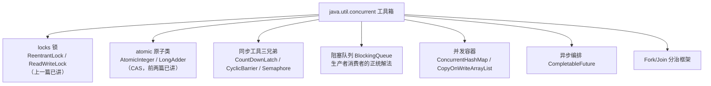
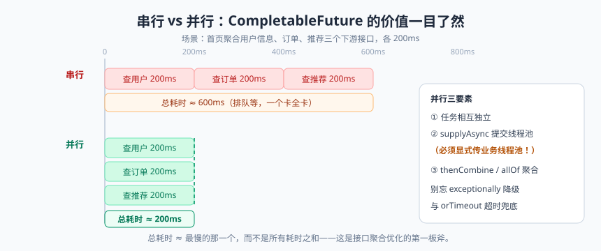

# 并发工具箱：JUC 全家桶

设想一个日常场景：首页接口要聚合三个数据——用户信息、订单列表、推荐商品。串行调用三次，每次 200ms，用户等 600ms；并行调用，理论上 200ms 出结果。再比如：主线程要等 5 个从节点把数据都上报齐了才开始计算，怎么等？

这些问题的答案，全在 `java.util.concurrent`（J.U.C）这个工具箱里。今天咱们把里面最常用的家伙什儿一个个拿出来盘一遍：同步工具三兄弟（CountDownLatch / CyclicBarrier / Semaphore）、阻塞队列家族、并发容器、以及现代 Java 并发的颜值担当 CompletableFuture。

先看全家桶地图，心里有个目录：



---

## 一、同步工具三兄弟：等的人各有各的等法

### 1.1 CountDownLatch：一个人等一群人（倒计时门闩）

场景：百米赛跑，**裁判要等所有 8 名运动员都就位**才能发枪。

```java
public class RaceDemo {
    public static void main(String[] args) throws InterruptedException {
        int runners = 8;
        CountDownLatch readyLatch = new CountDownLatch(runners);   // 计数 8

        for (int i = 1; i <= runners; i++) {
            final int no = i;
            new Thread(() -> {
                try {
                    Thread.sleep((long) (Math.random() * 1000));  // 模拟各自准备耗时
                    System.out.println("运动员 " + no + " 已就位");
                } catch (InterruptedException e) {
                    Thread.currentThread().interrupt();
                } finally {
                    readyLatch.countDown();     // 就位一人，计数减 1（放 finally 保证必减）
                }
            }, "runner-" + i).start();
        }

        readyLatch.await();                     // 裁判（主线程）阻塞，直到计数归零
        System.out.println("全部就位 —— 砰！发令枪响");
    }
}
```

要点：`countDown()` 减计数，`await()` 等到计数为 0；计数**不能重置**，一次性用品——这是它和 CyclicBarrier 最本质的区别。

### 1.2 CyclicBarrier：一群人互相等（可循环的栅栏）

场景：**8 个朋友聚餐，先到的人必须等凑齐 8 人才开吃**；吃完下一轮（可复用）。

```java
public class DinnerDemo {
    public static void main(String[] args) {
        int people = 8;
        // parties=8：凑齐 8 人触发栅栏动作； barrierAction：人到齐后先干的事
        CyclicBarrier barrier = new CyclicBarrier(people,
                () -> System.out.println("======== 8 人到齐，开吃！========"));

        for (int i = 1; i <= people; i++) {
            final int no = i;
            new Thread(() -> {
                try {
                    Thread.sleep((long) (Math.random() * 800));
                    System.out.println("朋友 " + no + " 到达餐厅");
                    barrier.await();                          // 等其他人到齐
                    System.out.println("朋友 " + no + " 开始动筷子");   // 凑齐后所有线程同时放行
                } catch (Exception e) {
                    Thread.currentThread().interrupt();
                }
            }).start();
        }
    }
}
```

CyclicBarrier 还支持 `await(timeout, unit)` 超时，超时抛 `BrokenBarrierException`，栅栏"破损"后其他等待线程也会被释放（都抛异常）——适合"凑不齐就散伙"的业务。

### 1.3 Semaphore：限制同时访问的人数（信号量/停车场的杆）

场景：**停车场只有 5 个车位**，车满了后来的在门口排队，有车出去，才放一辆进来。

```java
public class ParkingLotDemo {
    public static void main(String[] args) {
        Semaphore permits = new Semaphore(5);      // 5 个许可证 = 5 个车位

        for (int i = 1; i <= 10; i++) {
            final int carNo = i;
            new Thread(() -> {
                try {
                    permits.acquire();             // 取许可证（车位-1），没车位就阻塞
                    System.out.println("车 " + carNo + " 停进车位");
                    Thread.sleep((long) (Math.random() * 2000));   // 模拟停车时长
                    System.out.println("车 " + carNo + " 开走了");
                } catch (InterruptedException e) {
                    Thread.currentThread().interrupt();
                } finally {
                    permits.release();             // 还许可证（车位+1），必须放 finally
                }
            }).start();
        }
    }
}
```

Semaphore 典型用途：限流（数据库连接池、第三方接口并发额度）、资源配额控制。

### 1.4 三兄弟对比与选型

| 对比项 | CountDownLatch | CyclicBarrier | Semaphore |
|--------|---------------|---------------|-----------|
| 语义 | 一个线程等其他 N 个 | N 个线程互相等 | 限制同时访问的线程数 |
| 计数可重置 | ❌ 一次性 | ✅ 自动重置可复用 | 不适用（许可证循环使用） |
| 核心方法 | countDown / await | await | acquire / release |
| 底层 | AQS 共享模式 | ReentrantLock + Condition | AQS 共享模式 |
| 生活类比 | 裁判等运动员就位 | 聚餐等人到齐 | 停车场车位 |
| 典型场景 | 主任务等子任务全部完成（并行计算汇总） | 多线程分段计算、分批处理 | 限流、连接池 |

> 📌 **划重点**：选型口诀——**"一等多"用 CountDownLatch（且只要等一次），"多等多/循环用"用 CyclicBarrier，"限制并发量"用 Semaphore**。另外 JDK 7+ 主线程等子任务，如果子任务有返回值，直接上 CompletableFuture.allOf 更现代。

---

## 二、BlockingQueue：阻塞队列，生产者消费者的正统解法

上一篇咱们手写过 Lock + Condition 版阻塞队列，其实 J.U.C 早就备好了成品。**当队列满时 put 阻塞，队列空时 take 阻塞**——生产者消费者模型一句话搞定：

```java
BlockingQueue<Order> queue = new ArrayBlockingQueue<>(100);

// 生产者
queue.put(order);          // 队列满则阻塞等待（不用自己写 wait/notify）

// 消费者
Order order = queue.take(); // 队列空则阻塞等待
```

家族成员选型表：

| 队列 | 底层结构 | 容量 | 特点与典型用途 |
|------|---------|------|---------------|
| ArrayBlockingQueue | 数组 | 有界（构造指定） | 一把锁（put/take 共用），吞吐中等；简单场景首选 |
| LinkedBlockingQueue | 链表 | 可选（默认 Integer.MAX_VALUE，危险！） | 两把锁（put/take 分离）读写并行吞吐高；**务必指定容量** |
| SynchronousQueue | 无存储 | 0 | 不存元素，put 必须等一个 take"手递手"交接；直接传递场景、线程池 CachedThreadPool 用它 |
| PriorityBlockingQueue | 堆 | 无界 | 按优先级出队（任务有轻重缓急时） |
| DelayQueue | 堆 | 无界 | 元素到期才能被取走：**延迟任务**（订单超时关闭的原始解法） |

实战——用阻塞队列写一个"订单处理器"：

```java
public class OrderProcessor {
    private final BlockingQueue<Order> queue = new LinkedBlockingQueue<>(1000);  // 记得给容量！
    private volatile boolean running = true;

    public void start() {
        Thread worker = new Thread(() -> {
            while (running || !queue.isEmpty()) {      // 优雅关闭：处理完存量再退出
                try {
                    Order order = queue.poll(1, TimeUnit.SECONDS);  // 限时等待，避免永久阻塞
                    if (order != null) {
                        process(order);
                    }
                } catch (InterruptedException e) {
                    Thread.currentThread().interrupt();
                    break;
                }
            }
        }, "order-worker");
        worker.start();
    }

    public void submit(Order order) throws InterruptedException {
        queue.put(order);                              // 满了阻塞，天然背压（Backpressure）
    }

    private void process(Order order) { System.out.println("处理订单：" + order.id()); }
    record Order(String id) {}
}
```

> 💡 **老鸟忠告**：阻塞队列的 `put`/`take` 是阻塞四件套，还有非阻塞的 `offer`/`poll`（失败返回 false/null）和限时版本 `offer(e, t, unit)`。生产环境更推荐**限时版本**：既不丢任务，也不会在异常场景永久卡死。消息队列（MQ）本质上就是"分布式的 BlockingQueue"，思想完全同源。

---

## 三、并发容器：线程安全的集合

### 3.1 ConcurrentHashMap：并发版的 HashMap

HashMap 线程不安全（丢失数据、JDK 7 扩容死循环），多线程环境请用 ConcurrentHashMap。JDK 8 的实现精髓：**CAS + synchronized 锁单个桶头节点**——锁粒度从"整张表"（JDK 7 的分段锁 Segment）细化到"一个桶"，冲突概率极低，并发度大幅提升。

```java
ConcurrentHashMap<String, Integer> map = new ConcurrentHashMap<>();
map.put("apple", 1);                          // put：桶头 CAS 插入；桶不空则 synchronized 锁桶头
Integer old = map.putIfAbsent("banana", 2);   // 原子操作：不存在才放
map.computeIfAbsent("list", k -> new ArrayList<>()).add("x");  // 经典套路：并发安全的 Map<K, List<V>>
map.merge("apple", 1, Integer::sum);          // 原子累加：计数器利器
```

注意：ConcurrentHashMap 的 size() 不加全局锁（用 baseCount + CounterCell 分段计数，思想同 LongAdder），弱一致性的迭代器不会抛 ConcurrentModificationException。

### 3.2 CopyOnWriteArrayList：写时复制的名单

读时直接读（无锁），**写时复制整个数组，改完把引用一指**。适合**读多写极少**的场景：白名单、黑名单、监听器列表、配置订阅者。

```java
CopyOnWriteArrayList<Listener> listeners = new CopyOnWriteArrayList<>();

listeners.forEach(Listener::onChange);   // 读：无锁，随便并发
listeners.add(newListener);             // 写：复制底层数组+追加+替换引用（加锁互斥写）
```

> ⚠️ **踩坑实录**：某同学把 COW 列表当普通列表用，每秒写几百次，内存瞬间起飞，GC 疯狂告警——每次写都复制数组，写多读少用它是灾难。**COW 的适用面很窄：读远多于写，且列表不大。** 它的迭代器是"快照"（弱一致性）：迭代期间别人写，你看到还是旧版本，不抛异常，但也不是最新数据。

### 3.3 为什么有 ConcurrentHashMap 却没有 ConcurrentArrayList？

因为 ArrayList 这类基于数组下标随机写的结构，"线程安全"很难定义：两个线程分别 set(1, x) 和 set(2, y) 没问题，但 `list.add()` 要改 size 和数组，复合操作没法用细粒度锁保护。真需要并发 List：读多写少用 COW，写多用 `Collections.synchronizedList`（一把大锁，性能一般）或干脆换 ConcurrentLinkedQueue。

---

## 四、CompletableFuture：异步编排的颜值担当


> 🖼️ **图解**：串行 600ms vs 并行 200ms：异步聚合的价值一目了然

### 4.1 Future 的痛

```java
ExecutorService pool = Executors.newFixedThreadPool(3);
Future<User> f1 = pool.submit(() -> queryUser());       // 提交异步任务
Future<List<Order>> f2 = pool.submit(() -> queryOrders());

User user = f1.get();        // 阻塞等结果 1
List<Order> orders = f2.get();  // 阻塞等结果 2
// 痛点① get() 是阻塞的，两个任务本可并行，写得不好就退化成串行
// 痛点② 任务之间有依赖时，只能一层层 get，写出一堆"回调地狱"
// 痛点③ 没有 异常处理、组合、超时 等高级能力
```

### 4.2 CompletableFuture 组合拳

回到开头的场景：**并行查三个接口，取最慢的 200ms，然后聚合**：

```java
ExecutorService bizPool = new ThreadPoolExecutor(8, 16, 60, TimeUnit.SECONDS,
        new ArrayBlockingQueue<>(100), new ThreadPoolExecutor.CallerRunsPolicy());

CompletableFuture<UserInfo> userFuture =
        CompletableFuture.supplyAsync(() -> queryUser(200), bizPool);          // 任务1：用户信息

CompletableFuture<List<Order>> orderFuture =
        CompletableFuture.supplyAsync(() -> queryOrders(200), bizPool);        // 任务2：订单

CompletableFuture<List<Product>> recFuture =
        CompletableFuture.supplyAsync(() -> queryRecommend(200), bizPool)      // 任务3：推荐
                .exceptionally(e -> {                                          // 单任务失败降级：不影响整体
                    log.warn("推荐服务挂了，返回默认推荐", e);
                    return List.of(DEFAULT_PRODUCT);
                });

CompletableFuture<HomePage> page = userFuture
        .thenCombine(orderFuture, (user, orders) -> new HomePage(user, orders)) // 两两聚合
        .thenCombine(recFuture, HomePage::withRecommend)                        // 再聚合第三个
        .orTimeout(500, TimeUnit.MILLISECONDS)                                  // 整体超时兜底（JDK 9+）
        .completeOnTimeout(FALLBACK_PAGE, 500, TimeUnit.MILLISECONDS);          // 超时给默认值

HomePage result = page.join();   // 三个任务并行，总耗时 ≈ 200ms 而非 600ms
```

常用 API 速查：

| 方法 | 作用 | 记忆点 |
|------|------|--------|
| supplyAsync / runAsync | 提交有/无返回值的异步任务 | **必须传自定义线程池**，默认 ForkJoinPool.commonPool() 是全局共享的坑 |
| thenApply / thenAccept / thenRun | 对结果做转换/消费/执行 | "下一步"系列，不阻塞 |
| thenCombine | 合并两个独立任务的结果 | 两路汇合 |
| allOf / anyOf | 等全部/任意一个完成 | 再配 join() 取结果 |
| exceptionally / handle | 处理异常（handle 正常异常都走） | 异常不会"穿透"到主线程吓人 |
| orTimeout / completeOnTimeout | 超时控制（JDK 9+） | 接口聚合必备 |

> ⚠️ **踩坑实录**：`supplyAsync` 不传线程池时用全局的 `ForkJoinPool.commonPool()`——所有业务共用、并行度只有 CPU核数-1，一个慢任务能把别的模块拖下水。**规范：所有 CompletableFuture 都显式传业务线程池。** 另外注意 `join()` 和 `get()` 都会阻塞等待，区别是 join 抛非受检异常，代码更清爽。

---

## 五、Fork/Join：分治并行（了解即可）

Fork/Join 是"把大任务拆（fork）成小任务，各线程算完再合并（join）结果"的分治框架，核心是**工作窃取（Work-Stealing）**：每个线程有自己的双端队列，自己从头取任务，闲下来的线程从别人队列尾部"偷"任务——忙的线程不中断，闲的线程不浪费。

```java
class SumTask extends RecursiveTask<Long> {
    private final long[] numbers;
    private final int from, to;
    private static final int THRESHOLD = 10_000;    // 拆分阈值：小于它就不拆了

    SumTask(long[] numbers, int from, int to) {
        this.numbers = numbers; this.from = from; this.to = to;
    }

    @Override
    protected Long compute() {
        if (to - from <= THRESHOLD) {               // 直接算
            long sum = 0;
            for (int i = from; i < to; i++) sum += numbers[i];
            return sum;
        }
        int mid = (from + to) >>> 1;                 // 一分为二
        SumTask left = new SumTask(numbers, from, mid);
        SumTask right = new SumTask(numbers, mid, to);
        left.fork();                                 // 左半边异步执行
        return right.compute() + left.join();        // 右半边自己算 + 等左半边结果合并
    }
}

long total = ForkJoinPool.commonPool()
        .invoke(new SumTask(bigArray, 0, bigArray.length));
```

实际业务中 Fork/Join 直接出场机会不多（parallelStream 和 CompletableFuture 的默认池基于它），理解"分治 + 工作窃取"思想即可。

---

## 本篇小结

- 三兄弟选型：一等多（一次性）CountDownLatch；多等多/可复用 CyclicBarrier；限并发量 Semaphore；
- BlockingQueue 是生产者消费者正统解法：put/take 阻塞、offer/poll 非阻塞，生产用限时版本；LinkedBlockingQueue 必须给容量；
- ConcurrentHashMap：CAS + 锁桶头，细粒度并发；merge/computeIfAbsent 是原子操作的宝藏方法；
- CopyOnWriteArrayList 只适合"读多写少的小列表"，写多必翻车；
- CompletableFuture 链式编排 + allOf/thenCombine 并行聚合，务必显式传业务线程池、加超时兜底；
- Fork/Join = 分治 + 工作窃取，理解思想即可。

## 课后思考 & 动手练习

1. （概念）CountDownLatch 和 CyclicBarrier 各自适合什么场景？把 CountDownLatch 的计数用完后再 await 会怎样？
2. （概念）SynchronousQueue 和 ArrayBlockingQueue 的本质区别是什么？newCachedThreadPool 为什么用前者？
3. （动手）用 Semaphore(3) 模拟"3 个坑位的公厕"，10 个人排队上厕所，验证同时最多 3 人；
4. （动手）写一个生产者消费者：2 个生产者向 ArrayBlockingQueue(10) 放数据，3 个消费者消费，各跑 10 秒后优雅停止（interrupt + 检查标志位）；
5. （动手·进阶）用 CompletableFuture 并行调用 3 个"模拟远程接口"（sleep 随机 100~500ms），聚合结果并统计总耗时，验证接近最慢者而非三者之和；再给其中一个注入异常，练习 exceptionally 降级。

> 下一篇预告：并发暂时告一段落，接下来进入另一座大山——JVM。《JVM 内存结构：运行时数据区巡礼》，带你逛逛你的对象们在 JVM 里的"居住小区"：栈、堆、方法区，顺便亲手制造几次 OOM（放心，是故意的）。
