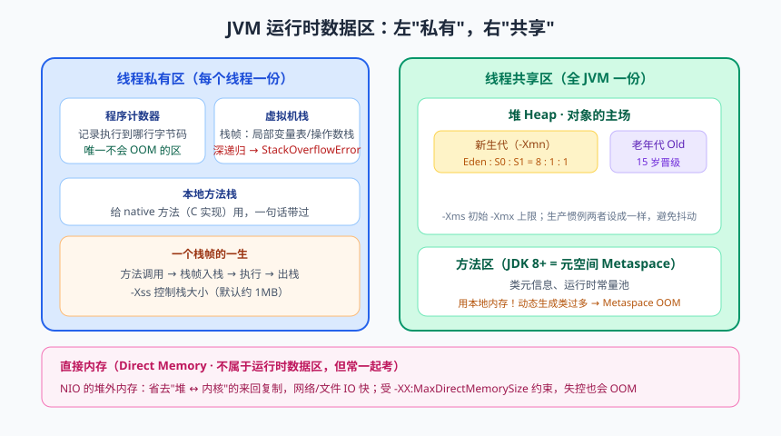
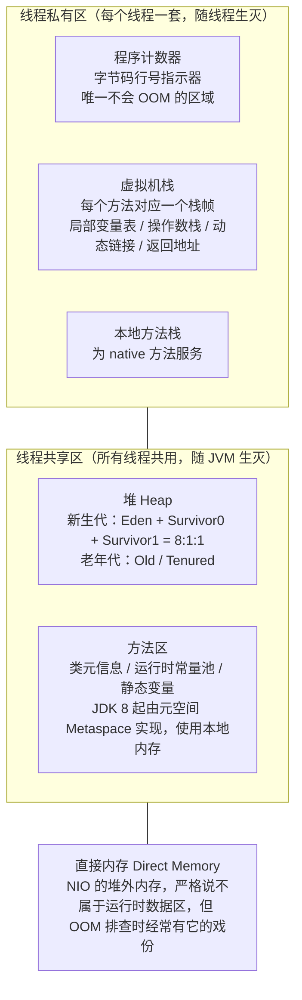
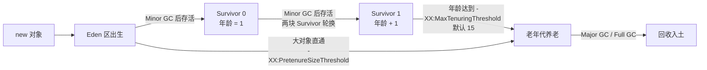

# JVM 内存结构：运行时数据区巡礼

各位同学，欢迎回到课堂。今天咱们干一件大事——组团参观 JVM 这栋大楼。你写了几年代码，天天往楼里塞对象，却可能从来没进门看过一眼：哪些房间是一个人独居的，哪些是几十个线程挤在一起合租的？哪间屋子永远不会挤爆？哪间屋子一爆就是凌晨三点的电话炸弹？

我在培训行业带过的学员里，太多人对着 `OutOfMemoryError: Java heap space` 的告警截图一脸懵，最后使出职业生涯终极绝招——重启大法。重启当然能"解决"问题，就像水管漏水你把总闸一关，眼不见心不烦，可问题还蹲在原地等你。JVM 内存结构就是 OOM 时的救命地图：报错落在哪个区、哪个参数管哪块地盘、日志里那串英文在骂什么——看懂了它，你才能从"重启工程师"进化成"排查工程师"。

好消息是，这块知识真不难，就是零件多。咱们按"线程私有 → 线程共享 → 堆外"的参观路线，把这栋楼挨个逛一遍。出发前先上个全景沙盘。

## 一、总览：JVM 大楼的两类户型


> 🖼️ **图解**：运行时数据区全景：左私有（栈/PC）右共享（堆/元空间）

按《Java 虚拟机规范》（JVMS）的划分，运行时数据区（Runtime Data Area）一共五块：程序计数器、虚拟机栈、本地方法栈、堆、方法区。前三块是"一室户"——线程私有（Thread Private），线程一出生就配一套，线程一走就收回，互不打扰；后两块是"大平层"——线程共享（Thread Shared），所有线程挤在一起用，跟大学公共自习室似的，谁都能进，东西堆多了就出事。



注意最后那位"编外人员"直接内存：它不在规范划定的五大区里，但 NIO 用得飞起，出事时也经常是嫌疑人之一，所以一并带上看一眼，免得它搞突袭。

> 📌 **划重点**：程序计数器、虚拟机栈、本地方法栈是**线程私有**的；堆、方法区是**线程共享**的。这是面试第一问，也是后面一切排查分析的地图，请焊死在脑子里。

## 二、程序计数器：最小的房间，最稳的脾气

程序计数器（Program Counter Register，PC 寄存器）可以看作当前线程所执行字节码的行号指示器。字节码解释器工作时，就是靠改变这个计数器的值来选取下一条要执行的字节码指令，分支、循环、跳转、异常处理、线程恢复，全都依赖它。

那为什么它是线程私有的？因为 CPU 在多线程之间来回切换（时间片轮转），切走之前必须记住"这哥们儿演到第几幕了"，切回来才能接着演。每个线程一个独立计数器，互不干扰，线程切换后才能恢复到正确的执行位置。

它还有个荣耀头衔：**整个 JVM 中唯一不会发生内存溢出（OutOfMemoryError，OOM）的区域**。原因很朴素——《规范》里它的容量被固定为最小的存储单位，只存一个行号，想撑爆它都没有原材料。它就像大楼走廊尽头那个只挂一块门牌的小格子，房租都不用交。

执行的是 native 方法时，计数器值为 undefined——本地方法不是字节码，没有行号可记。

## 三、虚拟机栈：方法的"工位"

虚拟机栈（Java Virtual Machine Stack）描述的是 Java 方法执行的线程内存模型：每个方法被调用，就同步创建一个栈帧（Stack Frame）；方法执行完毕（正常返回或抛异常），栈帧就出栈。栈帧的生命周期跟方法一模一样，堪称方法在 JVM 里的工位。

### 3.1 栈帧的四大件

每个栈帧内部有四个区域：

- **局部变量表（Local Variable Table）**：存放方法参数和局部变量，以变量槽（Variable Slot）为单位。long 和 double 占两个槽，其余类型占一个。第 0 号槽默认放 `this`（实例方法的话）。
- **操作数栈（Operand Stack）**：字节码指令的工作台。Java 是基于栈的执行引擎，算个 `1 + 2` 要先把 1、2 压栈，再执行 iadd 弹出相加、结果压回——像在算盘上扒拉珠子。
- **动态链接（Dynamic Linking）**：指向运行时常量池中该方法所属的引用，把字节码里的符号引用在运行期解析成直接引用，多态就靠它。
- **方法返回地址（Return Address）**：方法退出后回到调用者的哪个字节码偏移量继续执行。

### 3.2 跟着字节码走一遍 i++

光说不练假把式，咱们用 `javap -c` 看一个最简单的方法在栈里怎么跑：

```java
public class IncrementDemo {
    public int compute() {
        int i = 1;   // 局部变量 i，存放在局部变量表 1 号槽（0 号槽留给了 this）
        i++;         // 自增
        return i;    // 返回
    }
}
```

编译后 `javap -c IncrementDemo` 的输出（JDK 8）：

```text
public int compute();
  Code:
     0: iconst_1     // 把常量 1 压入操作数栈
     1: istore_1     // 弹出栈顶，存入局部变量表 1 号槽：i = 1
     2: iload_1      // 把 i 的值（1）加载到操作数栈
     3: iconst_1     // 把常量 1 压入操作数栈
     4: iadd         // 弹出栈顶两个 int 相加：1 + 1 = 2，结果压回栈
     5: istore_1     // 弹出 2，存回 1 号槽：i = 2
     6: iload_1      // 加载 i（2）到栈顶，作为返回值
     7: ireturn      // 返回栈顶 int
```

看到没？所谓 `i++`，在栈里就是"取出来、加一、放回去"三步抖音神曲，操作数栈就是那个舞台。看懂这段，你就摸到字节码的门把手了——下一篇讲垃圾回收、下下篇讲类加载时还会反复用到这个视角。

### 3.3 栈溢出演示：没有出口的递归

栈的容量有限（`-Xss` 控制），方法调用太深，栈帧摞不下，就抛 `StackOverflowError`（SOF）。最经典的翻车现场——没有出口的递归：

```java
public class StackSOF {
    private static long depth = 0;

    public static void recursion() {
        depth++;        // 每递归一层，栈里就多压一个栈帧
        recursion();    // 没有出口的递归，就像只上不下的电梯
    }

    public static void main(String[] args) {
        try {
            recursion();
        } catch (StackOverflowError e) {
            System.out.println("栈深度约：" + depth);   // -Xss 越大，这个数字越大
            e.printStackTrace();                        // 异常栈会打印出一模一样的重复行
        }
    }
}
// 实验：分别用 -Xss256k 和 -Xss1m 跑一遍，对比栈深度
```

> ⚠️ **踩坑实录**：有学员写 JSON 反序列化，后端返回了一种"自己套自己"的恶意嵌套结构，Jackson 默认递归解析，线上直接 `StackOverflowError`。查了半天代码没有任何明显递归——凶手在依赖库里。教训：SOF 不一定是你自己写的递归，也可能是复杂正则回溯、第三方库的深层解析，异常栈里重复出现哪个类的方法名，哪个就是凶手。

## 四、本地方法栈：一句话交代

本地方法栈（Native Method Stack）跟虚拟机栈是双胞胎，区别只有一点：它为本地（Native）方法服务，也就是那些 `native` 关键字修饰、由 C/C++ 实现的方法。HotSpot 里干脆直接把虚拟机栈和本地方法栈合二为一。深挖等学 JNI 的时候再说，今天一句话打发。

## 五、堆：对象的世界杯主场

堆（Heap）是 JVM 管理内存里最大的一块，几乎所有的对象实例和数组都在这里分配（逃逸分析导致的栈上分配是后话）。它是线程共享的，所以并发分配靠 TLAB（Thread Local Allocation Buffer，线程本地分配缓冲区）来减少竞争——相当于合租屋里每人先划一个抽屉，各塞各的，塞不下了再抢公共区域。

### 5.1 新生代与老年代：8:1:1 的黄金分割

堆内部按对象"年龄"分代：

- **新生代（Young Generation）**：分为 Eden 区和两个 Survivor 区（S0、S1，也叫 From、To），默认比例 **Eden : S0 : S1 = 8 : 1 : 1**（由 `-XX:SurvivorRatio=8` 控制）。
- **老年代（Old Generation / Tenured）**：存放熬过多次回收的"中年对象"和新年代比例默认约 2:1（`-Xmn` 设新生代大小，或 `-XX:NewRatio` 设比例）。

为什么 Survivor 要两个而不是一个？因为回收算法用的是标记-复制：每次只用 Eden + 一个 Survivor，回收时把活着的对象复制到另一个空 Survivor，两块轮换着用，内存永远不碎。这篇先记住结论，算法细节下篇垃圾回收细聊。

### 5.2 对象的旅居路线：从摇篮到养老院

一个普通对象在堆里的一生：**先在 Eden 出生 → 每次 Minor GC 后还活着就搬进 Survivor，年龄 +1 → 每熬过一次 GC 长一岁 → 到了 15 岁"退休"进老年代**。年龄阈值由 `-XX:MaxTenuringThreshold=15` 控制（最大 15，因为对象头里年龄只有 4 个 bit，最大存 15）。



### 5.3 大对象直接进养老院

"大对象"指需要大量连续内存的对象（长字符串、大数组）。HotSpot 提供了 `-XX:PretenureSizeThreshold`（Serial 和 ParNew 收集器有效）：超过该值的对象不经过新生代，直接在老年代分配。道理很现实——大块头在 Eden 和 Survivor 之间来回复制太亏了，工位搬不动，直接分个办公室。

> 💡 **老鸟忠告**：生产上我更建议**在代码层面消灭大对象**（分页查询代替一次性拉全表、流式读取代替整文件加载），而不是琢磨怎么给大对象安排养老。见过太多系统被一个 `SELECT *` 拉回来的 500MB List 干趴，参数调得再漂亮也架不住代码里塞大象。

## 六、方法区：从永久代到元空间

方法区（Method Area）存放类的元信息（Class 结构、字段、方法字节码）、运行时常量池、静态变量（JDK 7 起静态变量实际挪到了堆中）、JIT 编译后代码等。它逻辑上属于堆的一部分，但有个悠久的"户口问题"：

- **JDK 7 及以前**：HotSpot 用**永久代（PermGen）**实现方法区——把方法区塞进堆里，受 `-XX:MaxPermSize` 管着。
- **JDK 8 起**：永久代被移除，改为**元空间（Metaspace）**，使用**本地内存（Native Memory）**，默认上限是机器物理内存，用 `-XX:MetaspaceSize` / `-XX:MaxMetaspaceSize` 调节。

为什么要干掉永久代？两个老痛点：一是**大小难定**，类加载多的应用（动态代理、脚本引擎、大量 JSP）动不动 `PermGen space` OOM，运维只能靠拍脑袋改参数；二是**字符串常量池（String Pool）在 JDK 7 就已挪到堆**，永久代越来越名不副实，GC 效率还低。元空间在本地内存上，想用多少用多少（当然仍建议设上限，别放飞自我）。

**运行时常量池（Runtime Constant Pool）**是方法区的一部分：class 文件里的常量池（存放字面量与符号引用）在类加载后进入运行时常量池。它相比 class 文件常量池更"活"——最著名的例子就是 `String.intern()`，JDK 7 起字符串常量池在堆中，`intern()` 会把首次遇到的字符串引用收进去。

> ⚠️ **踩坑实录**：某系统上线三个月，某天凌晨突然挂掉，日志赫然 `java.lang.OutOfMemoryError: Metaspace`。排查发现是重构后 Groovy 脚本引擎每次执行都用新的 `GroovyClassLoader` 加载脚本，类元数据只增不减。修复方式：脚本引擎单例复用 + 设置 `-XX:MaxMetaspaceSize=512m` 兜底。元空间 OOM 的第一嫌疑人永远是"动态生成类的框架"：CGLIB、Groovy、反射代理。

## 七、直接内存：NIO 的自留地

直接内存（Direct Memory）不是运行时数据区的一部分，也不受堆大小限制，而是通过 `ByteBuffer.allocateDirect()` 向操作系统申请的堆外内存，由 `-XX:MaxDirectMemorySize` 限制（默认约等于 `-Xmx`）。

Doug Lea 当年推动 NIO 引入它，理由简单粗暴：JDK 1.4 之前，基于流的 IO 要把数据从内核缓冲区拷到用户态的 Java 堆里，读文件、发网络都得"拷两次"；而堆外内存可以被操作系统直接访问，省掉了一次堆内外来回复制，对高吞吐 IO 场景（Netty 的零拷贝、RPC 框架的网络缓冲区）是巨大提升。

代价是：堆外内存的分配与回收成本更高，且不受 GC 直接管理，通常靠 Cleaner（幻象引用机制）在引用被回收后释放。所以 Netty 才搞了内存池（PooledDirectByteBuf）自己管理，这是后话。

## 八、亲手炸一遍：各区 OOM 演示

学 JVM 不动手，等于学游泳不沾水。下面两个实验建议你一定亲手跑一遍，感受一下"亲手炸掉 JVM"的快乐。

### 8.1 堆 OOM：只进不出的 List

```java
import java.util.ArrayList;
import java.util.List;

public class HeapOOM {
    public static void main(String[] args) {
        List<byte[]> list = new ArrayList<>();
        int i = 0;
        while (true) {
            list.add(new byte[1024 * 1024]);   // 每轮塞 1MB，引用一直持有，GC 无法回收
            System.out.println("已分配 " + (++i) + " MB");
        }
    }
}
// JVM 参数：-Xms16m -Xmx16m -XX:+HeapDumpOnOutOfMemoryError -XX:HeapDumpPath=/tmp/
// 期望结果：java.lang.OutOfMemoryError: Java heap space
// 加上 HeapDump 参数，OOM 时自动留下一份"现场尸体"（hprof 文件），下一章排查用得上
```

### 8.2 元空间 OOM：CGLIB 类工厂狂飙

```java
// 依赖：org.springframework.cglib 或 net.sf.cglib:cglib:3.3.0
import org.springframework.cglib.proxy.Enhancer;
import org.springframework.cglib.proxy.MethodInterceptor;

public class MetaspaceOOM {
    public static void main(String[] args) {
        int i = 0;
        try {
            while (true) {
                Enhancer enhancer = new Enhancer();
                enhancer.setSuperclass(MetaspaceOOM.class);
                enhancer.setUseCache(false);   // 关闭缓存，逼 CGLIB 每次都生成新代理类
                enhancer.setCallback((MethodInterceptor) (obj, method, a, proxy) ->
                        proxy.invokeSuper(obj, a));
                enhancer.create();             // 每个代理类都是一份新的类元数据，堆进元空间
                i++;
            }
        } catch (Throwable e) {
            System.out.println("生成了 " + i + " 个代理类后，元空间阵亡");
            e.printStackTrace();
        }
    }
}
// JVM 参数：-XX:MaxMetaspaceSize=10m
// 期望结果：java.lang.OutOfMemoryError: Metaspace
```

> 📌 **划重点**：OOM 报错信息的"尾巴"就是案发现场地址——`Java heap space` 查堆、`Metaspace` 查动态类、`unable to create new native thread` 查线程数、`Direct buffer memory` 查堆外。先看地址，再定排查路线。

## 九、常用内存参数速查表

| 参数 | 作用 | 生产建议 |
|---|---|---|
| `-Xms` | 初始堆大小 | 与 -Xmx 设成一样，避免运行期扩容抖动 |
| `-Xmx` | 最大堆大小 | 一般设容器内存的 50%~70%，给元空间/栈/直接内存留活路 |
| `-Xmn` | 新生代大小 | 按"老年代存活对象 2~3 倍"原则反推，别拍脑袋 |
| `-Xss` | 单线程栈大小 | 默认 1m，深层递归场景才需要调大，通常不动 |
| `-XX:SurvivorRatio=8` | Eden 与单个 Survivor 之比 | 默认 8，即 8:1:1 |
| `-XX:MaxTenuringThreshold=15` | 晋升老年代年龄阈值 | 默认 15，一般不动 |
| `-XX:MetaspaceSize` | 元空间初始触发 GC 阈值 | 建议 256m 起，避免启动期频繁 Full GC |
| `-XX:MaxMetaspaceSize` | 元空间上限 | 务必设置！默认无上限，放飞等于裸奔 |
| `-XX:MaxDirectMemorySize` | 直接内存上限 | Netty 系应用重点关照 |

## 十、堆 vs 栈：终极对比（面试必考）

| 维度 | 虚拟机栈 | 堆 |
|---|---|---|
| 存放内容 | 栈帧（局部变量表、操作数栈等） | 对象实例、数组 |
| 线程归属 | 线程私有 | 线程共享 |
| 生命周期 | 随方法调用/返回，随线程生灭 | 随 JVM 生灭 |
| 内存错误 | StackOverflowError（也可能 OOM） | OutOfMemoryError |
| 分配效率 | 快（移动栈指针即可） | 相对慢（需分配与 GC 配合） |
| 碎片问题 | 无（栈帧连续进出） | 有（靠 GC 算法治理） |
| 核心参数 | `-Xss` | `-Xms` / `-Xmx` / `-Xmn` |

一句话记忆：**栈管运行（方法的执行上下文），堆管存储（对象本身）**。基本类型变量的值在栈的局部变量表里，但它引用的对象（`new` 出来的那位）住在堆里——"变量在栈，对象在堆"。

## 本篇小结

- 运行时数据区五件套：程序计数器、虚拟机栈、本地方法栈线程私有；堆、方法区线程共享。
- 程序计数器是唯一不会 OOM 的区域，因为容量固定且极小。
- 栈帧四件套：局部变量表、操作数栈、动态链接、返回地址；方法调用深度过大抛 StackOverflowError。
- 堆分新生代（Eden:S0:S1 = 8:1:1）与老年代；对象默认在 Eden 出生，熬到 15 岁进老年代。
- 大对象可越过新生代直接进老年代，避免 Survivor 之间反复拷贝。
- JDK 8 起永久代被元空间取代，元空间使用本地内存，必须设 MaxMetaspaceSize 上限。
- 直接内存是 NIO 的堆外内存，省一次拷贝但要小心泄漏，常见于 Netty 场景。
- OOM 报错尾巴就是案发现场：heap space / Metaspace / native thread / direct buffer。

## 课后思考 & 动手练习

1. 为什么程序计数器必须是线程私有的？如果共享会发生什么？
2. 方法区内存不足时，JDK 8 之前和之后的报错信息分别是什么？参数分别怎么设？
3. 一个 20MB 的字节数组（`-Xmx256m`，新生代 85MB），会在哪里分配？为什么？
4. 【动手实验】把 StackSOF 示例分别在 `-Xss128k`、`-Xss512k`、`-Xss1m` 下跑三遍，记录栈深度并解释规律；再把 `recursion()` 改成带出口的递归，观察栈深度的上限行为。
5. 【动手实验】运行 HeapOOM，加上 `-XX:+HeapDumpOnOutOfMemoryError`，用 `jhat` 或下一章要讲的 MAT 打开 hprof 文件，找到占用最大的对象——提前体验一次"验尸"。

下一篇预告：对象在堆里生老病死，可谁负责"收尸"？下一篇《垃圾回收：对象的生与死》，咱们聊聊 GC 怎么判定一个对象该死、又怎么死得体面——从引用计数的老骗局，一路讲到 G1 的 Region 世界。
