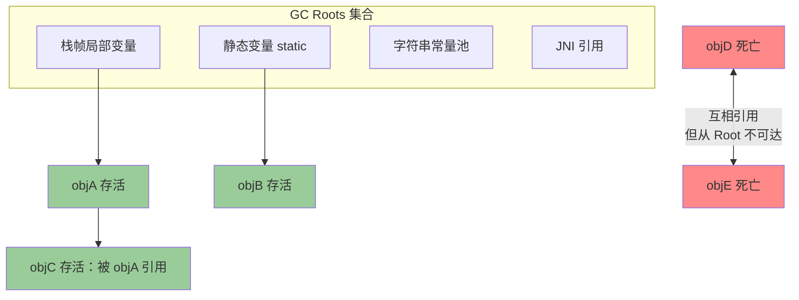
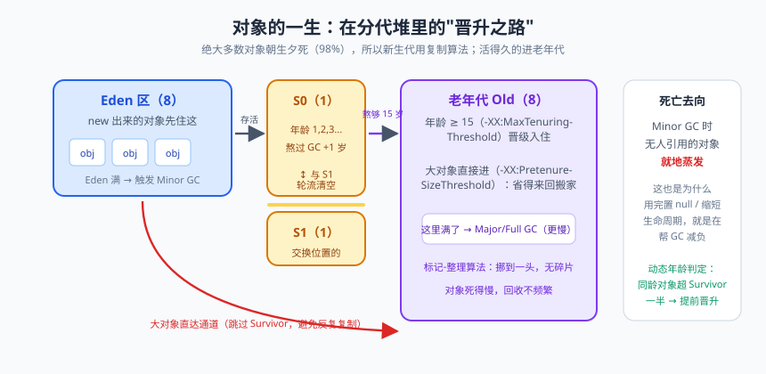

# 垃圾回收：对象的生与死

上篇咱们把 JVM 大楼的房间逛了个遍，对象们在堆里安家落户、生儿育女。但有个问题一直没正面回答：对象死了以后，谁收尸？你 `new` 了一个对象，用完就撒手不管，连句再见都没有——在 Java 的世界里，这不是你的冷漠，这是设计者的温柔：垃圾回收（Garbage Collection，GC）替你兜底。

不过这个"保姆"到底怎么判断对象死没死？多久扫一次屋子？扫地的时候为什么你的程序会卡一下？这些问题的答案，就是从"会写 Java"到"会救 Java"的分水岭。我见过面试者把 GC 算法背得滚瓜烂熟，一问"你们线上为什么选 G1"就哑火——背结论和懂原理，是两码事。

今天这节课，咱们从"没有 GC 的悲惨世界"讲起，一路讲到亚毫秒停顿的 ZGC。系好安全带，发车。

## 一、没有 GC 的世界：手动 free 的 C 时代悲歌

C 语言时代，`malloc` 拿内存、`free` 还内存，全靠程序员自觉。忘记 free？内存泄漏（Memory Leak），程序像貔貅一样只进不出，最后被操作系统掐死。free 早了？悬垂指针（Dangling Pointer），那块内存已经被别人征用，你还拿着旧地址去读写，数据错乱、诡异的崩溃随机出现——这类 Bug 的排查难度，堪比在西湖里找一根指定的水草。

更要命的是"谁来 free"这个所有权问题：一个 buffer 传了三个函数，到底谁负责释放？早期 C++ 搞出引用计数智能指针，结果又栽在循环引用上。于是 1959 年 Lisp 之父 John McCarthy 提出了自动垃圾回收的构想，Java 把它发扬光大：**内存管理的责任从程序员转移到运行时**，用一点性能开销，换来开发效率和内存安全的大跃进。

> 📌 **划重点**：GC 解决的是"自动发现并回收不再使用的对象"。它管不了两类事：一是还持着引用但逻辑上已无用的对象（这叫内存泄漏，GC 认为它活着）；二是堆外资源（文件句柄、Socket，得靠 try-with-resources）。

## 二、怎么判断对象该死

### 2.1 引用计数法：看起来很美的老骗局

思路朴素：给对象配个计数器，被引用 +1，引用失效 -1，归零即死。实现简单、判断高效，Python（CPython）就用它。但它有个致命伤——**循环引用（Circular Reference）**：俩对象互相指着对方，计数器都是 1，实际上从外面谁也够不着它们，却永远"活着"。

```java
public class CircularRef {
    public Object instance = null;
    // -Xms20m -Xmx20m
    public static void main(String[] args) {
        CircularRef a = new CircularRef();   // a 引用计数 = 1
        CircularRef b = new CircularRef();   // b 引用计数 = 1
        a.instance = b;                      // b 计数 = 2
        b.instance = a;                      // a 计数 = 2
        a = null;                            // a 对象计数 = 1（被 b.instance 指着）
        b = null;                            // b 对象计数 = 1（被 a.instance 指着）
        System.gc();   // 若是引用计数，这俩永远回收不了；HotSpot 实际能回收 → 证明它不用引用计数
    }
}
```

HotSpot 没有采用引用计数，用的是下面这位。

### 2.2 可达性分析：从根出发的寻亲之旅

可达性分析（Reachability Analysis）从一组叫 **GC Roots** 的根对象出发，顺着引用链（Reference Chain）往下搜，能搜到的对象算"可达"——活着；搜不到的，就是"不可达"——死亡候选人。

GC Roots 包括哪些？记住这张"寻亲名单"：

- 虚拟机栈（栈帧局部变量表）中引用的对象——正在执行的方法里的参数、局部变量；
- 方法区中类静态属性引用的对象——`static` 字段；
- 方法区中常量引用的对象——比如字符串常量池里的引用；
- 本地方法栈中 JNI（native 方法）引用的对象；
- 活跃线程、系统类加载器、同步锁持有的对象等 JVM 内部引用。



看图说话：objD 和 objE 互相手拉手，引用计数视角下它们都是 1，但可达性分析视角下，没有任何一条链从 Roots 通向它们——手拉手淹死的经典画面。这就是 HotSpot 的选择：**以连通性论生死，不看人气看户口**。

### 2.3 对象的自我救赎：finalize 的一次自救机会

被判不可达的对象不马上死。宣告死亡至少要经历两次标记：第一次发现不可达后，检查是否重写了 `finalize()` 且没被执行过——是的话对象被塞进 F-Queue 队列，由一条低优先级的 Finalizer 线程去执行它的 finalize()。如果在 finalize() 里把自己重新挂到 GC Roots 上（比如给静态变量赋值 this），它就完成自救；否则第二次标记后，真的死了。

```java
public class FinalizeEscape {
    public static FinalizeEscape SAVE_HOOK = null;

    @Override
    protected void finalize() throws Throwable {
        super.finalize();
        System.out.println("finalize() 执行，我把自己挂回静态变量，完成自救");
        SAVE_HOOK = this;                    // 自救：重新建立引用链
    }

    public static void main(String[] args) throws Exception {
        SAVE_HOOK = new FinalizeEscape();
        SAVE_HOOK = null;                    // 第一次断链
        System.gc();
        Thread.sleep(500);                   // Finalizer 线程优先级低，等它一下
        System.out.println("第一次 GC 后还活着吗：" + (SAVE_HOOK != null));

        SAVE_HOOK = null;                    // 第二次断链
        System.gc();
        Thread.sleep(500);
        System.out.println("第二次 GC 后还活着吗：" + (SAVE_HOOK != null)); // false：finalize 只有一次机会
    }
}
```

> ⚠️ **踩坑实录**：有学员真在生产里用 finalize() 关数据库连接，结果连接池越用越少。原因：finalize() 执行时机完全不确定，Finalizer 线程优先级还低，对象堆积在队列里，连接释放遥遥无期。JDK 9 已将 finalize() 标记为 Deprecated。**任何资源释放都请用 try-with-resources**，finalize 自救实验仅用于理解机制，不是给你的后门。

## 三、三大引用类型：生死看淡，各有底线

JDK 1.2 后引用分四级，重点看后三级（表格里"回收时机"是核心考点）：

| 引用类型 | 类 | 回收时机 | 典型用途 |
|---|---|---|---|
| 强引用（Strong） | 直接 `Object o = new Object()` | 永不回收——只要强引用在，GC 宁可 OOM 也不动它 | 日常编码，99% 的场景 |
| 软引用（Soft） | `SoftReference<T>` | 内存不足时（将要 OOM 前）回收 | 内存敏感缓存：图片缓存、页面缓存 |
| 弱引用（Weak） | `WeakReference<T>` | 只要发生 GC 就回收 | ThreadLocalMap 的 Entry、WeakHashMap |
| 幻象引用（Phantom） | `PhantomReference<T>` | 形同虚设，不影响生命周期，仅回收时收到通知 | 堆外内存回收通知（DirectByteBuffer 的 Cleaner） |

```java
import java.lang.ref.SoftReference;
import java.lang.ref.WeakReference;

public class ReferenceDemo {
    public static void main(String[] args) {
        // 软引用：内存不够才回收，适合缓存
        SoftReference<byte[]> soft = new SoftReference<>(new byte[1024 * 1024 * 5]);
        // 弱引用：一 GC 就没，ThreadLocalMap 的坑就埋在这
        WeakReference<byte[]> weak = new WeakReference<>(new byte[1024 * 1024 * 5]);

        System.out.println("GC 前  soft=" + (soft.get() != null) + "  weak=" + (weak.get() != null));
        System.gc();
        System.out.println("GC 后  soft=" + (soft.get() != null) + "  weak=" + (weak.get() != null)); // weak=false
        byte[] pressure = new byte[1024 * 1024 * 12];  // 制造内存压力，软引用也保不住
        System.out.println("内存吃紧后 soft=" + (soft.get() != null));
    }
}
// JVM 参数：-Xmx20m
```

> 💡 **老鸟忠告**：ThreadLocal 用完必须 `remove()`，就是因为 Entry 的 key 是弱引用、value 是强引用：线程池的线程长生不老，key 被 GC 拿走了，value 还被 Entry 强持着——这就是 ThreadLocal 内存泄漏的经典剧本。弱引用不是"自动防泄漏"，只是让泄漏能被清理掉一半。

## 四、回收算法三大件

### 4.1 标记-清除（Mark-Sweep）

第一步标记所有存活对象（注意，标的是活的，不是死的），第二步统一清除未标记者。简单直接，但两大毛病：**效率不稳定**（对象多就慢）和**空间碎片**（清完的内存七零八落，下次分配大对象可能明明总空间够、连续空间不够，被迫提前触发下一次 GC）。

### 4.2 标记-复制（Copying）

把空间对半分，只用一半；GC 时把存活对象复制到另一半，然后整块清空原空间。优点：没有碎片、分配高效（指针碰撞即可）；缺点：浪费一半空间，且**对象存活率高时复制开销剧增**。所以它是**新生代的绝配**——新生代对象"朝生夕死"，98% 以上熬不过第一次 Minor GC，需要复制的没几个，浪费自然可以优化：HotSpot 把新生代切成 Eden 和两块 Survivor（8:1:1），每次只用 Eden + 一个 Survivor（共 90%），回收时把活对象复制进另一块 Survivor，两块轮换，最坏也就浪费 10%。

### 4.3 标记-整理（Mark-Compact）

标记后不直接清除，而是把存活对象向一端移动，再清掉边界外的内存。老年代的绝配——老年代对象存活率高，标记-复制要搬的家当太多；标记-整理不产生碎片，代价是移动对象需要**全程暂停修正引用**，慢但值。

| 算法 | 核心思路 | 优点 | 缺点 | 适用代 |
|---|---|---|---|---|
| 标记-清除 | 标记存活，清除垃圾 | 实现简单 | 内存碎片、效率不稳 | CMS 老年代（用碎片换低停顿） |
| 标记-复制 | 存活对象复制到另一半 | 无碎片、分配快 | 浪费空间、存活多则慢 | 新生代（存活率低） |
| 标记-整理 | 存活对象向一端搬移 | 无碎片、不浪费 | 移动对象需 STW、慢 | 老年代（存活率高） |

## 五、分代收集：跨代引用与卡页


> 🖼️ **图解**：对象晋升之路：Eden→Survivor 熬年龄→老年代，大对象走直达通道

既然分了代，就冒出新问题：老年代对象引用着新生代对象怎么办？Minor GC 时难道把整个老年代也扫一遍？那分代就白分了。解法是**记忆集（Remembered Set）**：把老年代划成一个个 512 字节的**卡页（Card Page）**，维护一张卡表（Card Table）；一旦老年代某处写入引用指向新生代，就把对应卡页标为"脏"。Minor GC 时只需扫描脏卡页对应的老年代区域，一个小字节节数组，解决跨代引用的大问题。

原则一句话：**分代收集不是一种具体算法，而是"按对象存活特征选合适算法"的策略组合**——新生代 Mark-Copy，老年代 Mark-Sweep 或 Mark-Compact。

## 六、STW：世界暂停为什么不可避免

GC 过程中，回收器需要确保对象引用关系不再变化，否则标记结果就作废（想象你数教室人数时同学们还在窜座位）。所以不少阶段必须暂停所有用户线程（Stop The World，STW）。停顿时长与堆大小、活对象数量、算法能力相关。**"低延迟收集器"卷了几十年，卷的不是消灭 STW，而是把 STW 压短、压稳**——这也是后面收集器演进的主旋律。

## 七、收集器演进史：从摩托车到高铁

### 7.1 Serial 与 Parallel：单线程摩托车与多线程公交车

**Serial**（-XX:+UseSerialGC）：单线程收集，STW 时只有它一个人干活，像一辆小摩托——灵活、省油（无线程交互开销），适合单核、小内存（几十 MB）的客户端或嵌入式的场景。**Parallel Scavenge / Parallel Old**（JDK 8 默认，-XX:+UseParallelGC）：多线程并行回收，主打**吞吐量**（用户代码时间占比），像一辆公交车一趟拉一车人，总耗时不短但用户代码跑得爽，适合后台批处理、计算型任务。

### 7.2 CMS：低延迟先驱，也是悲情英雄

CMS（Concurrent Mark Sweep，-XX:+UseConcMarkSweepGC）第一次把"最短停顿"立为主目标，老年代收集首次实现**大部分工作与用户线程并发**。四个阶段：

1. **初始标记（Initial Mark）**：STW，仅标记 GC Roots 直连对象，速度快；
2. **并发标记（Concurrent Mark）**：与用户线程并发，沿引用链遍历全堆；
3. **重新标记（Remark）**：STW，修正并发期间用户线程导致的标记变化；
4. **并发清除（Concurrent Sweep）**：与用户线程并发，清理垃圾。

并发标记阶段引出**三色标记**抽象：白（未访问）、灰（自己访问完、成员还没访问完）、黑（自己成员都访问完）。并发时用户线程改引用，可能产生**漏标**——同时满足"黑色对象插入了指向白色对象的新引用"和"灰色对象到该白对象的引用断开"两个条件时发生。CMS 用**增量更新（Incremental Update）**破坏第一个条件：记录并发期间新增的引用，重新标记阶段重新扫；G1 用 **SATB（Snapshot-At-The-Beginning，原始快照）**破坏第二个条件：并发开始时拍快照，删除引用时记录旧引用，当快照处理。

CMS 三宗罪：**浮动垃圾**（并发阶段产生的新垃圾本轮管不了）、**并发失败退化**（老年代预留空间不够放晋升对象，Concurrent Mode Failure，退化成 Serial Old 单线程整理，停顿时间暴涨）、**内存碎片**（标记-清除天生抽奖）。JDK 9 起被标记 Deprecated，14 正式移除——先驱的宿命就是成为铺路石。

### 7.3 G1：Region 化的时代（JDK 9+ 默认）

G1（Garbage First，-XX:+UseG1GC）把堆切成一堆大小相等的 **Region**（1~32MB），每个 Region 可以动态扮演 Eden、Survivor、Old 或大对象区（Humongous）。回收价值比拼：G1 跟踪各 Region 的垃圾比例与回收耗时，**优先收垃圾最多的 Region（Garbage First 名字的由来）**，并用 `-XX:MaxGCPauseMillis=200` 设定停顿目标，按预算挑出一组 Region 组成回收集（Collection Set，CSet），实现**停顿时间可预测**。跨 Region 引用靠记忆集（RSet），漏标用 SATB 解决。兼顾吞吐与低延迟，大堆（6GB+）表现稳，是当下绝大多数服务的默认选择。

### 7.4 ZGC / Shenandoah：亚毫秒俱乐部

ZGC（JDK 11 实验、15 转正、21 支持分代）与 Shenandoah 把停顿压进**亚毫秒/毫秒级且与堆大小无关**，TB 级大堆也能hold住。核心技术是**着色指针（Colored Pointer，在 64 位指针里埋 GC 标记位）+ 读屏障（Load Barrier，读引用时顺带自愈/转移）**，实现并发整理对象。代价是吞吐略降、某些平台特性支持有差异。超大堆、超低延迟（交易、实时风控）场景值得投入。

| 收集器 | 并行/并发 | 停顿 | 吞吐 | 适用场景 | 备注 |
|---|---|---|---|---|---|
| Serial | 单线程 | 长 | 低 | 小内存客户端 | 简单省资源 |
| Parallel Scavenge + Parallel Old | 并行 | 中 | **高** | 批处理、计算任务 | JDK 8 默认 |
| ParNew + CMS | 并发 | **低** | 中 | 老牌低延迟 Web | JDK 14 已移除 |
| G1 | 并行+并发 | 低且可预测 | 较高 | 大堆通用服务 | JDK 9+ 默认 |
| ZGC / Shenandoah | 并发 | **亚毫秒级** | 中 | 超大堆/超低延迟 | JDK 11+/15+ |

## 八、GC 日志关键字入门

```java
// 用最简单的方式主动触发一次 GC 观察日志
public class GcLogDemo {
    public static void main(String[] args) {
        byte[] a = new byte[1024 * 1024 * 5];  // 5MB，占点地方
        a = null;
        System.gc();                            // 建议式触发 Full GC（别忘了 -XX:+DisableExplicitGC 能拒绝）
    }
}
// JDK 8：-XX:+PrintGCDetails；JDK 11+：-Xlog:gc*
```

关键字解读：`[GC (Allocation Failure) ...]` 开头无 Full 的，是 **Minor GC**（新生代空间分配失败触发）；`[Full GC ...` 是 **Full GC**（整堆+方法区，最疼的那种）；`Java heap space` 后缀说明 GC 后空间仍不够。还有个阴险货——`GC overhead limit exceeded`：超过 98% 的时间在做 GC、却回收不到 2% 的堆，JVM 判定"这么耗下去没意义"提前自杀，本质是堆将满未满的僵尸状态（下篇实战详聊）。

> 📌 **划重点**：日志里看三件事——GC 类型（Minor/Full）、GC 原因（括号里那个）、GC 前后堆占用变化。Full GC 频繁出现且回收后老年代占用高位不降，基本就是内存泄漏的前兆。

## 本篇小结

- 引用计数有循环引用硬伤，HotSpot 采用可达性分析：从 GC Roots 出发不可达即死。
- GC Roots：栈帧局部变量、静态变量、常量、JNI 引用、活跃线程等。
- finalize() 提供一次且仅一次的自救机会，但时机不可控，已被废弃，别用。
- 软引用（内存不足回收，做缓存）、弱引用（遇 GC 就回收，ThreadLocalMap）、幻象引用（回收通知，堆外内存）。
- 三大算法：标记-清除（碎片）、标记-复制（新生代绝配，98% 朝生夕死）、标记-整理（老年代绝配）。
- 跨代引用靠卡页记忆集解决，避免全堆扫描。
- STW 无法彻底消灭，收集器演进史就是压缩 STW 的历史：Serial→Parallel（吞吐）→CMS（并发低延迟，三色标记+增量更新）→G1（Region+CSet+SATB）→ZGC/Shenandoah（着色指针+读屏障）。
- GC 日志三看法：类型、原因、回收前后变化；警惕 GC overhead limit exceeded。

## 课后思考 & 动手练习

1. 为什么标记-复制适合新生代、标记-整理适合老年代？如果反过来会怎样？
2. CMS 的"并发失败"是怎么发生的？为什么一旦发生停顿时间反而更夸张？
3. G1 是怎么做到"停顿时间可预测"的？CSet 在其中扮演什么角色？
4. 软引用做缓存就一定安全吗？结合 `GC overhead limit exceeded` 说说软引用缓存把堆吃满时会发生什么。
5. 【动手实验】用 `-Xms64m -Xmx64m -XX:+UseSerialGC -Xlog:gc*`（JDK 11+）跑一段循环分配 1MB 数组的代码，观察日志里的 Minor GC 频率；再换 `-Xmn16m` 与 `-Xmn48m` 各跑一次，对比 Minor GC 次数与单次耗时，写一段你的结论。

下一篇预告：对象会死，类也有生命周期。下一篇《类加载机制：双亲委派与字节码》——从一个 class 文件被加载，讲到"自定义 java.lang.String 为什么永远转正不了"，再带你看懂 javap 反编译出的那堆天书。
