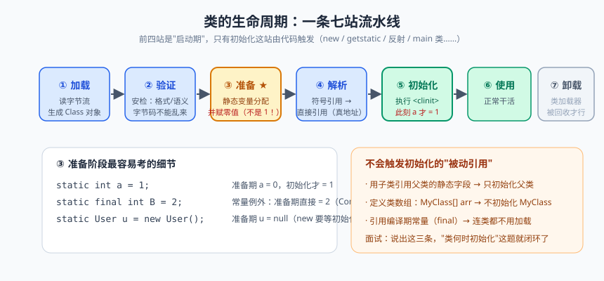
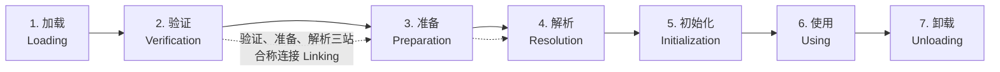
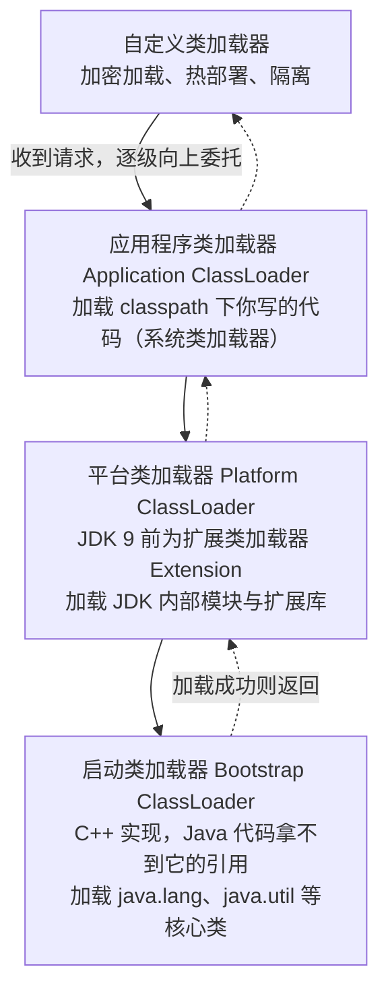
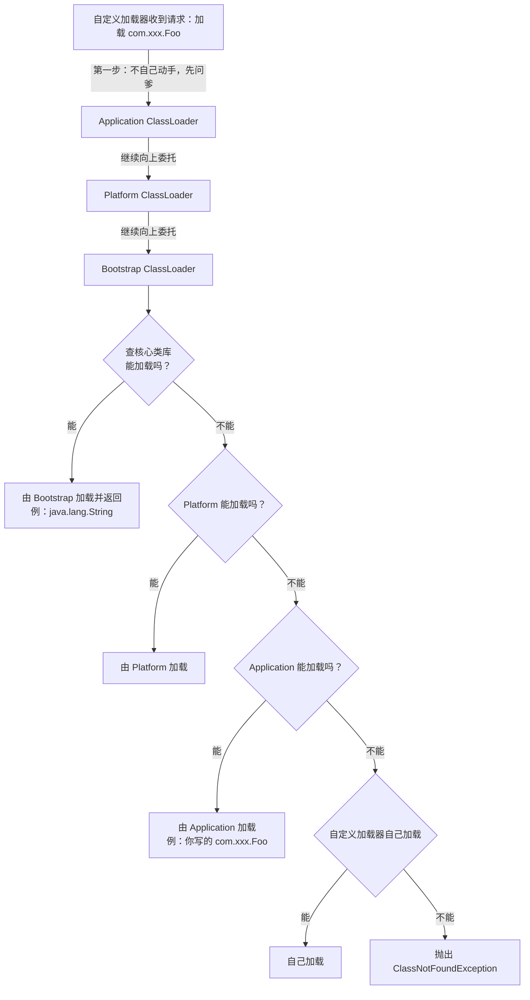

# 类加载机制：双亲委派与字节码

上两篇咱们聊了对象在堆里的生老病死。今天往上走一层，聊聊对象的"户口本"——类（Class）本身。你天天写 `new Thread()`，但你可能不知道：`Thread` 这个类从硬盘上的 class 文件，到能被 new 出实例，中间经历了一段堪比考公务员的严格流程——加载、验证、准备、解析、初始化，一关都不能少。

这流程还不只是仪式感。搞懂它，你才能回答那些面试名场面：为什么 `static int a = 1` 在某个时刻其实是 0？为什么自己写个 `java.lang.String` 永远没法上位？为什么 Tomcat 里的两个 webapp 各自塞一个不同版本的 fastjson 居然能相安无事？Lombok 没写一行 get 方法代码，编译完却全有了，谁干的？

今天咱们把 class 文件的一生讲透，顺便带你入门字节码。放心，不难，就是有点上头。

## 一、类生命周期总览：七站旅途


> 🖼️ **图解**：七站流水线：准备期 a=0、初始化才 a=1 的经典考点

类从被加载到虚拟机内存开始，到从内存中卸载，整个生命周期七站：



注意两个细节：一是验证、准备、解析三站合称**连接（Linking）**；二是解析阶段在某些情况下可以在初始化之后才进行（运行期动态绑定，支持 Java 的多态）。而加载、验证、准备、初始化的**开始顺序是确定的**，解析就不一定了。

## 二、加载：拿到字节流，造出 Class 对象

加载（Loading）阶段做三件事：

1. 通过类的**全限定名**获取定义此类的二进制字节流（从 jar 包、class 文件、网络、动态代理生成……来源不限，这就是后来的热部署、字节码增强的入口）；
2. 把字节流的静态存储结构转化为**方法区**的运行时数据结构；
3. 在内存中生成一个 `java.lang.Class` 对象，作为方法区这个类各种数据的访问入口。

注意"二进制字节流来源不限"这句话，信息量很大：从 ZIP 里读（jar 包）、从网络读（Applet 时代）、运行时动态生成（动态代理）、从加密文件读（代码保护）——类的来源不落地的自由，成就了 Java 生态里半个框架圈。

## 三、验证、准备、解析：安检、分房、换门牌

**验证（Verification）**是连接第一步，确保 class 文件字节流符合规范、不会危害虚拟机——文件格式、元数据、字节码、符号引用四道关卡。毕竟 class 文件可以手工伪造，不查清楚就执行，等于把陌生人的 U 盘直接插生产服务器。我们重点看后两步。

### 3.1 准备：静态变量的"零值入住"

准备（Preparation）阶段为类中定义的**静态变量**分配内存（JDK 8 起随类元数据逻辑归属，静态变量实体在堆中）并设置**零值**——注意，是零值，不是你写的初值：

```java
public static int a = 1;
// 准备阶段结束后：a = 0（int 的零值）
// 要等初始化阶段执行 <clinit> 后，a 才等于 1

public static final int CONST = 1314;
// 准备阶段就是 1314！
// 因为 static final 修饰、编译期可确定的常量带有 ConstantValue 属性，准备阶段直接赋值
```

为什么这么设计？因为此时类的构造方法、静态代码块一个都还没执行，你写的 `= 1` 本质是初始化阶段的赋值语句，准备阶段只保证变量"先住进来、有张床"。

### 3.2 解析：符号引用换成直接引用

解析（Resolution）把常量池里的**符号引用（Symbolic Reference）**（用一组符号描述目标，比如 `java/lang/Object`，不一定真的在内存里）替换为**直接引用（Direct Reference）**（直接指向目标的指针、偏移量等）。类比：符号引用是写着"杭州市西湖区"的信封，解析就是把它换成 GPS 坐标——直接能导航过去。

## 四、初始化：<clinit> 的登场时刻

初始化（Initialization）才真正开始执行类中编写的 Java 代码：执行类构造器 **`<clinit>()`** 方法——由编译器自动收集**所有静态变量的赋值语句和静态代码块**合并产生，编译器保证父类的 `<clinit>` 先执行。JVM 严格保证 `<clinit>` 在多线程下被正确加锁同步——所以静态内部类单例天生线程安全，这个后话。

《规范》规定了六种"必须立即初始化"的场景，常考的有：**new、getstatic、putstatic、invokestatic** 四条指令（实例化对象、读写静态字段、调用静态方法）；**反射调用**（`Class.forName`，注意 `loadClass` 默认不触发）；初始化一个类时若父类未初始化，**先触发父类初始化**；**main 方法所在的类**启动时初始化。

### 4.1 被动引用：三个"看着像会初始化、其实不会"的例子

```java
// 例子 1：通过子类引用父类静态字段 —— 只初始化父类
class Father {
    static int value = 42;
    static { System.out.println("Father <clinit>"); }
}
class Son extends Father {
    static { System.out.println("Son <clinit>"); }
}
public class PassiveRef1 {
    public static void main(String[] args) {
        System.out.println(Son.value);
        // 输出：Father <clinit> → 42。Son 安静如鸡：
        // 静态字段定义在 Father，对 Son 只是"路过"，不构成对 Son 主动使用
    }
}

// 例子 2：定义类数组 —— 不触发初始化
public class PassiveRef2 {
    public static void main(String[] args) {
        Son[] array = new Son[10];   // 触发初始化的是数组类型 [LSon;（JVM 自动派生），不是 Son
        System.out.println(array.length);   // 只输出 10，无任何 <clinit>
    }
}

// 例子 3：引用常量 —— 编译期已进入本类常量池
class Const {
    static final String HELLO = "hello";
    static { System.out.println("Const <clinit>"); }
}
public class PassiveRef3 {
    public static void main(String[] args) {
        System.out.println(Const.HELLO);
        // 不打印 Const <clinit>：编译期常量已存进 PassiveRef3 的常量池，
        // 运行期跟 Const 类没有半毛钱关系
    }
}
```

> ⚠️ **踩坑实录**：曾有学员在静态块里做配置加载，某天同事把一处 `Config.init()` 的显式调用改成了"反正别处引用过这个类，类加载就会执行静态块"——结果引用方式恰好是上面三种被动引用之一，静态块没执行，配置空指针在凌晨爆雷。教训：**需要确定执行的初始化逻辑，别赌"类会被加载"，显式调用**。

## 五、类加载器层次：谁负责加载谁

类加载阶段"通过全限定名获取字节流"这个动作，交给类加载器（ClassLoader）实现。同一個类，被不同加载器加载，在 JVM 里就是**两个不同的类**——身份由"类加载器 + 全限定名"共同决定。JDK 9 前后层次略有调整：



验证 Bootstrap 存在感的小实验：`String.class.getClassLoader()` 返回 **null**——不是没有加载器，是它 C++ 实现，Java 层拿不到引用，规范规定返回 null。而你自己写的类，`getClassLoader()` 返回的是 AppClassLoader。

四层加载器职责一览：

| 类加载器 | 实现 | 加载什么 | 拿得到引用吗 |
|---------|------|---------|:---:|
| Bootstrap | C++（JVM 一部分） | `JAVA_HOME/lib` 核心库（java.lang.*、java.util.*） | 拿不到（返回 null） |
| Platform（JDK 9 前为 Extension） | Java 实现 | JDK 内部模块与扩展库 | 能 |
| Application（System） | Java 实现 | classpath 下的应用代码与第三方依赖 | 能（你写的类的默认加载器） |
| 自定义 | 继承 ClassLoader 自己写 | 任意来源：网络流、加密字节码、热部署目录 | 能 |

## 六、双亲委派模型：向上委托，向下兜底

### 6.1 工作原理

如果一个类加载器收到类加载请求，它**不先自己加载，而是委派给父加载器**逐级向上；直到 Bootstrap 无法完成，才由子加载器自己尝试。用一段代码说清一切——这其实就是 `ClassLoader.loadClass()` 的骨架：

```java
protected Class<?> loadClass(String name, boolean resolve) throws ClassNotFoundException {
    synchronized (getClassLoadingLock(name)) {
        Class<?> c = findLoadedClass(name);          // 1. 检查是否已加载过
        if (c == null) {
            try {
                if (parent != null) {
                    c = parent.loadClass(name, false); // 2. 有爹先委托爹
                } else {
                    c = findBootstrapClassOrNull(name);// 3. 没爹说明到顶了，委托 Bootstrap
                }
            } catch (ClassNotFoundException e) {
                // 父加载器抛异常——说明父到顶也没找到，啥都不做，往下走
            }
            if (c == null) {
                c = findClass(name);                  // 4. 爹们搞不定，自己动手 findClass
            }
        }
        if (resolve) resolveClass(c);
        return c;
    }
}
```



### 6.2 两大好处

**好处一：避免重复加载。** 父加载器加载过的类，子加载器不会再加载一次，保证类在 JVM 里的唯一性（配合"加载器+类名"的身份机制）。

**好处二：防止核心 API 被篡改。** 这是安全底线。亲手做个实验：

```java
// 文件名 String.java，包名就敢叫 java.lang
package java.lang;

public class String {
    public static void main(String[] args) {
        System.out.println("我是冒牌 String");
    }
}
// javac 能编译通过（编译器不拦你）
// 但 java java.lang.String 运行结果：
// "错误: 在类 java.lang.String 中找不到 main 方法"
// 原因：双亲委派把请求一路送到 Bootstrap，它从核心类库里找到了"正牌 String"，
// 你的冒牌货躺在 classpath 根本没机会被加载。
// 若换成 java.lang 下不存在的类名（如 java.lang.Hack），则直接报：
// java.lang.SecurityException: Prohibited package name: java.lang
```

> 📌 **划重点**：双亲委派 = "儿子收到活先问爹，爹干不了儿子再干"。它保证了 `java.lang.String` 永远是官方正版的唯一原因——不是编译器拦你，是类加载顺序让你永远排不上队。

## 七、破坏双亲委派：规矩是死的，需求是活的

模型虽好，三次著名的"破坏"推动了演进。第一次是历史遗留（JDK 1.2 之前自定义加载器重写 loadClass），第二次就是我们重点讲的 **SPI 与线程上下文类加载器**，第三次是 OSGi / 热部署的网状加载。

### 7.1 SPI 的死结与解法：线程上下文类加载器

死结：`DriverManager` 在 JDK 核心类库里（由 Bootstrap 加载），它需要加载 classpath 里的 MySQL 驱动；但 Bootstrap 看得见的只有核心类库，**爹看不见儿子地盘里的类**——基础的 JDBC 竟然被加载器层次卡死了。

解法：**线程上下文类加载器（Thread Context ClassLoader）**。JDK 给每个线程塞了一个"后门加载器"，默认是 AppClassLoader。核心类库需要加载厂商实现时，不用自己的 Bootstrap，改用当前线程的上下文加载器——爹借儿子的手干活：

```java
// 你只写了一行：
// Connection conn = DriverManager.getConnection(url, user, pwd);
// DriverManager（Bootstrap 加载）内部通过 ServiceLoader（SPI 机制）发现驱动：

// ServiceLoader.load 的核心逻辑（JDK 8 风格简化）：
ClassLoader cl = (Thread.currentThread().getContextClassLoader() == null)
        ? ClassLoader.getSystemClassLoader()                       // 后门：拿到 AppClassLoader
        : Thread.currentThread().getContextClassLoader();
ServiceLoader<Driver> loadedDrivers = ServiceLoader.load(Driver.class, cl);
// 然后去读 classpath 各 jar 里的 META-INF/services/java.sql.Driver 文件，
// 按文件里写的类名加载 mysql 的驱动类 —— 父加载器借线程上下文"越级"加载实现类
```

这就是双亲委派的经典"逆向破坏"：基础逻辑放核心库（爹），具体实现放 classpath（儿子的地盘），爹通过后门调儿子的资源。JNDI、JAXP 这些 SPI 都是这个套路。

至于 **OSGi** 和热部署，一句带过：它们把"父子链"改成按需跳转的网状加载，实现模块间按 Import/Export 精细互相加载，曾是 Eclipse 插件体系的基石。

### 7.2 Tomcat 的 WebappClassLoader：隔离的智慧

Tomcat 面对的现实问题：一台 Tomcat 跑多个 webapp，A 应用用 fastjson 1.1，B 应用用 fastjson 1.2，还都可能有同名类。它的方案是给**每个 webapp 配一个独立的 WebappClassLoader**：

- 各 webapp 自己的类，WebappClassLoader **先自己加载**（打破先问爹的顺序），实现应用间隔离；
- 加载不到再委托父级（Common 类加载器 → 平台/应用加载器），共享 JDK 与 Tomcat 公共库；
- 但 `java.*` 等核心包**强制委托**给 Bootstrap——隔离可以，篡改核心不行。

于是多个应用的同名类互不干扰，JVM 身份机制（加载器+类名）在此居功至伟。Spring Boot 的 LaunchedClassLoader、OSGi 的模块加载，思路同宗同源。

> 💡 **老鸟忠告**：写自定义类加载器时，**重写 `findClass()` 而不是 `loadClass()`**——前者保留双亲委派流程（只定义"我自己怎么找类"），后者直接把委派逻辑改了。除非你明确知道自己在干嘛（比如做隔离容器），否则别动 loadClass。见过加密类加载需求把 loadClass 重写残了，连 `java.lang.Object` 都加载失败的惨案。

## 八、字节码初探：javap 打开新世界

### 8.1 先看懂一个最简单的方法

```java
public class BytecodeDemo {
    public static int add(int a, int b) {
        int sum = a + b;
        return sum;
    }
}
// javac BytecodeDemo.java && javap -c BytecodeDemo
```

```text
public static int add(int, int);
  Code:
     0: iload_0      // 加载第 0 个参数 a 压入操作数栈
     1: iload_1      // 加载第 1 个参数 b 压入操作数栈
     2: iadd         // 弹出两个 int 相加，结果 3 压回栈
     3: istore_2     // 弹出存入局部变量表 2 号槽（sum）
     4: iload_2      // 加载 sum 压栈
     5: ireturn      // 返回栈顶 int
```

读懂套路：`i` 前缀 = int 操作，load/store = 压栈/存局部变量表，const = 常量压栈，数字后缀 = 槽位编号。Java 是基于操作数栈的解释执行模型，上一篇讲栈帧时已经铺过路，这里是不是突然就通了？

### 8.2 i++ vs ++i：字节码层面见真章

```java
public class IncDemo {
    public int post() { int i = 0; i = i++; return i; }   // 经典面试题：返回 0
    public int pre()  { int i = 0; i = ++i; return i; }   // 返回 1
}
```

```text
public int post();
     0: iconst_0            // 常量 0 压栈
     1: istore_1            // i = 0
     2: iload_1             // 把 i 的"旧值 0"压栈 —— 关键一步：先留旧值
     3: iinc          1, 1  // 局部变量表里 i 直接 +1（注意：这步不经过操作数栈！）
     6: istore_1            // 把栈顶的旧值 0 存回 i —— 刚加的 1 被无情覆盖
     7: iload_1
     8: ireturn             // 返回 0

public int pre();
     0: iconst_0
     1: istore_1            // i = 0
     2: iinc          1, 1  // 先在局部变量表里 +1，i 变成 1
     5: iload_1             // 把"新值 1"压栈
     6: istore_1
     7: iload_1
     8: ireturn             // 返回 1
```

`iinc` 指令直接改局部变量表、不碰操作数栈，`i++` 则是"先留旧值再自增"，赋值回去时旧值把新值盖了——面试官问十次的题，字节码给一次永久性答案。

### 8.3 String 拼接在字节码里长啥样

```java
public String concat(String a, String b) {
    return a + b;
}
```

```text
// JDK 8：StringBuilder 方案
 0: new           #2   // class java/lang/StringBuilder
 3: dup
 4: invokespecial #3   // StringBuilder.<init>:()V —— 调构造方法
 7: aload_1
 8: invokevirtual #4   // StringBuilder.append:(Ljava/lang/String;)
11: aload_2
12: invokevirtual #4   // 再 append b
15: invokevirtual #5   // StringBuilder.toString:()
18: areturn

// JDK 9+：invokedynamic + StringConcatFactory 方案
 0: aload_1
 1: aload_2
 2: invokedynamic #6, 0   // InvokeDynamic #0: makeConcatWithConstants
                           // 由 StringConcatFactory 在首次调用时动态生成拼接方法
 7: areturn
```

JDK 9 起改为 `invokedynamic` 调 `StringConcatFactory.makeConcatWithConstants`，把拼接策略的优化权交给 JVM 运行期决定（可用 `-Djava.lang.invoke.stringConcat` 查看策略），通常比无脑 new StringBuilder 更快。所以"循环里别用 + 拼字符串"这条老规矩的机理你要分版本理解：**单表达式里的 + 编译器早就帮你优化了；循环里跨多次拼接，编译器无能为力，才需要你手动 StringBuilder**。

### 8.4 字节码增强三剑客

最后认识三位"粮食供应商"——大量框架在编译期或运行期靠它们直接生产/修改字节码：**ASM**（最底层、最快，直接操纵字节码指令，CGLIB、Gradle 都基于它）；**Javassist**（API 最像写 Java 代码，上手快，Hibernate 用它）；**ByteBuddy**（API 最现代优雅，Mockito、SkyWalking、多数 APM Agent 的选择）。Lombok 改写 AST 属于编译期注解处理的另一条路，但 CGLIB 动态代理、AOP 的织入、APM 的无侵入埋点，吃的都是这三家的粮。学到这里，"动态代理类为什么会把元空间吃爆"（上上篇的 OOM 实验）就彻底闭环了。

## 本篇小结

- 类生命周期：加载→验证→准备→解析→初始化→使用→卸载；验证+准备+解析=连接。
- 加载三件事：全限定名取字节流、方法区建数据结构、生成 Class 对象；字节流来源不限是字节码生态的基石。
- 准备阶段赋零值；`static final` 带 ConstantValue 的常量例外，准备阶段就有真实值。
- 初始化执行 `<clinit>`（静态赋值+静态块，父类先行，线程安全）；new/getstatic/putstatic/invokestatic、反射、子类触发父类、main 类是触发时机。
- 被动引用三例：子类引用父类静态字段、定义类数组、引用编译期常量，都不触发初始化。
- 加载器层次：Bootstrap（C++，拿不到引用）→Platform（原 Extension）→Application→自定义。
- 双亲委派：向上委托、向下兜底；两大好处——避免重复加载、防核心 API 篡改（冒牌 String 实验）。
- 破坏双亲委派：SPI 靠线程上下文类加载器"爹借儿子的手"；Tomcat 的 WebappClassLoader 用"先自己后父亲"实现应用隔离；iinc 直接操作局部变量表，解释了 i++ 的旧值覆盖。

## 课后思考 & 动手练习

1. `static final int X = new Random().nextInt();` 在准备阶段是零值还是随机值？为什么和 `static final int Y = 42` 不同？
2. 双亲委派模型被"破坏"了三次，各自解决什么问题？线程上下文类加载器为什么必须存在？
3. 同一个类被 AppClassLoader 和自定义加载器各加载一次，`instanceof` 结果会怎样？为什么 Tomcat 反而需要这种行为？
4. 【动手实验】写一个含静态代码块的类，分别用 `Class.forName("Xxx")`、`ClassLoader.getSystemClassLoader().loadClass("Xxx")`、`new Xxx()` 三种方式加载，观察静态块执行差异；再用 PassiveRef1~3 三个例子验证被动引用。
5. 【动手实验】自己写 `post()`/`pre()` 两个方法，`javap -c` 反编译对照本文输出；再写一个 for 循环里用 `+` 拼接字符串的方法，反编译看编译器有没有帮你优化，用实验验证"循环内拼接要用 StringBuilder"的边界。

下一篇预告：内存、GC、类加载三大原理课都上完了，下一节实战见真章——《JVM 调优实战：工具箱与真实案例》，jps/jstat/jmap/jstack 四板斧加 Arthas 神器，三个真实案例带你从"告警群懵逼"到"五分钟定位"。
