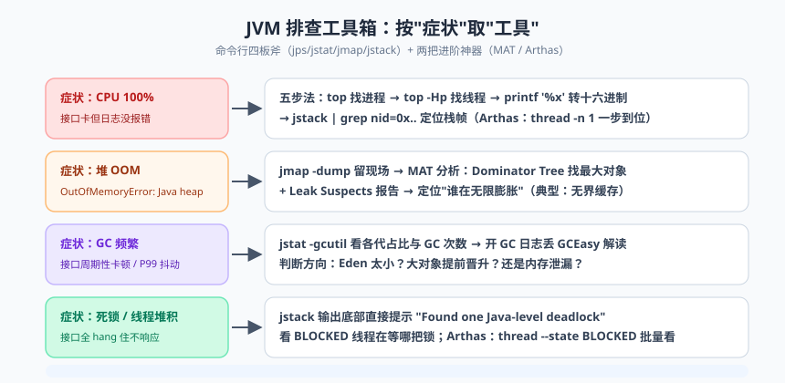

# JVM 调优实战：工具箱与真实案例

前三篇咱们把 JVM 的内存结构、垃圾回收、类加载三大原理课都修完了，今天进入实战篇——真刀真枪地上生产线。先讲个我入行时的糗事：当年值班遇到服务卡顿，我信心满满地登上服务器，敲了一串从博客上抄来的 JVM 参数重启服务，然后……服务从"偶尔卡"进化成了"稳定地卡"。师父赶来只干了一件事：把我的参数全删了，恢复默认，然后打开监控看了十分钟，指着一条 SQL 说："问题在这。"

这就是今天第一课要讲的：**调优是最后手段，不是第一反应**。工具箱再漂亮，也得先知道钉子在哪。今天这节课分三块：先立三观，再发工具（命令行四板斧 + 可视化 + Arthas 神器），最后上三个我亲手处理过的真实案例。学完这篇，你在告警群里就能从"等着别人看"变成"我来定位"的那个人。

## 一、调优的正确三观

**三观一：调优是最后手段。** 大多数"JVM 问题"的真凶是代码：一条全表扫描的 SQL、一个没分页的查询、一次无界的本地缓存、一个死循环。先看代码和监控，再谈参数。改参数能带来的收益通常在 10%~20% 量级，改好一处代码可能是 10 倍。

**三观二：先监控，后调优。** 没有度量就没有优化——凭感觉调参等于闭着眼睛开药。GC 日志、监控面板（Prometheus + Grafana）、APM（SkyWalking 等），这是调优的三块仪表盘，缺一不可。调优前先回答：现在的 GC 频率是多少？停顿多长？内存曲线长什么样？

**三观三：没有银弹。** 任何参数都是在"吞吐"和"延迟"之间做交易，适合别人的参数未必适合你——堆大小、对象分配速率、业务容忍度全都不同。**抄参数一时爽，出事火葬场**。明白每个参数背后的原理（前几篇的功课），才是抄得放心的前提。

> 📌 **划重点**：调优的标准动作顺序是：**现象 → 监控/日志定位瓶颈 → 改代码或参数 → 观察对比 → 归档复盘**。跳过中间直接改参数重启的，不叫调优，叫抽卡。

## 二、命令行工具箱：四板斧


> 🖼️ **图解**：按"症状"取"工具"：CPU 100%/OOM/GC 频繁/死锁各用哪招

JDK 自带的工具在 `$JAVA_HOME/bin` 下，一个都不用装，生产服务器上就能直接用。

### 2.1 jps：找到进程

`jps -l` 列出所有 Java 进程 PID 和主类全名。一切排查的起点——先知道要查"谁"。

### 2.2 jstat：GC 情况的听诊器

```bash
jstat -gcutil 12345 1000   # 每 1000ms 输出一次 12345 进程的 GC 百分比概况
```

```text
 S0     S1     E      O      M     CCS    YGC    YGCT    FGC    FGCT     GCT
 0.00  93.44  60.22  45.10  95.02  89.11   102   1.235     3    0.890   2.125
```

各列含义必须背下来：S0/S1 = 两个 Survivor 使用率（%）；E = Eden 使用率；O = 老年代使用率；M = 元空间（Metaspace）使用率；CCS = 压缩类空间使用率；**YGC/YGCT = 年轻代 GC 次数 / 累计耗时（秒）**；**FGC/FGCT = Full GC 次数 / 累计耗时**；GCT = GC 总耗时。看点技巧：O 列在 Full GC 后仍持续高位（比如 90%+）不降，怀疑内存泄漏；FGC 数字肉眼可见地涨，就是周期性卡顿的直接嫌疑。用 `jstat -gccause 12345` 还能看最近一次 GC 原因。

### 2.3 jmap：堆的解剖刀

```bash
jmap -histo 12345 | head -20          # 堆内对象直方图：哪个类的实例最多、占多大
jmap -histo:live 12345 | head -20     # 只统计活对象（会先触发一次 Full GC，注意！）
jmap -dump:format=b,file=heap.hprof 12345   # 导出完整堆快照，供 MAT 分析
```

```text
 num     #instances         #bytes  class name
   1:       1203456      1538321920  [B                              -- 字节数组，1.5GB，重大嫌疑
   2:        987654       237036960  java.util.HashMap$Node
   3:        654321       209378720  com.xxx.dto.OrderInfo           -- 业务对象，看是谁持有着它
```

> ⚠️ **踩坑实录**：曾有同学在生产 8GB 堆的服务上直接 `jmap -dump`，结果 JVM 整整 STW（Stop The World）了近 40 秒，dump 文件 6GB 还把磁盘写满了——一个 OOM 还没查完，先制造了一场雪崩。生产 dump 三原则：**尽量在低峰期做；先确认磁盘剩余空间大于堆大小；能复现的问题优先在测试环境复现后再 dump**。JDK 8+ 更优雅的方式是加启动参数 `-XX:+HeapDumpOnOutOfMemoryError -XX:HeapDumpPath=/data/dump/`，让 OOM 时自动留"遗照"。

### 2.4 jstack：线程快照与死锁检测

`jstack 12345` 输出全部线程的调用栈快照（Thread Dump）。先来一个死锁 Demo：

```java
public class DeadLockDemo {
    private static final Object LOCK_A = new Object();
    private static final Object LOCK_B = new Object();

    public static void main(String[] args) {
        new Thread(() -> {
            synchronized (LOCK_A) {
                sleep(1000);                       // 确保 T2 也拿到了 B
                synchronized (LOCK_B) {            // T1 等 T2 手里的 B
                    System.out.println("T1 拿到两把锁");
                }
            }
        }, "worker-1").start();

        new Thread(() -> {
            synchronized (LOCK_B) {
                sleep(1000);
                synchronized (LOCK_A) {            // T2 等 T1 手里的 A —— 死锁闭环
                    System.out.println("T2 拿到两把锁");
                }
            }
        }, "worker-2").start();
    }

    static void sleep(long ms) {
        try { Thread.sleep(ms); } catch (InterruptedException ignored) { }
    }
}
```

`jstack <pid>` 的输出末尾会直接给出判决书：

```text
Found one Java-level deadlock:
=============================
"worker-1":
  waiting to lock monitor ... (object 0x000000076ab5e728, a java.lang.Object),
  which is held by "worker-2"
"worker-2":
  waiting to lock monitor ... (object 0x000000076ab5e780, a java.lang.Object),
  which is held by "worker-1"
```

线程状态也要认识：RUNNABLE（运行/等 IO）、BLOCKED（等锁）、WAITING / TIMED_WAITING（wait/sleep/join）。大量 BLOCKED 围绕同一把锁 = 锁竞争热点；线程栈全卡在 socketRead = 下游依赖拖死你。

`jinfo <pid>` 查看和修改运行期 JVM 参数；`jcmd <pid> help` 是官方"瑞士军刀"，GC.class_histogram、Thread.print、JVMTI CompiledMethod 等命令一网打尽，一句带过，知道有它们即可。

## 三、可视化与进阶工具

**JConsole**（JDK 自带，`jconsole` 命令启动）：内存/线程/类加载的实时曲线，本地零配置，快速看个大概。**VisualVM**（VisualVM，dump 文件分析、实时 CPU 采样、插件生态）：比 JConsole 强一档，个人排查首选。**MAT**（Eclipse Memory Analyzer，吃 hprof 文件的专业户）：两个杀手锏必须掌握——**Leak Suspects 报告**（自动给出泄漏嫌疑与证据链）和 **Dominator Tree**（支配树：谁直接/间接持有最多内存，按 Retained Heap 排序，最大的那个就是主犯）。命令行只能告诉你"字节数组 1.5GB"，MAT 能告诉你"是 Local Cache 这个 Map 持有的"。

### Arthas：线上排查神器速成

阿里开源的 Arthas 是"不用重启、不用改代码"的动态排查神器，`java -jar arthas-boot.jar` 挂到目标进程即用：

```bash
dashboard                                      # 全局面板：线程、内存、GC 一屏尽收，先看天气
thread -n 3                                    # CPU 占用最高的 3 个线程（CPU 高问题的第一步）
thread --blocked                               # 谁在等锁；thread <id> 看单个线程栈
jad com.xxx.service.OrderService               # 反编译线上正在运行的代码——确认部署的到底是不是这版
sc -d com.xxx.service.OrderService             # 查类信息：从哪个 jar 加载的、类加载器是谁
watch com.xxx.service.OrderService createOrder '{params, returnObj, throwExp}' -x 2 -n 5
                                               # 观察方法调用：入参、返回值、异常，现场直播 5 次
trace com.xxx.service.OrderService createOrder '#cost > 200'
                                               # 方法内部调用链耗时，只打印超过 200ms 的调用
tt -t com.xxx.service.OrderService createOrder # 时间隧道：记录每次调用现场，tt -i 1000 可回放检查
```

老鸟用法口诀：怀疑代码版本用 `jad`，怀疑参数用 `watch`，怀疑慢用 `trace`，想"回到案发现场"用 `tt`。它还有 `ognl` 表达式、`heapdump`、`vmtool` 等进阶能力，官方文档值得通读一遍。

### GC 日志配置与在线分析

```bash
# JDK 8 风格：
-XX:+PrintGCDetails -XX:+PrintGCDateStamps -Xloggc:/logs/gc.log
-XX:+UseGCLogFileRotation -XX:NumberOfGCLogFiles=5 -XX:GCLogFileSize=20M

# JDK 9+ 统一日志（Unified Logging），一个 -Xlog 全搞定：
-Xlog:gc*:file=/logs/gc.log:time,uptime,level,tags:filecount=5,filesize=20m
```

拿到日志后，扔进 **GCEasy**（gceasy.io，上传 gc.log 出报告）或 GCEasy 类的在线工具：它直接给你停顿分布、吞吐占比、回收后堆大小曲线、异常点标注，比肉眼翻日志高效一百倍。看到"平均停顿 40ms、99 分位 800ms"这种报告，优化方向自己就跳出来了。

> 💡 **老鸟忠告**：**GC 日志请无条件常开**。它的开销可以忽略不计（写入量通常每秒几 KB），但事故复盘时它是唯一的时间证人。多少团队出了事才发现没开 GC 日志，只能对着监控的"内存锯齿图"猜谜。

## 四、案例一：OOM 三连排查

### 4.1 堆 OOM：Local Cache 无限膨胀

现象：电商营销服务运行三天后 `OutOfMemoryError: Java heap space`。排查路径：加了 `-XX:+HeapDumpOnOutOfMemoryError`，拿到 hprof → **MAT 打开 → Leak Suspects 直接点名：一个 ConcurrentHashMap 占了 62% 堆** → Dominator Tree 顺藤摸瓜，是"用户实时权益缓存"：只往里 put，从未清理，也没有容量上限与过期策略（业务量上来后彻底失控）。修复：换 Caffeine 并设置 `maximumSize` + `expireAfterWrite`，OOM 永久消失。**参数没改一行，改的是代码**——再次印证三观一。

### 4.2 元空间 OOM：动态代理类膨胀

现象：规则引擎服务 `OutOfMemoryError: Metaspace`，重启后一个月复发。jmap 看堆很健康，`jstat -gcutil` 的 M 列一路涨到顶。dump 类列表发现上万个 `com.xxx.rule.Rule$ByteBuddy$xxxx` 代理类——每次规则热更新都 new 一个新的 `ByteBuddy` 子类加载器，旧类无法卸载。修复：代理生成器复用 + 缓存已生成类型 + `-XX:MaxMetaspaceSize=512m` 兜底。元空间 OOM 永远先查"谁在动态生成类"。

### 4.3 GC overhead limit exceeded：僵尸状态

现象：日志刷屏 `java.lang.OutOfMemoryError: GC overhead limit exceeded`。机理：JVM 花了超过 98% 的时间做 GC，却回收不到 2% 的堆——堆"将满未满"，程序陷入"干一下活就被拉去 GC"的僵尸态，与其这么耗着，JVM 选择提前自尽。本例真凶是软引用缓存：缓存把堆吃到 90%+，每次 GC 都能挤出一丁点软引用对象，刚好躲过 heap space OOM，又永远不够用。修复：缓存上限收紧 + 堆从 4G 扩到 6G（短期缓解）+ 清理无界缓存（根治）。

## 五、案例二：CPU 100% 排查五步法

现象：订单服务单核 CPU 打满。这是标准五步，命令全程演示：

```java
// 先在自己机器上造个案发现场
public class CpuFullDemo {
    public static void main(String[] args) {
        new Thread(() -> {
            long i = 0;
            while (true) { i++; }        // 死循环空转：单核 CPU 杀手
        }, "cpu-killer").start();
    }
}
```

```bash
# 第一步：找到吃 CPU 的进程
top
#    PID USER      %CPU  ...
#  12345 app       99.7        ← 锁定进程

# 第二步：找到进程内吃 CPU 的线程（-H 表示显示线程）
top -Hp 12345
#    PID   USER  %CPU
#  12378   app   99.2         ← 锁定线程 TID = 12378

# 第三步：线程号转十六进制（jstack 输出里的 nid 是 16 进制）
printf '%x\n' 12378
# 305a

# 第四步：jstack 里检索这个 nid，定位栈帧
jstack 12345 | grep -A 20 'nid=0x305a'
# "cpu-killer" #11 prio=5 os_prio=31 tid=0x... nid=0x305a runnable
#    at com.xxx.demo.CpuFullDemo.lambda$main$0(CpuFullDemo.java:8)   ← 案发代码行

# 第五步：对着代码行修复（本例：补上退出条件的 bug；实际常见还有正则回溯、死循环重试、频繁序列化）
```


五步口诀：**top 找进程 → top -Hp 找线程 → printf 转十六进制 → jstack 定位 → 改代码**。面试问"CPU 100% 怎么查"就答这五步，一个字都别少。用 Arthas 更省事：`thread -n 1` 一步到位，但五步法是功底，得会。

## 六、案例三：接口周期性卡顿

现象：支付回调接口每 10 秒左右抖一下，P99 延迟飙到 800ms。GC 日志丢进 GCEasy 一看：**Young GC 每 9~11 秒一次，单次停顿 45ms，但伴随"对象提前晋升"**——每次 Young GC 都有几十 MB 对象直接进了老年代，老年代缓慢上涨，进而周期性触发 Full GC（这才是 800ms 的来源）。

两种病因的分叉判断：**Eden 太小**（GC 频繁但每次回收干净）vs **大对象/过早晋升**（Survivor 放不下熬过两次 GC 的中间对象，提前进老年代）。本例日志显示大量对象年龄 2 就晋升——Survivor 太挤。调整前后对比：

| 指标 | 调整前（-Xmx4g，默认分代） | 调整后（-Xmx4g -Xmn2g -XX:SurvivorRatio=8） |
|---|---|---|
| Young GC 频率 | 每 10 秒一次 | 每 40 秒一次 |
| 单次 Young GC 停顿 | 45ms | 130ms（变长但可接受） |
| 每次晋升老年代 | 30~60MB | < 2MB |
| Full GC 频率 | 每天数次 | 两周零次 |
| 接口 P99 | 800ms | 120ms |

调整思路：加大新生代让"朝生夕死"的对象有足够的场地当场死掉（Eden 装得下一个请求周期的分配量），加大 Survivor 空间让"中间状态对象"（本次请求的缓冲区）活到自然死亡而不是提前挤进老年代。**注意这是本例的病因与解法，不是万能公式**——如果对象是"长期存活"型（缓存类），加大新生代反而是灾难。先看日志再动参数，永远。

## 七、常用参数速查表

| 类别 | 参数 | 说明 |
|---|---|---|
| 内存 | `-Xms` / `-Xmx` | 初始/最大堆，生产建议设成相同 |
| 内存 | `-Xmn` | 新生代大小（Eden+2*Survivor） |
| 内存 | `-XX:MetaspaceSize` / `-XX:MaxMetaspaceSize` | 元空间触发阈值 / 上限，务必设上限 |
| 内存 | `-Xss` | 单线程栈大小，默认 1m |
| 内存 | `-XX:MaxDirectMemorySize` | 直接内存上限（Netty 关注） |
| GC 选择 | `-XX:+UseParallelGC` | 吞吐优先，JDK 8 默认 |
| GC 选择 | `-XX:+UseG1GC` | 均衡型，JDK 9+ 默认 |
| GC 选择 | `-XX:+UseZGC` | 超低延迟大堆（JDK 15+ 转正） |
| GC 调节 | `-XX:MaxGCPauseMillis=200` | G1/ZGC 停顿目标 |
| 故障兜底 | `-XX:+HeapDumpOnOutOfMemoryError` | OOM 自动 dump，生产标配 |
| 故障兜底 | `-XX:+ExitOnOutOfMemoryError` | OOM 快速退出交由编排系统拉起，避免僵尸态 |
| 日志 | `-Xlog:gc*`（9+）/ `-XX:+PrintGCDetails`（8） | GC 日志常开 |

## 八、调优 CheckList

1. GC 日志是否常开？OOM 是否自动 dump？容器内存限制与 -Xmx 是否匹配（留出元空间/栈/直接内存的余量）？
2. 监控告警是否覆盖：GC 次数与耗时、堆/元空间使用率、线程数、CPU、Full GC 告警？
3. 选型是否有据：吞吐型批处理用 Parallel，通用服务 G1，大堆低延迟评估 ZGC——能说出理由吗？
4. 代码层面四大嫌疑先过一遍：无界缓存、大对象全量查询、循环内重复创建、批量任务没分页。
5. 每次调参是否只改一个变量、有调整前的基线数据、调整后有对比复盘？
6. 元空间上限、直接内存上限是否都已设置？
7. 线程池与锁的使用是否规范（有界队列、超时释放）？
8. 事故归档了吗？——不复盘的故障，等于交了学费没领书。

## 本篇小结

- 调优三观：最后手段、先监控后调优、没有银弹；标准动作是"现象→定位→修改→对比→归档"。
- 四板斧：jps 找进程、jstat -gcutil 看 GC（各列含义要背）、jmap 解剖堆（生产 dump 有 STW 与磁盘风险）、jstack 抓线程与死锁。
- MAT 的 Leak Suspects 与 Dominator Tree 是内存泄漏排查的手术刀；GCEasy 是 GC 日志的免费化验科。
- Arthas 六连招：dashboard 看天气、thread 找热点、jad 反编译、sc 查来源、watch 直播、trace 计时、tt 回放。
- OOM 三连的排查路线各不相同：堆 OOM 走 dump→MAT；元空间 OOM 查动态类生成；GC overhead limit 是堆将满未满的僵尸态。
- CPU 100% 五步法：top → top -Hp → printf 转十六进制 → jstack 定位 → 修代码。
- 周期性卡顿先分诊：Eden 太小（GC 频繁）vs 过早晋升（Survivor 挤、老年代涨），用 GC 日志分叉判断。
- 生产标配参数：GC 日志常开、OOM 自动 dump、元空间与直接内存设上限。

## 课后思考 & 动手练习

1. `jstat -gcutil` 输出里 FGC 一直在涨但每次只涨 0.1% 不到，服务却越来越慢，你会怀疑什么？下一步做什么？
2. 为什么生产环境 `jmap -dump` 要慎用？`-XX:+HeapDumpOnOutOfMemoryError` 相比手动 dump 有什么优势？
3. 案例三里，如果日志显示的是"对象大量长期存活、每次 GC 后老年代占用高企"，加大 -Xmn 还合适吗？应该往哪个方向调？
4. 【动手实验】跑起 DeadLockDemo，用 jps + jstack 完整走一遍死锁检测，把"Found one Java-level deadlock"那段截图存档；再用 Arthas 的 `thread --blocked` 复查一遍，对比两种工具的输出。
5. 【动手实验】给 CpuFullDemo 复现五步法全程（top → top -Hp → printf → jstack），再用 Arthas `thread -n 1` 一步定位，体会两种路径的效率差异。

下一篇预告：JVM 篇到这里就圆满收官了。从下一篇起，我们开启并发编程的世界——《Java 多线程基础：线程的诞生与消亡》，说说 Thread 的前世今生、线程安全的坑，以及为什么面试官总爱问 synchronized 和 volatile。
