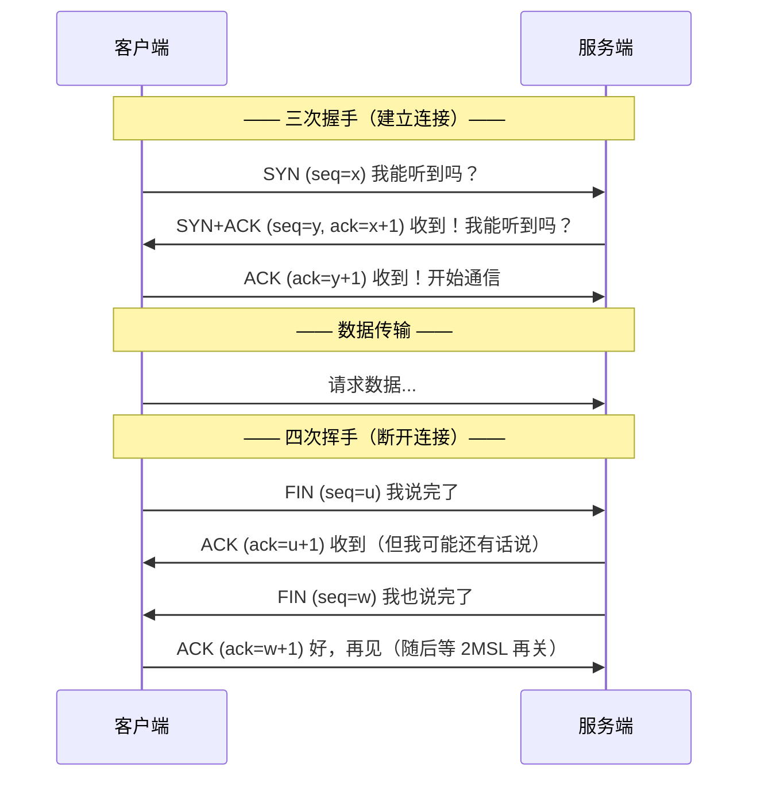
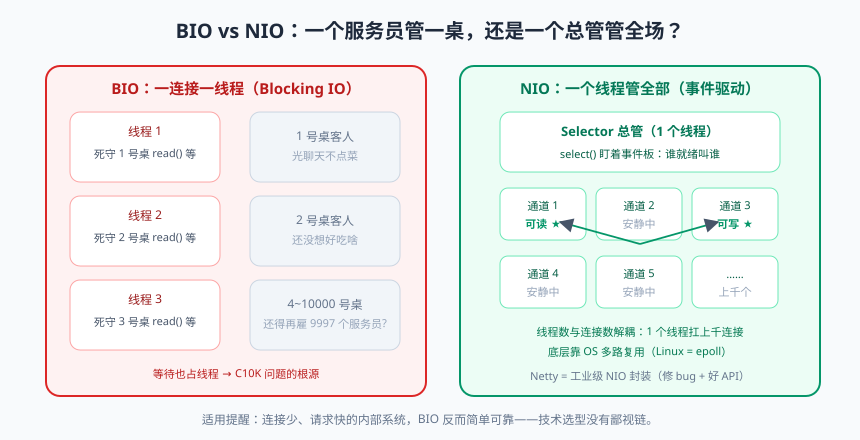

# 网络编程：从 Socket 到 HTTP

先说个扎心的事实：你每天写的 `@GetMapping` 接口，层层扒开之后，最底下跑的就是今天要讲的这些东西——Socket、TCP、HTTP。Spring Boot 只是给你穿了西装，里子还是 JDK 的网络编程。

很多同学学到网络编程就跳过："我用框架就行，学这个干嘛？" 这就好比会开车但不知道发动机是啥——车能跑，但一冒烟就只能干瞪眼。线上接口超时、连接池耗尽、TIME_WAIT 堆积、粘包拆包……这些高频疑难杂症，答案全在网络基础里。今天咱们把这些底层知识一次捋顺。

---

## 一、网络模型：先认路再开车

经典 OSI 七层模型背下来意义不大，**TCP/IP 四层模型**才是工程世界的主流通货：

| TCP/IP 四层 | 干什么 | 对应协议/技术 | 生活类比（快递系统） |
|------------|--------|--------------|---------------------|
| 应用层 | 业务语义：请求响应格式 | HTTP、HTTPS、DNS、MQTT | 包裹里的信件内容 |
| 传输层 | 端到端传输：端口、可靠性 | **TCP**、UDP | 快递公司（顺丰/圆通） |
| 网络层 | 主机到主机：IP 寻址路由 | IP、ICMP | 分拣中心（省市路由） |
| 链路层 | 相邻设备传输：网卡 | 以太网、Wi-Fi | 快递员和货车 |

一台服务器上跑着几百个进程，数据到了网卡给谁？靠**端口（Port）**区分：IP 定位主机，端口定位进程，`IP + Port = Socket 地址`。所以 Tomcat 默认占 8080，MySQL 占 3306，大家各回各家。

### TCP vs UDP：可靠先生和速度先生

| 对比项 | TCP（传输控制协议） | UDP（用户数据报协议） |
|--------|--------------------|-----------------------|
| 连接 | 面向连接（先握手） | 无连接（拿起来就发） |
| 可靠性 | 可靠：不丢、不重、按序 | 尽力而为：可能丢、可能乱序 |
| 速度/开销 | 慢，头部 20 字节起 | 快，头部固定 8 字节 |
| 传输形态 | 字节流（无边界的"水管"） | 数据报（一封封独立的信） |
| 典型场景 | 网页、API、文件传输、消息 | 直播弹幕、游戏、DNS、心跳 |

### 三次握手与四次挥手（高频面试题）

TCP 建立连接要"三次握手（Three-way Handshake）"，断开要"四次挥手"：



**为什么握手是三次不是两次？** 两次的话，服务端无法确认"自己发出去的应答客户端收到了"；而且一个迟到的旧 SYN（网络迷路的老包）会让服务端白白建立连接浪费资源。三次握手本质是**双方各确认一次"我能发、我能收"**。

**为什么挥手是四次？** TCP 全双工（双向都能发）。一方说"我说完了"（FIN），另一方可能还有数据没发完，只能先应答 ACK，等自己发完再 FIN——所以 ACK 和 FIN 分开发，多了一次。

**为什么主动断开方要等 2MSL（TIME_WAIT）？** 确保最后一个 ACK 对方能收到（丢了就重发 FIN）；同时让旧连接的报文在网络中自然死亡，避免污染下一个同名端口的新连接。

> 📌 **划重点**：服务器上大量 TIME_WAIT 是**主动断开方的正常现象**（高并发短连接场景），它本身不是 bug；大量 CLOSE_WAIT 才危险——那是你的代码收到对方 FIN 后**没有调用 close()**，连接泄漏，八成是忘了关资源。

---

## 二、Socket 编程：BIO 的三轮演进


> 🖼️ **图解**：BIO 一桌一服务员死等 vs NIO 一个总管盯全场事件

Socket（套接字）是操作系统对 TCP/UDP 的编程抽象——你可以把它理解为"网络世界的电话机"：拨号（connect）、接听（accept）、说话（write）、听声（read）、挂断（close）。

### 2.1 第一轮：单线程服务器（一个电话一部机）

```java
public class BioEchoServer {
    public static void main(String[] args) throws IOException {
        ServerSocket serverSocket = new ServerSocket(9000);   // 占住 9000 端口
        System.out.println("服务器启动，监听 9000...");
        while (true) {
            Socket socket = serverSocket.accept();   // 阻塞：等电话铃响
            System.out.println("客户端接入：" + socket.getRemoteSocketAddress());
            handle(socket);                          // 处理完这个才能 accept 下一个！
        }
    }

    private static void handle(Socket socket) throws IOException {
        byte[] buffer = new byte[1024];
        int len;
        while ((len = socket.getInputStream().read(buffer)) != -1) {  // 阻塞：等对方说话
            socket.getOutputStream().write(buffer, 0, len);   // echo：原样回写
        }
        socket.close();
    }
}
```

问题很明显：`accept` 和 `read` 都是**阻塞**的。第一个客户端不挂断，第二个客户端连电话都打不进来。

### 2.2 第二轮：一连接一线程（每个客户一个客服）

```java
while (true) {
    Socket socket = serverSocket.accept();
    new Thread(() -> {                          // 每个连接一个线程
        try { handle(socket); }
        catch (IOException e) { /* 记日志 */ }
    }).start();
}
```

能用了，但代价惨烈：**1 万个连接 = 1 万个线程**。每个线程默认 1MB 栈内存，还没算上下文切换的开销。这就是著名的 **C10K 问题**：连接数上万时，机器先被线程拖死。线程还都阻塞在 read 上等数据——大部分时间在睡觉，纯浪费。

### 2.3 第三轮：线程池 + 仍然存在的天花板

```java
ExecutorService pool = new ThreadPoolExecutor(20, 50, 60, TimeUnit.SECONDS,
        new ArrayBlockingQueue<>(100));
while (true) {
    Socket socket = serverSocket.accept();
    pool.execute(() -> { try { handle(socket); } catch (IOException ignored) {} });
}
```

线程数可控了，但**根本矛盾没解决**：BIO 模型里"等待数据"本身就要占一个线程。1000 个空闲连接即使不说话，也要 1000 个线程守着 read。就像餐厅给每桌派一个服务员，客人光聊天不点菜，服务员也干站着——**真正缺的是"谁有需要叫谁"的机制**，这就引出了 NIO。

> 💡 **老鸟忠告**：BIO 并非一无是处：连接少、请求快的内部系统用它反而简单稳定。技术选型没有鄙视链，只有适不适合。

---

## 三、NIO 三大件：Buffer、Channel、Selector

JDK 1.4 引入 NIO（New IO / Non-blocking IO），三大核心组件配合"一个线程管上千连接"：

### 3.1 Buffer：数据的中转站

NIO 读写都经过 Buffer（`ByteBuffer` 最常用），它内部有四个关键指针，构成一个小状态机：

```java
ByteBuffer buf = ByteBuffer.allocate(1024);
// 写模式：position=写入位置，limit=容量
channel.read(buf);        // 从通道读数据进 buffer（position 前进）
buf.flip();               // 翻转：写模式→读模式（limit=position，position=0）
while (buf.hasRemaining()) {
    byte b = buf.get();   // 读取（position 前进）
}
buf.clear();              // 清空回到写模式（position=0，limit=容量，数据其实没擦）

// 手写体验一次状态切换：
ByteBuffer b = ByteBuffer.allocate(8);
b.put((byte) 1).put((byte) 2).put((byte) 3);   // 写入 3 字节
System.out.println(b.position());              // 3
b.flip();                                       // 翻转
System.out.println(b.limit());                 // 3：只能读 3 个
System.out.println(b.get());                   // 1
```

**忘调 flip() 就读不到数据 / 读写错乱**，是 NIO 编程的第一大坑。

### 3.2 Channel：双向的高速公路

Stream（BIO）是单向的（Input 或 Output 二选一），**Channel 是双向的**，可以同时读写，还能异步关闭。常用的有 `SocketChannel`、`ServerSocketChannel`、`FileChannel`。

### 3.3 Selector：多路复用器（NIO 的灵魂）

Selector 就是那个"餐厅服务员总管"：**一个线程把上千个 Channel 都注册到 Selector 上，Selector 监听哪些 Channel 有事件（可读/可写/可连接/可接受），谁就绪就处理谁。** 线程不再傻等某一个连接，而是"事件驱动"。

底层依赖操作系统的多路复用调用：

| 系统调用 | 原理 | 复杂度 | 平台 |
|---------|------|--------|------|
| select | 每次把 fd 集合拷进内核，线性扫描 | O(n) | 老牌通用 |
| poll | 同 select，只是突破了 1024 限制 | O(n) | Unix |
| **epoll** | 内核事件表注册 + 回调，就绪的 fd 主动通知 | O(1) | Linux（主流） |

Linux 下 Java NIO 底层就是 epoll（Mac 上是 kqueue）。这也是 Nginx、Redis 快的共同秘诀：**单线程 + IO 多路复用**。

```java
public class NioEchoServer {
    public static void main(String[] args) throws IOException {
        Selector selector = Selector.open();
        ServerSocketChannel server = ServerSocketChannel.open();
        server.bind(new InetSocketAddress(9000));
        server.configureBlocking(false);                       // 必须非阻塞才能注册
        server.register(selector, SelectionKey.OP_ACCEPT);     // 关心"接入"事件

        System.out.println("NIO 服务器启动...");
        while (true) {
            selector.select();                                 // 阻塞直到至少一个事件就绪
            Iterator<SelectionKey> it = selector.selectedKeys().iterator();
            while (it.hasNext()) {
                SelectionKey key = it.next();
                it.remove();                                   // 手动移除已处理的事件（经典坑）
                if (key.isAcceptable()) {                      // 新连接
                    SocketChannel client = server.accept();
                    client.configureBlocking(false);
                    client.register(selector, SelectionKey.OP_READ);   // 改关心"可读"
                } else if (key.isReadable()) {                 // 有数据可读
                    SocketChannel client = (SocketChannel) key.channel();
                    ByteBuffer buf = ByteBuffer.allocate(1024);
                    int len = client.read(buf);
                    if (len == -1) { client.close(); continue; }       // 对端关闭
                    buf.flip();
                    client.write(buf);                          // echo 回去
                }
            }
        }
    }
}
```

一个线程，一个 while 循环，就能扛上千连接——**线程数与连接数解耦了**。

### 3.4 TCP 粘包拆包：流式协议的原罪

TCP 是**字节流**，没有"消息边界"——就像水管里流水，你分不清哪一瓢是第一杯。发送端连发两条 "hello" 和 "world"，接收端可能一次收到 "helloworld"，也可能收到 "hell" + "oworld"。这不是 bug，是流的本质。

解法就是**自定义边界**：定长协议（每条消息固定字节）、分隔符协议（如换行）、**长度字段协议**（最通用：头部 4 字节写明包体长度，Netty 的 LengthFieldBasedFrameDecoder 就是干这个的）。HTTP 的 Content-Length 头，本质就是长度字段方案。

> ⚠️ **踩坑实录**：新手写 Socket 聊天程序，客户端 `write` 两次，服务端 `read` 一次就把两条拼一起显示了，然后怀疑人生。记住：**TCP 保证字节不丢不乱序，但不保证"消息"的边界——边界是应用层协议的责任。**

---

## 四、HTTP：应用层的通用语

HTTP 是 TCP 之上的应用层协议：请求-响应模型、无状态。日常开发必备的几个点：

**报文结构**（请求）：

```
POST /api/orders HTTP/1.1        ← 请求行：方法 路径 版本
Host: api.example.com            ← 请求头：键值对
Content-Type: application/json
Content-Length: 46

{"productId": 1001, "quantity": 2}   ← 请求体
```

**状态码分类**（面试和排障都高频）：

| 状态码 | 含义 | 常见场景 |
|--------|------|---------|
| 200 | 成功 | 正常响应 |
| 201 / 204 | 已创建 / 无内容 | RESTful 创建成功 / 删除成功 |
| 301 / 302 | 永久/临时重定向 | 域名迁移、登录跳转 |
| 400 | 请求参数错误 | 参数校验不过 |
| 401 / 403 | 未认证 / 无权限 | 没登录 / 登录了但权限不够 |
| 404 | 资源不存在 | 路径写错 |
| 429 | 请求过多 | 被限流 |
| 500 | 服务器内部错误 | 代码抛异常没接住 |
| 502 / 504 | 网关错误 / 网关超时 | 后端挂了 / 后端太慢（Nginx 等不到响应） |

**HTTP/1.1 keep-alive**：一条 TCP 连接可以连续发多个请求，避免每次都三次握手（否则一个页面几十个资源就要几十次握手，慢死）。连接池的复用本质就是复用 keep-alive 连接。

**HTTPS = HTTP + TLS**：在 TCP 和 HTTP 之间加一层加密。TLS 握手（非对称加密协商）→ 之后用协商出的对称密钥加密通信。你只需要记住：HTTPS 解决**窃听（加密）、篡改（完整性校验）、冒充（证书验证）**三大问题。

---

## 五、Netty：为什么没人裸写 NIO

看完上面的 NIO 代码你可能已经感觉到了：Selector、Buffer、flip、事件循环……写得人心态爆炸。而且 JDK NIO 还有著名的 **epoll 空轮询 bug**（select() 在无事件时也被唤醒，CPU 飙到 100%，JDK 至今没彻底修）。所以业界共识：**生产级网络程序用 Netty**（Dubbo、RocketMQ、ElasticSearch、gRPC Java 的底层全是它）。

Netty 对 NIO 做了三件事：修 bug（空轮询检测与重建 Selector）、简化 API（链式 ByteBuf 不用手动 flip）、提供企业级组件（内置编解码器、心跳、半包处理）。

核心组件一张表：

| 组件 | 职责 | 类比 |
|------|------|------|
| EventLoopGroup | 一组事件循环线程（Boss 接客，Worker 干活） | 餐厅：迎宾员 + 服务员团队 |
| Channel | 网络连接的抽象 | 一桌客人 |
| ChannelPipeline | 处理器链，进出的数据流经一串 Handler | 后厨流水线 |
| ChannelHandler | 真正的业务/编解码逻辑 | 流水线上的一个工位 |

一个能跑的 Netty Echo 服务器：

```java
public class NettyEchoServer {
    public static void main(String[] args) throws Exception {
        EventLoopGroup boss = new NioEventLoopGroup(1);    // 只管 accept
        EventLoopGroup worker = new NioEventLoopGroup();   // 管读写（默认 CPU核数*2）
        try {
            ServerBootstrap b = new ServerBootstrap();
            b.group(boss, worker)
             .channel(NioServerSocketChannel.class)
             .childHandler(new ChannelInitializer<SocketChannel>() {
                 @Override
                 protected void initChannel(SocketChannel ch) {
                     ch.pipeline().addLast(new ChannelInboundHandlerAdapter() {
                         @Override
                         public void channelRead(ChannelHandlerContext ctx, Object msg) {
                             ctx.writeAndFlush(msg);        // echo：原样写回（自动 release）
                         }
                         @Override
                         public void exceptionCaught(ChannelHandlerContext ctx, Throwable cause) {
                             cause.printStackTrace();
                             ctx.close();
                         }
                     });
                 }
             });
            ChannelFuture f = b.bind(9000).sync();          // 绑定端口启动
            System.out.println("Netty Echo Server 启动于 9000");
            f.channel().closeFuture().sync();
        } finally {
            boss.shutdownGracefully();
            worker.shutdownGracefully();
        }
    }
}
```

对比裸 NIO 版：代码没少多少，但你白拿了空轮询修复、ByteBuf（读写指针分离，不用 flip）、优雅关闭和一堆现成编解码器。

顺带一提：Java 11 之后调用 HTTP API 有官方的 `HttpClient`（支持 HTTP/2、异步），比古老的 HttpURLConnection 舒服多了：

```java
HttpClient client = HttpClient.newHttpClient();
HttpRequest req = HttpRequest.newBuilder(URI.create("https://httpbin.org/get")).build();
client.sendAsync(req, HttpResponse.BodyHandlers.ofString())
      .thenAccept(resp -> System.out.println(resp.statusCode() + " " + resp.body()));
```

---

## 本篇小结

- TCP/IP 四层模型里，传输层定位进程靠端口；TCP 可靠有序但重，UDP 轻快但可能丢；
- 三次握手是双方确认收发能力，四次挥手因为 TCP 全双工且半关闭需要分开应答；TIME_WAIT 是主动方的正常状态，CLOSE_WAIT 才是泄漏信号；
- BIO 的天花板是"等待占用线程"：一连接一线程导致 C10K 问题；
- NIO 三大件：Buffer（注意 flip 状态机）、Channel（双向）、Selector（多路复用，Linux 下是 epoll），实现线程数与连接数解耦；
- TCP 是字节流没有消息边界，粘包拆包要靠应用层协议：定长/分隔符/长度字段；
- HTTP 要熟悉报文结构与状态码分类；HTTPS 靠 TLS 解决窃听、篡改、冒充；
- 生产级网络编程用 Netty：修了 JDK NIO 的坑、简化了 API，核心是 EventLoopGroup + Pipeline + Handler。

## 课后思考 & 动手练习

1. （概念）为什么握手三次而挥手四次？TIME_WAIT 出现在主动方还是被动方，为什么要等 2MSL？
2. （概念）一台服务器上出现 5 万个 CLOSE_WAIT，说明代码可能出了什么问题？
3. （动手）把本文 BIO 单线程版 echo 跑起来，用两个终端同时 `telnet localhost 9000`，验证第二个客户端进不来；再改成"一连接一线程"版验证可同时聊天。
4. （动手）用 `ByteBuffer` 完成一次"写入 3 字节 → flip → 读出 → clear"全过程，打印每次操作后的 position/limit/capacity，画出状态变化。
5. （动手·进阶）给 NioEchoServer 加上"长度字段"协议处理：客户端 4 字节长度 + 包体发送两条消息，服务端按边界正确拆出两条（提示：需要累积 buffer 判断够不够一个完整包）。

> 下一篇预告：《设计模式：高频模式实战》——23 种模式不用全背，咱们只精讲最高频的 7 个，而且每个都能在 Spring/JDK 源码里找到"官方示范"。学完你会发现：框架不神秘，只是把设计模式用得炉火纯青。
