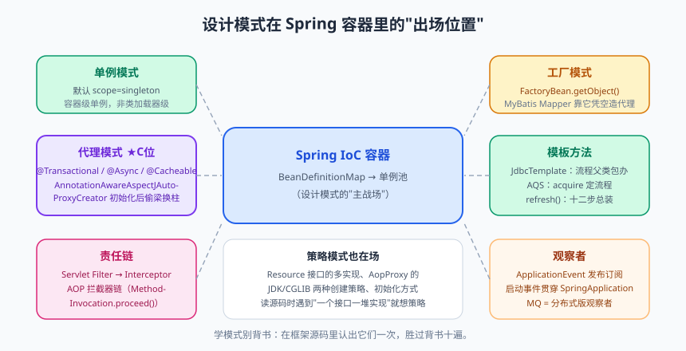

# 设计模式：高频模式实战

每次讲设计模式，总有两个灵魂问题：**"学这个有什么用？背 23 种吗？"** 和 **"学了之后到处套，被同事打怎么办？"**

我的答案一直是：设计模式不是知识点，是**"变化的方向"**——当你的代码未来可能朝某个方向变化时，前辈们留下的这些结构能让变化"局部化"，改一处而不动全身。你不需要背 23 种（GoF 原版里有些模式在现代语言里已经被语法本身消化了，比如命令模式被 Lambda 大幅简化），你需要的是：**吃透高频的那几个，并且知道 Spring/JDK 源码里它们长什么样。** 这样下次读框架源码，你会不断拍大腿："哦！原来这就是策略模式！"

进阶篇收官之作，咱们用设计模式把前面学的面向对象、反射、并发串起来。

---

## 一、开胃菜：设计原则快速回顾

23 种模式是"招式"，七大原则才是"内功"。招式会忘，内功不会：

| 原则 | 一句话 | 反面教材 |
|------|--------|---------|
| 单一职责（SRP） | 一个类只干一件事 | `UserService` 里既有登录逻辑又有发邮件逻辑 |
| 开闭原则（OCP） | 对扩展开放，对修改关闭 | 加一种支付方式要改 `if-else` 十处代码 |
| 里氏替换（LSP） | 子类必须能无痛替换父类 | 子类重写方法时抛出父类不会抛的异常/直接返回 null |
| 接口隔离（ISP） | 接口要小而专 | 一个"万能接口"有 20 个方法，实现类被迫写一堆空方法 |
| 依赖倒置（DIP） | 依赖抽象不依赖实现 | Controller 直接 `new MysqlUserDao()` |
| 迪米特法则 | 只和直接朋友说话 | 订单服务一路 `a.getB().getC().getD()` 深挖别人隐私 |
| 合成复用 | 优先组合而非继承 | 为了复用 `ArrayList` 的能力去继承它 |

> 📌 **划重点**：所有设计模式都是这七条原则的具体落地。读源码时看到"奇怪"的结构，往这几条原则上想，八成能想通。

---

## 二、七大高频模式逐一击破


> 🖼️ **图解**：设计模式在 Spring 容器里的真实出场位置

### 2.1 单例模式：一个类只有一个实例

**为什么**：有些对象创建昂贵（配置中心）、或天然只应有一份（线程池管理器、Spring 上下文）。

```java
// 推荐写法①：静态内部类（懒加载 + JVM 类加载机制天然保证线程安全）
public class ConfigHolder {
    private ConfigHolder() {}                       // 私有构造，堵死外部 new
    private static class Holder {
        static final ConfigHolder INSTANCE = new ConfigHolder();  // 内部类首次使用才加载
    }
    public static ConfigHolder getInstance() { return Holder.INSTANCE; }
}

// 推荐写法②：枚举（《Effective Java》钦定，天然防反射、防反序列化破坏）
public enum Registry {
    INSTANCE;
    public void register(String key, String value) { /* ... */ }
}
```

**Spring 里的出场**：Spring 容器中的 Bean 默认就是单例（scope=singleton）——但注意，**Spring 的单例是"容器级"的**（一个 ApplicationContext 一份），和 GoF 的"类加载器级"单例不是一回事。这也是面试爱考的细节。

> ⚠️ **踩坑实录**：手写 DCL 单例忘记 volatile（并发篇讲过的"半成品对象"问题）；或者以为加了 private 构造器就万无一失——反射 `setAccessible(true)` 照样能 new 出第二个实例，只有枚举真正防住。

### 2.2 工厂模式：把 new 的活儿交给专业的人

**为什么**：直接 `new` 让调用方依赖具体类；对象创建逻辑复杂或需要按条件挑选实现时，`new` 会污染业务代码。

```java
// 简单工厂：一个静态方法按参数造对象（严格说不是 GoF 模式，但最常用）
public class PaymentFactory {
    public static Payment create(String channel) {
        return switch (channel) {
            case "alipay" -> new AlipayPayment();
            case "wechat" -> new WechatPayment();
            case "unionpay" -> new UnionPayPayment();
            default -> throw new IllegalArgumentException("未知渠道：" + channel);
        };
    }
}

// 工厂方法：每个产品配一个工厂，符合开闭原则（加产品只需加类，不改老代码）
public interface PaymentFactory { Payment create(); }
public class AlipayFactory implements PaymentFactory {
    public Payment create() { return new AlipayPayment(); }
}
```

**JDK/Spring 里的出场**：`LoggerFactory.getLogger()`、`Calendar.getInstance()`；Spring 的 `FactoryBean`（.getObject() 决定注册进容器的到底是什么对象——MyBatis 的 Mapper 接口没有实现类却能被注入，靠的就是 MapperFactoryBean 动态造代理）。

### 2.3 策略模式：消灭 if-else 地狱

**为什么**：同一件事有多种做法，if-else 会让每加一种做法都去改老方法（违反开闭），而且方法越长越难测。

```java
// 重构前：支付服务里的一坨
public PayResult pay(String channel, Order order) {
    if ("alipay".equals(channel)) {
        // 30 行支付宝逻辑
    } else if ("wechat".equals(channel)) {
        // 30 行微信逻辑
    } else if ("unionpay".equals(channel)) {
        // 30 行银联逻辑
    }
    // 明年加"数字人民币"，还得回来改这个方法……
}

// 重构后：每个策略自成一类，统一接口
public interface PaymentStrategy {
    PayResult pay(Order order);
    String channel();                        // 标明自己负责哪个渠道
}

@Component
public class PaymentService {
    private final Map<String, PaymentStrategy> strategyMap;   // Spring 注入魔法

    // 构造器注入 List<PaymentStrategy>，Spring 会把所有实现类打包送来
    // 再按 channel() 分组成 Map，运行时 O(1) 定位策略
    public PaymentService(List<PaymentStrategy> strategies) {
        this.strategyMap = strategies.stream()
                .collect(Collectors.toMap(PaymentStrategy::channel, Function.identity()));
    }

    public PayResult pay(String channel, Order order) {
        PaymentStrategy strategy = strategyMap.get(channel);
        if (strategy == null) throw new BizException("不支持的支付渠道：" + channel);
        return strategy.pay(order);          // 新增渠道 = 加一个类，这里零修改
    }
}
```

> 💡 **老鸟忠告**：Spring + 策略模式的组合（注入 List/Map 自动装配所有实现）是业务开发最实用的重构手法，没有之一。任何"按类型走不同逻辑"的 switch，都值得想想能不能这么拆。

### 2.4 模板方法：父类定流程，子类填空

**为什么**：多个子类做同一件事，流程骨架相同，只有个别步骤不同——把骨架提到父类，子类只实现差异点。

```java
public abstract class AbstractDataImporter {          // 模板类
    // 模板方法：流程固定，final 防止子类改流程
    public final ImportReport importFile(String path) {
        byte[] raw = readFile(path);                  // 通用步骤：父类实现
        List<String> rows = parse(raw);               // 差异步骤：子类实现
        validate(rows);                               // 差异步骤：子类实现
        return save(rows);                            // 通用步骤：父类实现（含事务、日志）
    }

    private byte[] readFile(String path) { /* 通用读文件 */ return null; }
    protected abstract List<String> parse(byte[] raw);       // 钩子：子类填空
    protected void validate(List<String> rows) {}            // 钩子方法：可选实现（默认放行）
    private ImportReport save(List<String> rows) { /* 通用入库 */ return null; }
}

public class CsvImporter extends AbstractDataImporter {
    @Override protected List<String> parse(byte[] raw) { /* CSV 解析 */ return null; }
}
```

**Spring 里的出场**（多到离谱）：`JdbcTemplate`（callback 填充 SQL 与行映射，CRUD 流程它包了）、`AbstractList`、`refresh()` 容器刷新流程里留的十几个可覆写方法、`ThreadPoolExecutor.beforeExecute/afterExecute` 钩子。**AQS 也是教科书级模板方法**：acquire 流程固定，tryAcquire 留给子类——并发篇讲过了，串起来了没？

### 2.5 责任链：一个请求，层层过关

**为什么**：请求需要经过多个处理环节（校验→鉴权→限流→业务），且环节顺序/增删要灵活。if 嵌套写死的"流水线"没法动态调整。

```java
public abstract class OrderHandler {
    private OrderHandler next;                          // 指向下一个处理者

    public OrderHandler setNext(OrderHandler next) {    // 链式设置，返回 next 方便 .setNext().setNext()
        this.next = next;
        return next;
    }

    public final void handle(Order order) {
        if (doHandle(order) && next != null) {          // 本关通过才放行下一关
            next.handle(order);
        }
    }
    protected abstract boolean doHandle(Order order);
}

// 组装链条
OrderHandler chain = new StockCheckHandler();
chain.setNext(new PriceCheckHandler())
     .setNext(new RiskControlHandler());
chain.handle(order);
```

**框架里的出场**：Servlet 的 `Filter`（doFilter 里调 chain.doFilter 放行）、Spring MVC 的 `HandlerInterceptor`、**Netty 的 Pipeline**（数据进出流经一串 Handler，是责任链最极致的形态）、Sentinel 的 ProcessorChain。

### 2.6 代理模式：给你找个"替身"

**为什么**：想在不动目标类代码的前提下，给方法加前后逻辑（日志、事务、权限、监控）——代理持有目标对象，调用前后做手脚。

```java
// JDK 动态代理（基于接口）：运行时生成 $Proxy0
public class TimeLogProxy implements InvocationHandler {
    private final Object target;
    public TimeLogProxy(Object target) { this.target = target; }

    @Override
    public Object invoke(Object proxy, Method method, Object[] args) throws Throwable {
        long start = System.currentTimeMillis();
        try {
            return method.invoke(target, args);            // 真正调用目标方法
        } finally {
            System.out.println(method.getName() + " 耗时 "
                    + (System.currentTimeMillis() - start) + "ms");
        }
    }
}

UserService proxy = (UserService) Proxy.newProxyInstance(
        UserService.class.getClassLoader(),
        new Class[]{UserService.class},
        new TimeLogProxy(new UserServiceImpl()));
proxy.getUser(1L);   // 走的是代理，自动带上耗时统计
```

**Spring 里的出场**：整个 Spring AOP（@Transactional、@Async、@Cacheable 的底座）。JDK 动态代理要求目标实现接口；CGLIB 靠生成子类，final 类/方法无法代理。这块的细节在 Spring 原理篇《AOP》专门展开，这里先记住：**你每天用的注解魔法，本质都是代理模式。**

### 2.7 观察者模式：有事广播，别挨个通知

**为什么**：一个事件发生（下单成功），多个关心方要响应（发短信、加积分、清购物车），如果下单代码直接调用三个服务，耦合就焊死了——以后每加一个响应方都改下单代码。观察者让发布方只管"喊一嗓子"，谁爱听谁订阅。

```java
// 手写版：JDK 自带 Observable 已过时，用 Spring 事件更香
public class OrderCreatedEvent extends ApplicationEvent {
    private final String orderNo;
    public OrderCreatedEvent(Object source, String orderNo) {
        super(source); this.orderNo = orderNo;
    }
    public String getOrderNo() { return orderNo; }
}

@Component
public class OrderService {
    private final ApplicationEventPublisher publisher;       // 发布器
    public OrderService(ApplicationEventPublisher publisher) { this.publisher = publisher; }

    @Transactional
    public void createOrder(Order order) {
        save(order);                                          // 只管核心逻辑
        publisher.publishEvent(new OrderCreatedEvent(this, order.getOrderNo()));  // 喊一嗓子
    }
}

@Component
public class SmsListener {
    @EventListener                                            // 订阅：谁关心谁监听
    public void onOrderCreated(OrderCreatedEvent event) {
        System.out.println("发短信：" + event.getOrderNo());
    }
}

@Component
public class PointsListener {
    @EventListener
    @Async                                                    // 异步监听，不拖慢主流程
    public void addPoints(OrderCreatedEvent event) {
        System.out.println("加积分：" + event.getOrderNo());
    }
}
```

**框架里的出场**：Spring 事件机制（如上）、GUI 编程的一切点击监听、**MQ 本质就是"跨进程的观察者模式"**（发布订阅模型的分布式版）。

---

## 三、模式关系图与误用警告

```mermaid
flowchart TD
    subgraph 创建型["创建型：对象怎么来"]
        S1["单例"] --- S2["工厂"]
    end
    subgroup[""]
    subgraph 结构型["结构型：对象怎么组装"]
        T1["代理<br/>(AOP底座)"]
    end
    subgraph 行为型["行为型：对象怎么协作"]
        B1["策略"] --- B2["模板方法"] --- B3["责任链"] --- B4["观察者"]
    end
    S2 -->|"产品实现统一接口"| B1
    T1 -->|"代理包裹策略"| B1
    B4 -->|"跨进程版即MQ"| MQ["消息中间件"]
```

> ⚠️ **踩坑实录（误用警告）**：见过把只有两个分支的 if 改成四个类加一个工厂的，美其名曰"策略模式"——同事 review 时血压直接拉满。**模式的收益要在"变化真的发生"时才兑现**：当前逻辑稳定、分支就两三个，if-else 就是最好的设计。设计模式是为了可维护性，不是为了炫技；**过度设计比没有设计更难维护**。

学习路径建议：不要捧着模式书从 A 背到 Z，去读 Spring/JDK 源码——JdbcTemplate 是模板方法、AOP 是代理、`addFirst/addLast` 的 Netty Pipeline 是责任链、`ApplicationEvent` 是观察者、`FactoryBean` 是工厂……**在真实代码里认出它们一次，胜过背书十遍。**

---

## 本篇小结

- 模式是"变化的方向"，七大原则（尤其开闭、依赖倒置）是内功；
- 单例推荐静态内部类/枚举，注意 Spring 单例是容器级的；
- 策略模式 + Spring 的 List/Map 注入是消灭 if-else 的最强组合；
- 模板方法"父类定流程子类填空"，Spring 里到处都是（JdbcTemplate/AQS）；
- 责任链（Filter/Interceptor/Pipeline）、代理（AOP 底座）、观察者（Spring 事件/MQ）各有真实出场；
- 最大的坑是过度设计：分支少且稳定时，if-else 就是最好的设计。

## 课后思考 & 动手练习

1. （概念）Spring 的 singleton Bean 和 GoF 单例模式有什么区别？
2. （概念）为什么"注入 List<Strategy>"能自动收集所有实现类？背后是 Spring 的什么机制？
3. （概念）模板方法和策略模式都为了"复用与变化分离"，它们的本质区别是什么？（提示：算法骨架 vs 完整算法的替换）
4. （动手）把一段"满 100 减 20、满 300 减 80、新用户再打 9 折"的 if-else 优惠计算，重构成策略模式 + 组合。
5. （动手·进阶）用 JDK 动态代理写一个 `@Metric` 注解 + 代理工厂：任何接口方法被调用时自动打印方法名、参数、耗时；再用 Spring 的 List 注入方式把"订单服务三种物流渠道"重构成策略模式并写单测验证。

> 进阶篇到此收官！接下来开启新篇章——**Spring Boot 原理篇**。第一篇《Spring IoC：控制反转的前世今生》：为什么说"new 一个对象"这个动作，正在毁掉你的项目？咱们从"没有 Spring 的黑暗时代"讲起。
