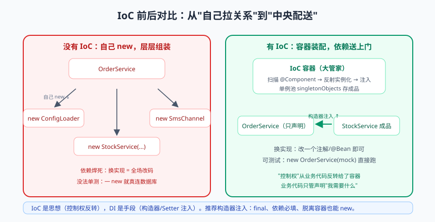

# Spring IoC：控制反转的前世今生

从这篇开始，咱们进入 Spring Boot 原理篇。开篇先回答一个扎心的问题：**为什么 Spring 能统治 Java 企业开发二十年？**

不是因为注解好用，也不是因为文档全。是因为它从根本上解决了一个软件工程的核心痛点——**对象之间的组装（依赖管理）问题**。IoC 容器就这一件事干到了极致。今天咱们从"没有 Spring 的黑暗时代"讲起，一步步推导出 IoC 的诞生，最后亲手写一个迷你 IoC 容器——写完你会发现：**框架不是魔法，是工程智慧的结晶。**

---

## 一、黑暗时代：new 出来的灾难

### 1.1 一层层 new 的"套娃地狱"

假设开发一个订单服务：下单要扣库存、发通知，通知依赖短信通道，短信通道依赖配置中心。没有框架的写法：

```java
public class OrderService {
    public void createOrder(Order order) {
        // 依赖全靠自己 new，层层组装
        ConfigLoader configLoader = new ConfigLoader("/etc/app.properties");
        SmsChannel smsChannel = new AliyunSmsChannel(configLoader);
        NotificationService notificationService = new NotificationService(smsChannel);

        StockDao stockDao = new StockDao(new MysqlDataSource("jdbc:mysql://...", "root", "***"));
        StockService stockService = new StockService(stockDao);

        // ……终于能干正事了
        stockService.deduct(order);
        notificationService.notify(order);
    }
}
```

这段代码有三大罪状：

1. **职责错位**：OrderService 本该只关心业务，却被迫关心"对象怎么造"——像让 CEO 自己装修工位、接网线；
2. **牵一发动全身**：哪天短信通道从阿里云换成腾讯云，或者 StockDao 构造参数变了，所有 `new` 它的地方全要改；
3. **无法替换与测试**：依赖是焊死的，想给 OrderService 写单元测试？对不起，它会在测试环境真连数据库、真发短信。

### 1.2 工厂模式：中间商救场

有同学说：简单，上工厂！

```java
public class BeanFactory {
    public static NotificationService getNotificationService() {
        return new NotificationService(new AliyunSmsChannel(new ConfigLoader("...")));
    }
}
```

好了一点，但每个依赖类型都得写一个工厂方法，依赖关系变了还是要改工厂代码——**工厂只是把"new 的地狱"集中到了一处，并没有让依赖关系"可配置、可自动"。** 而且 OrderService 自己的依赖，还是得它自己去工厂拿（主动拉取）。

> 📌 **划重点**：问题的本质是**控制权**——对象的生命周期和依赖装配，控制权散落在每个业务代码手里。要根治，就得把这个控制权**收走**，交给一个统一的"大管家"。这个思想，就叫控制反转。

---

## 二、IoC：控制反转到底反转了什么


> 🖼️ **图解**：IoC 前后对比：自己拉关系 new vs 中央统一配送

**IoC（Inversion of Control，控制反转）**：对象的创建、装配、生命周期管理，从程序员手中转交给容器。业务代码只声明"我需要什么"，不再操心"它从哪来"。

```java
@Service
public class OrderService {
    private final StockService stockService;        // 只声明依赖
    private final NotificationService notificationService;

    public OrderService(StockService stockService, NotificationService notificationService) {
        this.stockService = stockService;           // 容器负责把现成的"成品"递进来
        this.notificationService = notificationService;
    }

    public void createOrder(Order order) {
        stockService.deduct(order);                 // 只管用，谁造的？容器造的
        notificationService.notify(order);
    }
}
```

注意这个"反转"的视角：**以前是 OrderService 主动 new 依赖（拉），现在是容器主动把依赖送上门（推）**。送上门这个动作，就叫**依赖注入（Dependency Injection，DI）**。

IoC 与 DI 的关系：IoC 是思想（控制权反转），DI 是实现该思想的主要手段（容器把依赖塞给你）。此外还有"依赖查找"（主动从容器 JNDI/ApplicationContext.getBean 取）等次要手段。面试时一句话："**IoC 是原则，DI 是手段**。"

```mermaid
flowchart LR
    subgraph 没有IoC["没有 IoC（主动拉）"]
        A["OrderService"] -->|"自己 new / 自己找"| B["StockService"]
        A -->|"自己 new"| C["NotificationService"]
    end
    subgraph 有IoC["有 IoC（被动接收）"]
        D["IoC 容器"] -->|"创建并注入"| E["OrderService"]
        D -->|"创建并注入"| F["StockService"]
        D -->|"创建并注入"| G["NotificationService"]
    end
    没有IoC ~->|"控制权上交容器"| 有IoC
    style D fill:#e1f5fe
```

---

## 三、容器两大家族：BeanFactory 与 ApplicationContext

IoC 容器在 Spring 里有两个接口体系：

| 对比项 | BeanFactory | ApplicationContext |
|--------|-------------|---------------------|
| 定位 | 最底层容器，提供基础 DI 能力 | 企业级容器，BeanFactory 的超集 |
| Bean 加载 | **懒加载**：getBean 时才创建 | **预加载**：容器启动时创建所有单例（默认） |
| 附加能力 | 无 | 国际化、事件发布、资源加载、AOP 集成、环境 Profile |
| 适用场景 | 资源极度受限（早期 Applet） | 99.9% 的应用场景 |

**ApplicationContext 是日常开发的唯一选择。** Spring Boot 里 `SpringApplication.run()` 返回的就是一个 `ConfigurableApplicationContext`（具体是 AnnotationConfigServletWebServerApplicationContext 这类实现）。

> 💡 **老鸟忠告**："启动慢但访问快（预创建）" vs "启动快但首次访问卡（懒加载）"——Spring 选了前者，因为问题在启动期暴露好过在高峰期暴露。生产事故最喜欢"第一次调用才初始化"的坑。懒加载可通过 `@Lazy` 精确控制。

## 四、BeanDefinition：Bean 的"图纸"

容器装配 Bean 分两步走，就像盖房子"先画图纸再施工"：

1. **图纸阶段**：解析配置（注解/XML/JavaConfig），把每个 Bean 的元信息登记成 **BeanDefinition**——它记录了 Bean 的 class、scope（单例/原型）、是否懒加载、依赖哪些 Bean、初始化方法名等；
2. **施工阶段**：容器按图纸反射实例化、填充属性、初始化，最终成品放进**单例池（singletonObjects，本质一个 ConcurrentHashMap）**。


理解了"图纸 → 施工 → 成品库"三阶段，下一篇的 Bean 生命周期和三级缓存（都是围绕施工阶段的细节）就顺理成章了。

---

## 五、注解驱动：现代 Spring 的注册与注入

### 5.1 Bean 的注册方式

```java
// ① 类路径扫描：@Component 及其语义化派生注解（最常用）
@Component        // 通用组件
@Service          // 业务层（语义化：让读代码的人知道这是干嘛的）
@Repository       // 数据层（额外功能：自动翻译数据库异常）
@Controller       // Web 层
public class OrderService { ... }
// 注意：派生注解本质都是 @Component，扫描规则相同；@Service 不是"加了功能"，是"加了语义"

// ② @Configuration + @Bean：第三方类没法改源码加注解，用这种方式
@Configuration
public class AppConfig {
    @Bean                                        // 方法返回值注册为 Bean，方法名即 Bean 名
    public RestTemplate restTemplate(RestTemplateBuilder builder) {
        return builder.connectTimeout(Duration.ofSeconds(2)).build();
    }
}

// ③ @Import：批量导入（自动配置的核心，下下篇细讲）
// ④ @Conditional 系条件装配（同上）
```

### 5.2 依赖注入：三种姿势与一个选择困难

```java
// 姿势① 字段注入：最省事，最受诟病
@Service
public class OrderService {
    @Autowired
    private StockService stockService;      // 离开容器没法测试，没法用 final
}

// 姿势② Setter 注入：适合可选依赖
@Autowired
public void setStockService(StockService stockService) { this.stockService = stockService; }

// 姿势③ 构造器注入（官方推荐）：★
@Service
public class OrderService {
    private final StockService stockService;    // 可以 final：不可变，天然线程安全

    public OrderService(StockService stockService) {   // 单构造器时 @Autowired 可省略
        this.stockService = stockService;
    }
}
```

| 对比项 | 字段注入 | Setter 注入 | 构造器注入 |
|--------|:---:|:---:|:---:|
| 支持 final | ❌ | ❌ | ✅ |
| 依赖齐全性校验 | ❌（可能 null） | ❌ | ✅（缺依赖容器直接起不来） |
| 脱离容器可用（如单测 new 对象） | ❌ | 部分 | ✅ |
| 循环依赖 | 照样可能 | 照样可能 | 直接暴露问题（启动报错，逼你改设计） |
| IDEA 警告 | ⚠️ 黄牌 | 无 | 无 |

> 📌 **划重点**：**构造器注入是唯一官方推荐**。它的哲学是"依赖不全就不许出生"——问题在启动期暴露，而不是上线后某个深夜抛 NPE。字段注入看似优雅，实则是把"必需依赖"伪装成"可有可无"。Spring Boot 4.3 起，单构造器连 @Autowired 都不用写。

### 5.3 @Autowired vs @Resource vs @Inject

| 注解 | 来源 | 匹配策略 |
|------|------|---------|
| @Autowired | Spring 自带 | **先按类型**，多个候选再按名字/@Qualifier |
| @Resource | JSR-250（JDK/Java EE） | **先按名字**，找不到再按类型 |
| @Inject | JSR-330 | 同 @Autowired（需引依赖） |

多实现冲突的三板斧：`@Primary`（标注默认实现）> `@Qualifier("beanName")`（点名要谁）> `@Resource(name="...")`。

```java
public interface PayChannel { void pay(Order order); }

@Component @Primary                       // 多实现时的默认项
public class AlipayChannel implements PayChannel { ... }

@Component("wechatChannel")
public class WechatChannel implements PayChannel { ... }

@Service
public class PayService {
    private final PayChannel defaultChannel;       // 注入 @Primary 的 AlipayChannel
    private final PayChannel wechat;

    public PayService(PayChannel defaultChannel,
                      @Qualifier("wechatChannel") PayChannel wechat) {
        this.defaultChannel = defaultChannel;      // 构造器 + Qualifier 组合拳
        this.wechat = wechat;
    }
}
```

> ⚠️ **踩坑实录**：同类型多个 Bean 且没标 @Primary/@Qualifier 时，容器启动直接报 `NoUniqueBeanDefinitionException`；还有一个隐藏玩法——若字段/参数名恰好等于某个 Bean 名（如 `wechatChannel`），@Autowired 会按名字兜底匹配成功。于是出现"改个参数名，程序就启动失败"的灵异事件。解法：永远显式声明 @Qualifier，别赌名字匹配。

---

## 六、手写迷你 IoC：给框架"祛魅"

最后，用 60 行代码实现一个仅支持构造器注入的迷你容器。写完你会发现 Spring 的 IoC 核心就这点事（剩下的千行代码都在处理各种边界与扩展）：

```java
public class MiniIocContainer {
    private final Map<Class<?>, Object> singletons = new ConcurrentHashMap<>();   // 单例池
    private final List<Class<?>> beanClasses = new ArrayList<>();                // 注册的图纸

    /** 注册 Bean 类型（真实 Spring 是靠 @ComponentScan 扫描，这里手动注册等价） */
    public void register(Class<?>... classes) {
        beanClasses.addAll(Arrays.asList(classes));
    }

    /** 启动：把所有单例创建出来（真实 Spring 的 finishBeanFactoryInitialization） */
    public void refresh() {
        beanClasses.forEach(this::getBean);
    }

    /** 获取 Bean：不存在则创建（递归解析构造器依赖） */
    @SuppressWarnings("unchecked")
    public <T> T getBean(Class<T> clazz) {
        Object bean = singletons.get(clazz);
        if (bean != null) return (T) bean;                        // 成品库里有，直接给

        try {
            Constructor<?> ctor = clazz.getDeclaredConstructors()[0];   // 取构造器（简化：取第一个）
            Object[] args = Arrays.stream(ctor.getParameterTypes())     // 逐个解析参数依赖
                    .map(this::getBean)                                 // 递归：依赖的依赖也要造
                    .toArray();
            bean = ctor.newInstance(args);                         // 反射实例化 + 构造器注入一步到位
            singletons.put(clazz, bean);                           // 放入单例池
            return (T) bean;
        } catch (Exception e) {
            throw new RuntimeException("创建 Bean 失败：" + clazz.getName(), e);
        }
    }
}

// 使用：OrderService → StockService → StockDao 三层依赖，一行 new 都不用写
MiniIocContainer ioc = new MiniIocContainer();
ioc.register(StockDao.class, StockService.class, OrderService.class);
ioc.refresh();
OrderService orderService = ioc.getBean(OrderService.class);
orderService.createOrder(new Order("1001"));
```

递归 `getBean` 解析依赖，就是 Spring "依赖注入"的骨架。当然，真实的 Spring 还要处理：字段注入、BeanPostProcessor 扩展点、循环依赖（三级缓存）、生命周期回调、代理增强（AOP）、作用域……这些就是后面几篇的主角。

---

## 本篇小结

- 没有 IoC 的世界：依赖层层手动 new，职责错位、牵一发动全身、没法测试；
- IoC 反转的是"对象创建与装配的控制权"：业务代码从主动拉（new）变成被动收（注入）；DI 是 IoC 的落地手段；
- ApplicationContext（预加载、企业级能力）是日常唯一选择，BeanFactory 是其底层基座；
- 容器装配分两步：解析成 BeanDefinition（图纸）→ 反射实例化+注入（施工）→ 单例池（成品库）；
- Bean 注册首选类路径扫描（@Component 家族），第三方类用 @Bean；
- 注入首选**构造器注入**（final、必依赖校验、可测试）；多实现用 @Primary/@Qualifier 显式消歧；
- 60 行迷你 IoC 容器 = 递归 getBean 解析构造器依赖，框架核心不过如此。

## 课后思考 & 动手练习

1. （概念）IoC 和 DI 是什么关系？"控制反转"具体反转了什么？用自己的话说一遍。
2. （概念）为什么 Spring 官方和 IDE 都"嫌弃"字段注入？构造器注入在可测试性上的优势具体体现在哪？
3. （概念）@Autowired 找到多个候选 Bean 时的处理顺序是什么？
4. （动手）把本文"黑暗时代"的 OrderService（三层依赖）改写成 Spring 注解版：@Service + 构造器注入，写一个 main 用 AnnotationConfigApplicationContext 启动并调用 createOrder。
5. （动手·进阶）给 MiniIocContainer 增加"字段注入"支持（扫描 @Inject 注解字段并反射 set）；再试试用它构造 OrderService ↔ StockService 循环依赖，观察会发生什么（无限递归栈溢出）——这就是 Spring 需要三级缓存的原因，为下一篇埋好伏笔。

> 下一篇预告：《Bean 生命周期与循环依赖》——从实例化到销毁，Bean 的一生要经历哪些关卡？A、B 互相依赖的"先有鸡还是先有蛋"问题，Spring 的三级缓存是怎么解的？这是 Spring 面试的天花板题，咱们下篇拆穿它。
