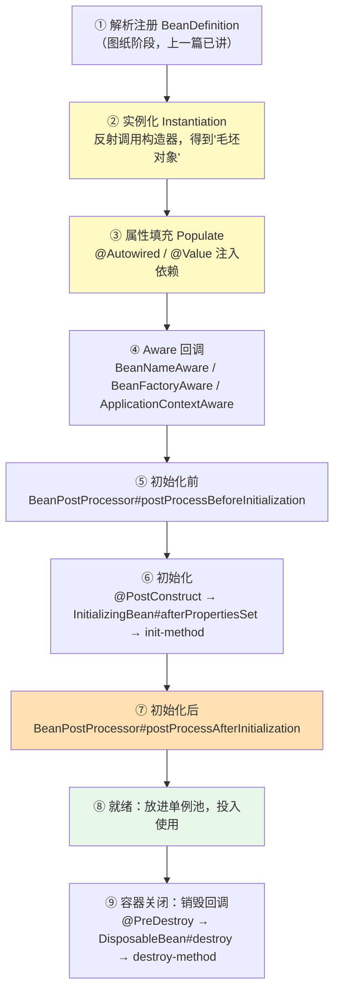
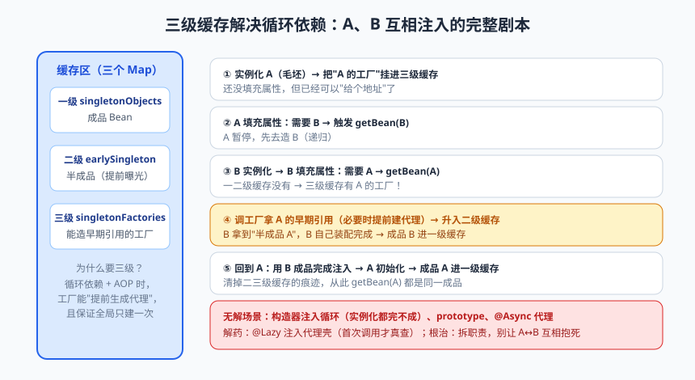
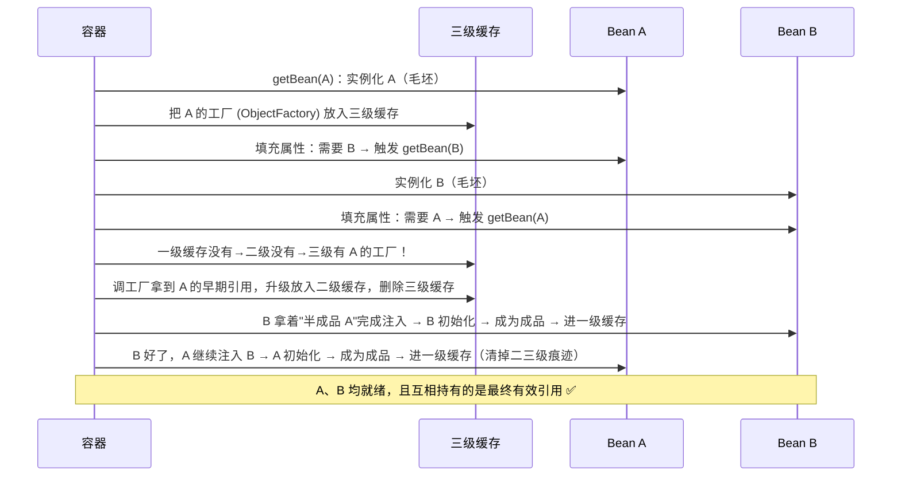

# Bean 生命周期与循环依赖

上一篇咱们给 IoC 容器"祛了魅"，末尾留了个悬念：迷你容器里 OrderService ↔ StockService 互相依赖，递归 getBean 直接栈溢出。而真正的 Spring 面对循环依赖照样能跑——凭什么？靠的是大名鼎鼎（也大名鼎鼎地难懂）的**三级缓存**。

今天这篇讲两件事：**Bean 的完整一生**（从实例化到销毁要闯哪些关）和**循环依赖的三级缓存解法**。这两块是 Spring 原理的"天花板考点"，更是排查实际问题的硬功夫：为什么 @Autowired 的字段是 null？为什么 @PostConstruct 里依赖还没就绪？为什么拿到的是没增强过的原始对象？答案全在 Bean 生命周期的时序里。

---

## 一、Bean 的完整一生：从出生到退休

先上全景图，后面逐段拆解：



用一段"可运行的证据代码"把顺序钉死——写一个把所有回调全实现的 Bean：

```java
@Component
public class LifecycleBean implements BeanNameAware, InitializingBean, DisposableBean {

    private String beanName;

    public LifecycleBean() {
        System.out.println("① 构造器：实例化（毛坯房）");
    }

    @Autowired
    public void setDependency(SomeService dependency) {
        System.out.println("② 属性填充：依赖注入（装修水电）");
    }

    @Override
    public void setBeanName(String name) {          // Aware 回调：告诉你自己叫啥、住哪个容器
        this.beanName = name;
        System.out.println("③ Aware 回调：我的名字是 " + name);
    }

    @PostConstruct                                  // JSR-250 注解，推荐方式
    public void postConstruct() {
        System.out.println("④ @PostConstruct 初始化（家具进场，可安全使用依赖）");
    }

    @Override
    public void afterPropertiesSet() {              // InitializingBean 接口（侵入 Spring API）
        System.out.println("⑤ afterPropertiesSet 初始化");
    }

    @PreDestroy
    public void preDestroy() {
        System.out.println("⑥ @PreDestroy：容器关闭前收尾（关水关电）");
    }

    @Override
    public void destroy() {
        System.out.println("⑦ DisposableBean#destroy");
    }
}
```

启动容器再关闭，控制台严格按 ①→⑦ 打印。三种初始化/销毁方式对比：

| 方式 | 初始化 | 销毁 | 特点 |
|------|--------|------|------|
| JSR-250 注解 | @PostConstruct | @PreDestroy | **推荐**：不依赖 Spring API，可移植 |
| 接口 | InitializingBean / DisposableBean | 同左 | 侵入式（实现 Spring 接口），不建议业务类用 |
| @Bean 属性 | @Bean(initMethod="x", destroyMethod="y") | 同左 | 适合第三方类，配置与代码分离 |

> 📌 **划重点**：初始化回调只有**一个**真实用途——**在依赖全部就绪后执行一次性逻辑**（预热缓存、校验配置、启动后台任务）。顺序记口诀：**构造 → 注入 → Aware → BeanPostProcessor前 → @PostConstruct → afterPropertiesSet → BeanPostProcessor后 → 上岗**。

### BeanPostProcessor：生命周期的"海关"

第⑤⑦步的 `BeanPostProcessor` 是整个生命周期里**最重要**的扩展点——它相当于在"初始化前/后"两个关卡设了海关，可以偷梁换柱地**返回另一个对象**替代原 Bean。Spring 内部一大票功能都靠它实现：

| Processor | 干什么 |
|-----------|--------|
| AutowiredAnnotationBeanPostProcessor | 处理 @Autowired/@Value 注入（在属性填充阶段干活） |
| CommonAnnotationBeanPostProcessor | 处理 @Resource/@PostConstruct/@PreDestroy |
| AnnotationAwareAspectJAutoProxyCreator | **在 postProcessAfterInitialization 里生成 AOP 代理**（下篇主角） |

第三位划重点：**你拿到的 @Service Bean，如果它需要被 AOP 增强（如 @Transactional），单例池里放的根本不是原始对象，而是初始化后关卡"偷梁换柱"塞进来的代理对象。** 搞不清这一点，后面 AOP 失效的坑你一个都躲不过。

---

## 二、循环依赖：先有鸡还是先有蛋


> 🖼️ **图解**：三级缓存化解 A↔B 循环依赖的六步剧本

### 2.1 问题现场

```java
@Service
public class A {
    private final B b;                          // A 依赖 B
    public A(B b) { this.b = b; }
}

@Service
public class B {
    private final A a;                          // B 又依赖 A —— 完蛋，死循环
    public B(A a) { this.a = a; }
}
```

容器创建 A → 发现需要 B → 去创建 B → 发现需要 A → A 还没造完……如果没有干预，就是无限递归（咱们的迷你容器就是这么栈溢出的）。

### 2.2 三级缓存：Spring 的解法

Spring 用三个 Map 配合，把死循环掰开了揉碎了：

| 缓存 | 名字 | 存什么 |
|------|------|--------|
| 一级缓存 | singletonObjects | **成品** Bean（完全体：注入+初始化+可能的代理） |
| 二级缓存 | earlySingletonObjects | **半成品** Bean（已实例化、未注入，提前曝光的引用） |
| 三级缓存 | singletonFactories | **工厂** ObjectFactory：能现场造出"早期引用"的 lambda（必要时提前生成代理） |

完整时序走一遍（A 字段注入 B，B 字段注入 A）：



一句话总结流程：**A 创建中就先把"半成品工厂"挂到三级缓存曝光 → B 创建时从这个工厂拿到 A 的早期引用，完成自己的装配 → B 完工后 A 继续装配完工。** 半成品先"卖期房"，业主（B）拿着合同（早期引用）等交房，最终引用不变，皆大欢喜。

### 2.3 为什么需要三级，两级不行吗？

经典追问。如果只有一二级缓存，也能解决"字段注入"的循环依赖——半成品放二级，直接给。那三级缓存的工厂是干嘛的？**为了在需要时才决定"早期引用给原始对象还是代理对象"，并保证全局只创建一次代理。**

回忆上篇的时序：正常情况下代理对象是在**初始化后**由 AOP Processor 生成的。但循环依赖时，B 在 A "初始化后"之前就要拿 A 的引用——如果给 B 的是原始对象，等 A 代理化完成后，B 手里握的就是"没增强的裸对象"，调用 @Transactional 直接失效。所以三级缓存的工厂会在"被提前索取"时**提前调用 AOP 逻辑生成代理**，把代理给 B，并保证后续初始化流程不再重复生成。

> ⚠️ **踩坑实录（@Async 场景）**：@Async 的代理由 AsyncAnnotationBeanPostProcessor 生成，**它没有实现提前暴露代理的接口**。于是循环依赖 + @Async 组合下，B 拿到的 A 是"原始对象"，@Async 方法异步失效，还会抛 `BeanCurrentlyInCreationException`。解法：避免这种组合，或用 @Lazy 打破循环（见下）。这是 Spring 源码级面试和真实生产双料高频坑。

### 2.4 三级缓存也不是万能的

| 场景 | 能解吗 | 原因 |
|------|:---:|------|
| 单例 + 字段/Setter 注入循环 | ✅ | 有"先实例化后注入"的时间差可利用 |
| 单例 + 构造器注入循环 | ❌ | 构造器要先参数，实例化都完不成，没有半成品可曝光；启动直接报 BeanCurrentlyInCreationException |
| prototype 作用域循环 | ❌ | 不缓存原型 Bean，无曝光机制 |
| @Async 参与的循环 | ❌ | 代理不提前暴露（如上） |

**构造器循环依赖的解药——@Lazy**：给构造器参数打 @Lazy，容器注入的不是真 A，而是一个"代理壳"（首次真正调用方法时才去容器拿真身）：

```java
@Service
public class B {
    private final A a;
    public B(@Lazy A a) {      // 注入的是 A 的代理，打破"创建期死锁"
        this.a = a;            // 首次 a.xxx() 才触发真 A 的获取
    }
}
```

> 💡 **老鸟忠告**：循环依赖能被 Spring 解开，不代表它合理——**A 依赖 B、B 又依赖 A，往往说明职责切分出了问题**（通常该抽出一个 C 来放公共逻辑）。把它当成"设计坏味道"的信号灯，而不是可以随便依赖的通行证。Spring Boot 2.6 起**默认禁止循环依赖**（需 `spring.main.allow-circular-references=true` 显式打开），官方态度已经很明确了。

---

## 三、实战排查：生命周期视角的三个灵异事件

**事件一：@PostConstruct 里调自己的 @Transactional 方法，事务不生效。**
时序分析：@PostConstruct 在初始化阶段执行，而 AOP 代理在初始化**后**才生成——此刻"自己"还是原始对象，调方法走不进代理，事务拦截器根本没机会工作。解法：事务逻辑挪到正式使用时再调，或用 `applicationContext.getBean()` 拿代理再调。

**事件二：@Autowired 注入的 Bean 是 null。**
常见三种死法：① 所在类根本没被容器管理（漏 @Service，还指望注入？）；② 在 static 字段/方法上用 @Autowired（容器：这我没法注入）；③ 用 `new` 出来的对象里期待注入（自己 new 的对象不归容器管，字段当然是 null）。一句话：**注入只发生在"容器创建的 Bean"的生命周期里。**

**事件三：拿到的对象没被增强（事务/异步失效）。**
检查三件事：类是否被代理（final/private/static 方法无法被 CGLIB 覆写）；是否 this 自调用（绕过代理，下篇 AOP 详解）；是否被 @Lazy 或循环依赖"截胡"成了早期引用。

---

## 本篇小结

- Bean 生命周期主线：实例化 → 属性填充 → Aware → BeanPostProcessor 前 → @PostConstruct/afterPropertiesSet → BeanPostProcessor 后 → 就绪 → @PreDestroy/destroy；
- 初始化回调的用途是"依赖就绪后的一次性逻辑"，推荐 JSR-250 注解（@PostConstruct/@PreDestroy）；
- BeanPostProcessor 是生命周期海关，@Autowired/@Value/@PostConstruct/AOP 代理全在关卡上干活，**AOP 代理在初始化后生成**；
- 三级缓存：成品（一级）/半成品（二级）/工厂（三级）；流程口诀"三级曝光工厂 → 提前拿早期引用升二级 → 完工进一级"；
- 三级缓存的工厂是为了让 AOP 场景下提前给出**代理**引用，保证只创建一次代理；
- 构造器注入、prototype、@Async 的循环依赖无解；@Lazy 可打破构造器循环；循环依赖本质是设计坏味道，Boot 2.6+ 默认禁止。

## 课后思考 & 动手练习

1. （概念）按顺序默写 Bean 从实例化到销毁的完整流程，标注 BeanPostProcessor 两个方法的时机。
2. （概念）如果只有二级缓存，"AOP + 循环依赖"场景会出什么问题？三级缓存的工厂解决了哪一步？
3. （概念）为什么 Spring Boot 2.6 默认禁用循环依赖？说说你对"技术上能解 ≠ 设计上该有"的理解。
4. （动手）写 LifecycleBean 验证本文打印顺序；再分别测试 @PostConstruct 抛异常、构造器抛异常时容器启动的表现，体会"启动期暴露问题"的设计哲学。
5. （动手·进阶）分别构造三种循环依赖实测：字段注入循环（成功）、构造器循环（报 BeanCurrentlyInCreationException）、@Lazy 修复构造器循环；最后给 05-architecture 篇的 MiniIocContainer 动手实现一个"二级缓存版"循环依赖解法（提示：实例化后先曝光半成品，再属性注入）。

> 下一篇预告：《Spring AOP：动态代理的魔法》——为什么事务方法 this 调用会失效？@Transactional 背后是谁在偷梁换柱？咱们从手写 JDK 动态代理开始，把 Spring AOP 的底牌全部翻开。
