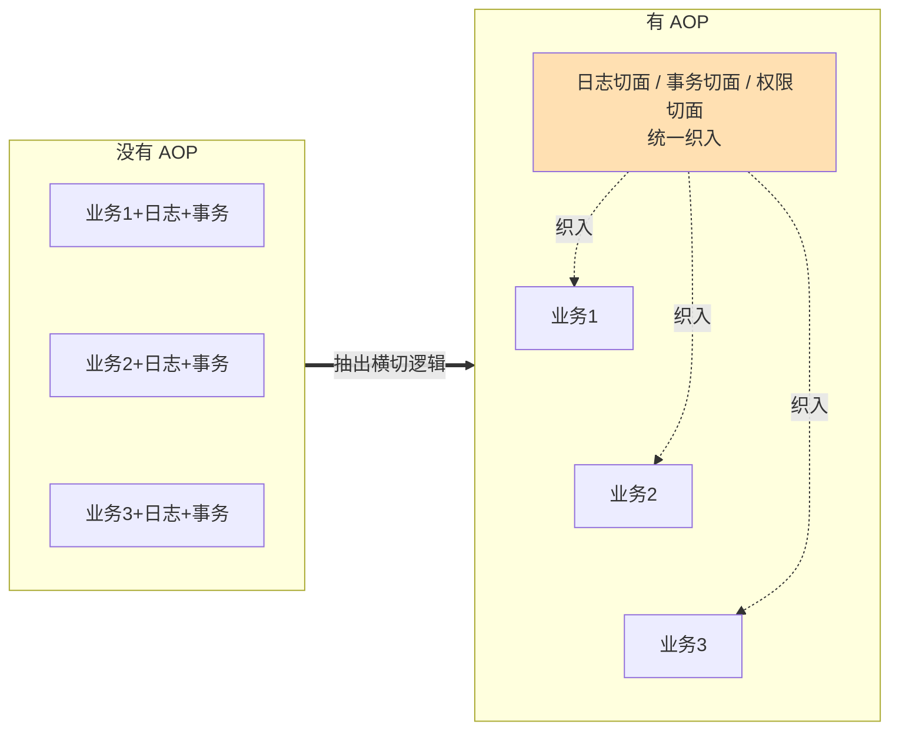
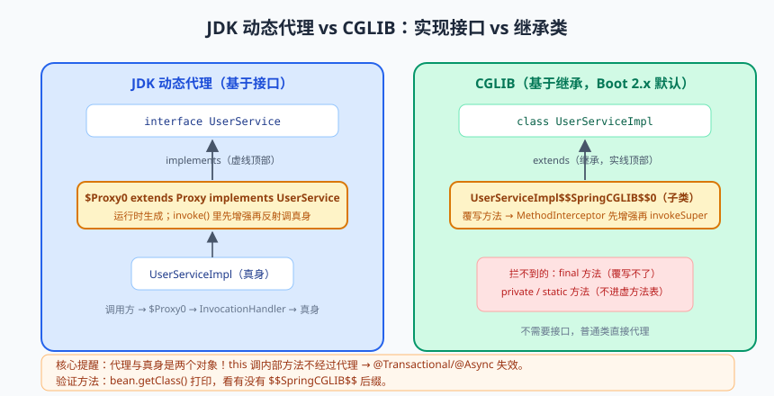
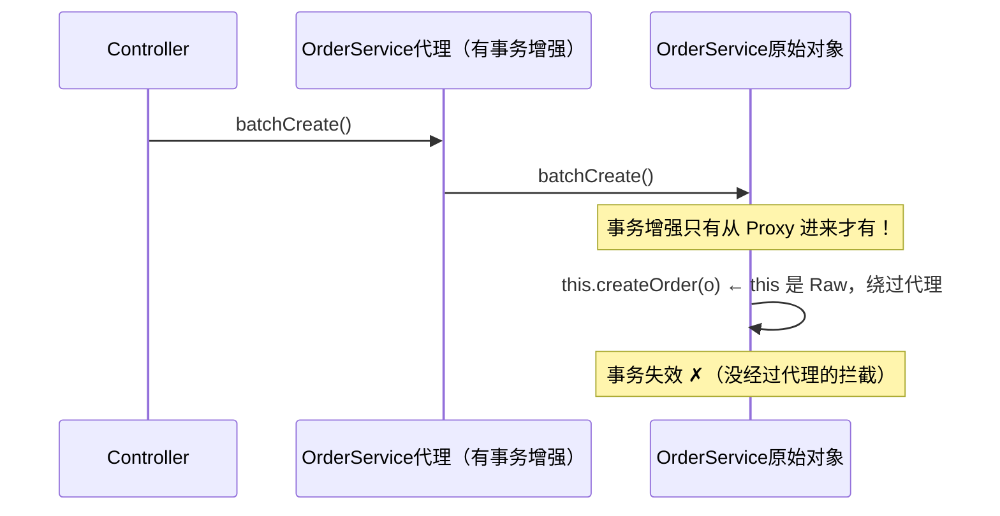

# Spring AOP：动态代理的魔法

先看一个价值"三天排查时间"的 bug 现场：

```java
@Service
public class OrderService {
    @Transactional
    public void createOrder(Order order) { ... }        // 有事务

    public void batchCreate(List<Order> orders) {
        for (Order o : orders) {
            this.createOrder(o);                        // ← 灵异现场：事务没生效！
        }
    }
}
```

`createOrder` 明明标了 @Transactional，从 `batchCreate` 里调它，事务却消失了；而 Controller 直接调 `createOrder` 时事务好好的。同一个方法，两种命运——为什么？

答案四个字：**动态代理**。这篇咱们从 AOP 的思想讲到 Spring 的实现，从手写 JDK 代理讲到 CGLIB，最后把"代理失效"的各种姿势一网打尽。学完这篇，上面这个 bug 你一眼就能看穿。

---

## 一、为什么需要 AOP：横切关注点的觉醒

想象一个电商系统，几乎每个业务方法都需要：记日志、开事务、控权限、打耗时埋点。按老写法：

```java
public void createOrder(Order order) {
    long start = System.currentTimeMillis();
    log.info("createOrder begin, param={}", order);
    TransactionStatus tx = txManager.begin();           // 开事务
    try {
        // ……10 行真正的业务逻辑……
        txManager.commit(tx);
    } catch (Exception e) {
        txManager.rollback(tx);
        throw e;
    } finally {
        log.info("createOrder end, cost={}ms", System.currentTimeMillis() - start);
    }
}
```

业务逻辑 10 行，"配套设施" 15 行。复制到几十个方法里，改一次日志格式要改几十处。这些**每个业务都要、但又不属于业务的逻辑**，叫做**横切关注点（Cross-Cutting Concern）**。

OOP 的继承解决不了它（日志和事务不是"一种业务"，没法继承），组合也要每个类手动塞。于是 AOP（Aspect-Oriented Programming，面向切面编程）登场：**把横切逻辑抽成"切面"，织入（Weaving）到目标方法周围**——业务代码干干净净只写业务，日志事务全自动。



---

## 二、核心概念词典（用"体检流水线"记牢）

AOP 的术语出了名的劝退，咱们用体检类比一次性记牢：

| 术语 | 英文 | 体检类比 | 说明 |
|------|------|---------|------|
| 连接点 | Joinpoint | 每个可以插队的体检项目 | 程序执行中的点，Spring 里=**方法的执行** |
| 切点 | Pointcut | "只拦 40 岁以上的项目" | 匹配哪些连接点的**表达式** |
| 通知 | Advice | 抽血前/后的动作 | 拦截到之后要执行的增强逻辑 |
| 切面 | Aspect | "抽血全套流程" | 切点 + 通知 = 何时何地干什么 |
| 织入 | Weaving | 把流程装到体检线上 | 把切面应用到目标对象的过程（Spring 用**运行时代理**实现） |
| 目标对象 | Target | 你本人 | 被增强的原始 Bean |
| 代理 | Proxy | 替你跑腿的护士 | 拦截你、套上增强逻辑再调真身的对象 |

### 五种通知类型

```java
@Aspect
@Component
public class LogAspect {
    // 切点表达式：execution(修饰符 返回值 包.类.方法(参数))
    @Pointcut("execution(* com.demo.service..*.*(..))")
    public void serviceMethods() {}                     // 空方法只做切点"命名锚点"

    @Before("serviceMethods()")                          // 前置：方法前
    public void before(JoinPoint jp) {
        System.out.println("→ 进入 " + jp.getSignature().getName());
    }

    @AfterReturning(value = "serviceMethods()", returning = "result")   // 返回后：正常返回
    public void afterReturning(JoinPoint jp, Object result) {
        System.out.println("← " + jp.getSignature().getName() + " 返回 " + result);
    }

    @AfterThrowing(value = "serviceMethods()", throwing = "ex")         // 异常后
    public void afterThrowing(JoinPoint jp, Exception ex) {
        System.out.println("✖ " + jp.getSignature().getName() + " 抛异常 " + ex.getMessage());
    }

    @After("serviceMethods()")                           // 后置：finally，无论成败
    public void after(JoinPoint jp) { System.out.println("· " + jp.getSignature() + " 结束"); }

    @Around("serviceMethods()")                          // 环绕：全能选手，手动控制执行
    public Object around(ProceedingJoinPoint pjp) throws Throwable {
        long start = System.currentTimeMillis();
        try {
            Object result = pjp.proceed();               // 放行目标方法（不调它方法就不执行！）
            return result;
        } finally {
            System.out.println("⏱ " + pjp.getSignature() + " 耗时 "
                    + (System.currentTimeMillis() - start) + "ms");
        }
    }
}
```

正常执行顺序（Spring 5.2.7+）：`@Around 前 → @Before → 目标方法 → @Around 后 → @After → @AfterReturning`。**@Around 是"包围圈"**：proceed() 之前相当于 Before，之后相当于 AfterReturning，甚至可以改参数（`pjp.getArgs()` 改完传给 `proceed(newArgs)`）、改返回值、吞异常。

切点表达式速查（匹配范围从小到大排）：

| 表达式 | 例子 | 匹配什么 |
|--------|------|---------|
| execution | `execution(* com.demo.service.OrderService.*(..))` | 按"方法签名"匹配：任意返回值/该类所有方法/任意参数 |
| within | `within(com.demo.service..*)` | 整个包下的所有类 |
| @annotation | `@annotation(com.demo.LogRecord)` | 带**指定注解**的方法（业务里最常用、最精准） |
| bean | `bean(orderService)` | 按 Bean 名字 |

> 📌 **划重点**：业务开发 90% 的自定义切面就该用 `@annotation` 方式——自定义一个 @LogRecord 注解，想增强哪个方法就贴哪个方法，精准优雅，绝无误伤。

---

## 三、底层实现：JDK 动态代理 vs CGLIB


> 🖼️ **图解**：JDK 代理（实现接口）vs CGLIB（继承覆写）的结构差异

Spring AOP 的织入方式是**运行时代理**：容器启动时（还记得上一篇 BeanPostProcessor 的"初始化后"关卡吗），如果检测到一个 Bean 需要增强，就动态生成一个代理对象放进单例池。两种生成方式：

### 3.1 手写 JDK 动态代理（基于接口）

```java
public interface UserService {
    String getUser(Long id);
}

public class UserServiceImpl implements UserService {
    public String getUser(Long id) { return "用户" + id; }
}

public class JdkProxyDemo {
    public static void main(String[] args) {
        UserService target = new UserServiceImpl();

        UserService proxy = (UserService) Proxy.newProxyInstance(
                UserService.class.getClassLoader(),        // 用谁的类加载器
                new Class[]{UserService.class},            // 代理要实现哪些接口
                (p, method, methodArgs) -> {               // InvocationHandler：调用分发
                    System.out.println("[前置] 调用 " + method.getName());
                    Object result = method.invoke(target, methodArgs);   // 反射调真身
                    System.out.println("[后置] 返回 " + result);
                    return result;
                });

        proxy.getUser(1L);
        // 输出：[前置] 调用 getUser → 用户1 → [后置] 返回 用户1
        // proxy 的类型是运行时生成的 $Proxy0（extends Proxy implements UserService）
    }
}
```

关键认知：**调用方拿到的 proxy 和 target 是两个不同的对象**。proxy 内部持有 target，调用方法时先进 InvocationHandler（增强逻辑住这），再反射调 target。**"this 是谁"决定了走不走增强**——这就是开篇 bug 的伏笔。

### 3.2 CGLIB（基于继承）

目标类没有接口怎么办？CGLIB 在运行时**生成目标类的子类**（字节码增强），重写非 final 方法，子类里插入增强逻辑：

```java
Enhancer enhancer = new Enhancer();
enhancer.setSuperclass(UserServiceImpl.class);       // 代理类是它的"儿子"
enhancer.setCallback((MethodInterceptor) (obj, method, args1, proxy) -> {
    System.out.println("[前置] " + method.getName());
    Object result = proxy.invokeSuper(obj, args1);   // 调用父类（真身）逻辑
    System.out.println("[后置] 返回 " + result);
    return result;
});
UserServiceImpl proxy = (UserServiceImpl) enhancer.create();
```

### 3.3 Spring 的选择策略

| 对比项 | JDK 动态代理 | CGLIB |
|--------|-------------|-------|
| 前提 | 目标类实现了接口 | 无要求（final 类/方法不行） |
| 原理 | 实现相同接口，组合真身 | 继承目标类，覆写方法 |
| 限制 | 只能增强接口方法 | final/private/static 方法增强不了 |
| Spring 默认 | 有接口时用它 | **Spring Boot 2.x 起默认全用它**（proxyTargetClass=true） |

> ⚠️ **踩坑实录**：Spring Boot 默认 CGLIB 后出现一类新坑——把 Bean 注入为**接口类型**之外的**具体类型**时没问题，但若用 `@Autowired List<UserService>` 收集时混入"代理类与接口类型不一致"的认知偏差，就容易翻车。更典型的是 CGLIB 代理类没有默认构造器时启动报错（Spring 6 修复了大部分场景）。记住一个排查心法：**怀疑代理问题时，打印 `bean.getClass()`，看到 `$Proxyxx`（JDK）或 `xx$$SpringCGLIB$$0`（CGLIB）就说明被增强了。**

---

## 四、代理失效大全：this 调用是万坑之源

现在揭晓开篇 bug。容器单例池里的 OrderService 是**代理对象**；Controller 调 `orderService.createOrder()` 走代理 → 事务增强生效 ✓。但 `batchCreate` **内部**的 `this.createOrder(o)`：此时 `this` 是**原始对象**（代理调用真身时，真身内部的 this 永远是它自己），完全绕过了代理 → 事务拦截器根本没机会执行 ✗。



**通用解法两招**：

```java
// 解法① 自注入（推荐）：注入自己的代理，调代理而不是 this
@Service
public class OrderService {
    @Autowired
    private OrderService self;             // 注入的是代理对象

    public void batchCreate(List<Order> orders) {
        for (Order o : orders) {
            self.createOrder(o);           // 走代理 → 事务生效 ✓
        }
    }
}

// 解法② AopContext（需开启 exposeProxy = true）
((OrderService) AopContext.currentProxy()).createOrder(o);
```

**其余高频失效场景速查表**（@Transactional 通用，因为事务就是切面）：

| 场景 | 原因 |
|------|------|
| this 自调用（如上） | 绕过代理 |
| 方法不是 public | CGLIB/JDK 都无法代理非 public（代理机制限制） |
| final / static / private 方法 | final 覆写不了；static 属于类不属于实例代理；private 同上 |
| 异常被 catch 吞掉 | 切面/事务感知不到异常（事务默认只对 RuntimeException 回滚） |
| 类没被 Spring 管理 | 没 Bean 化就没代理化 |
| 多线程里调 this 方法 | 同 this 自调用，子线程拿的是原始对象引用 |
| @PostConstruct 里调增强方法 | 代理还没生成（上一篇讲过的时序问题） |

> 💡 **老鸟忠告**：排查代理问题的第一反射动作——打印 `AopUtils.isAopProxy(bean)` 或 `bean.getClass()`：看到 `$Proxy123`（JDK）或 `OrderService$$SpringCGLIB$$0`（CGLIB）就是被增强了，看到原始类名就是没走代理。另外，切面虽好别贪多：一个方法挂上事务+异步+自定义日志三个切面时，注意 `@Order` 控制切面执行顺序，否则拦截顺序和你想的不一样（事务切面默认优先级最低，会最先进入最晚退出）。

---

## 五、手写迷你 AOP：40 行看透本质

把 AOP 的"织入"用最朴素的方式实现一遍——**拦截 Bean 创建，返回代理**：

```java
@Component
public class MiniAopPostProcessor implements BeanPostProcessor {

    @Override
    public Object postProcessAfterInitialization(Object bean, String beanName) {
        Class<?> targetClass = bean.getClass();
        // 扫描类上的方法，看有没有标注我们的 @MiniAspect 注解（简化：按注解判断是否增强）
        boolean needProxy = Arrays.stream(targetClass.getDeclaredMethods())
                .anyMatch(m -> m.isAnnotationPresent(MiniTimed.class));
        if (!needProxy) return bean;                        // 不需要增强：原样返回

        // 生成 JDK 代理：接口在就 JDK（简化演示，仅支持有接口的场景）
        Class<?>[] interfaces = targetClass.getInterfaces();
        return Proxy.newProxyInstance(targetClass.getClassLoader(), interfaces,
                (proxy, method, args) -> {
                    long start = System.currentTimeMillis();
                    try {
                        return method.invoke(bean, args);   // 调用真身
                    } finally {
                        System.out.println("⏱ " + method.getName() + " 耗时 "
                                + (System.currentTimeMillis() - start) + "ms");
                    }
                });
        // 真实 Spring：这里会合并所有切面（Advisor 链），生成 CglibAopProxy/JdkDynamicAopProxy
        // 方法调用时走拦截器链 CglibMethodInvocation.proceed()——责任链模式！
    }
}

@Target(ElementType.METHOD) @Retention(RetentionPolicy.RUNTIME)
public @interface MiniTimed {}
```

这就是 Spring AOP 的骨架：**BeanPostProcessor（初始化后关卡）+ 动态代理 + 拦截器链（责任链）**。@Transactional、@Async、@Cacheable、全局日志切面，全是这条生产线上的产品。

---

## 本篇小结

- AOP 解决横切关注点问题：切面 = 切点（在哪拦）+ 通知（干什么）；
- 五种通知里 @Around 最全能，proceed() 控制目标方法执行；切点表达式业务首选 @annotation；
- Spring AOP 靠运行时代理织入：JDK 代理（接口+InvocationHandler）或 CGLIB（继承+MethodInterceptor），Boot 2.x 默认 CGLIB；
- 代理与目标是两个对象；**this 调用绕过代理**是事务/异步失效的第一大坑，解法是自注入或 AopContext；
- 失效速查：非 public/final/static/private、异常被吞、类没被容器管理、@PostConstruct 时序；
- 迷你 AOP = BeanPostProcessor + 动态代理 + 责任链拦截器，@Transactional 等注解魔法皆源于此。

## 课后思考 & 动手练习

1. （概念）连接点和切点的区别是什么？织入在 Spring 里发生在 Bean 生命周期的哪个阶段？
2. （概念）JDK 动态代理和 CGLIB 的实现原理差异？为什么 CGLIB 无法代理 final 方法？
3. （概念）复述 this 调用导致事务失效的完整链路（从 Controller 进来到方法执行，经过哪些对象）。
4. （动手）写一个 @LogRecord 注解 + AOP 切面：记录方法名、入参、返回值、耗时到日志；贴在任意 Service 方法上验证；再故意抛异常验证 @AfterThrowing。
5. （动手·进阶）复现并修复开篇的批量下单事务失效 bug：用自注入方式修复；然后写一个 @Around 切面打印 `bean.getClass()`，观察被代理类名（`$$SpringCGLIB$$`）；最后试试给 private 方法加 @Transactional，验证它确实不生效并解释原因。

> 下一篇预告：《Spring Boot 自动配置：@SpringBootApplication 拆解》——一个注解三个分身，@EnableAutoConfiguration 凭什么能"猜"出你要装什么？顺手咱们再手写一个自己的 Starter，让别的项目一行配置接入你的组件。
