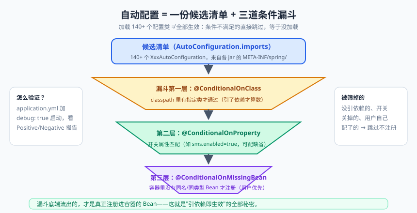
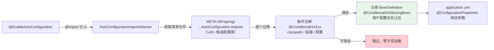

# Spring Boot 自动配置：@SpringBootApplication 拆解

Spring Boot 的口号是"约定优于配置"（Convention over Configuration）。但很多同学用了两年 Spring Boot，仍然把它当"魔法"：加一个 `spring-boot-starter-data-redis` 依赖，RedisTemplate 就能注入了；引入 web starter，Tomcat 就起来了——**凭什么？**

今天这篇把 `@SpringBootApplication` 这个注解拆开揉碎，讲清楚自动配置（Auto-Configuration）的完整链条，最后**手写一个自定义 Starter**。写完你会发现：Spring Boot 没有魔法，只有"配置的搬运 + 条件的判断"，而这一切的基础，就是咱们前两篇学的 IoC 容器和条件装配。

---

## 一、先忆苦思甜：Spring 的"配置地狱"时代

用原始 Spring MVC 搭一个 Hello World web 项目，你需要：web.xml（DispatcherServlet 配置）、applicationContext.xml（组件扫描、数据源、事务管理器）、spring-mvc.xml（注解驱动、视图解析器）……三个 XML 两百行起步。而且这些配置**每个项目长得都差不多**——千篇一律的东西，凭什么让人类手写？

更要命的是依赖管理：Spring 5.2.x 配 Hibernate 哪个版本？Jackson 和 Spring 版本兼不兼容？版本冲突的 `NoSuchMethodError` 能调一天。

Spring Boot 对这两件事的回答：

| 痛点 | 解法 | 对应特性 |
|------|------|---------|
| 依赖版本管理 | 官方帮你把兼容的版本搭配好，一揽子引入 | **Starter 起步依赖** |
| 千篇一律的配置 | 按你引入的依赖，自动注册所需的 Bean | **自动配置** |
| 部署麻烦（装 Tomcat、打包 war） | 服务器内置进 jar | **内嵌容器** |

---

## 二、@SpringBootApplication：一个注解三个分身

每个 Spring Boot 项目的 main 类上都顶着这个注解，它其实是三个注解的**组合注解**：

```java
@SpringBootConfiguration      // ① 本质是 @Configuration：声明"本类是配置类"
@EnableAutoConfiguration      // ② 核心中的核心：开启自动配置
@ComponentScan(excludeFilters = { ... })   // ③ 组件扫描：扫本类所在包及子包
public @interface SpringBootApplication { ... }
```

### 2.1 @SpringBootConfiguration = @Configuration

它就是 `@Configuration` 的"马甲"（多一层语义标识）。回忆 IoC 篇：@Configuration 类是容器的配置源头，@Bean 方法会注册进容器。main 类自己就是一个配置类——这就是为什么你直接在 main 类里写 @Bean 也能生效。

### 2.2 @ComponentScan：主类为什么要放根包？

扫描范围默认是 **main 类所在的包及其子包**。这解释了一个新手经典事故：把 `Application.java` 放在 `com.demo` 包，Service 放在 `com.util` 包（不是子包）→ 扫不到 → 启动报 `NoSuchBeanDefinitionException`。**约定：main 类永远放根包。**

### 2.3 @EnableAutoConfiguration：自动配置的入口

```java
@AutoConfigurationPackage       // 把 main 类所在包注册进去，供后续扫描（如 JPA 的实体扫描）
@Import(AutoConfigurationImportSelector.class)   // 关键：导入"配置选择器"
public @interface EnableAutoConfiguration { ... }
```

`@Import` 导入的 `AutoConfigurationImportSelector` 才是真正干活的：它读取一份"候选自动配置类清单"，筛选后批量注册进容器。

---

## 三、自动配置的加载机制：一份清单的前世今生


> 🖼️ **图解**：140+ 候选配置类经三道条件漏斗，流出的才真正生效

先把整条链路画成图，后面逐段拆解：



### 3.1 清单从哪来

Spring Boot 官方把 140+ 个自动配置类（`XxxAutoConfiguration`）提前写好，每个类对应一个技术组件（Redis、MyBatis、MVC、数据源……），**以"清单文件"的形式登记在每个 jar 包里**：

| 版本 | 清单文件位置 | 机制 |
|------|-------------|------|
| Boot 2.7 之前 | 各 jar 的 `META-INF/spring.factories` 的 `EnableAutoConfiguration` 键 | SpringFactoriesLoader 加载 |
| Boot 2.7 / 3.x | 各 jar 的 `META-INF/spring/org.springframework.boot.autoconfigure.AutoConfiguration.imports`（每行一个全类名） | 新的 ImportCandidates 加载 |

```properties
# META-INF/spring/org.springframework.boot.autoconfigure.AutoConfiguration.imports（示意）
org.springframework.boot.autoconfigure.jdbc.DataSourceAutoConfiguration
org.springframework.boot.autoconfigure.data.redis.RedisAutoConfiguration
org.springframework.boot.autoconfigure.web.servlet.WebMvcAutoConfiguration
```

> ⚠️ **注意版本坑**：自己写 Starter 或面试时，2.7 前后这个差异是高频考点。Boot 3 彻底移除了对 spring.factories 中自动配置的支持（spring.factories 还活着，但只用于别的扩展点如 Listener）。

### 3.2 加载≠生效：条件注解把门

140+ 个配置类如果全量生效，你的没有数据库的项目启动就崩了。秘诀是**每个自动配置类头上都挂着条件注解（@Conditional 系）**——条件不满足，这个配置类直接跳过，等于没加载：

| 注解 | 条件 |
|------|------|
| @ConditionalOnClass | classpath 里有指定类（引了依赖才有它） |
| @ConditionalOnMissingBean | 容器里**没有**指定 Bean（用户没自己配） |
| @ConditionalOnBean | 容器里有指定 Bean |
| @ConditionalOnProperty | 配置文件里有指定属性（matchIfMissing 控制缺省行为） |
| @ConditionalOnWebApplication | 是 Web 应用（有 Servlet） |
| @ConditionalOnClass + @AutoConfiguration | Boot 3 风格的组合声明 |

### 3.3 走读一个真实例子：RedisAutoConfiguration（简化版源码）

```java
@AutoConfiguration                                     // Boot 3 写法（2.x 是 @Configuration + 清单注册）
@ConditionalOnClass(RedisOperations.class)            // ① 类路径有 Redis 相关类（说明你引了 redis 依赖）
@EnableConfigurationProperties(RedisProperties.class) // ② 绑定 spring.redis.* 配置
public class RedisAutoConfiguration {

    @Bean
    @ConditionalOnMissingBean(name = "redisTemplate") // ③ 容器没有 redisTemplate 才创建——用户配置优先！
    public RedisTemplate<Object, Object> redisTemplate(
            RedisConnectionFactory redisConnectionFactory) {
        RedisTemplate<Object, Object> template = new RedisTemplate<>();
        template.setConnectionFactory(redisConnectionFactory);
        return template;
    }
    // ... stringRedisTemplate 同理
}
```

三步套路清晰可见：**classpath 有这个类（说明你用了这技术）→ 绑定专属配置类 → 容器没有就注册默认 Bean**。@ConditionalOnMissingBean 是"谦让机制"：**只要你自己定义了同类型 Bean，自动配置就让位**。这就是"约定优于配置"的另一面——"配置可覆盖约定"。

### 3.4 配置绑定：@ConfigurationProperties

自动配置类的参数从哪来？从 application.yml，通过属性绑定类：

```java
@ConfigurationProperties(prefix = "spring.redis")     // 绑定 spring.redis.* 前缀
public class RedisProperties {
    private String host = "localhost";                // 默认值：不配置也有兜底
    private int port = 6379;
    private String password;
    private int database = 0;
    // getter/setter
}

# application.yml（松散绑定：驼峰/中划线/下划线都认）
spring:
  redis:
    host: 192.168.1.100
    port: 6380
    password: secret123
```

> 📌 **划重点**：自动配置链条一句话总结——**@EnableAutoConfiguration 触发加载清单文件里所有候选配置类 → 条件注解筛选（classpath 有什么、你配了什么、容器缺什么）→ 满足条件的注册 Bean → 参数从 application.yml 经 @ConfigurationProperties 绑定**。所谓"自动"，是"提前写好 + 运行时按条件挑"。

> ⚠️ **踩坑实录**：一个真实翻车现场——同事给项目加了 `spring-boot-starter-data-redis` 依赖"只是想用它的工具类"，结果 RedisAutoConfiguration 条件满足，启动时容器尝试连接 localhost:6379 的 Redis。测试环境没装 Redis，应用启动直接报 `Unable to connect to Redis`。**依赖不是随便加的**：starter 一进 classpath，自动配置就可能"认领"它。同理，明明配了数据源却连不上、明明没写 DataSource 的 Bean 却有连接池——先想想是不是哪个依赖"惹"来的自动配置（`debug: true` 看报告）。

### 3.5 调试神器：自动配置报告

想知道"为什么我的配置没生效"？开箱即用的诊断开关：

```yaml
# application.yml 加一行，启动时打印条件评估报告
debug: true
```

启动日志会出现两段：**Positive matches**（生效的配置及原因）和 **Negative matches**（没生效的及原因）。排查"Bean 咋没注进来"的第一工具。

---

## 四、Starter：自动配置的"快递包装"

理解了自动配置，Starter 就没什么神秘的了——**Starter = 依赖打包（jar 只做依赖聚合）+ 自动配置类**。

以 `spring-boot-starter-data-redis` 为例，它是个几乎"空"的 jar：pom 里声明了 spring-data-redis、lettuce 等依赖；真正干活的是 `spring-boot-autoconfigure` jar 里的 RedisAutoConfiguration。**"引依赖即生效" = Maven 传递依赖把 jar 带进来（classpath 有类了）+ 清单文件把配置类登记了（条件满足）。**

命名规范：官方 `spring-boot-starter-xxx`，第三方 `xxx-spring-boot-starter`（如 mybatis-spring-boot-starter）。

---

## 五、实战：手写 sms-spring-boot-starter

目标：别的项目引入我们的 starter + 在 yml 里配几个参数，就获得一个可直接注入的 `SmsClient`。全流程 4 个文件：

### 5.1 工程结构

```
sms-spring-boot-starter/
├── pom.xml                                 # 依赖 spring-boot-autoconfigure
└── src/main/java/com/demo/sms/
    ├── SmsClient.java                      # 核心功能类（发给谁、内容、渠道）
    ├── SmsProperties.java                  # 配置绑定类
    └── SmsAutoConfiguration.java           # 自动配置类
└── src/main/resources/META-INF/spring/
    └── org.springframework.boot.autoconfigure.AutoConfiguration.imports   # 清单
```

### 5.2 核心代码

```java
// ① 配置绑定：用户在 yml 里怎么配
@ConfigurationProperties(prefix = "sms")            // 对应 sms.access-key=xxx
public class SmsProperties {
    private String accessKey;                       // 云服务商 AK
    private String secretKey;
    private String signName = "DemoApp";            // 默认签名
    private boolean enabled = false;                // 总开关
    // getter/setter 省略不得省——绑定靠它们
}

// ② 核心功能：一个普通的类，什么都不知道，只认构造参数（纯业务组件）
public class SmsClient {
    private final SmsProperties properties;

    public SmsClient(SmsProperties properties) { this.properties = properties; }

    public void send(String phone, String content) {
        if (!properties.isEnabled()) {
            System.out.println("[SMS MOCK] 发送至 " + phone + "：" + content);   // 演示用，生产别这么打日志
            return;
        }
        // 真实实现：调云服务 API（省略 HTTP 细节）
        System.out.println("[SMS] 通过 " + properties.getSignName() + " 发送：" + content);
    }
}

// ③ 自动配置：把上面俩组装起来（容器里的"装配说明书"）
@AutoConfiguration
@ConditionalOnClass(SmsClient.class)                        // classpath 有 SmsClient（本包被引入）
@ConditionalOnProperty(prefix = "sms", name = "enabled",    // sms.enabled 不存在也装配（havingValue 匹配缺省）
        havingValue = "true", matchIfMissing = true)
@EnableConfigurationProperties(SmsProperties.class)         // 注册配置绑定
public class SmsAutoConfiguration {

    @Bean
    @ConditionalOnMissingBean                               // 用户自己定义了 SmsClient 就让位
    public SmsClient smsClient(SmsProperties properties) {
        return new SmsClient(properties);
    }
}
```

```properties
# ④ 清单文件 META-INF/spring/org.springframework.boot.autoconfigure.AutoConfiguration.imports
com.demo.sms.SmsAutoConfiguration
```

### 5.3 使用方体验

```xml
<!-- 业务项目 pom.xml -->
<dependency>
    <groupId>com.demo</groupId>
    <artifactId>sms-spring-boot-starter</artifactId>
    <version>1.0.0</version>
</dependency>
```

```yaml
sms:
  access-key: AK123
  secret-key: SK456
  sign-name: 购物App
  enabled: true
```

```java
@Service
public class RegisterService {
    private final SmsClient smsClient;                 // 直接注入，开箱即用
    public RegisterService(SmsClient smsClient) { this.smsClient = smsClient; }

    public void register(String phone) {
        // ...注册逻辑
        smsClient.send(phone, "验证码 6666");
    }
}
```

> 💡 **老鸟忠告**：写 Starter 的三个职业习惯：① 核心功能类与自动配置分离（自动配置只做"装配"，不含业务），方便非 Spring 环境复用；② 一律加 @ConditionalOnMissingBean，给使用者留覆盖余地；③ 提供 `additional-spring-configuration-metadata.json`，让 IDE 能提示你自己的配置项（meta/ 目录下）——这是"官方感"和"业余感"的分水岭。

---

## 本篇小结

- Spring Boot 三大支柱：Starter 依赖打包、自动配置、内嵌容器；解决的是"配置地狱 + 依赖地狱 + 部署麻烦"；
- @SpringBootApplication = @SpringBootConfiguration（配置类）+ @ComponentScan（扫主类包及子包，主类必须放根包）+ @EnableAutoConfiguration（开启自动配置）；
- 自动配置链条：@Import(AutoConfigurationImportSelector) → 读清单文件（2.7 前 spring.factories / 之后 AutoConfiguration.imports）→ 条件注解筛选 → 注册 Bean；
- 条件注解是"智能"的来源：@ConditionalOnClass（引了依赖才生效）、@ConditionalOnMissingBean（用户配置优先）、@ConditionalOnProperty（开关可控）；
- 配置参数经 @ConfigurationProperties 绑定，支持默认值与松散命名；
- debug: true 打印正/负匹配报告，是排查"配置没生效"的第一工具；
- 手写 Starter 四件套：功能类 + Properties + AutoConfiguration + 清单文件。

## 课后思考 & 动手练习

1. （概念）@SpringBootApplication 里三个注解各干什么？为什么 main 类必须放根包？
2. （概念）引入 starter-data-redis 后 RedisTemplate 能注入，用"依赖→清单→条件→Bean"四步复述完整链条。
3. （概念）@ConditionalOnMissingBean 体现了什么设计哲学？如果去掉它会有什么问题？
4. （动手）在任意 Spring Boot 项目开启 `debug: true`，观察 Negative matches 里随便一个配置类，解释它没生效的原因。
5. （动手·进阶）照第五节动手写一个 `email-spring-boot-starter`（EmailClient + EmailProperties + AutoConfiguration + imports 清单），在另一个项目引入并验证：① 正常发送；② 自己定义一个 EmailClient Bean 验证自动配置让位；③ sms.enabled=false 时验证 Bean 不注册。

> 下一篇预告：《Spring Boot 启动流程：从 main 到 Tomcat 就绪》——`SpringApplication.run()` 这一行代码背后藏着一次"火箭发射"：十步检查单、事件广播、容器刷新、内嵌 Tomcat 点火。全程走读一遍，从此启动报错你不再两眼一抹黑。
