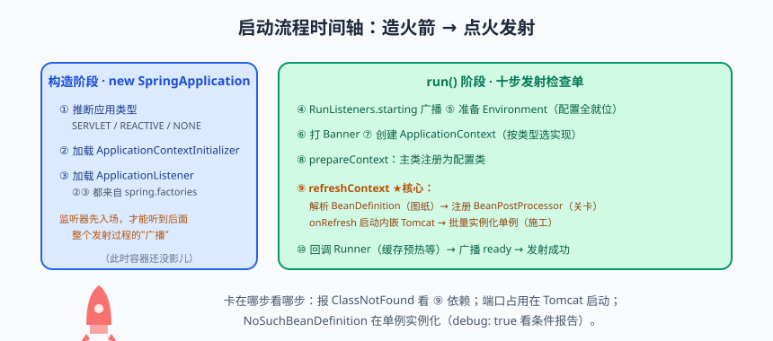
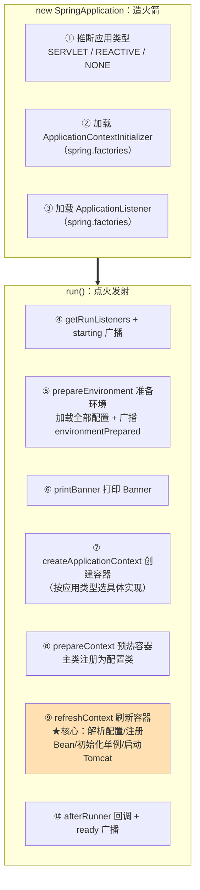

# Spring Boot 启动流程：从 main 到 Tomcat 就绪

每个 Spring Boot 工程都有一行人尽皆知的代码：

```java
@SpringBootApplication
public class Application {
    public static void main(String[] args) {
        SpringApplication.run(Application.class, args);
    }
}
```

短短一行，按下回车，控制台 logo 一出、Tomcat 端口一起、Bean 全就绪——像一次火箭发射：看着是按了个按钮，背后是一整套"发射检查单"。今天咱们把这次发射**逐秒回放**：从 `run()` 进入到 Tomcat 就绪一共发生什么。啃完这篇，你会拥有两个超能力：面试时把启动流程讲得让面试官点头，以及——线上启动报错时，看一眼堆栈就知道卡在哪个阶段。

---

## 一、发射总览：两大阶段十步检查单


> 🖼️ **图解**：启动时间轴：构造阶段造火箭，run 阶段十步点火

`SpringApplication.run(Application.class, args)` 的内部分为**构造阶段**（造火箭）和 **run 阶段**（点火发射）：



---

## 二、构造阶段：还没 run 就干了三件事

```java
// SpringApplication 构造器（源码简化）
public SpringApplication(ResourceLoader resourceLoader, Class<?>... primarySources) {
    // ① 推断应用类型：classpath 里有什么决定造什么火箭
    this.webApplicationType = WebApplicationType.deduceFromClasspath();
    //   - 有 DispatcherHandler（WebFlux）→ REACTIVE
    //   - 有 Servlet + DispatcherServlet（Spring MVC）→ SERVLET
    //   - 都没有 → NONE（普通 Java 程序）
    // ②③ 从 META-INF/spring.factories 加载两组扩展
    setInitializers((Collection) getSpringFactoriesInstances(ApplicationContextInitializer.class));
    setListeners((Collection) getSpringFactoriesInstances(ApplicationListener.class));
}
```

**为什么先加载 Initializer 和 Listener？** 因为发射过程中要不断"广播事件"（starting、environmentPrepared、contextPrepared、ready……），监听器得提前入场才能听到。这里的加载机制和上一篇的自动配置清单如出一辙——spring.factories 是 Spring Boot 所有"提前登记、运行时挑选"玩法的老巢。

---

## 三、run 阶段十步逐步拆解

### ④ 第五步前先搭"广播站"：getRunListeners + starting 事件

```java
// run() 源码骨架（大幅简化，保留主干）
public ConfigurableApplicationContext run(String... args) {
    StopWatch stopWatch = new StopWatch();                        // 计秒表：启动耗时统计
    stopWatch.start();
    ConfigurableApplicationContext context = null;

    SpringApplicationRunListeners listeners = getRunListeners(args); // 广播站
    listeners.starting();                                          // 事件1：starting
    // ... ⑤⑥⑦⑧⑨⑩
}
```

`SpringApplicationRunListeners` 是给"启动过程"专门准备的广播台，典型监听器如 `EnvironmentPostProcessor`（处理配置）、`ConfigDataLoader`（读 yml 的入口之一）都在这里被触发。

### ⑤ 准备环境：你所有的配置在这就位

`prepareEnvironment` 做的事：创建 `StandardEnvironment`，然后把所有配置源按优先级装进去。**配置的优先级顺序**（高 → 低）是排查"配置怎么没生效"的核心知识：

| 优先级 | 配置源 | 说明 |
|:---:|--------|------|
| 1 | 命令行参数 | `--server.port=9090`（运维覆盖神器） |
| 2 | `SPRING_APPLICATION_JSON` | 环境变量形式的 JSON 配置 |
| 3 | 操作系统环境变量 | `export SERVER_PORT=9090` |
| 4 | application-{profile}.yml | 指定环境配置（如 test/prod） |
| 5 | application.yml / properties | 主配置文件 |

加载完成后广播 **environmentPrepared** 事件——**Spring Cloud 的"配置中心拉取"（bootstrap 阶段）就挂在这一环**。多环境切换靠 `spring.profiles.active`：

```bash
java -jar app.jar --spring.profiles.active=prod --server.port=8081
```

### ⑥⑦ 打印 Banner、创建容器

Banner 就是控制台那个 logo（`banner.txt` 可自定义，甚至可以关掉：`spring.main.banner-mode=off`）。创建容器按构造阶段推断的类型选择实现：Servlet 应用拿到的是 **`AnnotationConfigServletWebServerApplicationContext`**——注意它现在还是个"空容器"，Bean 一个没装。

### ⑧ prepareContext：把主类"喂"进容器

主类（@SpringBootApplication 标注的 Application 类）作为配置类注册进容器。回忆上上篇：自动配置的入口是主类上的 @EnableAutoConfiguration——**先注册主类，后面 refresh 才有解析的起点**。

### ⑨ refreshContext：全场最佳，启动的心脏

`refresh()` 是 Spring 容器的"总装车间"（源码在 AbstractApplicationContext，十二个步骤，Spring Framework 时代的顶梁柱）。关键几步：

```java
public void refresh() throws BeansException, IllegalStateException {
    // 1. invokeBeanFactoryPostProcessors ★解析@Configuration/@ComponentScan/@Bean/@Import
    //    → 触发组件扫描、加载全部 BeanDefinition（图纸阶段！IoC 篇讲过）
    //    → @EnableAutoConfiguration 的自动配置也在这步被处理（AutoConfigurationImportSelector）
    // 2. registerBeanPostProcessors  注册 BeanPostProcessor（AOP、@Autowired 的处理器入关）
    // 3. onRefresh ★Web 场景的钩子：createWebServer —— 内嵌 Tomcat 在这创建并启动！
    // 4. finishBeanFactoryInitialization ★实例化所有非懒加载单例（施工阶段：Bean 真正诞生）
    //    → 完整走 Bean 生命周期（Bean 生命周期篇的主场）
    // 5. publishEvent(ContextRefreshedEvent)
}
```

> 📌 **划重点**：refresh 四个关键动作记口诀——**解析图纸（BeanFactoryPostProcessor）→ 注册关卡（BeanPostProcessor）→ 点火 Tomcat（onRefresh）→ 批量造 Bean（finishBeanFactoryInitialization）**。启动日志卡在哪句，就对应哪一步：卡在 "Starting Servlet service" 前是 Tomcat 问题；卡在 Bean 装配是循环依赖/缺依赖；卡在数据源初始化是连接问题。

### ⑩ 收尾：回调 Runner、广播 ready

```java
listeners.started(context);                  // 事件：started
callRunners(context, applicationArguments); // 回调 ApplicationRunner / CommandLineRunner
listeners.ready(context, timeTaken);         // 事件：ready —— 发射成功！
```

**Runner 是"启动完成立刻执行"的业务扩展点**，两者区别仅在参数封装：

| Runner | 参数 | 特点 |
|--------|------|------|
| ApplicationRunner | ApplicationArguments（解析好的 args，方便取 --key=value） | 推荐 |
| CommandLineRunner | String... args（原始参数） | 老牌 |

```java
@Component
@Order(1)                                   // 多个 Runner 按 Order 排序执行
public class CacheWarmUpRunner implements ApplicationRunner {
    @Override
    public void run(ApplicationArguments args) throws Exception {
        // 典型用途：缓存预热、字典加载、注册中心注册、启动自检
        System.out.println("容器就绪，开始预热缓存...");
    }
}
```

### "想在启动时干点事"该用哪个？

| 时机 | 手段 |
|------|------|
| Bean 依赖就绪后（单个 Bean 内部） | @PostConstruct |
| 所有 Bean 就绪后（少量全局逻辑） | ApplicationRunner / CommandLineRunner |
| 想监听启动各阶段事件 | ApplicationListener\<ApplicationReadyEvent 等\> / @EventListener |
| 改配置/加配置源 | EnvironmentPostProcessor（spring.factories 注册） |

> ⚠️ **踩坑实录**：把重活（预热大缓存、拉全量数据）塞进 @PostConstruct，导致**启动时间从 20 秒涨到 5 分钟**——因为 @PostConstruct 在 Bean 初始化阶段执行，会阻塞后续所有 Bean 的创建。重活放 Runner 里用异步线程做，或者干脆上 MQ/定时任务，别让启动流程等你。

---

## 四、内嵌 Tomcat：jar 包为什么能自己跑

传统部署：写 war → 扔进独立的 Tomcat → Tomcat 是"房子"，应用是"租客"。Spring Boot 反转了关系：**应用是房子，Tomcat 是内置家电**。

原理三步（发生在 refresh 的 onRefresh 阶段）：

1. 自动配置发现你是 Servlet Web 应用（条件注解：@ConditionalOnWebApplication + classpath 有 Tomcat 类）；
2. `ServletWebServerFactory`（默认 TomcatServletWebServerFactory，可换 Jetty/Undertow）的 `getWebServer()` 被调用：**new 一个 Tomcat 对象 → 绑定端口（默认 8080）→ 注册 DispatcherServlet → 启动**；
3. Tomcat 与应用同 JVM、非 daemon 线程守着 main 不退出——所以 `java -jar` 直接跑，不依赖外部容器。

```yaml
server:
  port: 8080                       # 换端口
  tomcat:
    threads:
      max: 200                     # 最大工作线程
    max-connections: 8192          # 最大连接数
  shutdown: graceful               # 优雅停机：先停止接新请求，处理完存量再退出（配 preStop 更佳）
```

> 💡 **老鸟忠告**：内嵌容器的线程模型要心里有数——Tomcat 默认 200 个工作线程处理请求，每个请求占一个线程（同步 Servlet 模型）。**Tomcat 线程池打满的外在表现是请求排队、RT 上涨**，这也是"业务线程池配置不当会拖垮 Web 线程"的传播链起点（性能篇细讲）。

---

## 五、启动报错排查地图

| 报错关键词 | 卡在哪一步 | 排查方向 |
|-----------|-----------|---------|
| ClassNotFound / NoClassDefFound | 容器创建前后 | 依赖缺失/冲突：`mvn dependency:tree` |
| Port 8080 was already in use | onRefresh 启动 Tomcat | 端口占用：`lsof -i:8080`，或换 --server.port |
| NoSuchBeanDefinitionException | finishBeanFactory 初始化单例 | 没扫到（包位置）/条件注解没满足（debug: true 看报告） |
| BeanCurrentlyInCreationException | 同上 | 循环依赖（Bean 生命周期篇） |
| UnsatisfiedDependencyException | 同上 | 缺依赖 Bean，顺藤摸瓜看 which bean is missing |
|Communications link failure | 数据源初始化 | DB 网络问题：先 telnet 3306 通不通 |
| 启动成功但秒退 | main 结束 | 非 Web 应用或 Web 类型推断失败（缺 web 依赖） |

---

## 本篇小结

- 启动分两大阶段：构造阶段（推断应用类型、加载 Initializer/Listener）+ run 阶段（十步发射检查单）；
- 配置加载顺序：命令行 > 环境变量 > profile 配置 > 主配置，高优先级覆盖低优先级；
- refresh 四大关键动作：解析 BeanDefinition → 注册 BeanPostProcessor → onRefresh 启动内嵌 Tomcat → 批量实例化单例 Bean；
- 内嵌容器原理：ServletWebServerFactory new 出 Tomcat，同 JVM 运行，jar 包因此可独立执行；
- 启动期扩展点选型：@PostConstruct（Bean 级）→ Runner（全局级）→ 事件监听（阶段级）；重活放 Runner 且异步执行；
- 排查启动报错先定位阶段（依赖/端口/循环依赖/条件不满足），debug: true 和堆栈是两大武器。

## 课后思考 & 动手练习

1. （概念）按顺序说出 run() 的十步检查单，标注哪一步创建 Tomcat、哪一步实例化 Bean。
2. （概念）命令行 `--server.port=9090` 为什么能覆盖 yml 里的配置？从配置优先级角度解释。
3. （概念）@PostConstruct 和 ApplicationRunner 的执行时机有何不同？各适合干什么？
4. （动手）写一个 ApplicationRunner，在启动完成后打印环境名、激活的 Profile、JVM 最大内存；再用 @Order 验证多个 Runner 的顺序。
5. （动手·进阶）在 application.yml 故意制造三种启动失败并收集报错：① 端口占用（先 `nc -l 8080`）；② 缺数据库连接（配错 url）；③ Bean 循环依赖。对照本文排查地图写出每个报错的关键词和定位思路。

> 下一篇预告：《事务与数据访问：@Transactional 的秘密》——原理篇收官之作。Spring 事务 = IoC + AOP + 设计模式的集大成者：七大传播行为怎么选？为什么异常被 catch 了事务就不回滚？八大失效场景一次说透，让你在被事务背刺之前先看穿它。
