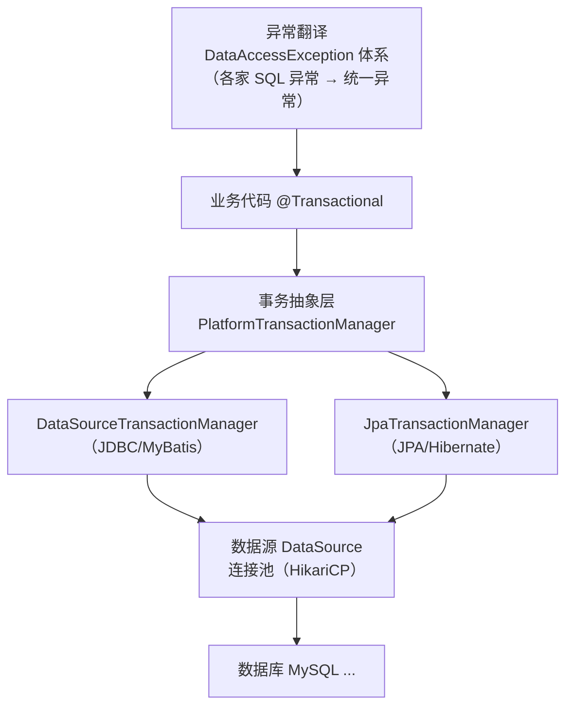
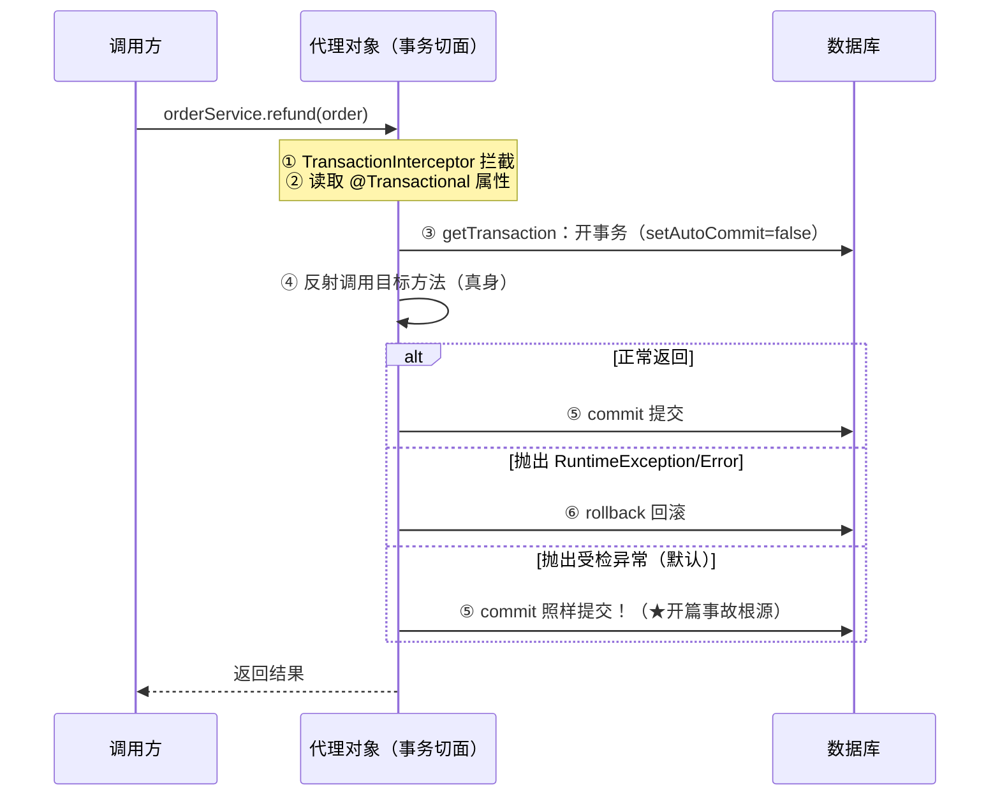
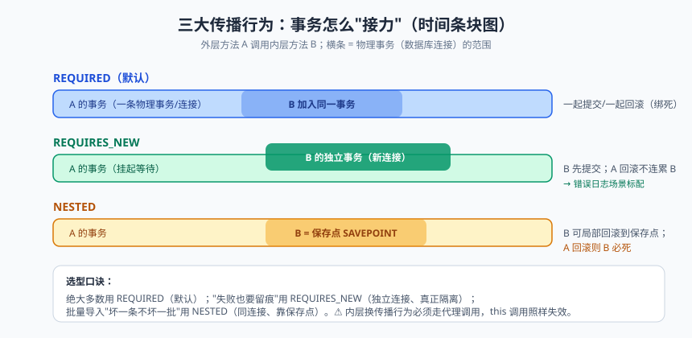

# 事务与数据访问：@Transactional 的秘密

先看一个让公司损失真金白银的案例。某电商的退款代码：

```java
@Transactional
public void refund(Order order) {
    refundDao.updateStatus(order.getId(), REFUNDED);     // 更新退款状态
    accountDao.addBalance(order.getUserId(), order.getAmount());  // 给用户加余额
    notifyService.sendSms(order.getUserPhone());          // 发通知
}
```

上线三个月没出过事。某天短信网关抖动，`sendSms` 抛了个**受检异常包装的 IOException**——结果状态更新和余额增加**全部回滚了**，但短信平台那边其实已经发出去了。用户收到"退款成功"的短信，一查余额没变。客服电话被打爆。

这个事故的根源，是一个 90% 用过 @Transactional 的人都答不准的问题：**@Transactional 默认回滚哪些异常？** 今天是 Spring Boot 原理篇收官之战，把事务的底层原理、传播行为、失效场景一次讲透。它综合了前三篇的全部知识：IoC（Bean 化）、AOP（代理拦截）、生命周期（代理时机）——是检验你原理篇学习成果的最好试金石。

---

## 一、Spring 数据访问体系：先看全景

Spring 事务不是孤岛，它是 Spring 数据访问（Data Access）体系的一环：



两大抽象：

- **PlatformTransactionManager（事务管理器）**：定义 getTransaction/commit/rollback 三个动作。不同数据访问技术有不同实现，**业务代码只面向接口**——这就是依赖倒置在框架层的应用。用 MyBatis/JdbcTemplate 时，自动装配的是 DataSourceTransactionManager；
- **DataAccessException 异常体系**：把各家数据库千奇百怪的错误码（MySQL 的 1062、Oracle 的 ORA-00001）翻译成统一的 `DuplicateKeyException`、`DataIntegrityViolationException`——@Repository 注解的功能之一就是激活这个翻译。

---

## 二、@Transactional 的本质：一个 AOP 切面

现在你对这句话应该秒懂了：**@Transactional 就是 Spring 用 AOP 织入的一个"事务切面"**。拦截器叫 `TransactionInterceptor`，工作流程：



**默认回滚规则（必背）**：只回滚 `RuntimeException` 和 `Error`，**受检异常（IOException、SQLException 等）默认不回滚，照样提交！** 设计理由：Spring 认为受检异常属于"可预期、可恢复的业务结果"（如余额不足），而运行时异常才是"程序出错了"。但这个默认值坑了无数人，**破局方法就是显式声明**：

```java
@Transactional(rollbackFor = Exception.class)     // 任何异常都回滚，生产代码建议无脑加
public void refund(Order order) { ... }
```

> 📌 **划重点**：`rollbackFor = Exception.class` 应该成为肌肉记忆。宁可回滚过多（大不了重试），不可提交不该提交的数据。开篇的事故，一行注解参数就能避免。

---

## 三、七大传播行为：事务的"接力规则"


> 🖼️ **图解**：REQUIRED/REQUIRES_NEW/NESTED 的事务条块图

传播行为（Propagation）回答的问题是：**一个事务方法调用另一个事务方法，事务怎么接力？** 就像两个人传东西：是共用一个口袋（加入现有事务），还是各自拿口袋（开新事务）？

| 传播行为 | 含义 | 生活类比 |
|---------|------|---------|
| **REQUIRED**（默认） | 有事务就加入，没有就新建 | 顺风车：有车就拼车，没车自己叫一辆 |
| **REQUIRES_NEW** | 总是开新事务，挂起当前事务 | 单独打车：不管你有没有车，我自己叫一辆，你等我 |
| **NESTED** | 嵌套事务：在外层事务里设保存点，可局部回滚 | 分店记账：主账本下有分账本，分店亏了单独重记 |
| SUPPORTS | 有事务就加入，没有就非事务跑 | 随缘：有车拼车，没车走路 |
| NOT_SUPPORTED | 总是非事务跑，挂起当前事务 | 强制走路：再好的车也不坐 |
| MANDATORY | 必须已有事务，否则报错 | 拼车守则：没车你就别出门（IllegalTransactionStateException） |
| NEVER | 必须没有事务，否则报错 | 独行侠：有车我还不坐了 |

**日常 95% 场景用默认 REQUIRED 就够**，但有两个必须会的"非默认"用法：

**用法一：REQUIRES_NEW 记录失败日志**——主事务回滚了，日志必须留下来：

```java
@Service
public class ErrorLogService {
    @Transactional(propagation = Propagation.REQUIRES_NEW)   // 独立新事务
    public void saveErrorLog(ErrorLog log) {
        // 主事务回滚不影响这里：因为这是另一个连接上的独立事务
        errorLogMapper.insert(log);
    }
}

@Service
public class OrderService {
    @Transactional
    public void createOrder(Order order) {
        try {
            doBusiness(order);
        } catch (Exception e) {
            errorLogService.saveErrorLog(new ErrorLog(order, e));  // 挂在另一个事务上，必然落库
            throw e;      // 继续抛，让主事务回滚
        }
    }
}
```

**用法二：NESTED 局部回滚**——批量处理中某条失败只回滚这一条，其他照常提交（外层 catch 掉内层异常即可，外层提交时嵌套部分也提交）：

```java
@Transactional
public void batchImport(List<Row> rows) {
    for (Row row : rows) {
        try {
            self.importOne(row);          // importOne 标注 @Transactional(propagation = NESTED)
        } catch (Exception e) {
            failedRows.add(row);          // 只回滚这一条的保存点，循环继续
        }
    }
}
```

> ⚠️ **踩坑实录**：NESTED 和 REQUIRES_NEW 都能"局部处理"，但机制完全不同：NESTED 是**同一个物理事务里的保存点（SAVEPOINT）**，外层回滚它必死；REQUIRES_NEW 是**真正独立的物理事务（新连接）**，外层死活与它无关。另外注意"self.importOne"的写法——直接 this 调用传播行为同样会失效（原因见下节第 1 条）。

---

## 四、事务失效八大场景（踩坑实录大合集）

**场景一：同类 this 调用（头号杀手）**

```java
@Service
public class OrderService {
    public void batchCreate(List<Order> orders) {
        for (Order o : orders) {
            this.createOrder(o);       // ✗ this 是原始对象，绕过代理 → 事务失效
        }
    }
    @Transactional
    public void createOrder(Order o) { ... }
}
```
原因：AOP 篇讲过的 this 陷阱——事务切面只挂在代理对象上。解法：自注入（`@Autowired OrderService self`）后调 `self.createOrder(o)`。

**场景二：方法不是 public**

```java
@Transactional
private void deduct(Long id) { ... }   // ✗ 代理拦不到（JDK/CGLIB 都无法拦截 private）
```
Spring 官方文档明确：非 public 方法上的 @Transactional 不生效（CGLIB 覆写不了）。同类里改成 public 并通过代理调用。

**场景三：异常被 catch 吞了**

```java
@Transactional
public void refund(Order order) {
    try {
        doRefund(order);
    } catch (Exception e) {
        log.error("退款失败", e);      // ✗ 异常没抛出代理，切面以为一切正常 → 照样 commit
    }
}
```
切面感知的是"方法是否抛异常出去"。要么 rethrow，要么手动 `TransactionAspectSupport.currentTransactionStatus().setRollbackOnly()`。

**场景四：受检异常默认不回滚**——开篇案例，加 `rollbackFor = Exception.class`。

**场景五：多线程调用**

```java
@Transactional
public void createOrder(Order order) {
    new Thread(() -> orderDao.insert(order)).start();   // ✗ 新线程拿到的是新连接，不在当前事务里
}
```
事务信息绑定在 ThreadLocal（连接从 ThreadLocal 取），**跨线程事务天然失效**。需要事务的操作必须在同一线程，或使用编程式事务控制。

**场景六：数据库引擎不支持**——MyISAM 引擎不支持事务（MySQL 5.5 前默认引擎），表是 MyISAM 的话一切白搭。确认 `SHOW CREATE TABLE` 是 InnoDB。

**场景七：Bean 没被 Spring 管理**

```java
public class OrderService {              // ✗ 没有 @Service
    @Transactional
    public void createOrder() { ... }
}
```
没 Bean 化 → 没代理化 → 注解是装饰品。同类变体：自己 `new OrderService()` 出来的对象。

**场景八：传播行为设置不当**——内层方法标了 NOT_SUPPORTED 或在 NEVER 里被调用；或者内层 REQUIRES_NEW 自己提交了，外层回滚救不了它。理解传播行为语义即可避开。

> 💡 **老鸟忠告**：八个场景看着多，根因只有三个：**①没走代理（this/private/new/没扫描）②切面没感知（异常被吞/受检异常）③不在同一个事务上下文（多线程/传播行为）**。记住三大根因，比背八个场景更抗遗忘。

---

## 五、编程式事务：TransactionTemplate

声明式事务好用但有边界：**小范围事务、动态决定回滚、一段代码里两段独立事务**——注解就力不从心了。这时用编程式：

```java
@Service
public class PointService {
    private final TransactionTemplate txTemplate;      // Spring Boot 自动装配，直接注入

    public PointService(PlatformTransactionManager txManager) {
        this.txTemplate = new TransactionTemplate(txManager);
    }

    public void grantPoints(User user, int points) {
        txTemplate.execute(status -> {                 // lambda 内是一个事务
            pointDao.insert(user.getId(), points);
            userDao.updateLevel(user.getId(), calcLevel(user, points));
            if (points < 0) {
                status.setRollbackOnly();              // 手动标记回滚（不抛异常的方式）
            }
            return null;
        });
    }
}
```

适用场景：方法很长但只有一小段需要事务（缩小事务范围=缩短锁持有时间）；需要条件性回滚；老代码改造不想动方法签名。

## 六、MyBatis / JPA 集成要点

**MyBatis（含 MyBatis-Plus，实践篇主角）**：`mybatis-spring-boot-starter` 自动装配 SqlSessionFactory 与 SqlSessionTemplate；**关键机制**：SqlSession 与 Spring 事务同步——同一事务内的多次 Mapper 调用复用同一个数据库连接（否则两个连接互相看不见对方的未提交数据，事务就穿了）。`@MapperScan("com.demo.mapper")` 扫描 Mapper 接口，为每个接口生成**代理对象**（FactoryBean + 动态代理，IoC 篇的知识闭环了）注册进容器。

**JPA（Hibernate）**：`JpaRepository` 接口即继承即用；两个易错点：① **save 之后 flush 才发 SQL**，事务提交时统一 flush；② 懒加载异常 `LazyInitializationException`——Session 已关闭还想取懒加载属性（典型于把 Entity 直接序列化返回给前端，解法：DTO 分离，实践篇细讲）。

## 七、事务最佳实践清单

- **事务方法尽量短**：把 RPC 调用、发短信、文件 IO 挪出事务（别让数据库连接陪着你等三方接口超时，连接池会被拖垮）；
- **@Transactional(rollbackFor = Exception.class)** 写成默认姿势；
- **只读事务**：查询方法标 `@Transactional(readOnly = true)`——驱动层优化（MySQL 只读优化 + ORM 跳过脏检查，JPA 下收益显著）；
- **别把大事务交给 @Transactional**：批量处理拆批 + 每批独立事务，避免超长事务撑爆 undo log 和连接占用；
- **测试事务**：`@Transactional` 测试方法默认结束后回滚（Test 系列注解），测试不污染数据库（测试篇细讲）。

---

## 本篇小结

- Spring 事务 = PlatformTransactionManager 抽象 + TransactionInterceptor AOP 切面，@Transactional 触发的动作序列：拦截→开事务→调真身→按异常类型 commit/rollback；
- **默认只回滚 RuntimeException 与 Error**，受检异常要 rollbackFor 显式声明；
- 传播行为默认 REQUIRED；REQUIRES_NEW 独立事务（失败日志场景）、NESTED 保存点（局部回滚场景）是两个必会的非默认值；
- 八大失效场景三大根因：没走代理、切面没感知异常、不在同一事务上下文；
- 编程式 TransactionTemplate 适合小范围/动态事务控制；
- 最佳实践：rollbackFor 常备、事务尽量短、查询加 readOnly、批量拆小事务。

## 课后思考 & 动手练习

1. （概念）复述 TransactionInterceptor 的完整工作流程，标注 commit/rollback 的判定时机。
2. （概念）NESTED 与 REQUIRES_NEW 的本质区别？各自适合什么场景？
3. （概念）八大失效场景背后有哪三大根因？自己先归类再看答案。
4. （动手）建一张 account 表（InnoDB），复现"受检异常不回滚"：方法内抛 `new IOException("模拟")`，验证数据被提交；加上 rollbackFor 后验证回滚。
5. （动手·进阶）用两个 Service + REQUIRES_NEW 实现"主事务回滚但错误日志落库"的完整 Demo：故意让主流程抛 RuntimeException，验证订单表无数据、error_log 表有记录；再把日志方法改成 REQUIRED（默认）对比两者差异。

> 原理篇（01-06）至此收官！你现在已经具备了"看穿 Spring Boot"的能力。接下来进入**应用实践篇**——把这些原理真刀真枪用到项目里。第一篇《从零搭建一个 RESTful API 服务》：分层架构、参数校验、统一异常处理、接口文档，一个工程级项目的地基怎么打，咱们边写边讲。
