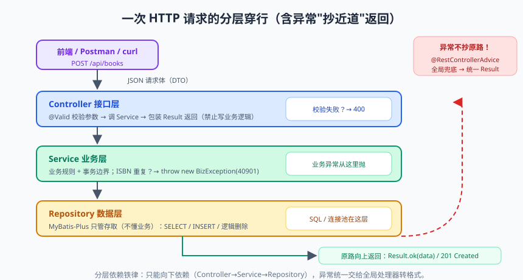
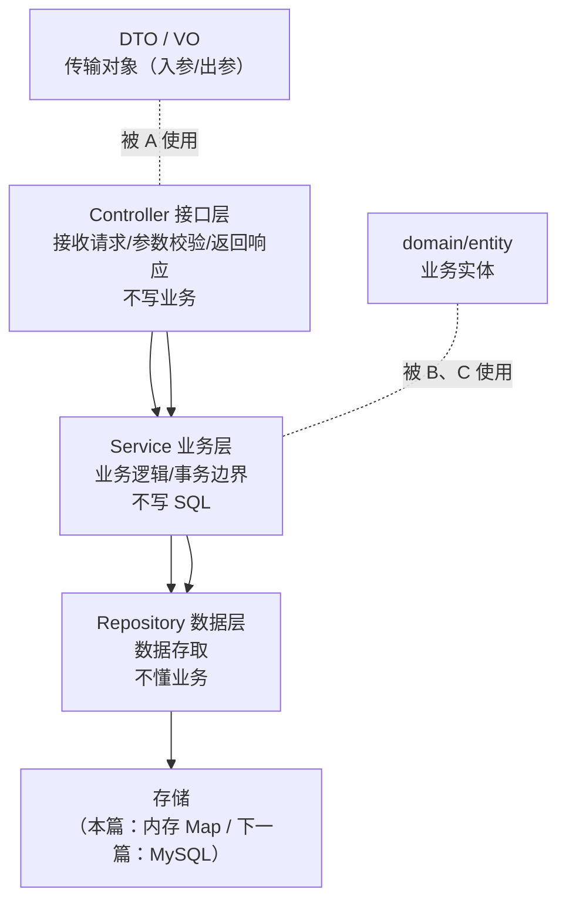

# 从零搭建一个 RESTful API 服务

从这篇开始进入应用实践篇。前三个阶段你攒了一身内力：语法、并发、JVM、Spring 原理——现在到了"打出来"的时候。

实践篇的贯穿案例是**图书管理小系统**：本篇先用内存存储把 Web 层的地基打好（分层架构、统一响应、异常处理、参数校验、接口文档），下一篇落库 MySQL，再下一篇加 Redis 缓存。一个项目三步演进，就像真实工作中的迭代节奏。

有同学问："增删改查谁不会啊？"——会写 CRUD 和会**搭一个可维护的工程**是两回事。今天着重的就是后者：别人接手你的项目时，是夸"结构真清楚"还是骂"这写的什么玩意儿"。

---

## 一、项目初始化与依赖选择

打开 [start.spring.io](https://start.spring.io)（或 IDEA 的 Spring Initializr）：

- 项目：Maven，Java 17，Spring Boot 3.2.x（不想追新用 2.7.x 也行，本篇内容两者基本一致，仅 `javax.*` 与 `jakarta.*` 包名差异）；
- 依赖勾选：**Spring Web**（MVC + 内嵌 Tomcat）、**Validation**（参数校验）、**Lombok**（少写样板代码）。

生成的 pom 核心依赖：

```xml
<dependencies>
    <dependency>
        <groupId>org.springframework.boot</groupId>
        <artifactId>spring-boot-starter-web</artifactId>       <!-- MVC + Jackson + Tomcat -->
    </dependency>
    <dependency>
        <groupId>org.springframework.boot</groupId>
        <artifactId>spring-boot-starter-validation</artifactId> <!-- @Valid 参数校验 -->
    </dependency>
    <dependency>
        <groupId>org.projectlombok</groupId>
        <artifactId>lombok</artifactId>
        <optional>true</optional</optional>
    </dependency>
</dependencies>
```

> 📌 **划重点**：spring-boot-starter-web 已经传递依赖了 Jackson（JSON 序列化）、内嵌 Tomcat、Spring MVC——"引一个依赖，Web 三件套全到"，这就是原理篇讲的 Starter 机制在为你服务。

---

## 二、分层架构：包结构的"交通规则"


> 🖼️ **图解**：一次请求的分层穿行，异常走"抄近道"统一处理



| 层 | 包名 | 职责 | 禁止事项 |
|----|------|------|---------|
| Controller | `controller` | 收参数、调 Service、回结果 | ❌ 写业务逻辑、❌ 直接调 DAO |
| Service | `service` | 业务规则、事务控制 | ❌ 拼 SQL、❌ 处理 HTTP 细节 |
| Repository | `repository` | 数据读写 | ❌ 做业务判断 |
| DTO/VO | `dto` / `vo` | 出入参模型 | 与 Entity 分离（后述） |

**依赖方向铁律：只能向下依赖（Controller→Service→Repository），禁止反向**。为什么这么较真？因为分层的本质是"变化隔离"：换数据库只动 Repository，改业务规则只动 Service，加接口只动 Controller——每层的变化不传染。

```
com.demo.library
├── LibraryApplication.java        # 主类（根包！原理篇讲过的扫描规则）
├── controller/                    # BookController
├── service/                       # BookService（接口）+ impl/BookServiceImpl
├── repository/                    # BookRepository
├── domain/                        # Book 实体
├── dto/                           # BookCreateRequest / BookUpdateRequest
├── vo/                            # BookVO（返回给前端的视图对象）
├── common/                        # Result、BizException、GlobalExceptionHandler
└── config/                        # 配置类（OpenAPI 等）
```

---

## 三、统一响应体：给前端一个稳定的"信封"

裸返回数据是工程大忌：前端没法统一处理错误，接口格式随业务放飞。标准做法是统一响应体：

```java
@Data
public class Result<T> {
    private int code;          // 业务码：0 成功，非 0 失败（也可用字符串 "OK"/"BIZ_ERROR"）
    private String message;    // 人类可读信息
    private T data;            // 业务数据

    public static <T> Result<T> ok(T data) { return build(0, "success", data); }
    public static <T> Result<T> fail(int code, String message) { return build(code, message, null); }
    private static <T> Result<T> build(int code, String message, T data) {
        Result<T> r = new Result<>();
        r.setCode(code); r.setMessage(message); r.setData(data);
        return r;
    }
}
```

**一个必答题：HTTP 状态码 200 + 业务错误码（code != 0），还是直接返回 4xx/5xx？** 两种流派：

- **信封流派**（国内主流）：HTTP 一律 200，成败看 code。优点：前端统一拦一个地方；网关/监控不会被业务错误干扰。缺点：不符合 HTTP 语义，REST 原教旨主义者会皱眉；
- **REST 流派**：4xx/5xx 表达客户端/服务端错误。语义纯正，但前端要同时处理 HTTP 层和业务层两套错误。

> 💡 **老鸟忠告**：没有对错，只有团队约定。**关键是一致**——最差的是一半接口 200+code、一半接口直接 500，前端同学会哭的。本系列采用折中：业务错误用 200+code，参数错误返回 400，未捕获异常返回 500。

---

## 四、全局异常处理：错误也要优雅

业务代码只管抛异常，格式统一交给"全局接盘侠" `@RestControllerAdvice`：

```java
// 业务异常：业务规则不满足（如书不存在、ISBN 重复）
@Getter
public class BizException extends RuntimeException {      // 继承 RuntimeException：不强制调用方 catch
    private final int code;
    public BizException(int code, String message) {
        super(message);
        this.code = code;
    }
}

@RestControllerAdvice                                   // 全局拦截所有 Controller 的异常
@Slf4j
public class GlobalExceptionHandler {

    /** 业务异常：预期内的失败，正常返回业务码 */
    @ExceptionHandler(BizException.class)
    public Result<Void> handleBiz(BizException e) {
        log.warn("业务异常：{}", e.getMessage());
        return Result.fail(e.getCode(), e.getMessage());
    }

    /** 参数校验异常：@Valid 失败时抛出，提取可读信息 */
    @ExceptionHandler(MethodArgumentNotValidException.class)
    @ResponseStatus(HttpStatus.BAD_REQUEST)             // 参数错用 400
    public Result<Void> handleValid(MethodArgumentNotValidException e) {
        String msg = e.getBindingResult().getFieldErrors().stream()
                .map(fe -> fe.getField() + "：" + fe.getDefaultMessage())
                .collect(Collectors.joining("；"));
        return Result.fail(400, msg);
    }

    /** 兜底：没料到的异常，500 + 记完整堆栈（日志记细节，响应给概要——别把堆栈泄给前端） */
    @ExceptionHandler(Exception.class)
    @ResponseStatus(HttpStatus.INTERNAL_SERVER_ERROR)
    public Result<Void> handleUnknown(Exception e) {
        log.error("系统异常", e);
        return Result.fail(500, "系统繁忙，请稍后重试");
    }
}
```

> ⚠️ **踩坑实录**：兜底异常把 `e.getMessage()` 直接返回给前端——某天异常信息里带了 SQL 片段和表结构，被安全扫描当成接口泄密。**内部细节进日志，外部只给友好提示**，这是纪律。

---

## 五、参数校验：把脏数据挡在门外

校验逻辑写在 Controller 里 if-else 会把人写疯。JSR-380（Bean Validation）注解一行搞定：

```java
@Data
public class BookCreateRequest {
    @NotBlank(message = "书名不能为空")                    // 字符串非空且非空白
    @Size(max = 100, message = "书名最长 100 字")
    private String title;

    @NotBlank
    private String author;

    @NotNull(message = "价格必填")
    @DecimalMin(value = "0.0", inclusive = false, message = "价格必须大于 0")
    private BigDecimal price;                            // 金额用 BigDecimal（基础篇的债这里还）

    @Pattern(regexp = "97[89]\\d{10}(\\d{3})?", message = "ISBN 格式不正确")   // ISBN-13/10
    private String isbn;
}
```

Controller 上加 @Valid 触发校验：

```java
@PostMapping("/api/books")
public Result<BookVO> create(@Valid @RequestBody BookCreateRequest req) { ... }
```

常用校验注解速查：

| 注解 | 作用 |
|------|------|
| @NotNull / @NotEmpty / @NotBlank | 非 null / 集合非空 / 字符串非空白 |
| @Size(min=, max=) | 长度（字符串/集合） |
| @Min / @Max / @Range | 数值范围 |
| @Email / @Pattern(regexp=) | 格式校验 |
| @Past / @Future | 时间在过去/未来 |

**@Valid vs @Validated**：@Valid 是 JSR 标准（可标在嵌套对象上递归校验），@Validated 是 Spring 扩展（支持**分组校验**和标在类上校验方法参数）。分组校验实战——新增时 id 必须为空，更新时 id 必须有：

```java
public interface Create {}
public interface Update {}

@Data
public class BookRequest {
    @Null(groups = Create.class, message = "新增不能指定 id")
    @NotNull(groups = Update.class, message = "更新必须带 id")
    private Long id;
    // ... 其余字段默认属于 Default 组
}

@PostMapping("/api/books")
public Result<BookVO> create(@Validated(BookRequest.Create.class) @RequestBody BookRequest req) {}
```

---

## 六、Controller 层：RESTful 完整 CRUD

RESTful 风格核心：**用 HTTP 动词表达动作，用 URL 表达资源**（资源是名词，复数）：

| 操作 | 方法 + URL | 成功状态码 |
|------|-----------|:---:|
| 新增 | POST /api/books | 201 |
| 查询单个 | GET /api/books/{id} | 200 |
| 分页查询 | GET /api/books?page=1&size=10 | 200 |
| 全量更新 | PUT /api/books/{id} | 200 |
| 删除 | DELETE /api/books/{id} | 204 |
| 业务动作（不好用动词资源的） | POST /api/books/{id}/borrow | 200 |

```java
@RestController
@RequestMapping("/api/books")
@RequiredArgsConstructor
@Tag(name = "图书管理")                                 // springdoc 注解
public class BookController {

    private final BookService bookService;

    @Operation(summary = "新增图书")
    @PostMapping
    @ResponseStatus(HttpStatus.CREATED)                 // 201
    public Result<BookVO> create(@Valid @RequestBody BookCreateRequest req) {
        return Result.ok(bookService.create(req));
    }

    @Operation(summary = "查询图书详情")
    @GetMapping("/{id}")
    public Result<BookVO> detail(@PathVariable Long id) {
        return Result.ok(bookService.getById(id));
    }

    @Operation(summary = "分页查询")
    @GetMapping
    public Result<PageVO<BookVO>> list(@RequestParam(defaultValue = "1") int page,
                                       @RequestParam(defaultValue = "10") int size) {
        return Result.ok(bookService.page(page, size));
    }

    @Operation(summary = "更新图书")
    @PutMapping("/{id}")
    public Result<BookVO> update(@PathVariable Long id,
                                 @Valid @RequestBody BookUpdateRequest req) {
        return Result.ok(bookService.update(id, req));
    }

    @Operation(summary = "删除图书")
    @DeleteMapping("/{id}")
    @ResponseStatus(HttpStatus.NO_CONTENT)              // 204 无响应体
    public void delete(@PathVariable Long id) {
        bookService.delete(id);
    }
}
```

### 为什么 DTO 和 Entity 必须分离？

新手的 BookController 直接返回 Book 实体，三大隐患：

1. **字段泄露**：实体里的成本价、软删标记全暴露给前端；
2. **懒加载序列化爆炸**（下一篇接 JPA 时）：`jackson` 序列化关联对象触发意外 SQL，甚至死循环；
3. **耦合**：表结构一动，接口契约跟着动——前端和 DBA 一起骂你。

正确姿势：**入参用 Request DTO，出参用 VO，Entity 只在 Service/Repository 层活动**，边界处做转换（字段多时引 MapStruct，手写也行）：

```java
@UtilityClass
public class BookConverter {
    public BookVO toVO(Book book) {
        return BookVO.builder()
                .id(book.getId()).title(book.getTitle())
                .author(book.getAuthor()).price(book.getPrice())
                .build();
    }
}
```

---

## 七、Service 与内存 Repository

本篇先内存存储（ConcurrentHashMap），专注 Web 层；下一篇平滑替换成 MySQL：

```java
@Service
public class BookServiceImpl implements BookService {
    private final BookRepository repository;

    public BookServiceImpl(BookRepository repository) { this.repository = repository; }

    @Override
    public BookVO create(BookCreateRequest req) {
        if (repository.existsByIsbn(req.getIsbn())) {
            throw new BizException(40901, "ISBN 已存在：" + req.getIsbn());   // 业务异常交给全局处理
        }
        Book book = new Book();
        book.setTitle(req.getTitle());
        book.setAuthor(req.getAuthor());
        book.setPrice(req.getPrice());
        book.setIsbn(req.getIsbn());
        return BookConverter.toVO(repository.save(book));
    }

    @Override
    public BookVO getById(Long id) {
        Book book = repository.findById(id)
                .orElseThrow(() -> new BizException(40404, "图书不存在：" + id));
        return BookConverter.toVO(book);
    }
    // update / delete / page 同理，略
}

@Repository
public class BookRepository {
    private static final Map<Long, Book> STORE = new ConcurrentHashMap<>();
    private static final AtomicLong ID_GEN = new AtomicLong();

    public Book save(Book book) {
        if (book.getId() == null) book.setId(ID_GEN.incrementAndGet());
        STORE.put(book.getId(), book);
        return book;
    }
    public Optional<Book> findById(Long id) { return Optional.ofNullable(STORE.get(id)); }
    public boolean existsByIsbn(String isbn) {
        return STORE.values().stream().anyMatch(b -> b.getIsbn().equals(isbn));
    }
    // delete / page 略
}
```

---

## 八、接口文档：springdoc-openapi 一分钟接入

```xml
<dependency>
    <groupId>org.springdoc</groupId>
    <artifactId>springdoc-openapi-starter-webmvc-ui</artifactId>
    <version>2.3.0</version>   <!-- Boot 2.x 用 springdoc-openapi-ui -->
</dependency>
```

启动后访问 `http://localhost:8080/swagger-ui.html`：所有接口自动列出，@Operation/@Tag 注解补充说明，还能在线调试。**前后端协作从"看代码猜接口"变成"对着文档联调"**。

跨域（联调时前端 5173 端口访问后端 8080）一把梭：

```java
@Configuration
public class WebConfig implements WebMvcConfigurer {
    @Override
    public void addCorsMappings(CorsRegistry registry) {
        registry.addMapping("/api/**")
                .allowedOriginPatterns("http://localhost:5173")   // 生产环境收紧到具体域名
                .allowedMethods("GET", "POST", "PUT", "DELETE")
                .maxAge(3600);
    }
}
```

---

## 九、验收：一组可直接执行的 curl

```bash
# 新增（201）
curl -i -X POST http://localhost:8080/api/books \
  -H "Content-Type: application/json" \
  -d '{"title":"深入理解Java虚拟机","author":"周志明","price":129.00,"isbn":"9787111641247"}'

# 参数校验失败（400 + 具体字段提示）
curl -i -X POST http://localhost:8080/api/books \
  -H "Content-Type: application/json" \
  -d '{"title":"","price":-1}'

# 查询（200）
curl http://localhost:8080/api/books/1

# 查询不存在（200 + 业务码 40404）
curl http://localhost:8080/api/books/999

# 删除（204）
curl -i -X DELETE http://localhost:8080/api/books/1
```

---

## 本篇小结

- 分层架构是"变化隔离"：Controller/Service/Repository 各司其职，依赖只能向下；
- 统一响应体 + 全局异常处理是工程地基：错误处理集中、日志记细节、响应给概要；
- 参数校验用 JSR-380 注解 + @Valid；分组校验区分新增/更新场景；
- RESTful：动词表达动作、URL 表达资源；状态码 201/204/400 与业务码流派要团队一致；
- DTO/VO 与 Entity 分离，防字段泄露、防序列化炸弹、解耦表结构与接口契约；
- springdoc 自动生成在线文档，联调效率翻倍。

## 课后思考 & 动手练习

1. （概念）为什么 Controller 不写业务、Service 不写 SQL？各举一个"违反后如何恶化"的例子。
2. （概念）@Valid 和 @Validated 的区别？分组校验解决什么问题？
3. （动手）完成本篇完整项目，跑通全部 curl 命令，观察每个接口的状态码与响应体。
4. （动手）增加"借书"接口 POST /api/books/{id}/borrow：校验库存>0、扣减库存、记录借阅时间；库存不足抛 BizException。
5. （动手·进阶）给借阅记录加"逾期未还"查询接口 GET /api/borrows/overdue（超过 30 天未还），补全对应的 Service、内存 Repository 与单元测试（下一章测试篇会用到）。

> 下一篇预告：《数据库实战：MySQL 与 MyBatis-Plus》——内存 Map 换成真数据库：建表规范、CRUD 三种姿势、分页插件、字段自动填充，还有程序员必杀技"explain 慢 SQL 分析"和深分页优化。
