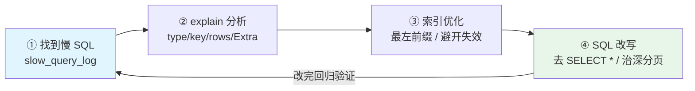
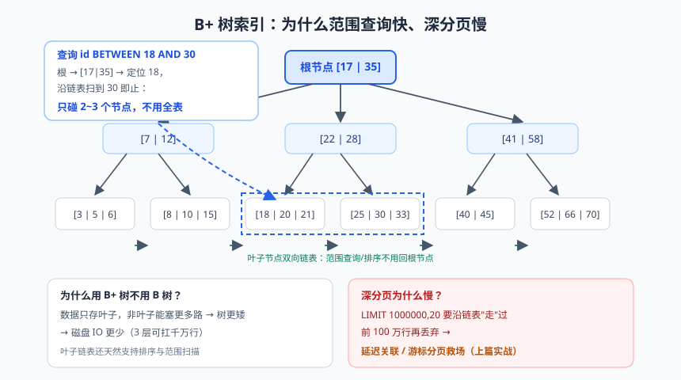

# 数据库实战：MySQL 与 MyBatis-Plus

上篇结尾，咱们的图书系统还是个"内存版 demo"——重启一次数据全没。这篇把它落到真正的 MySQL 上：建表、接 MyBatis-Plus、写 CRUD、配分页，然后是本篇的精华——**慢 SQL 的诊断与优化**。

数据库是后端工程师的"必修生死场"。一个说法很真实：**80% 的接口性能问题，最后都定位到数据库；80% 的数据库问题，最后都定位到索引和写法**。explain 这个技能，学会了就是分水岭。

---

## 一、环境准备与建表规范

一条 Docker 命令起 MySQL（8.x）：

```bash
docker run -d --name mysql-demo \
  -e MYSQL_ROOT_PASSWORD=root123 \
  -e MYSQL_DATABASE=library \
  -p 3306:3306 mysql:8.0
```

建表 DDL（好表从一个规范的 DDL 开始）：

```sql
CREATE TABLE `book` (
    `id`          BIGINT       NOT NULL AUTO_INCREMENT COMMENT '主键',
    `title`       VARCHAR(100) NOT NULL DEFAULT ''     COMMENT '书名',
    `author`      VARCHAR(50)  NOT NULL DEFAULT ''     COMMENT '作者',
    `price`       DECIMAL(10,2) NOT NULL DEFAULT 0.00  COMMENT '价格（DECIMAL 而非浮点，基础篇的债再还一次）',
    `isbn`        VARCHAR(20)  NOT NULL DEFAULT ''     COMMENT 'ISBN',
    `stock`       INT          NOT NULL DEFAULT 0      COMMENT '库存',
    `deleted`     TINYINT      NOT NULL DEFAULT 0      COMMENT '逻辑删除：0 在册 1 已删',
    `create_time` DATETIME     NOT NULL DEFAULT CURRENT_TIMESTAMP COMMENT '创建时间',
    `update_time` DATETIME     NOT NULL DEFAULT CURRENT_TIMESTAMP ON UPDATE CURRENT_TIMESTAMP COMMENT '更新时间',
    PRIMARY KEY (`id`),
    UNIQUE KEY `uk_isbn` (`isbn`),                     -- 业务唯一约束交给数据库兜底
    KEY `idx_author` (`author`)                        -- 高频查询字段建二级索引
) ENGINE=InnoDB DEFAULT CHARSET=utf8mb4 COLLATE=utf8mb4_0900_ai_ci COMMENT='图书表';
```

建表规范几条铁律：

- 字符集 **utf8mb4**（utf8 在 MySQL 是残缺的 3 字节版，存不了 emoji，血泪教训遍布全网）；
- 字段尽量 `NOT NULL DEFAULT`：NULL 参与比较和索引统计有无数坑（`!=` 查不到 NULL、`count(字段)` 忽略 NULL）；
- 每表必备 `create_time`/`update_time`（数据库层自动维护）；
- 唯一约束用唯一索引，别只靠应用层校验（并发下应用层校验必有漏网之鱼）。

---

## 二、集成 MyBatis-Plus：CRUD 三种姿势

### 2.1 依赖与配置

```xml
<dependency>
    <groupId>com.baomidou</groupId>
    <artifactId>mybatis-plus-boot-starter</artifactId>
    <version>3.5.5</version>
</dependency>
<dependency>
    <groupId>com.mysql</groupId>
    <artifactId>mysql-connector-j</artifactId>
</dependency>
```

```yaml
spring:
  datasource:
    url: jdbc:mysql://localhost:3306/library?useUnicode=true&characterEncoding=utf8mb4&serverTimezone=Asia/Shanghai
    username: root
    password: root123
    hikari:                          # Boot 默认连接池，值得调的几个参数
      maximum-pool-size: 20          # 默认 10；不是越大越好（见下文公式）
      minimum-idle: 5
      connection-timeout: 3000       # 拿不到连接 3 秒就报错，快速暴露问题
      max-lifetime: 1800000
mybatis-plus:
  configuration:
    log-impl: org.apache.ibatis.logging.stdout.StdOutImpl   # 开发期打印 SQL，上线关掉
  global-config:
    db-config:
      logic-delete-field: deleted    # 全局逻辑删除字段
      logic-delete-value: 1
      logic-not-delete-value: 0
```

主类加 `@MapperScan("com.demo.library.mapper")`（原理篇提过：为每个 Mapper 接口生成动态代理注册进容器）。

### 2.2 姿势一：BaseMapper 内置方法（零 SQL）

```java
@Data
@TableName("book")                                   // 对应表名
public class Book {
    @TableId(type = IdType.AUTO)                     // 主键自增
    private Long id;
    private String title;
    private String author;
    private BigDecimal price;
    private String isbn;
    private Integer stock;
    @TableLogic                                      // 逻辑删除字段（配合全局配置）
    private Integer deleted;
    private LocalDateTime createTime;
    private LocalDateTime updateTime;
}

public interface BookMapper extends BaseMapper<Book> { }   // 继承即得十几个 CRUD 方法
```

insert/selectById/updateById/deleteById 直接可用，且 deleteById 自动变成 `UPDATE book SET deleted=1 WHERE id=? AND deleted=0`（逻辑删除）。

### 2.3 姿势二：条件构造器 Wrapper（推荐 LambdaQueryWrapper）

```java
// Lambda 版：字段引用编译期检查，重构改字段名不会漏
List<Book> books = bookMapper.selectList(
        new LambdaQueryWrapper<Book>()
                .like(Book::getTitle, "Java")          // title LIKE '%Java%'
                .ge(Book::getStock, 1)                 // stock >= 1
                .orderByDesc(Book::getCreateTime)     // ORDER BY create_time DESC
                .last("LIMIT 10"));                    // 兜底限制（少用，破坏整洁）

// 更新示例：所有 "老版Java" 的书降价 20%
bookMapper.update(null,
        new LambdaUpdateWrapper<Book>()
                .eq(Book::getTitle, "老版Java")
                .set(Book::getPrice, new BigDecimal("79.00")));
```

> ⚠️ **踩坑实录**：用字符串列名的 `QueryWrapper<Book>().eq("title", ...)` 在重构把字段改名后不会报编译错误，运行时才炸。**一律用 Lambda 版**，让编译器看住你。

### 2.4 姿势三：自定义 XML（复杂 SQL 的主场）

```java
// Mapper 接口方法
List<Book> selectBorrowedByUser(@Param("userId") Long userId, @Param("days") int days);
```

```xml
<!-- resources/mapper/BookMapper.xml -->
<select id="selectBorrowedByUser" resultType="com.demo.library.domain.Book">
    SELECT b.* FROM book b
    JOIN borrow_record br ON br.book_id = b.id
    WHERE br.user_id = #{userId}
      AND br.borrow_time &gt; DATE_SUB(NOW(), INTERVAL #{days} DAY)   <!-- 动态天数 -->
    <if test="days > 90">                                              <!-- 动态标签：条件拼接 -->
        AND b.stock &gt; 0
    </if>
</select>
```

三种姿势选型：**内置方法 > Wrapper > XML**——能简单的绝不复杂，但报表、多表 JOIN、窗口函数这些硬骨头，老老实实写 XML（或注解 SQL），别用 Wrapper 硬拼（可读性为负数）。

### 2.5 分页：插件一行配置

```java
@Configuration
public class MybatisPlusConfig {
    @Bean
    public MybatisPlusInterceptor mybatisPlusInterceptor() {
        MybatisPlusInterceptor interceptor = new MybatisPlusInterceptor();
        interceptor.addInnerInterceptor(new PaginationInnerInterceptor(DbType.MYSQL));
        return interceptor;                       // 没有它，分页参数被静默忽略（全表查！经典坑）
    }
}

// Service 里
Page<Book> page = bookMapper.selectPage(
        new Page<>(pageNo, pageSize),             // 第几页、每页几条
        new LambdaQueryWrapper<Book>().orderByDesc(Book::getId));
long total = page.getTotal();                     // 插件自动发 COUNT 语句
List<Book> records = page.getRecords();
```

### 2.6 字段自动填充

create_time/update_time 已交给数据库 DEFAULT，但更通用的做法（比如填充操作人）用 `MetaObjectHandler`：

```java
@Component
public class AuditMetaHandler implements MetaObjectHandler {
    @Override
    public void insertFill(MetaObject metaObject) {
        this.strictInsertFill(metaObject, "createTime", LocalDateTime.class, LocalDateTime.now());
    }
    @Override
    public void updateFill(MetaObject metaObject) {
        this.strictUpdateFill(metaObject, "updateTime", LocalDateTime.class, LocalDateTime.now());
    }
}
// 实体字段上标 @TableField(fill = FieldFill.INSERT / INSERT_UPDATE)
```

---

## 三、连接池：HikariCP 不是默认即最优，但接近

HikariCP 是 Boot 默认连接池（快是有原理的：FastList 替换 ArrayList、ConcurrentBag 无锁借还）。**池子大小公式**（PostgreSQL 官方经验，MySQL 同理）：

> 池大小 ≈ CPU 核数 × (1 + 平均等待时间/平均计算时间) ≈ 核数 × 2~4

反直觉真相：**连接池不是越大越好**。MySQL 每个连接是一个线程、内存开销可观，200 个连接在 8 核机器上只会加剧上下文切换。绝大多数业务 10~20 够用。

> 💡 **老鸟忠告**：连接池参数要用监控验证，别抄网上"最佳配置"——盯两个指标：`active`（活跃连接，长期贴着 max 说明池小了或 SQL 太慢）和 `pending`（等连接的线程，>0 用户已经在排队，此时先查慢 SQL 而不是急着扩池）。**池不够用，九成是 SQL 慢导致连接还不了，治本在第四节。**

---

## 四、慢 SQL 治理四板斧（本篇精华）

流程先行，斧斧相扣：



### 4.1 第一斧：找到慢 SQL

```sql
-- 开启慢查询日志：执行超过 1 秒的记录下来
SET GLOBAL slow_query_log = ON;
SET GLOBAL long_query_time = 1;
-- 日志位置用 SHOW VARIABLES LIKE 'slow_query_log_file' 查看
```

### 4.2 第二斧：explain 执行计划（必杀技）


> 🖼️ **图解**：B+ 树：范围查询快、深分页慢的结构性原因

在 SQL 前加 explain，重点看这几列：

```sql
EXPLAIN SELECT * FROM book WHERE author = '周志明' AND title LIKE '%Java%';
```

| 列 | 看什么 | 好 → 坏 |
|----|--------|---------|
| **type** | 访问类型 | system > const > eq_ref > **ref** > range > index > **ALL（全表扫描！）** |
| **key** | 实际用的索引 | NULL = 没用上索引 |
| **rows** | 预估扫描行数 | 越少越好 |
| **Extra** | 附加信息 | Using index（覆盖索引，好）；Using filesort（额外排序，警惕）；Using temporary（临时表，警惕） |

### 4.3 第三斧：索引优化

**联合索引最左前缀原则**：索引 `(a, b, c)` 相当于建了 `(a)`、`(a,b)`、`(a,b,c)` 三个索引——查询条件必须从最左列开始连续命中：

```sql
INDEX idx_a_b_c (a, b, c)
WHERE a = 1 AND b = 2 AND c = 3   -- ✅ 全命中
WHERE a = 1 AND b = 2             -- ✅ 命中 a,b
WHERE b = 2 AND c = 3             -- ❌ 一列都不命中（没有 a）
WHERE a = 1 AND c = 3             -- ⚠️ 只命中 a（c 用不上索引，中间断了 b）
```

**索引失效十大高频场景**（每个都值得实测一遍）：

| 场景 | 反例 | 原因 |
|------|------|------|
| 对索引列做函数/运算 | `WHERE YEAR(create_time) = 2025` | 索引存原始值，函数后的结果无索引 |
| 隐式类型转换 | 字段是 VARCHAR 却写 `WHERE isbn = 9787111`（数字） | 等价于给列套 CAST 函数 |
| 前导模糊 | `WHERE title LIKE '%Java'` | B+ 树按前缀排序，前导 % 无法定位 |
| OR 连接非索引列 | `WHERE author='x' OR stock=1`（stock 无索引） | 有一侧全扫则整体退化 |
| 不等于/NOT IN | `WHERE stock <> 0` | 无法利用有序性，优化器常弃用 |
| 违反最左前缀 | 见上 | 联合索引结构决定 |
| 索引列上 IS NOT NULL | 视数据分布 | NULL 行少时反向选择代价高 |
| 优化器觉得不划算 | 回表代价 > 全表扫（选择性差的列，如性别） | 统计信息驱动 |

> 📌 **划重点**：`LIKE '%xx'` 不是绝对不能用——当**只有这一种查询方式**且数据量可控时，全扫也可接受；数据量大了再上 ES 或倒排。**优化是权衡，不是教条。**

### 4.4 第四斧：SQL 改写

**SELECT * 的代价**：拉全部列（网络+内存）、破坏覆盖索引可能。明确列名，让 `INDEX(a,b) + SELECT a,b` 有机会 Using index（不回表）。

**深分页问题**——`LIMIT 1000000, 20` 为什么慢？MySQL 要取出前 1000020 行、丢掉前 100 万行。两种解法：

```sql
-- 解法① 延迟关联：先用覆盖索引定位 20 个主键，再回表取整行
SELECT b.* FROM book b
JOIN (SELECT id FROM book ORDER BY id LIMIT 1000000, 20) t ON b.id = t.id;

-- 解法② 书签/游标（推荐，但要求翻页连续、记录上次位置）：记住上一页最后一条的 id
SELECT * FROM book WHERE id > #{lastId} ORDER BY id LIMIT 20;   -- 永远只扫 20 行
```

### 4.5 事务与批量写入的坑

原理篇讲过事务传播，这里补两个数据层实战坑：

```java
// ❌ 坑一：循环单条 insert —— 1 万次网络往返 + 1 万个事务
for (Book b : books) { bookMapper.insert(b); }

// ✅ MyBatis-Plus 批量（重写 insert 为多 values，配 rewriteBatchedStatements=true 效果更佳）
ServiceImpl.saveBatch(books, 500);        // 每批 500 条

// ❌ 坑二：大事务（@Transactional 方法里包含 RPC/发短信）
// 数据库连接被独占几分钟，连接池耗尽，全站请求排队 —— 事务里只放 DB 操作！
```

---

## 五、多环境配置

```yaml
# application.yml（公共）
spring:
  profiles:
    active: dev

# application-dev.yml / application-prod.yml 各自维护数据源
# 启动时切换：java -jar app.jar --spring.profiles.active=prod
# 敏感信息（生产密码）用环境变量注入，别提交进 Git！
spring:
  datasource:
    password: ${DB_PASSWORD:root123}
```

---

## 本篇小结

- 建表铁律：utf8mb4、NOT NULL DEFAULT、必备时间字段、唯一约束用唯一索引；
- MyBatis-Plus 三种姿势按复杂度递进：BaseMapper（零 SQL）→ LambdaQueryWrapper（编译期安全）→ XML（复杂 SQL）；分页必须配 PaginationInnerInterceptor；
- 逻辑删除 @TableLogic + 全局配置；审计字段 MetaObjectHandler 自动填充；
- HikariCP 池大小经验公式 ≈ 核数×(1+等待/计算)，连接池不是越大越好；
- 慢 SQL 四板斧：慢日志定位 → explain 看关键列（type/key/rows/Extra）→ 索引优化（最左前缀、避开失效场景）→ SQL 改写（延迟关联、游标分页）；
- 批量写入用 saveBatch 分批；事务方法里禁放 RPC/通知等慢操作。

## 课后思考 & 动手练习

1. （概念）为什么 `WHERE YEAR(create_time)=2025` 用不上索引？改成范围查询怎么写？
2. （概念）`LIMIT 1000000,20` 的两种优化方案各适合什么场景？游标分页的限制是什么？
3. （动手）把上篇的内存 BookRepository 替换为 MyBatis-Plus 实现，接口行为保持不变（对外无感知，这就是分层架构的回报）；跑通全部 curl。
4. （动手）建 10 万条测试数据，实测三组查询的耗时并用 explain 验证：`LIKE 'Java%'` vs `LIKE '%Java'`；有索引 vs 隐式类型转换（isbn 传数字）；深分页直接 LIMIT vs 延迟关联 vs 游标。
5. （动手·进阶）实现"借书"事务方法：校验库存、扣库存、插借阅记录三步一个事务（@Transactional(rollbackFor=Exception.class)），并用并发测试（20 线程同时借最后 1 本）验证库存不会超卖——如果超卖了，想想哪里出了问题（提示：扣减语句的写法）。

> 下一篇预告：《缓存实战：Redis 三板斧》——数据库扛不住读压力了怎么办？缓存穿透/击穿/雪崩三大经典问题逐个击破，再拿下分布式锁与缓存一致性这两个面试必考、生产必用的硬核话题。
