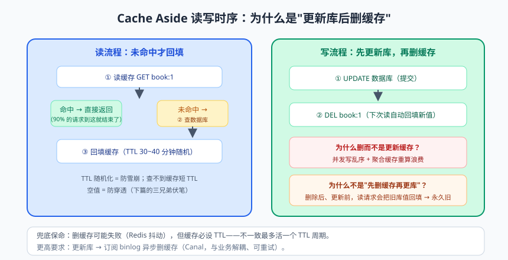
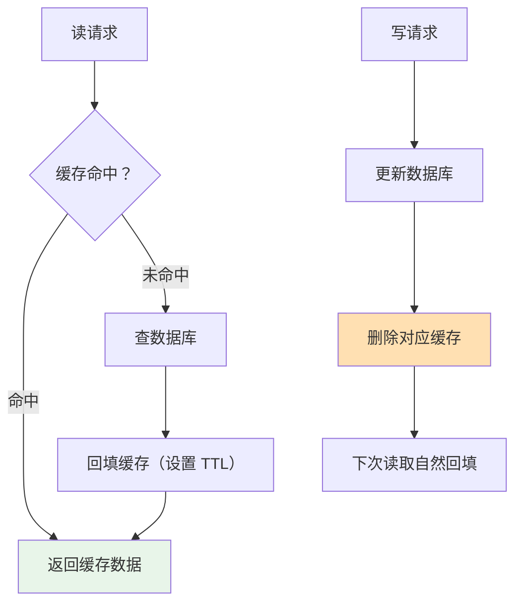
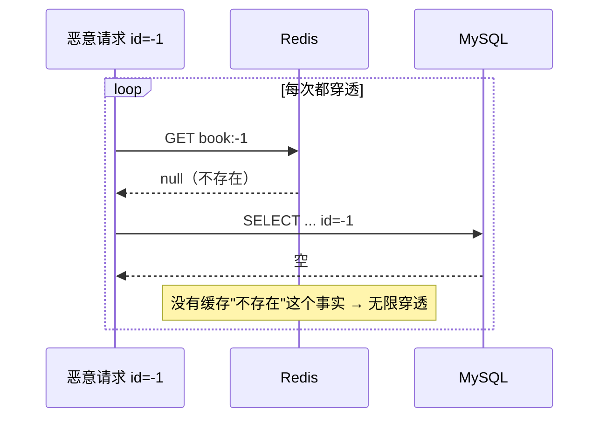

# 缓存实战：Redis 三板斧

先看一个"书架"类比：数据库是图书馆——书全但要排队借阅（慢）；缓存是自己书架——常用的几十本伸手就拿（快）。热门图书的详情页每次都去图书馆借？不现实。**缓存的本质：用空间换时间，用副本换吞吐。**

这篇把 Redis 缓存的实战知识一次配齐：Spring Boot 集成、缓存模式、缓存三大经典问题（穿透/击穿/雪崩）、缓存与数据库双写一致性、分布式锁。每一个都是生产环境真实搏斗过的主题。

---

## 一、Redis 速览与集成

### 1.1 五大基础数据结构（选型是第一生产力）

| 结构 | 特点 | 业务场景 |
|------|------|---------|
| String | k-v，单值最大 512MB | 缓存对象 JSON、计数器、分布式锁 |
| Hash | field-v 二级结构 | 购物车（uid → {商品id: 数量}）、对象属性局部更新 |
| List | 双端列表 | 消息列表、最新动态（lpush + lrange） |
| Set | 无序去重 | 标签、抽奖去重、共同好友（sinter 交集） |
| ZSet | 带分数排序 | 排行榜（zincrby + zrevrange）、延迟队列（分数存时间戳） |

```bash
docker run -d --name redis-demo -p 6379:6379 redis:7
```

### 1.2 Spring Boot 集成

```xml
<dependency>
    <groupId>org.springframework.boot</groupId>
    <artifactId>spring-boot-starter-data-redis</artifactId>
</dependency>
```

```yaml
spring:
  data:
    redis:
      host: localhost
      port: 6379
      timeout: 2s                    # 超时：缓存挂了不能拖死主流程
      lettuce:
        pool:
          max-active: 16
          max-idle: 8
```

**第一个必踩的坑：RedisTemplate 序列化**。默认用 JDK 序列化，存进去的 key 是一串乱码字节（`\xac\xed\x00\x05...`），redis-cli 里根本没法看。标准配置：

```java
@Configuration
public class RedisConfig {
    @Bean
    public RedisTemplate<String, Object> redisTemplate(RedisConnectionFactory factory) {
        RedisTemplate<String, Object> template = new RedisTemplate<>();
        template.setConnectionFactory(factory);

        StringRedisSerializer keySerializer = new StringRedisSerializer();      // key 可读
        GenericJackson2JsonRedisSerializer valueSerializer =
                new GenericJackson2JsonRedisSerializer();                       // value 存 JSON（带 @class 类型信息）

        template.setKeySerializer(keySerializer);
        template.setHashKeySerializer(keySerializer);
        template.setValueSerializer(valueSerializer);
        template.setHashValueSerializer(valueSerializer);
        return template;
    }
}
```

> ⚠️ **踩坑实录**：`GenericJackson2JsonRedisSerializer` 会在 JSON 里塞 `@class` 字段记录类型，缓存的对象**改包名/改类名后反序列化直接炸**，而且路径变更后旧缓存全部失效报错。生产建议：key 统一加版本前缀（`book:v2:{id}`），改结构时换版本号，旧缓存自然过期淘汰。

---

## 二、缓存模式：Cache Aside 是主流


> 🖼️ **图解**：Cache Aside 读写时序：为什么是"更新库后删缓存"

| 模式 | 读流程 | 写流程 | 点评 |
|------|--------|--------|------|
| **Cache Aside（旁路缓存）** | 查缓存→未命中查库→回填 | 更新库→**删除缓存** | 主流：应用层控制，语义清晰 |
| Read/Write Through | 查缓存，缓存层代理读写库 | 写缓存，缓存层同步写库 | 缓存层能力要求高（少用） |
| Write Behind（回写） | 同上 | 只写缓存，异步批量刷库 | 快但可能丢数据（Write Behind 又叫 Write Back，注意与 Write Through 区分） |

**写流程为什么是"删缓存"而不是"更新缓存"？** 两个理由：① 更新缓存容易有并发写乱序（A 先写库后写缓存、B 后写库先写缓存 → 缓存里是旧值）；② 很多缓存值是查询组装结果（多表聚合），更新单表就要重算整个缓存，浪费。**删除 = 懒加载语义**：下次读时再回填，永远算一次给一次。



### Spring Cache 注解版

```java
@Service
public class BookService {
    @Cacheable(value = "book", key = "#id")          // 先查缓存，未命中执行方法并回填
    public Book getById(Long id) { return bookMapper.selectById(id); }

    @CacheEvict(value = "book", key = "#id")         // 删除缓存（配合更新库的操作）
    public void update(Long id, BookUpdateRequest req) { ... }

    @CachePut(value = "book", key = "#id")           // 方法必执行，返回值刷新缓存（少用）
    public Book refresh(Long id) { ... }
}
```

注解版简洁，但 TTL、随机过期、击穿防护这些精细活儿做不了——**生产核心链路一般手写模板版**，注解版用于内部系统。

---

## 三、缓存三大经典问题（本篇灵魂）

### 3.1 缓存穿透：查"根本不存在"的数据

**现象**：请求的 key 在缓存和数据库里**都没有**（恶意伪造 id=-1、遍历攻击）。每次都穿过缓存打到库，缓存形同虚设。



**解法一：缓存空值**——把"不存在"也缓存住：

```java
public Book getById(Long id) {
    String key = "book:" + id;
    String cached = redisTemplate.opsForValue().get(key);
    if (cached != null) {
        return "NULL".equals(cached) ? null : JSON.parseObject(cached, Book.class);  // 空值标记
    }
    Book book = bookMapper.selectById(id);
    if (book == null) {
        redisTemplate.opsForValue().set(key, "NULL", Duration.ofSeconds(60));  // 短 TTL 防占坑
        return null;
    }
    redisTemplate.opsForValue().set(key, JSON.toJSONString(book), randomTtl());
    return book;
}
```

**解法二：布隆过滤器（Bloom Filter）**——"说不存在就一定不存在"的概率结构：一排 bit + 多个哈希函数，插入时把多个位置标 1，查询时任一位为 0 则**必然不存在**。误判率可配置（如 1%）。适合 key 集合相对固定的场景（商品 id 全集），新增数据要同步添加进过滤器。

### 3.2 缓存击穿：热点 Key 过期的瞬间

**现象**：某个**爆款 key**（如秒杀商品）过期的瞬间，成千上万并发同时未命中，齐刷刷冲向数据库——缓存被"击穿"了一个点。

**解法一：互斥锁重建**——只放一个请求去查库，其他人等：

```java
public Book getHotBook(Long id) {
    String key = "book:" + id;
    String cached = redisTemplate.opsForValue().get(key);
    if (cached != null) return JSON.parseObject(cached, Book.class);

    String lockKey = "lock:rebuild:" + id;
    String token = UUID.randomUUID().toString();
    try {
        // SET NX EX：只有一个线程能设置成功 = 拿到锁
        Boolean locked = redisTemplate.opsForValue()
                .setIfAbsent(lockKey, token, Duration.ofSeconds(5));
        if (Boolean.TRUE.equals(locked)) {
            Book book = bookMapper.selectById(id);            // 双重检查：拿到锁先再看一眼缓存
            redisTemplate.opsForValue().set(key, JSON.toJSONString(book), randomTtl());
            return book;
        }
        Thread.sleep(50);                                      // 没抢到锁：稍等重试（或自旋）
        return getHotBook(id);
    } finally {
        release(lockKey, token);                               // 见第四节：Lua 保证只删自己的锁
    }
}
```

**解法二：逻辑过期**——key 永不过期，value 里带过期时间字段；发现"逻辑过期"就异步重建，旧值先顶着返回（牺牲一致性换可用性，热点场景标配）。

### 3.3 缓存雪崩：大面积同时失效 / Redis 挂了

**现象 A**：大批 key 设置了相同 TTL，同一时刻集体过期，流量洪峰直灌数据库。**解法：TTL 加随机值**：

```java
private Duration randomTtl() {
    return Duration.ofSeconds(1800 + ThreadLocalRandom.current().nextInt(600));  // 30~40 分钟随机
}
```

**现象 B**：Redis 实例/集群整体宕机。**解法分层**：① 高可用架构（哨兵/集群）；② 服务降级限流（熔断器兜底：数据库连接池设上限 + 网关限流）；③ 多级缓存（本地 Caffeine → Redis → DB）。

> 📌 **划重点**：三兄弟一句话区分——**穿透是"查不存在的数据"（防：空值缓存/布隆）；击穿是"热点单个过期"（防：互斥重建/逻辑过期）；雪崩是"集体过期或整体宕机"（防：随机 TTL/高可用/限流）**。面试必考，生产必备。

---

## 四、分布式锁：Redis 版实现与陷阱

单机锁（synchronized/Lock）管不了多实例部署（每个 JVM 各一把锁，等于没锁）。分布式锁把锁放到所有实例共享的 Redis 里：

```java
// 加锁的正确姿势：SET key token NX EX —— 原子的"不存在才设置 + 过期时间"
Boolean locked = redisTemplate.opsForValue()
        .setIfAbsent("lock:stock:" + bookId, token, Duration.ofSeconds(10));

// 释放锁必须用 Lua：保证"判断是自己的锁 + 删除"两步原子执行
private static final String UNLOCK_LUA = """
        if redis.call('get', KEYS[1]) == ARGV[1] then
            return redis.call('del', KEYS[1])
        else
            return 0
        end
        """;

public void release(String lockKey, String token) {
    redisTemplate.execute(new DefaultRedisScript<>(UNLOCK_LUA, Long.class),
            List.of(lockKey), token);
}
```

**为什么这么讲究？** 三个连环坑：

1. **不加过期时间**：拿锁的实例宕机，锁永远不释放，全员死等；
2. **删除时不检查持有者**：A 的锁超时自动释放，B 拿到锁，A 缓过来执行 DEL——把 B 的锁删了！所以 value 要存唯一 token，删前先验证；
3. **验证+删除不是原子的**：验证完准备删的瞬间锁又过期被别人拿了。Lua 脚本把两步合成原子的。

**Redisson 现成方案**（加上看门狗自动续期：业务没执行完，锁的 TTL 每 10 秒自动续，避免"业务还没做完锁先过期"）：

```java
RLock lock = redissonClient.getLock("lock:stock:" + bookId);
if (lock.tryLock(3, 30, TimeUnit.SECONDS)) {     // 最多等 3 秒，持锁 30 秒（有看门狗会自动续）
    try { deductStock(bookId); }
    finally { lock.unlock(); }                   // Redisson 内部处理好了 token 校验
}
```

> 💡 **老鸟忠告**：Redis 分布式锁（主从异步复制）在极端场景可能两个客户端同时持锁（主节点加锁后没同步就宕机）。**对正确性要求极高的场景（资金）用 ZooKeeper/ETCD 分布式锁，或用数据库乐观锁兜底**——选型哲学见高手篇《分布式》。

---

## 五、缓存与数据库一致性

Cache Aside 的"先更新库，再删缓存"在并发下仍有小概率不一致：

| 时序 | 现象 |
|------|------|
| 写请求更新库 → 删缓存 | 主流方案：不一致窗口毫秒级，可接受 |

**为什么不是"先删缓存，再更新库"？** 经典反例：删缓存后、更新库前，读请求未命中 → 读到**旧库值**回填缓存 → 更新库完成 → 缓存里永远是旧值。删缓存动作被"白删"了。

进阶方案对比：

| 方案 | 一致性 | 复杂度 | 适用 |
|------|:---:|:---:|------|
| 先更新库再删缓存 | 最终一致（秒级窗口） | 低 | 绝大多数场景 |
| 延迟双删（更新库→删缓存→延迟几百 ms→再删一次） | 更稳的最终一致 | 中 | 读多写多、可接受短暂不一致 |
| binlog 订阅（Canal 监听 binlog 异步删缓存） | 最终一致且与业务解耦 | 高 | 大型系统、删除失败可重试 |
| 分布式锁强一致 | 强 | 很高 | 极少数金融场景（别轻易用） |

**兜底底牌**：缓存永远设置 TTL。哪怕删缓存失败（Redis 抖动），不一致最多活一个 TTL 周期。**TTL 是一致性的最后一道防线。**

---

## 六、落地：图书查询接口加缓存

```java
@Service
@RequiredArgsConstructor
public class BookCacheService {
    private final StringRedisTemplate redis;
    private final BookMapper bookMapper;

    public Book getById(Long id) {
        String key = "book:v1:" + id;
        // 1. 查缓存
        String cached = redis.opsForValue().get(key);
        if (cached != null) {
            return "NULL".equals(cached) ? null : JSON.parseObject(cached, Book.class);
        }
        // 2. 查库
        Book book = bookMapper.selectById(id);
        // 3. 回填：空值短 TTL，实值随机 TTL（防雪崩）；热点可再叠击穿防护
        if (book == null) {
            redis.opsForValue().set(key, "NULL", Duration.ofSeconds(60));
        } else {
            redis.opsForValue().set(key, JSON.toJSONString(book), randomTtl());
        }
        return book;
    }

    public void evict(Long id) { redis.delete("book:v1:" + id); }   // 更新库之后调用
}
```

监控两个指标别偷懒：**缓存命中率**（1 - 未命中数/总请求数，健康值 > 90%）；**大 Key/热 Key**（单个 value 超过 10KB、单 key QPS 超过 5000 要预警，`redis-cli --bigkeys` 定期巡检）。

---

## 本篇小结

- 缓存选型从数据结构开始：String/Hash/List/Set/ZSet 各有主场；
- RedisTemplate 必配 JSON 序列化；key 带版本前缀应对结构变更；
- Cache Aside（读未命中回填/写后删缓存）是主流模式，"删缓存"优于"更新缓存"；
- 三大问题：穿透（空值缓存/布隆）、击穿（互斥重建/逻辑过期）、雪崩（随机 TTL/高可用/限流）；
- 分布式锁三要素：SET NX EX 原子加锁 + 唯一 token + Lua 原子释放；生产用 Redisson（看门狗续期）；强一致场景换 ZK；
- 一致性：先更新库再删缓存 + TTL 兜底；高要求上延迟双删或 binlog 订阅。

## 课后思考 & 动手练习

1. （概念）为什么写操作是"删缓存"而不是"更新缓存"？为什么"先删缓存再更新库"更危险？
2. （概念）缓存穿透和击穿的解法为什么不同？（提示：一个防"不存在的 key"，一个防"热点过期瞬间"）
3. （动手）给图书系统接 Redis：详情接口加 Cache Aside 缓存（含空值缓存与随机 TTL），更新/删除接口联动 evict；用压测对比加缓存前后 QPS（用上篇的 10 万条测试数据更有感觉）。
4. （动手）模拟击穿：热门图书缓存过期瞬间用 50 并发请求冲击，观察数据库查询次数；再实现互斥锁重建版，对比两次的 DB 查询次数。
5. （动手·进阶）用 Redisson 分布式锁重构借书扣库存接口，20 并发抢最后 1 本不再超卖；再思考：如果不用锁，只把扣减 SQL 改成 `UPDATE book SET stock = stock - 1 WHERE id=? AND stock > 0` 并判断影响行数，是否也能解决？两种方案各有什么代价？

> 下一篇预告：《异步与消息：从 @Async 到 RocketMQ》——下单要调库存、积分、短信三个下游，同步调用又慢又脆弱。线程池异步只是第一步，真正的解耦削峰神器是消息队列。可靠投递、幂等消费、延迟消息，一个不少。
