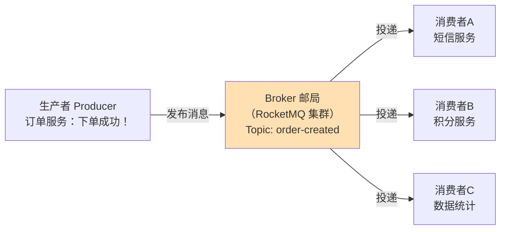
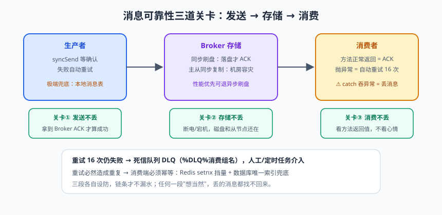
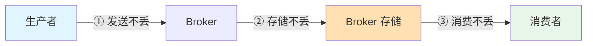

# 异步与消息：从 @Async 到 RocketMQ

看一个下单接口的"连环拖累"：创建订单 50ms + 扣库存 RPC 80ms + 加积分 RPC 60ms + 发短信 300ms（短信网关慢是常态）= 490ms。用户盯着转圈圈，就为了等一条"下单成功"的短信。更糟的是：短信网关一抖，下单接口跟着超时失败——**主流程被旁路逻辑绑架了**。

这篇的路线图：第一步，用线程池把"非必须同步"的操作甩到后台（@Async）；第二步，发现进程内异步的天花板（重启丢任务、无重试、不跨服务），引入消息队列 RocketMQ；第三步，搞定 MQ 的两大灵魂问题——**可靠投递**与**幂等消费**。

---

## 一、第一步：进程内异步化

### 1.1 自定义线程池 + @Async

@Async 的原理就是 AOP（原理篇老朋友）：调用被代理拦截，方法体被扔进线程池执行。**但默认线程池是个坑**（下面讲），先上标准姿势：

```java
@Configuration
@EnableAsync                                    // 开关
public class AsyncConfig {
    @Bean("bizExecutor")
    public ThreadPoolExecutor bizExecutor() {   // 自定义池：参数含义见并发篇
        return new ThreadPoolExecutor(
                8, 16, 60, TimeUnit.SECONDS,
                new ArrayBlockingQueue<>(500),
                r -> new Thread(r, "biz-async-" + r.hashCode()),
                new ThreadPoolExecutor.CallerRunsPolicy());   // 拒绝策略：调用者执行，天然降速
    }
}

@Service
public class OrderService {
    @Async("bizExecutor")                       // 指定用哪个池（不指定就用默认的！）
    public void sendSmsAsync(String phone, String content) {
        smsClient.send(phone, content);         // 耗时 300ms 的操作，不再阻塞下单主流程
    }
}
```

下单主流程变得清爽：创建订单 + 扣库存（强一致，必须同步）= 130ms 返回；短信、积分异步补发。

### 1.2 @Async 三大坑（AOP 知识的又一次实战）

> ⚠️ **踩坑实录**：
> ① **同类调用失效**：`this.sendSmsAsync()` 不走代理 → 异步失效照旧同步（原理篇讲烂的 this 陷阱）；
> ② **默认线程池陷阱**：不指定 executor 时，Spring 旧版本用 SimpleAsyncTaskExecutor——**每任务新建线程不复用**，高并发直接线程爆炸（Boot 已改进为 ThreadPoolTaskApplicationListener 按需创建，但显式指定池仍是铁律）；
> ③ **异常被吞**：异步方法的异常没人 catch，日志里静默消失。解法：配置 AsyncConfigurer 的异常处理器，或返回 CompletableFuture 由调用方处理。

```java
@Configuration
public class AsyncExceptionConfig implements AsyncConfigurer {
    @Override
    public Executor getAsyncExecutor() { return bizExecutor(); }
    @Override
    public AsyncUncaughtExceptionHandler getAsyncUncaughtExceptionHandler() {
        return (ex, method, params) ->
                log.error("异步方法异常：{}，参数：{}", method.getName(), Arrays.toString(params), ex);
    }
}
```

### 1.3 进程内异步的天花板

| 缺陷 | 后果 |
|------|------|
| 任务在内存里 | **重启丢任务**：发短信的任务还在队列里，服务一重启，无了 |
| 无重试机制 | 下游挂 5 分钟，期间的任务全部失败 |
| 不跨服务 | 积分是另一个团队的服务，你没法在自己进程里替它干活 |

要跨过这三条，就得请出**消息队列（Message Queue，MQ）**。

---

## 二、MQ 是什么：一座邮局



MQ 的三大价值（面试标准答案）：

> 📌 **划重点**：判断一个场景该不该上 MQ，就问三个问题——**要异步吗**（主流程不必等它）？**要解耦吗**（下游有多个且会变）？**要削峰吗**（写入洪峰超出处理能力）？一个都答不上来，就别为了"技术先进"上 MQ，它带来的复杂性（消息可靠性、幂等、排障）足够吃一壶。

- **异步**：主流程发完消息就返回（邮筒一投就走），耗时从 490ms 降到 130ms；
- **解耦**：订单服务只管"广播下单事件"，谁关心谁订阅。以后加"风控统计"，订单服务一行不改；
- **削峰**：秒杀洪峰先堆在 Broker 里，消费者按自己的节奏处理，数据库不被瞬时流量拍死。

选型速览（观点来自生产实践，别杠，杠就是你对）：

| 维度 | Kafka | **RocketMQ** | RabbitMQ |
|------|-------|-------------|----------|
| 吞吐 | 百万级/秒 | 十万级/秒 | 万级/秒 |
| 定位 | 日志流处理、大数据管道 | **业务消息** | 中小规模、灵活路由 |
| 延迟消息 | 不支持（要自己实现） | 支持（18 个固定级别） | 插件支持 |
| 事务消息 | 无 | **原生支持** | 无 |
| 语言生态 | Scala/Java | Java（阿里出品，源码很"Java"） | Erlang |

**业务消息选 RocketMQ，日志流选 Kafka** 是国内主流共识。

---

## 三、RocketMQ 实战集成

### 3.1 起环境

```bash
# NameServer（路由注册中心）+ Broker（存储与转发）
docker run -d --name rmqnamesrv -p 9876:9876 apache/rocketmq:5.1.4 sh mqnamesrv
docker run -d --name rmqbroker --link rmqnamesrv -p 10911:10911 \
  -e "NAMESRV_ADDR=rmqnamesrv:9876" apache/rocketmq:5.1.4 sh mqbroker
```

### 3.2 生产者

```xml
<dependency>
    <groupId>org.apache.rocketmq</groupId>
    <artifactId>rocketmq-spring-boot-starter</artifactId>
    <version>2.2.3</version>
</dependency>
```

```yaml
rocketmq:
  name-server: localhost:9876
  producer:
    group: library-producer
    send-message-timeout: 3000
```

```java
@Service
@RequiredArgsConstructor
public class OrderEventPublisher {
    private final RocketMQTemplate rocketMQTemplate;

    public void publishOrderCreated(Order order) {
        OrderCreatedEvent event = new OrderCreatedEvent(order.getId(), order.getUserId(), order.getAmount());
        // 同步发送：拿到 Broker 确认才算成功 —— 核心业务事件用它
        SendResult result = rocketMQTemplate.syncSend("order-created", event);
        if (result.getSendStatus() != SendStatus.SEND_OK) {
            throw new BizException(50001, "消息发送失败：" + result.getSendStatus());
        }
        // 还有异步 asyncSend（回调通知结果）和单向 sendOneWay（发完不管，日志类场景）
    }
}
```

三种发送方式对比：**syncSend**（等确认，核心事件）> **asyncSend**（回调，兼顾性能与可靠）> **sendOneWay**（不保证到达，埋点日志）。

### 3.3 消费者

```java
@Component
@RocketMQMessageListener(
        topic = "order-created",
        consumerGroup = "sms-consumer-group",    // 同组共同消费（负载均衡）；不同组各自全量消费
        consumeMode = ConsumeMode.CONCURRENTLY   // 并发消费（ORDERLY 为顺序消费）
)
@Slf4j
public class OrderSmsConsumer implements RocketMQListener<OrderCreatedEvent> {

    @Override
    public void onMessage(OrderCreatedEvent event) {
        smsClient.send(event.getUserId(), "下单成功，订单号 " + event.getOrderId());
        // 抛异常 = 消费失败 → RocketMQ 自动重试（默认 16 次）→ 仍失败进死信队列
    }
}
```

---

## 四、消息可靠性三问三答（本篇灵魂）


> 🖼️ **图解**：消息不丢的三道关卡：发送 ACK→落盘主从→消费 ACK+死信

**"我的消息到底会不会丢？"**——把链路切成三段，逐段设防：



**① 发送不丢**：用 syncSend 拿到 Broker 的 ACK；发送失败重试（starter 默认重试 2 次）；终极手段——**本地消息表**（消息先落业务库同事务，后台任务扫表补发，见高手篇分布式事务）。

**② 存储不丢**：刷盘策略决定"机器断电会不会丢"——

| 配置 | 含义 | 可靠性/性能 |
|------|------|------------|
| SYNC_FLUSH 同步刷盘 | 消息落盘才返回 ACK | 高可靠 / 慢一点 |
| ASYNC_FLUSH 异步刷盘 | 进 OS 缓存即 ACK，断电丢少量 | 高性能 / 有风险 |
| 主从复制（SYNC_MASTER） | 同步到从节点才 ACK | 机房级容灾 |

核心交易链路：同步刷盘 + 同步复制。

**③ 消费不丢**：RocketMQ 是 **ACK 机制**——onMessage 正常返回才确认；抛异常则重试（默认 16 次，间隔递增），最终失败进**死信队列（DLQ，Dead Letter Queue）**：`%DLQ%sms-consumer-group`，人工介入处理。**千万别在 catch 里把异常吞了**——那等于告诉 Broker"我消费成功了"，消息真丢了。

---

## 五、幂等消费：重复消息是常态，不是意外

为什么必然重复？发送方重试（第一次其实到了）、消费失败重投、消费者 rebalance……**MQ 的语义是 at-least-once（至少一次），重复不可避免**。所以消费者的铁律：**幂等（同一个消息处理 N 次，效果等同处理 1 次）**。

```java
@Component
@RocketMQMessageListener(topic = "order-created", consumerGroup = "points-consumer-group")
@RequiredArgsConstructor
@Slf4j
public class PointsConsumer implements RocketMQListener<OrderCreatedEvent> {
    private final PointsMapper pointsMapper;
    private final RedisTemplate<String, String> redis;

    @Override
    public void onMessage(OrderCreatedEvent event) {
        String msgKey = "mq:consumed:" + event.getOrderId();     // 业务唯一键（订单号）

        // 去重方案① Redis setnx 标记（快，但 Redis 挂了防线失守，需配合②）
        Boolean first = redis.opsForValue().setIfAbsent(msgKey, "1", Duration.ofDays(1));
        if (Boolean.FALSE.equals(first)) {
            log.info("重复消息，跳过：{}", event.getOrderId());
            return;
        }

        // 去重方案② 数据库唯一索引兜底（最可靠）：
        // points_log 表建 UNIQUE KEY uk_order(order_id)，插入重复直接 DuplicateKeyException
        try {
            pointsMapper.insertLog(event.getOrderId(), calcPoints(event));
        } catch (DuplicateKeyException e) {
            log.info("唯一索引拦截重复：{}", event.getOrderId());   // 幂等兜底成功
        }
    }
}
```

三层方案对比：**唯一索引（最稳，兜底必选）> Redis setnx（快，挡 99% 重复）> 状态机（订单状态只能单向流转，重复消息改不动已流转状态）**。生产标准姿势：Redis 挡量 + 唯一索引兜底。

---

## 六、延迟消息：订单超时自动关闭

老方案是定时任务扫表（每分钟扫一次超时订单）：有延迟（最长 1 分钟误差）、扫表有压力、多实例要防并发扫。**延迟消息**更优雅：下单时发一条"30 分钟后才可消费"的消息，消费者收到时订单还没支付就关单：

```java
// RocketMQ 开源版 18 个延迟级别：1s 5s 10s 30s 1m 2m ... 30m 1h 2h（level 16 = 30m）
rocketMQTemplate.syncSend("order-close",
        MessageBuilder.withPayload(new OrderCloseEvent(orderId)).build(),
        3000, 16);                                    // 超时 3ms？不：timeout=3000ms，delayLevel=16（30 分钟）

@Component
@RocketMQMessageListener(topic = "order-close", consumerGroup = "order-close-group")
public class OrderCloseConsumer implements RocketMQListener<OrderCloseEvent> {
    @Override
    public void onMessage(OrderCloseEvent event) {
        // 状态机幂等：只有"待支付"才能关单（已支付的消息来了不做任何事）
        orderMapper.closeIfUnpaid(event.getOrderId(), LocalDateTime.now());
        // UPDATE orders SET status='CLOSED' WHERE id=? AND status='PENDING_PAYMENT'
        // 影响行数为 0 说明已支付/已关闭，天然幂等
    }
}
```

> 💡 **老鸟忠告**：RocketMQ 5.x 已支持任意时间延迟，4.x/多数存量版本是 18 级固定档位——取档位时要"向上取整"（28 分钟超时就用 30 分钟档）。另外注意：**延迟消息的"关闭"和"支付"是并发竞态**——关单消费者和支付回调可能同时到达，必须靠数据库行级条件更新（乐观锁/状态机）保证只有一个赢。

## 七、什么时候不要用 MQ（反模式警告）

- **强一致场景**：扣库存必须同步知道结果，走 MQ 异步会出现"下单成功但库存没扣"的窗口——要么同步调用，要么走事务消息方案；
- **简单调用硬上 MQ**：两个服务间一次低频查询，引 MQ 是给团队添运维负担 + 排障成本；
- **消息风暴**：把 MQ 当数据库用（消费者天天查消息内容做业务），消息应该"小而快"。

---

## 本篇小结

- @Async 本质是 AOP 代理 + 线程池，必须自定义 executor、防同类调用失效、处理异步异常；
- 进程内异步有天花板（重启丢任务、无重试、不跨服务），跨过天花板要上 MQ；
- MQ 三大价值：异步、解耦、削峰；选型共识：业务消息 RocketMQ、日志流 Kafka；
- 发送三档：syncSend（核心）/asyncSend/sendOneWay（日志）；消费 ACK 机制：正常返回才确认，异常自动重试进死信；
- 可靠性三段设防：发送确认、同步刷盘+主从、消费失败重试+死信队列；
- 幂等是消费者铁律：Redis setnx 挡量 + 数据库唯一索引兜底 + 状态机；
- 延迟消息实现超时关单，配状态机条件更新防支付/关单竞态。

## 课后思考 & 动手练习

1. （概念）@Async 为什么同类调用会失效？和 @Transactional 失效是同一个原因吗？
2. （概念）"at-least-once 语义下重复消息不可避免"——你能列举至少三种重复消息的产生路径吗？
3. （动手）给图书系统加"借书成功"事件：借书主流程发布 MQ 消息，写两个消费者（通知 + 借阅统计），验证同一事件两个组都能收到。
4. （动手）实测幂等：手动向消费者重复投递同一订单号 3 次，分别验证"无防护重复加分 3 次""Redis 去重后 1 次""唯一索引兜底 1 次"。
5. （动手·进阶）实现延迟关单：模拟"借阅申请 1 分钟未确认自动取消"（用 1 分钟档延迟消息），配 `UPDATE ... WHERE status='PENDING'` 条件更新；写并发测试验证"确认"和"取消"竞态下不会出现"已确认又被取消"。

> 下一篇预告：《测试与质量守护》——代码写完只是半成品。测试金字塔怎么分层？Mockito 怎么隔离依赖？@SpringBootTest 和 Testcontainers 怎么选？给自己写的代码上一道保险，晚上才睡得着。
