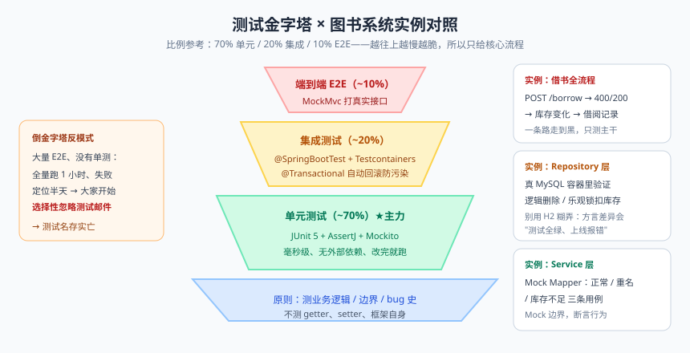
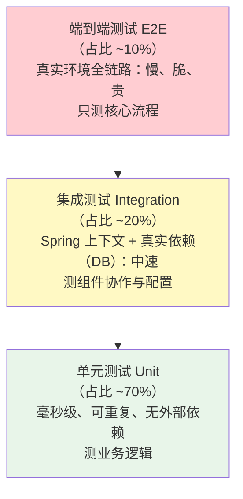

# 测试与质量守护

先讲两个真实场景，你品品哪种更惨：

场景 A：某同学改了订单折扣计算逻辑，自测"没问题"上线。三天后客服投诉：部分老订单退款金额错了。排查发现是两年前的一段满减逻辑被误伤——而他根本不知道那段代码和折扣有关联。

场景 B：同样的改动，跑一遍 `mvn test`，红了三个测试用例，五分钟定位到关联影响，修复后再绿，安心上线。

区别在哪？场景 B 的项目有一套**回归测试**——改动的"影响面"由测试自动守护。**测试不是给测试部门写的，是给三个月后的你自己写的**——那时候你早忘了这段代码的细节，但测试会替你记住"这个行为不能变"。

这篇讲清楚：测试怎么分层（金字塔）、单测怎么写（JUnit5 + Mockito）、集成测试怎么跑（@SpringBootTest + TestContainers）、覆盖率怎么正确对待。

---

## 一、测试金字塔：分层策略


> 🖼️ **图解**：金字塔三层 × 图书系统实例对照，别修成倒金字塔



**为什么金字塔底宽顶窄？**

- 单测跑得飞快（全量几千个用例几秒钟），改完代码立刻能跑，反馈成本最低，所以量最大；
- 越往上越慢越脆（E2E 挂了可能是环境问题不是代码问题），所以只覆盖"下单、支付"这类一条路走到黑的核心链路；
- 倒金字塔（大量 E2E、没有单测）是反模式：全量跑一小时，失败定位半天，最后大家都选择性忽略测试邮件——测试名存实亡。

| 层 | 测什么 | 工具 | 原则 |
|----|--------|------|------|
| 单元测试 | Service 业务逻辑、工具类、边界条件 | JUnit5 + Mockito + AssertJ | 快、隔离、多写 |
| 集成测试 | Repository 层 SQL、配置装配、切面 | @SpringBootTest + TestContainers | 关键路径覆盖 |
| 端到端 | 完整用户流程 | MockMvc / API 测试 | 少而精 |

> 📌 **划重点**：**什么值得测**——有业务逻辑的（价格计算、状态流转）、有边界条件的（空列表、并发）、有 bug 史的（修过的 bug 必须补测试，防复活）。**什么不值得测**——getter/setter、纯框架代码（Spring 自己测过了）、随时变的 UI 细节。

---

## 二、JUnit 5 速成

```java
class DiscountCalculatorTest {
    private final DiscountCalculator calculator = new DiscountCalculator();

    @Test                                        // 最基本的测试方法
    @DisplayName("满100减20：原价120应支付100")
    void discount_100_20() {
        BigDecimal result = calculator.finalPrice(new BigDecimal("120"));
        assertEquals(new BigDecimal("100.00"), result);
    }

    @Test
    @DisplayName("异常场景：负价格应抛参数异常")
    void negativePrice() {
        IllegalArgumentException ex = assertThrows(IllegalArgumentException.class,
                () -> calculator.finalPrice(new BigDecimal("-1")));
        assertTrue(ex.getMessage().contains("价格"));
    }

    @Nested                                      // 嵌套分组：按场景组织用例
    class VipDiscount {
        @Test
        @DisplayName("VIP 9折叠加满减")
        void vipWithFullReduction() { ... }
    }

    @ParameterizedTest                           // 参数化：一个方法跑 N 组数据
    @CsvSource({"100,80", "200,160", "0,0"})
    void vipEightyPercent(String price, String expected) {
        assertEquals(new BigDecimal(expected),
                calculator.vipPrice(new BigDecimal(price)));
    }

    @Test
    @Disabled("等风控规则确定后启用")              // 临时跳过（要写原因！）
    void riskCheck() { ... }

    @BeforeEach                                  // 每个测试方法前执行（准备数据）
    void setUp() { /* 每个用例独立的新计算器 */ }

    @BeforeAll                                   // 全类只执行一次（static）
    static void initAll() { }
}
```

### AssertJ：让断言回到人类语言

```java
// 原生 assertEquals：参数顺序反了是家常便饭，失败信息还难读
assertEquals(3, list.size());

// AssertJ 流式断言：主语开头，链式表达，失败信息自带上下文
assertThat(list)
        .hasSize(3)
        .contains("java", "go")
        .doesNotContain("php");

assertThat(order.getStatus())
        .isEqualTo(OrderStatus.PAID)
        .isNotEqualTo(OrderStatus.CLOSED);

// 提取对象属性批量断言（DTO 转换测试神器）
assertThat(books)
        .extracting(Book::getTitle, Book::getPrice)
        .containsExactly(
                tuple("JVM实战", new BigDecimal("129")),
                tuple("并发编程", new BigDecimal("99")));
```

---

## 三、Mockito：隔离依赖，只测"你写的逻辑"

Service 依赖 Mapper、MQ、Redis……单测如果连真依赖，那是集成测试（慢、脆）。**Mockito 用"替身"替换依赖**，让测试只聚焦被测逻辑本身。

```java
@ExtendWith(MockitoExtension.class)              // JUnit5 集成
class BookServiceTest {
    @Mock                                        // 替身：接口的所有方法返回默认值（null/0）
    BookMapper bookMapper;

    @InjectMocks                                 // 被测对象：自动把 @Mock 注进去
    BookServiceImpl bookService;

    @Test
    void getById_存在_返回VO() {
        // given：安排替身的行为
        Book dbBook = new Book();
        dbBook.setId(1L); dbBook.setTitle("JVM实战");
        when(bookMapper.selectById(1L)).thenReturn(dbBook);

        // when：调用被测方法
        BookVO vo = bookService.getById(1L);

        // then：断言结果
        assertThat(vo.getTitle()).isEqualTo("JVM实战");
        verify(bookMapper, times(1)).selectById(1L);   // 验证交互：恰好调用一次
    }

    @Test
    void getById_不存在_抛业务异常() {
        when(bookMapper.selectById(999L)).thenReturn(null);

        assertThatThrownBy(() -> bookService.getById(999L))
                .isInstanceOf(BizException.class)
                .hasMessageContaining("图书不存在");
    }

    @Test
    void create_重复ISBN_不落库() {
        when(bookMapper.selectByIsbn("9787111")).thenReturn(new Book());

        assertThatThrownBy(() -> bookService.create(reqOf("9787111")))
                .isInstanceOf(BizException.class);
        verify(bookMapper, never()).insert(any(Book.class));    // 验证"不该发生的事"：没插入
    }

    @Test
    void create_捕获参数验证组装逻辑() {
        ArgumentCaptor<Book> captor = ArgumentCaptor.forClass(Book.class);
        when(bookMapper.insert(any())).thenReturn(1);

        bookService.create(reqOf("9787111"));

        verify(bookMapper).insert(captor.capture());             // 捕获传给 insert 的实体
        assertThat(captor.getValue().getIsbn()).isEqualTo("9787111");   // 验证 DTO→Entity 转换
    }
}
```

Mockito 常用武器：`when().thenReturn()`（打桩返回）、`thenThrow()`（打桩抛异常）、`verify(mock, times(n)/never())`（验证交互）、`ArgumentCaptor`（捕获参数检查）、`any()/eq()`（参数匹配器）。

> ⚠️ **踩坑实录**：Mock 的陷阱是"Mock 得太嗨"——把被测对象自己的逻辑也 Mock 了（测了个寂寞），或者测试断言的不是行为而是实现细节（`verify` 满天飞，重构一次全崩）。原则：**Mock 边界（DB/网络/时间），断言行为（输入输出），少 verify 内部调用**。

---

## 四、集成测试：@SpringBootTest 与 TestContainers

### 4.1 @SpringBootTest：起真容器

```java
@SpringBootTest(webEnvironment = SpringBootTest.WebEnvironment.RANDOM_PORT)
@AutoConfigureMockMvc                              // 注入 MockMvc 直接打接口
class BookControllerTest {
    @Autowired MockMvc mockMvc;

    @Test
    void 新增图书_参数非法_返回400() throws Exception {
        mockMvc.perform(post("/api/books")
                        .contentType(MediaType.APPLICATION_JSON)
                        .content("{\"title\":\"\"}"))          // 空标题
                .andExpect(status().isBadRequest())            // 断言 HTTP 400
                .andExpect(jsonPath("$.code").value(400));     // 断言响应体
    }

    @Test
    void 查询图书_不存在_返回业务码() throws Exception {
        mockMvc.perform(get("/api/books/99999"))
                .andExpect(status().isOk())
                .andExpect(jsonPath("$.code").value(40404));
    }
}
```

**@Transactional 测试技巧**：测试方法标 @Transactional，Spring 会在测试结束时**自动回滚**——每个用例都在干净数据上跑，互不污染：

```java
@SpringBootTest
@Transactional                                    // 测试结束后数据自动回滚（Spring Test 的特殊处理）
class BookServiceIntegrationTest {
    @Autowired BookService bookService;

    @Test
    void create后能查到() {
        BookVO vo = bookService.create(validReq());
        assertThat(bookService.getById(vo.getId()).getTitle()).isNotBlank();
        // 不用清理：测试结束全回滚
    }
}
```

性能提醒：@SpringBootTest 每个测试类都起新上下文（约 5~15 秒），上下文缓存机制下同配置类共享一个。**别在单测里滥用它**——金字塔底座还是纯 Mockito。

### 4.2 Repository 层：TestContainers 起真 MySQL

用 H2 内存库测 SQL？方言差异会让你"测试全绿、上线报错"。**TestContainers 用 Docker 起一个真 MySQL**：

```xml
<dependency>
    <groupId>org.testcontainers</groupId>
    <artifactId>mysql</artifactId>
    <scope>test</scope>
</dependency>
<dependency>
    <groupId>org.testcontainers</groupId>
    <artifactId>junit-jupiter</artifactId>
    <scope>test</scope>
</dependency>
```

```java
@SpringBootTest
@Testcontainers
class BookRepositoryIT {                            // 集成测试惯例用 IT 结尾（和单测分开跑）
    @Container
    static MySQLContainer<?> mysql = new MySQLContainer<>("mysql:8.0")
            .withDatabaseName("library")
            .withUsername("test").withPassword("test");

    @DynamicPropertySource                          // 把容器地址动态注入 Spring 配置
    static void props(DynamicPropertyRegistry registry) {
        registry.add("spring.datasource.url", mysql::getJdbcUrl);
        registry.add("spring.datasource.username", mysql::getUsername);
        registry.add("spring.datasource.password", mysql::getPassword);
    }

    @Autowired BookMapper bookMapper;

    @Test
    void 逻辑删除_查询自动过滤() {
        Book b = bookMapper.selectById(1L);
        bookMapper.deleteById(1L);                  // 实际是 UPDATE deleted=1
        assertThat(bookMapper.selectById(1L)).isNull();   // 真 MySQL 验证 @TableLogic 行为
    }
}
```

---

## 五、覆盖率：指标不是目的

JaCoCo 接入（Maven 插件）后跑 `mvn verify`，`target/site/jacoco/index.html` 出报告：行覆盖/分支覆盖。然后是三个清醒认知：

1. **行覆盖 100% ≠ 没 bug**：覆盖只说明"这行执行过"，不说明"断言对了"。删掉所有断言的测试覆盖率照样涨；
2. **覆盖率是发现工具不是 KPI**：低覆盖率告诉你哪里没测（有价值）；拿覆盖率考核团队，得到的是为凑数写的无断言测试（有害）；
3. 务实目标：核心业务模块 70~80% 行覆盖 + 关键分支覆盖；工具类、配置类别强求。

### TDD 一段（了解即可）

测试驱动开发的节奏：**红（写一个失败的测试）→ 绿（最少代码让测试过）→ 重构（整理代码保持绿）**。它适合逻辑清晰、输入输出明确的场景（算法、计费规则）；不适合探索性开发（需求都在变，测试跟着白写）。**不必教条 TDD，但"改代码前先补一个能复现 bug 的测试"永远是对的。**

### CI 里跑测试

```yaml
# .github/workflows/ci.yml（节选）
name: CI
on: [push, pull_request]
jobs:
  build:
    runs-on: ubuntu-latest
    steps:
      - uses: actions/checkout@v4
      - uses: actions/setup-java@v4
        with: { java-version: '17', distribution: 'temurin' }
      - run: mvn -B verify          # 测试不过，流水线红，禁止合码
```

> 💡 **老鸟忠告**：测试的最大价值在**重构和升级时**——敢不敢把老项目从 Boot 2 升到 3、敢不敢大改计费逻辑，全看测试网结得牢不牢。没测试的系统，每行代码都是"祖传的不能动"。

---

## 本篇小结

- 测试金字塔：70% 单元（快、隔离）+ 20% 集成（真依赖）+ 10% E2E（核心链路）；倒金字塔是反模式；
- 值得测：业务逻辑、边界、bug 史；不值得测：getter/setter、框架代码；
- JUnit5 + AssertJ 流式断言 + Mockito 打桩/verify/Captor 是单测三件套；Mock 边界、断言行为、少 verify 细节；
- @SpringBootTest 测 Web 层与装配（MockMvc + jsonPath）；@Transactional 测试自动回滚保数据干净；
- TestContainers 起 Docker 真 MySQL 测 SQL，远胜 H2（方言差异）；
- 覆盖率是发现工具不是 KPI；核心模块 70~80% 足够；改 bug 前先写复现测试。

## 课后思考 & 动手练习

1. （概念）为什么单元测试要占金字塔的大头？"倒金字塔"会带来什么具体恶果？
2. （概念）@Mock 和 @InjectMocks 分别做什么？如果被测类是构造器注入，Mockito 怎么把替身塞进去的（联系 IoC 篇）？
3. （概念）为什么测试类的 @Transactional 结束后会回滚？这和生产里的事务行为一致吗？
4. （动手）给图书系统的 DiscountCalculator/BookService 核心方法补至少 10 个单测：覆盖正常、边界（空、0、负数）、异常三类场景，全部用 Mockito 隔离 Mapper。
5. （动手·进阶）用 TestContainers 给 BookMapper 写集成测试：验证逻辑删除、乐观锁扣库存（`UPDATE ... WHERE stock>0` 影响行数）；再写一个 MockMvc 测试覆盖"参数校验 400 → 业务异常 → 兜底 500"三条全局异常路径，接入 JaCoCo 看覆盖率报告。

> 下一篇预告：《日志、监控与上线部署》——实践篇收官：logback 生产级配置、TraceID 链路追踪、Actuator + Prometheus + Grafana 监控全家桶，最后用 Docker 把服务真正"上线"。让你的服务从"盲盒"变成"透明鱼缸"。
