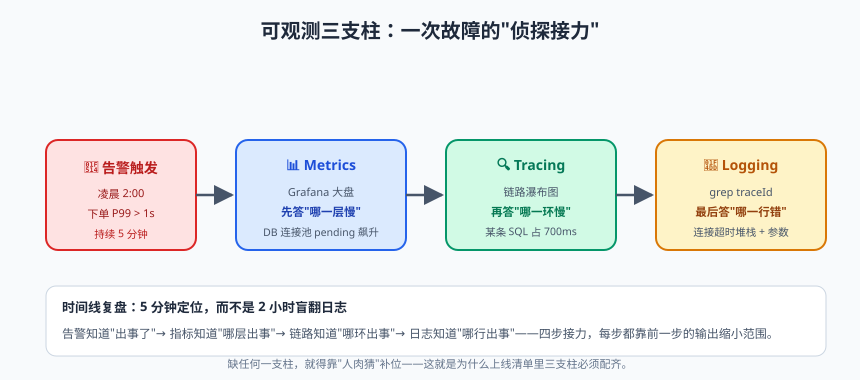

# 日志、监控与上线部署

实践篇最后一篇，讲三件事：**日志**（出了事能查）、**监控**（出事之前能知道）、**部署**（把服务真正送到线上）。合起来解决一个终极问题——

凌晨两点，告警电话：订单服务不可用。你睡眼惺忪打开电脑，然后发现：日志东一块西一块没有统一格式、接口调用链路在十几个服务里断成碎片、服务器 CPU 90% 但不知道哪个接口炸了、要发个修复版本还得手动传 jar 包重启……这一夜，你就是盲人摸象。

**没有可观测性（Observability）的服务就是盲盒。** 这篇把盲盒换成透明鱼缸。

---

## 一、日志：把"案发现场"留下

### 1.1 logback 生产级配置

Spring Boot 默认就是 Logback（spring-boot-starter-web 传递依赖了 logback）。自定义 `logback-spring.xml`：

```xml
<configuration>
    <property name="LOG_PATTERN"
              value="%d{yyyy-MM-dd HH:mm:ss.SSS} [%thread] [%X{traceId}] %-5level %logger{36} - %msg%n"/>
    <!-- [%X{traceId}]：从 MDC 取 traceId，串起一次请求的所有日志（下节讲） -->

    <!-- 控制台：开发环境用 -->
    <appender name="CONSOLE" class="ch.qos.logback.core.ConsoleAppender">
        <encoder><pattern>${LOG_PATTERN}</pattern></encoder>
    </appender>

    <!-- 滚动文件：生产主力。按天+按大小滚动，保留 30 天，总大小封顶防磁盘爆满 -->
    <appender name="FILE" class="ch.qos.logback.core.rolling.RollingFileAppender">
        <file>logs/app.log</file>
        <rollingPolicy class="ch.qos.logback.core.rolling.SizeAndTimeBasedRollingPolicy">
            <fileNamePattern>logs/app.%d{yyyy-MM-dd}.%i.log.gz</fileNamePattern>  <!-- 历史日志自动 gzip -->
            <maxFileSize>100MB</maxFileSize>
            <maxHistory>30</maxHistory>
            <totalSizeCap>10GB</totalSizeCap>
        </rollingPolicy>
        <encoder><pattern>${LOG_PATTERN}</pattern></encoder>
    </appender>

    <!-- 异步 Appender：日志写入不阻塞业务线程（高并发必开） -->
    <appender name="ASYNC" class="ch.qos.logback.classic.AsyncAppender">
        <appender-ref ref="FILE"/>
        <queueSize>1024</queueSize>
        <discardingThreshold>0</discardingThreshold>   <!-- 0=队列满也不丢任何级别日志 -->
    </appender>

    <springProfile name="dev">
        <root level="INFO"><appender-ref ref="CONSOLE"/></root>
    </springProfile>
    <springProfile name="prod">
        <root level="INFO"><appender-ref ref="ASYNC"/></root>
        <logger name="com.demo.library.mapper" level="DEBUG"/>   <!-- 单独调某个包级别 -->
    </springProfile>
</configuration>
```

### 1.2 日志规范：不是写的，是守的

| 级别 | 什么时候用 | 反例 |
|------|-----------|------|
| ERROR | **需要人处理**的故障（数据异常、依赖不可用） | 拿 ERROR 打调试信息，告警狼来了 |
| WARN | 可自动恢复/需关注（重试成功、降级触发、慢查询） | 该 WARN 的用 ERROR，值班同学崩溃 |
| INFO | 关键业务节点（订单创建、状态流转、启动关闭） | 一个请求打 20 条 INFO，淹没重点 |
| DEBUG | 调试细节（参数、中间状态），生产默认关 | 生产开着 DEBUG 还不改级别 |

五条铁律（每条都值一个生产事故）：

> 📌 **划重点**：日志的终极检验标准——**出事当晚，只靠日志能不能还原现场**：谁（userId/traceId）、什么时候、在哪个环节、什么输入、什么结果、为什么失败。达不到这个标准的日志，打得再多也是浪费磁盘。

```java
// ① 占位符，不要字符串拼接（拼接是无条件执行的，白白浪费 CPU）
log.info("订单创建成功，orderId={}，amount={}", orderId, amount);

// ② 异常必须作为最后一个参数传入（打印完整堆栈），msg 里别拼 e.getMessage()
log.error("扣库存失败，orderId={}", orderId, e);       // ✅
log.error("扣库存失败：" + e.getMessage());             // ❌ 丢堆栈

// ③ 敏感信息脱敏：密码/身份证/手机号，永远不进日志
log.info("用户注册，phone={}", mask(phone));            // 138****5678

// ④ 分支必须留痕：else 路径静默 = 排查时的黑洞
if (couponUsable) { ... } else { log.warn("优惠券不可用，userId={}，couponId={}", ...); }

// ⑤ warn/error 要能"讲清楚一件事"：谁(userId)、什么(orderId)、为什么、怎么办
```

### 1.3 TraceID：日志的"串珠线"

一次请求跨 5 个服务，怎么把散落各处的日志串起来？**TraceID + MDC（Mapped Diagnostic Context）**：入口生成全局唯一 ID，放进 MDC（底层 ThreadLocal），日志格式里 `%X{traceId}` 自动带出，跨服务时通过 HTTP 头传递：

```java
@Component
public class TraceIdFilter extends OncePerRequestFilter {
    private static final String TRACE_HEADER = "X-Trace-Id";

    @Override
    protected void doFilterInternal(HttpServletRequest req, HttpServletResponse resp,
                                    FilterChain chain) throws ServletException, IOException {
        String traceId = Optional.ofNullable(req.getHeader(TRACE_HEADER))     // 上游传了就接力
                .orElse(UUID.randomUUID().toString().replace("-", ""));       // 没传就生成
        MDC.put("traceId", traceId);                       // 放进 MDC → 日志自动携带
        resp.setHeader(TRACE_HEADER, traceId);             // 响应头也带上（前端报障时能提供）
        try {
            chain.doFilter(req, resp);
        } finally {
            MDC.remove("traceId");                         // 线程池复用线程，必须清理！（ThreadLocal 篇的债）
        }
    }
}
```

所有日志自动带上了 `a3f2c81b...`，`grep traceId` 一把捞出全链路。**生产日志必须带 traceId，没有商量。**（注意：跨服务传递时，调用下游要把 traceId 放进请求头；线程池异步时要用 TaskDecorator 复制 MDC。）

### 1.4 集中式日志：ELK 一瞥

单机日志 grep 效率太低，标准解法 **ELK**：


轻量替代：日志直接输出 JSON（logstash-logback-encoder），Filebeat 直发 Elasticsearch，省掉 Logstash。

---

## 二、监控：出事之前先知道


> 🖼️ **图解**：故障侦探接力：告警→Metrics 定层→Tracing 定环→Logging 定行

### 2.1 可观测性三支柱

| 支柱 | 回答的问题 | 本篇工具 |
|------|-----------|---------|
| Metrics 指标 | 系统现在健康吗？（数值随时间变化） | Actuator + Micrometer + Prometheus + Grafana |
| Logging 日志 | 发生了什么？（离散事件） | Logback + ELK |
| Tracing 链路 | 一次请求慢在哪一环？ | SkyWalking（高手篇实战） |

### 2.2 Actuator：开箱即用的体检中心

```xml
<dependency>
    <groupId>org.springframework.boot</groupId>
    <artifactId>spring-boot-starter-actuator</artifactId>
</dependency>
```

```yaml
management:
  endpoints:
    web:
      exposure:
        include: health,info,metrics,prometheus   # 暴露哪些端点（默认只有 health）
  endpoint:
    health:
      show-details: when-authorized              # 健康详情：别对匿名用户全裸
```

常用端点：`/actuator/health`（健康检查，K8s 探针用它：UP/DOWN）、`/actuator/metrics`（指标列表，`/actuator/metrics/jvm.memory.used` 看单项）、`/actuator/prometheus`（Prometheus 抓取格式）。

> ⚠️ **踩坑实录**：Actuator 的 env、heapdump 等端点暴露**配置明文和堆内敏感数据**。曾发生过生产环境把 `include: *` 全暴露 + 无鉴权，被扫描器扫到 heapdump 拿到数据库密码。原则：**只暴露必要端点、接入网关统一鉴权、生产环境 management 端口独立（如 9090）且只对内网开放。**

### 2.3 Micrometer + Prometheus + Grafana

Micrometer 是指标"门面"（类比 SLF4 至于日志），四大计量器：

| 计量器 | 语义 | 场景 |
|--------|------|------|
| Counter | 只增不减 | 请求数、错误数 |
| Gauge | 瞬时值 | 当前队列长度、活跃连接数 |
| Timer | 耗时分布 | 接口 RT（次数+总耗时） |
| DistributionSummary | 值分布 | 请求体大小 |

```xml
<dependency>
    <groupId>io.micrometer</groupId>
    <artifactId>micrometer-registry-prometheus</artifactId>
</dependency>
```

自定义业务指标（订单创建量）：

```java
@Service
@RequiredArgsConstructor
public class OrderMetrics {
    private final Counter orderCreateCounter;
    private final Timer orderCreateTimer;

    public OrderMetrics(MeterRegistry registry) {
        this.orderCreateCounter = Counter.builder("biz_order_create_total")
                .description("订单创建总数").tag("result", "success")
                .register(registry);
        this.orderCreateTimer = Timer.builder("biz_order_create_duration")
                .description("下单耗时").register(registry);
    }

    public void recordCreate(long costMs) {
        orderCreateCounter.increment();
        orderCreateTimer.record(Duration.ofMillis(costMs));
    }
}
```

Prometheus 配置抓取：

```yaml
# prometheus.yml
scrape_configs:
  - job_name: 'library-app'
    metrics_path: '/actuator/prometheus'
    static_configs:
      - targets: ['host.docker.internal:8080']
```

```bash
docker run -d -p 9090:9090 -v $PWD/prometheus.yml:/etc/prometheus/prometheus.yml prom/prometheus
docker run -d -p 3000:3000 grafana/grafana      # 打开 3000，加 Prometheus 数据源，导入面板 ID 4701（JVM 四件套）
```

Grafana 看什么（JVM 面板 + 自定义业务面板的关键指标）：

| 维度 | 指标 | 告警思路 |
|------|------|---------|
| 流量 | QPS、订单创建速率 | 突降 50% 告警（可能上游挂了） |
| 错误 | 5xx 比例、异常日志速率 | > 1% 持续 5 分钟告警 |
| 延迟 | RT P95/P99 | P99 > 1s 持续 5 分钟告警 |
| 饱和度 | JVM 堆使用率、GC 频率、线程数、连接池活跃数 | 堆 > 85%、Full GC 出现即告警 |

**告警哲学**：告警必须"看到就要行动"。天天狼来了的告警会被静音，真正致命的那条也一起被埋葬。

---

## 三、部署：把服务送上线

### 3.1 打包与 profile

```bash
mvn clean package -DskipTests=false    # CI 里跑完测试再打包
java -jar library-app.jar --spring.profiles.active=prod
# 外置配置优先级高于 jar 内：config/application.yml 或同目录 application.yml 可覆盖打包配置（运维改配置不用重新打包）
```

### 3.2 Docker 化

```dockerfile
# 多阶段构建：构建层和运行层分离，最终镜像不带 Maven 和源码
FROM maven:3.9-eclipse-temurin-17 AS builder
WORKDIR /app
COPY pom.xml .
RUN mvn dependency:go-offline           # 先拉依赖（利用 Docker 层缓存：pom 不变就跳过）
COPY src ./src
RUN mvn clean package -DskipTests

FROM eclipse-temurin:17-jre-alpine      # 运行层只要 JRE（~200MB vs JDK ~600MB）
WORKDIR /app
COPY --from=builder /app/target/*.jar app.jar

# 容器里跑 Java 的关键参数：尊重容器内存限制（老 JVM 默认看宿主机内存，容器限 1G 它按 16G 算堆，直接 OOMKilled）
ENV JAVA_OPTS="-XX:MaxRAMPercentage=75.0 -XX:+UseG1GC"
EXPOSE 8080
ENTRYPOINT ["sh", "-c", "java $JAVA_OPTS -jar app.jar"]
```

### 3.3 docker-compose 一键拉起全家桶

```yaml
version: "3.8"
services:
  app:
    build: .
    ports: ["8080:8080"]
    environment:
      SPRING_PROFILES_ACTIVE: prod
      SPRING_DATASOURCE_URL: jdbc:mysql://mysql:3306/library
      SPRING_DATA_REDIS_HOST: redis
    depends_on: [mysql, redis]
  mysql:
    image: mysql:8.0
    environment: { MYSQL_ROOT_PASSWORD: root123, MYSQL_DATABASE: library }
    ports: ["3306:3306"]
    volumes: ["mysql-data:/var/lib/mysql"]
  redis:
    image: redis:7
    ports: ["6379:6379"]
  prometheus:
    image: prom/prometheus
    ports: ["9090:9090"]
    volumes: ["./prometheus.yml:/etc/prometheus/prometheus.yml"]
  grafana:
    image: grafana/grafana
    ports: ["3000:3000"]
volumes:
  mysql-data:
```

`docker compose up -d` 一条命令：应用 + MySQL + Redis + 监控全家桶全部就绪——本地演示、测试环境、新同事入职环境，全都这一招。

### 3.4 优雅停机

直接 kill 进程 = 正在处理的请求被腰斩。三件套：

```yaml
server:
  shutdown: graceful          # 收到 SIGTERM 后：停止接新请求，等存量请求处理完（默认上限 30s）
spring:
  lifecycle:
    timeout-per-shutdown-phase: 30s
```

配合 K8s 的 preStop 钩子（sleep 几秒等负载均衡摘流量）+ ThreadPoolTaskExecutor 的 waitForTasksToCompleteOnShutdown，滚动更新不丢请求。

---

## 四、上线检查清单（贴工位上）

- [ ] 日志：格式统一带 traceId、ERROR 有告警、敏感信息已脱敏
- [ ] 监控：QPS/RT/错误率/堆/GC 五类指标上 Grafana，告警规则生效过演练
- [ ] 健康检查：/actuator/health 配入负载均衡/K8s 探针
- [ ] 配置：密码环境变量注入、生产 profile 独立、Actuator 端点最小化
- [ ] 容量：压测过、连接池/线程池参数有依据（性能篇细讲）
- [ ] 停机：graceful shutdown 开启、发布策略（滚动/灰度）确认
- [ ] 回滚：上一版本镜像/jar 可一键回滚，回滚演练过

> 💡 **老鸟忠告**：这份清单不是"上线前一天看的"，是**开发过程中每天对照的**。等到上线日才发现没 traceId、没监控，补的成本是平时的十倍——而且那晚你根本没有十倍时间。

---

## 本篇小结

- 日志三件套：logback 滚动+异步配置、五条规范（占位符/堆栈/脱敏/分支留痕/信息完整）、TraceID+MDC 串联全链路（finally 必须 remove）；
- ELK 解决日志集中检索：Filebeat → Logstash → ES → Kibana；
- 可观测性三支柱：Metrics（健康数值）、Logging（事件）、Tracing（链路）；
- Actuator 暴露健康与指标，但必须最小化+鉴权（env/heapdump 是泄密重灾区）；
- Micrometer 四计量器 + Prometheus 抓取 + Grafana 面板（JVM 4701），告警要"看到即行动"；
- Docker 多阶段构建瘦身镜像，MaxRAMPercentage 适配容器内存限制；compose 一键全家桶；优雅停机三件套防发布丢请求。

## 课后思考 & 动手练习

1. （概念）为什么日志用 `log.info("x={}", x)` 而不是 `log.info("x=" + x)`？两者在 DEBUG 级别关闭时的开销差异在哪？
2. （概念）MDC 的底层是什么？线程池场景下 traceId 为什么会"串号"？怎么解决？
3. （动手）给图书系统接 TraceIdFilter，验证一次请求的所有日志（Controller/Service/全局异常）都带同一 traceId；
4. （动手）接入 Actuator + Prometheus + Grafana（compose 拉起），导入 4701 面板，用压测工具打图书查询接口，观察 QPS/RT/堆内存/GC 曲线变化；
5. （动手·进阶）完成 Dockerfile 多阶段构建 + compose 全家桶部署；然后演练优雅停机：压测进行中执行 `docker restart`，统计被腰斩的请求数（对比开关 graceful 前后）；最后按第四节清单给你的项目打分，写出三项最需要补齐的行动项。

> 实践篇收官！接下来是最后的**高手进阶篇**：微服务拆分、分布式疑难杂症、性能优化方法论，以及——写给每一位学习者的《从码农到专家：Java 工程师成长指南》。最后一程，冲刺山顶。
