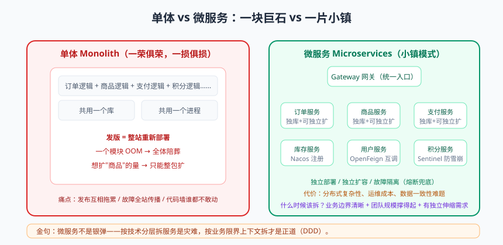
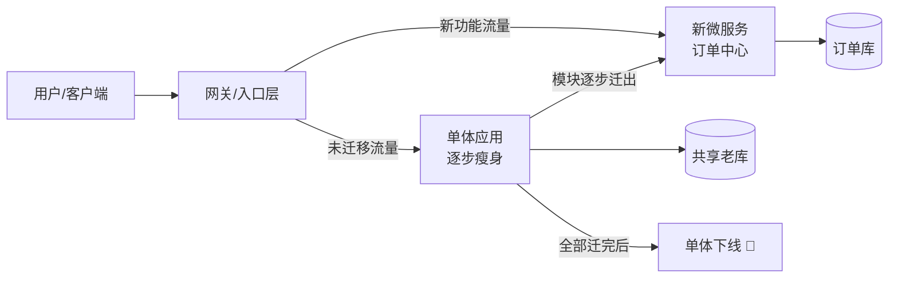
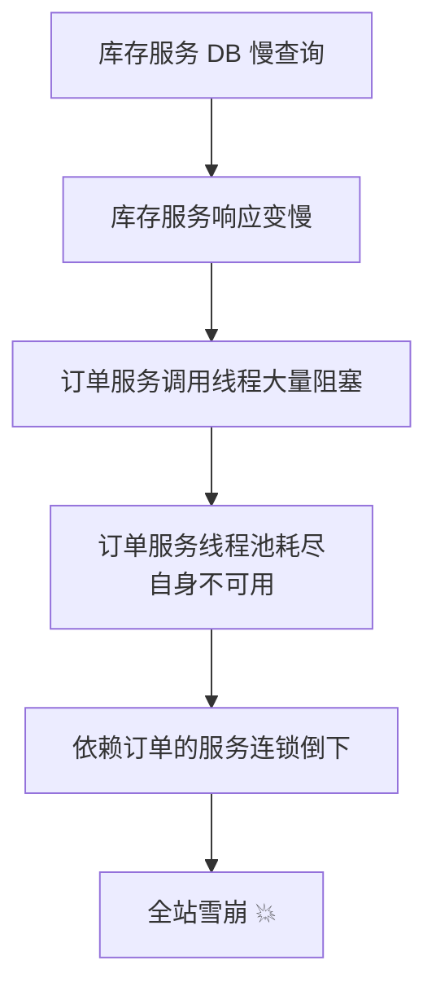
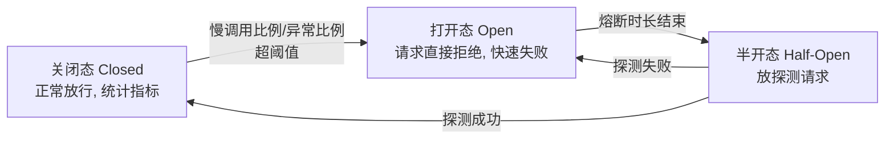

# 微服务拆分与 Spring Cloud 实战

先讲个真事。我带过一个学员，在一家电商公司守着一个跑了六年的单体应用（Monolith）：三百万行代码，war 包八百多兆，模块依赖关系画出来像一碗意大利面。每次发版，运维同学都得先烧一炷香：改了一行优惠券逻辑，整站重新部署四十分钟，期间用户看到的全是"系统升级中，请稍后"。想上个新功能？先排队，等五个团队的代码一起合并、一起回归、一起赌命。

更刺激的还在后头。有一年大促，商品模块查大表没分页，一个内存泄漏把堆吃光，Full GC 一停三十秒，结果订单、支付、购物车在同进程里集体陪葬。老板冲进技术部就一句灵魂发问："你们就说改了一行代码，怎么整站挂了？"这就是单体 grown-up 之后的三大烦恼：发布互相拖累、一个模块 OOM 全站陪葬、代码墙"谁都不敢动"。

微服务（Microservices）就是针对这三大烦恼的一剂药方。但我开讲前先给你泼盆冷水：这药有副作用，而且不小。这一篇我们先把"该不该拆、怎么拆"想明白，再用 Spring Cloud Alibaba 把"拆完之后怎么活"的技术栈一次讲透。系好安全带，发车。

## 一、单体的三宗罪：先确诊，再开药


> 🖼️ **图解**：单体巨石 vs 微服务小镇：独立部署与故障隔离

### 1. 发布互相拖累：一荣俱荣，一损更损

单体里所有模块打成同一个包，共享一个发布周期。运营想周五上个活动页，支付团队说"我们在改核心链路，别碰主干"。于是需求排队、代码冲突、回归测试全员加班。更可怕的是回滚：你回滚的是整个应用，别人刚上线的功能跟着一起时光倒流。发布从技术动作变成了政治谈判。

### 2. 故障全域蔓延：一个 OOM，全站陪葬

所有模块跑在同一个 JVM 进程里，共享一份堆内存。商品服务一个慢查询把内存吃爆，同进程里的订单接口、支付接口全部被 Full GC 拖住。资源隔离为零，木桶效应拉满：整站的水位，取决于最烂的那块板。老板眼里"就挂了一个小功能"，在用户眼里就是"全站挂了"。

### 3. 代码墙：谁都不敢动

六年单体，测试覆盖约等于玄学，唯一懂那个核心 Service 的老员工早已离职。新需求只能往上糊，老代码没人敢重构——"能跑就行"。技术债像滚雪球，改动风险却指数上升，最后所有人都学会了绕着走，代码墙越砌越高。

> 📌 **划重点**：单体的本质问题不是"代码写在一个工程里"，而是所有模块**共享进程、共享发布、共享故障域**。微服务的价值，恰恰是把这三样东西拆开。

## 二、微服务不是银弹：先算账，再动手

我很喜欢一句大实话：微服务是用**一系列新问题**换取**一群人的协作效率**。动手之前，先看看你要接住哪些新问题。

**代价一：分布式复杂性。** 原来是进程内方法调用，纳秒级、不会丢；现在是网络调用，毫秒级、会超时、会丢包。超时（Timeout）、重试（Retry）、幂等（Idempotency）、降级（Degradation），每一个都是新课题。本地一个 `try-catch` 搞定的事，跨进程后你永远要面对薛定谔的调用："超时了，对方到底执行成功没有？"

**代价二：运维成本翻倍。** 从管 1 个应用变成管 30 个应用。没有容器编排（K8s）、监控告警、日志聚合、链路追踪（Tracing），运维同学会提刀来见。微服务是富人家的游戏，基建不齐就别硬上。

**代价三：数据一致性。** 订单和库存分属两个服务、两个库，一个数据库事务（ACID）罩不住了，必须引入分布式事务方案——这是下一篇的主角，先埋个伏笔。

那什么时候**该**拆？满足以下两条以上，再认真考虑：

- **团队规模**：超过两三个"两个披萨团队"（Two-Pizza Team），主干合并冲突天天上演，发版窗口靠抢；
- **业务边界清晰**：能画出各团队都认的业务域，而不是一团浆糊。边界都没想清楚就拆，拆出来的是分布式大泥球；
- **独立伸缩需求**：秒杀模块大促要 100 台机器，后台管理平时 2 台就够。单体里没得选，只能跟着一起膨胀烧钱。

再说**康威定律（Conway's Law）**的通俗版：系统结构会长得和组织沟通结构一模一样。你按技术分层组队（前端组、后端组、DBA 组），系统就长成一大坨分层单体；你按业务域组队（订单组、库存组、支付组），微服务边界自然浮出水面。所以拆服务之前先看组织架构图——**拆系统，本质是拆组织的协作方式**。

> ⚠️ **踩坑实录**：某公司老板在技术大会听了微服务专场，回来强推"全面微服务改造"。5 人团队硬拆出 18 个服务，没有 DevOps 平台，发布要手动登十几台机器；一个列表查询跨 5 个服务，联调一次一下午。三个月后性能没提升，故障率翻了三倍，最后灰溜溜合并回 3 个服务。记住：微服务解决的是**组织规模带来的协作问题**，不是技术审美问题。

## 三、拆分方法论：DDD 战略设计速览

边界怎么找？拍脑袋是不行的，得靠领域驱动设计（Domain-Driven Design，DDD）的战略设计。别慌，速览版十分钟讲明白。

### 限界上下文（Bounded Context）：一个边界内，语言统一

判断标准很朴素：同一个词，在不同场景里含义是否一样。比如"商品"——在商品上下文里指 SKU 和详情；在物流上下文里指带重量、体积的发货单元；在搜索上下文里指一堆倒排索引词条。**边界内模型可以不一样**，别强行做一个"大而全的商品类"喂给所有人，那是单体思维的残留。每个上下文有自己独立的模型和数据库，上下文之间通过接口或事件通信。

### 子域（Subdomain）划分：核心、支撑、通用

- **核心域（Core Domain）**：业务赚钱、差异化的所在，投入最强兵力。电商里就是交易（订单 + 支付）；
- **支撑域（Supporting Domain）**：业务必需但不构成差异化，够用就好，比如库存、营销；
- **通用域（Generic Domain）**：行业通用能力，直接买或用开源，比如登录认证、消息推送。

把资源砸在核心域上，通用域别自己造轮子——这话我每年都要跟学员念八遍。

### 电商系统拆分实战走一遍

拿中型电商过一遍流程：

| 上下文 | 承载能力 | 子域定位 | 拆分理由 |
|---|---|---|---|
| 用户 | 注册、登录、会员资料 | 通用域 | 可用开源方案，独立演进 |
| 商品 | 商品、类目、详情、搜索 | 支撑域 | 读多写少，可独立缓存与扩容 |
| 订单 | 下单、状态机流转、售后 | 核心域 | 变更最频繁，必须独立发布 |
| 支付 | 渠道对接、退款、对账 | 核心域 | 合规隔离要求，与订单解耦 |
| 库存 | 扣减、预占、对账 | 支撑域 | 秒杀场景需独立伸缩 |

划边界的三板斧：看组织怎么分的活（康威定律）、看同一个名词是否需要多套模型（上下文）、看是否有独立伸缩或独立发布的诉求。三个视角互相印证，边界八九不离十。

### Anti-pattern：按技术分层拆是灾难

把系统拆成"Controller 服务、Service 服务、DAO 服务"——恭喜你，成功制造了分布式单体：每个需求横跨三个服务，一次本地调用变两次网络调用，事务彻底没救，团队还要跨服务协作。**微服务拆的是业务能力（垂直切），不是技术层次（水平切）**。

> 💡 **老鸟忠告**：拆分粒度的黄金检验法——"这个服务能不能由一个小团队**独立开发、独立测试、独立部署、独立上线**？"四个独立有一个不满足，边界就有问题。宁可先拆粗（5~8 个服务），跑顺了再细化。拆细容易，合并难。

## 四、拆分节奏：绞杀者模式（Strangler Fig）

别想"推倒重来重写一个新系统"——那是业界著名坟场，Netscape 就这么把自己送走的。正确姿势是**绞杀者模式（Strangler Fig Pattern）**：名字来自绞杀榕，种子落在老树上，新枝一寸寸长满，最终取代老树。



落地四步走：

1. **止血**：新功能一律做进新服务，坚决不再往单体里加代码，先让肿瘤停止长大；
2. **引流**：在网关/Nginx 按路由把对应流量切给新服务，用户无感知；
3. **蚕食**：优先迁出边界最清晰、变更最频繁的模块（比如订单），每迁一块灰度验证一块；
4. **收尾**：单体瘦到只剩顽固模块，最后下线，或作为"祖传遗产"长期共存（现实往往如此，没关系）。

## 五、Spring Cloud Alibaba 全家桶地图

边界划好了，接下来解决"拆完怎么活"。Spring Cloud Alibaba 是国内事实标准，先看全家桶地图，心里有张作战图：

| 组件 | 角色 | 取代/对标 | 一句话点评 |
|---|---|---|---|
| Nacos | 注册中心 + 配置中心 | Eureka + Config + Bus | 一个打俩，运维省心 |
| OpenFeign | 声明式 HTTP 调用 | RestTemplate + 手写负载均衡 | 写个接口就能调，优雅 |
| Spring Cloud Gateway | API 网关 | Zuul 1.x（阻塞 IO） | 基于 WebFlux，性能在线 |
| Sentinel | 熔断、降级、限流 | Hystrix（已停更） | 规则动态推送，自带控制台 |
| Seata | 分布式事务 | 手写补偿代码 | AT 模式几乎零侵入 |
| RocketMQ | 消息队列 | 按场景对标 Kafka/RabbitMQ | 事务消息是分布式事务利器 |

版本一句提醒：Spring Cloud Alibaba 2021.x 对应 Spring Cloud 2020.0.x、Spring Boot 2.6.x；2022.x 对应 Spring Boot 2.7.x。**千万别乱配版本**——启动时那些诡异的 `NoSuchMethodError`，九成来自版本错配。

## 六、Nacos：服务注册发现 + 配置中心

### 注册发现原理：心跳模型与 AP/CP

服务提供者启动时向 Nacos 注册自己的 IP、端口、元数据；消费者从 Nacos 拉取服务列表并缓存在本地，调用时直接按列表负载均衡，注册中心短暂宕机也不影响存量调用。

对于**临时实例（Ephemeral Instance，默认）**，Nacos 采用客户端心跳模型：客户端每 **5 秒**上报一次心跳；**15 秒**没收到，标记为不健康；**30 秒**没收到，直接剔除。数据在集群内用 Distro 协议异步同步，保证可用性优先——这是 **AP 模式**，主流注册中心的选择（网络抖动时宁可返回略旧的列表，也不能整体拒绝服务）。对于**持久化实例**，则由服务端主动健康探测，集群用 Raft 协议保证强一致——**CP 模式**。切换很简单：

```yaml
spring:
  cloud:
    nacos:
      discovery:
        server-addr: 127.0.0.1:8848
        namespace: prod          # 命名空间：隔离环境
        ephemeral: false         # false = 持久化实例，走 CP；默认 true 走 AP
```

### 配置中心：命名空间、分组与动态刷新

配置管理的三板斧：**命名空间（Namespace）**隔离环境（dev/test/prod），**分组（Group）**隔离业务线，**DataId** 定位具体配置文件。加一个 `@RefreshScope`，配置就能热生效：

```yaml
spring:
  application:
    name: order-service
  cloud:
    nacos:
      config:
        server-addr: 127.0.0.1:8848
        namespace: prod            # 环境隔离：生产命名空间
        group: TRADE_GROUP         # 业务隔离：交易业务线
        file-extension: yaml
```

```java
@RestController
@RefreshScope // 配置变更时销毁重建该 Bean，@Value 字段重新注入
public class PromoController {

    @Value("${promo.switch.enabled:false}")
    private boolean promoEnabled; // 运营在 Nacos 控制台改开关，这里热生效，无需重启

    @GetMapping("/promo/enabled")
    public boolean isEnabled() {
        return promoEnabled;
    }
}
```

> ⚠️ **踩坑实录**：见过一家公司把测试和生产的配置全放在 `public` 命名空间，只靠 DataId 前缀区分。某天同事改配置时手一抖，测试配置推到了生产， promo 优惠直接翻倍，资损一晚上五位数。从此立下铁律：**环境用 Namespace 隔离，生产命名空间只给极少数人写权限**。

## 七、OpenFeign：声明式调用，写个接口就完事

远程调用最怕样板代码，OpenFeign 的思路是"你只管声明，剩下的我来"：

```java
@FeignClient(name = "inventory-service", path = "/api/inventory",
        fallbackFactory = InventoryClientFallbackFactory.class)
public interface InventoryClient {

    @PostMapping("/deduct")
    Result<Boolean> deduct(@RequestBody DeductDTO dto); // 只写接口，框架生成实现并发起 HTTP 调用
}
```

```java
@Component
@Slf4j
public class InventoryClientFallbackFactory implements FallbackFactory<InventoryClient> {

    @Override
    public InventoryClient create(Throwable cause) {
        return dto -> {
            // 拿到异常才能区分处理：超时？限流？服务不存在？
            log.warn("库存服务调用失败，触发降级: {}", cause.getMessage());
            return Result.degrade("库存服务繁忙，请稍后重试"); // 返回兜底而不是抛异常
        };
    }
}
```

超时与重试必须显式配置，默认值（连接 10s、读 60s）在生产上就是灾难——一个慢接口能把你的线程池全拖住：

```yaml
feign:
  client:
    config:
      default:
        connectTimeout: 2000    # 全局默认：连接超时 2 秒
        readTimeout: 3000       # 全局默认：读超时 3 秒
      inventory-service:
        readTimeout: 1000       # 覆盖特定服务：库存是核心链路，超时收紧到 1 秒
  httpclient:
    enabled: true               # 换 Apache HttpClient 连接池，性能更稳
```

> 📌 **划重点**：OpenFeign 默认**不重试**（`Retryer.NEVER_RETRY`）。想开重试可以自定义 `Retryer`，但记住两条铁律：**只对幂等接口开重试**（查询类可以，扣款类千万别）；重试次数要少（1~2 次），否则重试风暴会把下游打得更死。另外，`fallbackFactory` 比 `fallback` 好用，因为它能把异常带给你，方便打日志和区分处理。

## 八、Spring Cloud Gateway：系统的南北大门

网关（Gateway）是所有外部流量的统一入口，干三件事：路由转发、统一鉴权、横切面处理（限流、日志、灰度）。核心模型是**路由（Route）= 谓词（Predicate）+ 过滤器（Filter）**：谓词决定"哪些请求匹配这条路由"（Path、Method、Header、Query、时间窗等），过滤器决定"匹配后前后做什么"（改头、限流、鉴权）。实战中最常见的需求——统一鉴权，用 `GlobalFilter` 实现：

```java
@Component
public class AuthGlobalFilter implements GlobalFilter, Ordered {

    @Override
    public Mono<Void> filter(ServerWebExchange exchange, GatewayFilterChain chain) {
        String token = exchange.getRequest().getHeaders().getFirst("Authorization");
        if (token == null || !JwtUtil.verify(token)) {
            exchange.getResponse().setStatusCode(HttpStatus.UNAUTHORIZED);
            return exchange.getResponse().setComplete(); // 未登录直接 401，根本不进后端服务
        }
        String userId = JwtUtil.parseUserId(token);
        ServerHttpRequest newRequest = exchange.getRequest().mutate()
                .header("X-User-Id", userId)   // 鉴权通过，把用户身份透传给下游服务
                .build();
        return chain.filter(exchange.mutate().request(newRequest).build());
    }

    @Override
    public int getOrder() {
        return -100; // 数值越小优先级越高，鉴权必须抢在最前面执行
    }
}
```

> 💡 **老鸟忠告**：网关要保持"薄"，只做与业务无关的横切逻辑（鉴权、限流、路由、灰度）。千万别把业务逻辑写进网关——我见过在网关里算优惠价格的，最后网关成了最胖、最难发布的单体。另外网关是无状态关键组件，**至少两节点 + 负载均衡**，它挂了就是全站挂了。

## 九、Sentinel：熔断限流，全站的保险丝

### 为什么需要：雪崩效应（Cascade Failure）

分布式系统最经典的连环车祸：库存服务变慢 → 订单服务调用它的线程全部阻塞在等待 → 线程池耗尽，订单服务自身不可用 → 依赖订单的服务依次倒下 → 全站雪崩。



解法就是保险丝思想：**快速失败，好过慢慢等死**。Sentinel 是 Hystrix 停更后的主流选择。

### 熔断器三状态机

熔断（Circuit Breaker）不是拍脑袋开关，是状态机：关闭态下统计请求，当**慢调用比例 / 异常比例 / 异常数**超过阈值，熔断器打开，后续请求直接拒绝（不再打向下游）；经过熔断时长后进入半开态，放一个探测请求过去：成功则恢复关闭态，失败则继续打开。



### 限流策略与实战代码

流量控制两个维度：**QPS**（每秒请求数）和**并发线程数**；流控效果三种：快速失败（直接拒绝）、Warm Up（冷启动预热，缓存刚预热时放慢流量进入）、排队等待（匀速通过，削峰填谷）。还有大杀器**热点参数限流**：只对"某个商品 ID"的访问限流，而不是整个接口。

```java
@RestController
public class OrderController {

    @GetMapping("/order/{id}")
    @SentinelResource(value = "getOrder", blockHandler = "getOrderBlock",
            fallback = "getOrderFallback")
    public Result<OrderVO> getOrder(@PathVariable Long id) {
        return Result.ok(orderService.getById(id));
    }

    // 触发限流/熔断规则（BlockException）时走这里
    public Result<OrderVO> getOrderBlock(Long id, BlockException e) {
        return Result.degrade("当前访问人数过多，请稍后再试"); // 友好拒绝
    }

    // 业务代码抛异常时走这里（降级兜底）
    public Result<OrderVO> getOrderFallback(Long id, Throwable t) {
        return Result.degrade("订单服务开小差了，请稍后重试");
    }
}
```

Dashboard 控制台可以实时配置规则、查看流量曲线和熔断状态，可视化非常友好。

> ⚠️ **踩坑实录**：Sentinel Dashboard 配的规则**默认存在应用内存里**，应用一重启，规则全蒸发。某团队大促前一天因发版重启了服务，限流规则悄悄消失，第二天流量洪峰直接打穿 DB。生产环境务必把规则**持久化到 Nacos/Apollo**（推模式），重启自动加载，别依赖控制台手点。

## 十、同步还是异步：OpenFeign vs MQ

服务间通信选同步调用还是消息队列（MQ）异步消息？不吹不黑，列表说话：

| 维度 | OpenFeign 同步调用 | MQ 异步消息 |
|---|---|---|
| 结果时效 | 实时拿到结果 | 最终一致（Final Consistency） |
| 耦合度 | 强耦合，需感知服务名 | 松耦合，只认 Topic |
| 主流程决策 | 适合（下单要实时知道库存够不够） | 不适合 |
| 流量削峰 | 不能 | 能（消息堆积缓冲） |
| 失败处理 | 调用方立刻感知失败 | 重试、死信队列（DLQ）兜底 |
| 广播通知 | 一对一，多个下游要调多次 | 一条消息多方订阅 |
| 典型场景 | 库存校验、余额扣减、实时查询 | 发短信、记积分、通知仓储、日志清洗 |

> 📌 **划重点**：选型口诀——**主干决策用同步**（必须立刻知道成败，能快速失败），**旁路通知用异步**（不该阻塞主流程的动作全部扔进 MQ）。下单时校验库存用 OpenFeign，下单成功后发短信、记积分、同步物流，全部走消息。

## 十一、别只顾着拆：链路追踪与本地开发之痛

一句带过但很重要：一个请求跨 8 个服务，排查慢在哪，没有**分布式链路追踪**就是盲人摸象。生产环境必布 **SkyWalking**（或 Zipkin/Jaeger），靠 TraceID 串起全链路——怎么玩转，下一阶段专门开一篇。

微服务还悄悄抬高了测试与本地开发的门槛。原来起一个应用就能跑，现在起全量服务笔记本直接起飞。实战两招：**契约测试（Contract Testing）**思想——消费方定义"我期望你返回什么样"，提供方跑测试验证契约不被悄悄破坏（可用 Spring Cloud Contract 或 WireMock）；**本地依赖 Mock**——开发时用 WireMock 桩掉下游服务，只真实起自己负责的服务 + 数据库，集成验证交给测试环境的 Testcontainers。

## 十二、落地自检清单（CheckList）

拆分之前，逐条打勾，打不满别开工：

1. 业务边界（限界上下文）已画出，且各团队负责人签字认可；
2. 数据库跟随服务拆分，**没有跨库 join、没有绕过接口直连别人的库**；
3. 服务间接口有契约定义（接口文档或契约测试）；
4. Nacos、网关等基础组件高可用部署（至少 3 节点集群）；
5. 监控告警、日志聚合（ELK）、链路追踪（SkyWalking）就位；
6. 熔断降级预案已制定并做过故障演练（Chaos Engineering 思想）；
7. 分布式事务方案已评审确定（本系列下一篇专讲）；
8. 团队已按服务边界重组或规划重组（康威定律要反着用：先按目标架构调组织）。

## 本篇小结

- 单体的本质病灶：共享进程、共享发布、共享故障域；
- 微服务不是银弹，本质是用技术复杂度换组织协作效率，团队小、边界糊就别硬拆；
- 康威定律：系统结构 = 组织沟通结构，拆服务先拆协作方式；
- 找边界用 DDD 战略设计：限界上下文 + 核心/支撑/通用子域，按业务垂直切，严禁按技术分层水平切；
- 拆分节奏用绞杀者模式：新功能进新服务，逐步蚕食，拒绝推倒重来；
- Nacos 一个打俩：注册中心（默认 AP 心跳模型）+ 配置中心（Namespace/Group 隔离 + `@RefreshScope` 热刷新）；
- OpenFeign 声明式调用，超时重试必须显式配置且只对幂等接口重试；
- Gateway 统一入口做鉴权限流，Sentinel 熔断限流防雪崩，规则务必持久化。

## 课后思考 & 动手练习

1. 你手头的系统如果要拆微服务，按 DDD 战略设计划分，你会切出哪几个限界上下文？哪个是核心域？说出你的理由。
2. Sentinel 熔断器从"打开"进入"半开"依赖什么条件？如果把熔断时长配置得非常短（比如 1 秒），会带来什么问题？
3. 为什么注册中心（如 Nacos 默认模式）普遍选择 AP 而不是 CP？如果注册中心短暂返回了过期的服务列表，调用方有什么兜底手段？
4. **动手实践**：用 Spring Boot 2.7.x + Spring Cloud Alibaba 2021.x 搭一个迷你 Demo：order-service 通过 OpenFeign 调用 inventory-service，Nacos 做注册与配置中心，给 OpenFeign 配置降级工厂，再用 Sentinel 给下单接口配一条 QPS=10 的限流规则并用 JMeter 压测验证，观察触发限流后返回的降级文案。
5. 反向思考题：什么情况下应该把多个微服务**合并**回一个？合并的判断标准和拆分有什么相通之处？

下一篇预告：服务拆完了、链路通了，真正的分布式噩梦才刚开始——跨服务下单扣库存，事务怎么保？下一篇《分布式疑难杂症门诊》，CAP、TCC、本地消息表、Seata、雪花算法，疑难杂症一网打尽，不见不散。
