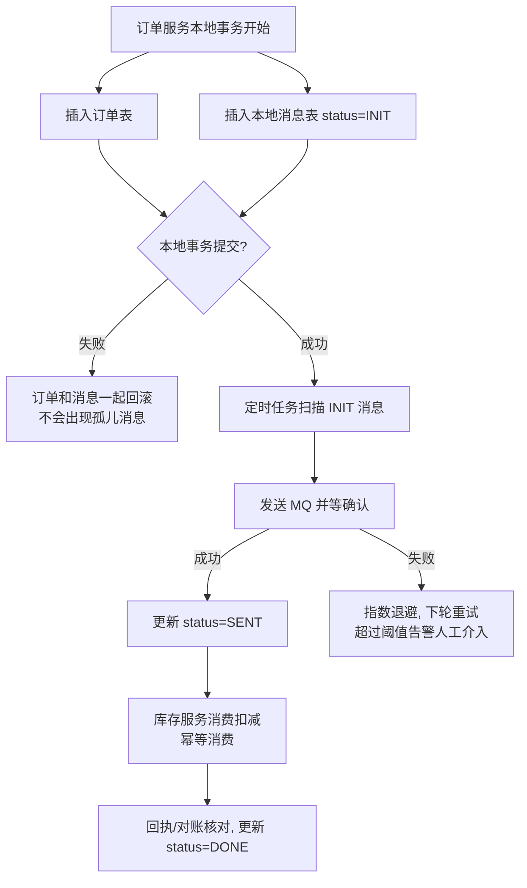
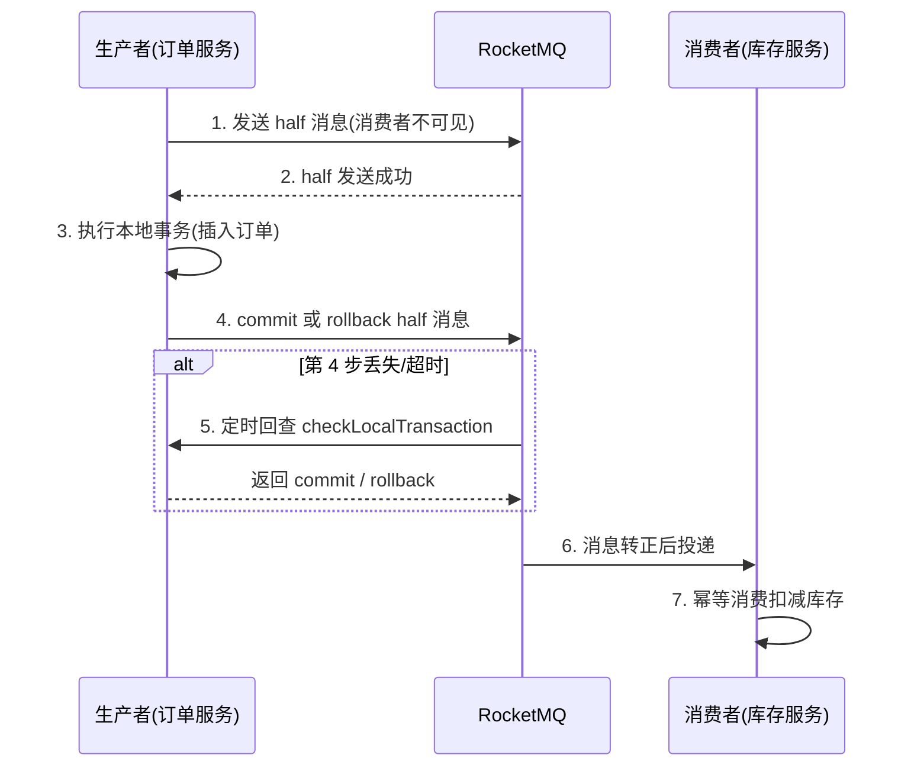
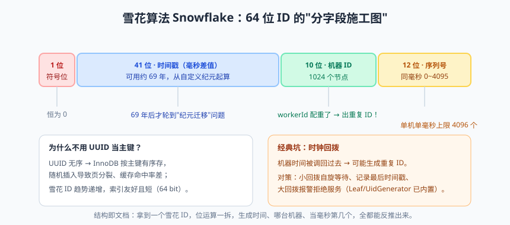
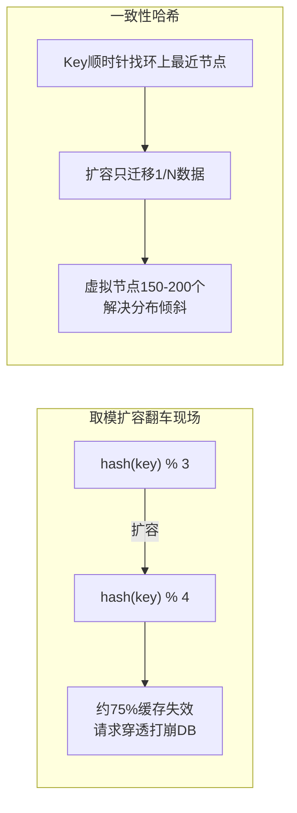

# 分布式疑难杂症门诊

欢迎来到分布式疑难杂症门诊，我是坐诊的老中医……啊不，老架构师。这个门诊部开张十多年，接诊的病人五花八门：有跨服务扣库存扣出负数的，有用户双击鼠标被扣两次款的，有分布式锁把别人锁丢了导致超卖的，还有 UUID 当主键把数据库页分裂到怀疑人生的。他们的共同特点是：本地跑得好好的，一上分布式，全崩了。

为什么？因为单机世界里，数据库事务（Transaction）就像亲妈，把 ACID 照顾得无微不至；一旦服务拆开、库也拆开，亲妈管不过来了，你面对的是一群"各管一段"的继母。网络会抖、消息会重、时钟会飘、机器会挂——分布式系统的所有疑难杂症，本质上都是在跟这四件不可控的事做斗争。

今天这节课就是一张完整的门诊挂号单：理论科（CAP/BASE）、事务科（分布式事务五件套）、幂等科、锁科、ID 科、哈希科。按号就诊，一个一个治。

## 一、挂号处必读：CAP 与 BASE 理论

### CAP："三选二"的真相

CAP 定理说：分布式系统最多同时满足一致性（Consistency）、可用性（Availability）、分区容错性（Partition Tolerance）中的两个。但这个说法有个著名误导——**P 根本没得选**。网络分区（Network Partition）不是选择题，是必然事件：交换机抖一下、机房光纤被挖断、GC 停顿几秒，都算分区。所以真实的选择题只有一个：**分区发生时，你要 C 还是要 A？**

- 选 **CP**：拒绝一部分请求来保数据强一致。典型如 ZooKeeper——少数派节点不可用，整体对外拒绝写入；
- 选 **AP**：保证每个请求都有响应，但可能返回旧数据。典型如 Eureka、Nacos 默认模式——注册中心宁可给你一份稍微过期的服务列表，也不整体瘫痪。

举个人话例子：**转账 vs 余额**。转账扣款（资金操作）通常倾向 C——宁可让你多等一下、甚至拒绝服务，也不能把钱算错；而查询余额页面（展示类操作）倾向 A——给你看昨天的余额也行，总不能页面直接报错。

### BASE：AP 的补丁

既然大多数互联网场景选了 AP，那不一致怎么办？BASE 理论（Basically Available, Soft state, Eventually consistent）就是 AP 的"售后服务条款"：

- **基本可用（Basically Available）**：故障时允许损失部分体验——降级页面、响应变慢、引导排队，但核心功能还在；
- **软状态（Soft State）**：允许数据存在中间状态，比如订单"支付中"——不追求任意时刻两边数据严格一致；
- **最终一致（Eventually Consistent）**：经过一段时间（通常是毫秒到秒级），数据最终会一致。

> 📌 **划重点**：CAP 不是"三选二"的菜单，而是"P 必选，分区发生时在 C 和 A 之间二选一"。BASE 是 AP 的工程化补丁：接受中间态 + 补偿机制，追求最终一致。互联网业务的绝大多数场景，都是"可以用旧数据换可用性"，唯独资金和库存的核心决策点不行——这就是接下来分布式事务科要解决的问题。

## 二、事务科：跨服务下单扣库存，事务怎么保？

先看病历：用户下单，订单服务在订单库插入订单，库存服务在库存库扣减库存。两库两服务，没有数据库事务罩着。订单插成功了，库存扣减调用失败（或超时）——订单存在但库存没扣，超卖或资损就这样诞生了。五种主流治疗方案，先上总对比表：

| 方案 | 一致性 | 业务侵入 | 性能 | 复杂度 | 适用场景 |
|---|---|---|---|---|---|
| 2PC/3PC（XA） | 强一致 | 低 | 差（同步阻塞） | 中 | 传统数据库间、强一致刚需 |
| TCC | 最终一致 | 高（每操作写三方法） | 好 | 高 | 资金类核心链路 |
| 本地消息表 | 最终一致 | 中 | 好 | 低 | 中小团队首选 |
| RocketMQ 事务消息 | 最终一致 | 中 | 好 | 中 | 已用 RocketMQ 的团队 |
| Seata AT | 最终一致 | 极低（一个注解） | 中 | 低 | 快速接入、并发不极端 |

### 方案一：2PC/3PC —— 教科书里的老前辈

两阶段提交（Two-Phase Commit，2PC）：协调者（Coordinator）先问所有参与者"能不能提交？"（Prepare 阶段，各参与者锁住资源并写 undo/redo 日志），全部同意后再统一下达提交命令（Commit 阶段）。它的两个致命伤：**同步阻塞**——Prepare 之后所有参与者抱着锁等命令，性能稀烂；**协调者单点**——协调者在关键时刻挂了，参与者进退两难，只能干等。三阶段提交（3PC）加了 CanCommit 预询问和超时机制，缓解阻塞但依然无法根除不一致。所以互联网高并发场景几乎不用 XA：数据库扛不住那种锁的持有时间。

### 方案二：TCC —— 资金链路的重装铠甲

TCC（Try-Confirm-Cancel）把一个业务动作拆成三个方法：**Try** 检查并预留资源（冻结 100 元额度，而不是真扣）；**Confirm** 确认提交（用冻结额度真扣，必须成功）；**Cancel** 取消预留（解冻）。全部由业务代码实现，框架（如 Seata TCC 模式）只负责调度：

```java
@LocalTCC
public interface InventoryTccAction {

    @TwoPhaseBusinessAction(name = "deductInventory",
            commitMethod = "confirm", rollbackMethod = "cancel")
    boolean tryDeduct(BusinessActionContext ctx,
                      @BusinessActionContextParameter("skuId") Long skuId,
                      @BusinessActionContextParameter("count") Integer count);
    // Try：可用库存 -100，冻结库存 +100，只预留不真正扣

    boolean confirm(BusinessActionContext ctx);
    // Confirm：冻结库存 -100，资源正式落袋，且必须实现成功（失败就一直重试）

    boolean cancel(BusinessActionContext ctx);
    // Cancel：可用库存 +100，冻结库存 -100，释放预留
}
```

TCC 的三座大山，面试和实战都爱考：

- **空回滚**：Try 请求因网络丢失没执行，事务回滚时 Cancel 却先到了。对策：Cancel 时查事务记录表，**没有 Try 记录就直接返回成功**（并补一条"已回滚"标记）；
- **悬挂**：Cancel 先执行完，迟到的 Try 才到达，预留的资源从此没人释放。对策：Try 执行前先查事务记录，**发现"已回滚"标记就拒绝执行**；
- **幂等**：Confirm 和 Cancel 都可能被框架重试多次。对策：记录执行状态，**已执行过直接返回成功**。

### 方案三：本地消息表 —— 最工程化的老实人

思路朴素到感人：**业务数据和待发送消息写在同一个本地事务里**，用数据库事务保证"业务成功则消息必达"。再用定时任务扫表补偿发送。牺牲一点实时性，换来极高的可靠性，中小团队首选。



它的美在于：消息和业务同库同事务，"要么都有、要么都没有"，天衣无缝；缺点是消息表耦合在业务库，且要自己写补偿任务和对账逻辑。

### 方案四：RocketMQ 事务消息 —— 让 MQ 替你写消息表

原理是**半消息（Half Message）+ 本地事务 + 回查**：先发一条对消费者不可见的 half 消息，执行本地事务，再提交或回滚这条消息；如果提交/回滚命令丢了，MQ 会主动回查你的事务状态。



它把"本地消息表"的表和定时任务都内置进了 MQ，业务方只需实现两个回调：执行本地事务、回答回查。代价是绑定 RocketMQ，且回查逻辑要写对。

### 方案五：Seata AT —— 一个注解的"分布式事务"体验

AT（Automatic Transaction）模式对业务**几乎零侵入**，一个注解开启全局事务：

```java
@GlobalTransactional // 开启全局事务，TM 向 TC 注册全局事务
public void createOrder(OrderCreateDTO dto) {
    orderMapper.insert(convert(dto));                        // 订单库：分支事务一
    inventoryClient.deduct(dto.getSkuId(), dto.getCount());  // 库存库：分支事务二
    accountClient.debit(dto.getUserId(), dto.getAmount());   // 账户库：分支事务三
}
```

底层原理三句话讲透：**一阶段**——Seata 的数据源代理拦截业务 SQL，解析出修改前后的数据镜像，生成 undo_log 与业务数据在**同一个本地事务里提交**，然后向事务协调器（TC）注册分支并申请**全局锁**，一阶段结束本地锁即释放，性能远好于 XA；**二阶段提交**——异步批量删除 undo_log，几乎零开销；**二阶段回滚**——用 undo_log 里的前镜像生成反向 SQL 补偿回去，全局锁保证回滚期间没人改这笔数据。

> ⚠️ **踩坑实录**：某团队给一个高频下单链路无脑上 Seata AT，大促时全局锁竞争激烈，大量事务在等锁中超时回滚，吞吐量反而腰斩。AT 的全局锁决定了它适合并发不极端的场景；秒杀级别的热点扣减，请上 TCC 或 Redis 预扣 + 异步落库。

### 选型建议：三维评估

一致性要求（资金强一致 → TCC；普通业务最终一致即可）、侵入性（老系统改不动 → Seata AT；新核心链路愿投入 → TCC）、性能（超高并发 → MQ 异步化 + 幂等消费）。绝大多数业务，**本地消息表 / 事务消息 + 幂等消费**就是性价比之王。

## 三、幂等科：分布式系统的保命符

为什么分布式离不开幂等（Idempotency）？因为**重试无处不在**：调用超时了要重试、MQ 保证 at-least-once 语义必然重投、用户手快双击提交按钮、前端框架自带重发。在单机里有事务兜底，分布式里"执行两次"没人兜底——不幂等，就等着重复扣款、超卖、重复发货上门挨骂。

| 方案 | 原理 | 典型场景 |
|---|---|---|
| 唯一索引 | 数据库约束兜底，重复插入直接报错 | 注册、消息消费记录 |
| Token 预取 | 进入页面前先领 token，提交时原子删除 | 表单防重复提交 |
| 状态机 | 只允许合法状态单向流转 | 订单状态流转 |
| 乐观锁 | version 号 / 条件更新 | 余额、库存扣减 |
| 去重表 | 唯一业务键先插去重表再处理 | MQ 消费去重 |

```java
// 状态机幂等：只允许"待支付 -> 已支付"，重复请求影响行数为 0
int rows = orderMapper.updateStatus(orderId, OrderStatus.PAID, OrderStatus.WAIT_PAY);
if (rows == 0) {
    log.info("订单 {} 状态未推进，判定为重复请求，幂等返回成功", orderId);
    return; // 直接返回成功，让上游安心停止重试
}
```

```sql
-- 唯一索引兜底：同一个消息 ID 只能插入一次，重复消费直接撞约束
ALTER TABLE mq_consume_record ADD UNIQUE KEY uk_msg_id (msg_id);
```

> 💡 **老鸟忠告**：幂等键的选择比方案本身更重要。用"业务语义键"（订单号 + 操作类型），别用数据库自增 ID；查询接口天然幂等可以不管，**所有写操作上线前先问一句"这个接口被执行两次会怎样？"** 答不上来的，先补幂等再上线。

## 四、锁科：分布式锁深水区

单机的 `synchronized` 出了进程就失效，多实例共享资源的互斥要靠分布式锁。主流方案横向对比：

| 实现 | 性能 | 可靠性 | 备注 |
|---|---|---|---|
| Redis SET NX | 高 | 单主模式有丢锁风险 | 主从异步复制，主挂锁丢 |
| Redisson | 高 | 看门狗续期，生产默认 | 锁可重入、支持红锁（有争议） |
| RedLock | 中 | 学术界有争议 | Martin Kleppmann 与 antirez 的著名论战 |
| ZooKeeper | 中 | 高 | 临时顺序节点 + Watch 通知 |
| ETCD | 中 | 高 | K8s 生态同款，Raft 保证 |

原生 Redis 锁的写法与风险：

```java
// 原子地"加锁 + 设置过期"，value 存唯一标识用于安全解锁
String result = jedis.set(lockKey, requestId, SetParams.setParams().nx().ex(30));
if (!"OK".equals(result)) {
    return false; // 没抢到锁
}
```

两个坑：**锁过期但业务没跑完**（别的线程拿到锁，并发就穿了）；**解锁解了别人的锁**（必须用 Lua 脚本校验 value 再删）。Redisson 一站式解决，看门狗（Watchdog）机制尤其优雅：

```java
RLock lock = redissonClient.getLock("seckill:sku:" + skuId);
lock.lock(); // 不传超时时间 -> 看门狗默认 30s，后台每 1/3 时间自动续期
try {
    deductStock(skuId); // 业务执行期间，锁不会因过期被别人抢走
} finally {
    lock.unlock(); // Lua 校验持有者身份后再释放，只解自己的锁
}
```

RedLock 争议一段话讲清：它向多个独立 Redis 节点依次加锁、过半成功才算成功，试图解决单点丢锁。但分布式系统学者 Martin Kleppmann 指出它依赖各节点时钟近似同步，时钟跳变时仍可能出错；Redis 作者 antirez 反驳时钟问题可控。工程界的共识是：**极端正确性场景（资金结算互斥）别赌 Redis，用 ZooKeeper**。ZK 的临时顺序节点方案：所有人排队，每个 watcher 只盯**前面一个人**，前面释放再唤醒自己——既避免羊群效应（Herd Effect，一个释放惊醒全部等待者），又天然实现公平锁，会话断开锁自动释放。

> 📌 **划重点**：选型口诀——**性能优先用 Redis（Redisson），正确性优先用 ZooKeeper**。以及一句被血泪反复验证的话：先问"加锁是否必要？"很多并发问题用数据库乐观锁、唯一约束就能优雅解决，分布式锁是最后手段，不是第一反应。

## 五、ID 科：分布式 ID 生成


> 🖼️ **图解**：雪花算法 64 位分字段结构与时钟回拨之坑

为什么 UUID 不能当主键？两个硬伤：**无序**——InnoDB 主键是聚簇索引，插入乱序会导致页分裂（Page Split），写入性能持续劣化；**太长**——36 个字符占空间，二级索引还要冗余主键，存储成本翻倍。自增主键在分库分表后又撞墙：多个库各自从 1 开始，主键必然冲突。

方案一是**数据库号段（Segment）模式**：用一张表存 `biz_tag, max_id, step`，每次取一个号段（比如 1000 个）缓存到应用内存发号，用完再取。美团的 Leaf-segment 在此基础上加了双 Buffer 预加载，取号段时异步准备下一个，数据库短暂抖动也不影响发号。

方案二是**雪花算法（Snowflake）**，结构逐位拆解：

```
| 1 bit |      41 bit       |     10 bit      |    12 bit    |
| 符号位 |    毫秒时间戳      |     机器 ID      |    序列号     |
| 恒为 0 | 相对起始纪元可撑69年 | 常拆 5位机房+5位机器 | 每毫秒4096个 |
```

- 41 bit 时间戳：毫秒级，相对自定义纪元，够用 69 年；
- 10 bit 机器号：可标识 1024 个节点，业界常拆成 5 bit 机房 + 5 bit 机器；
- 12 bit 序列号：同一毫秒同一机器可发 4096 个，单机理论 400 万+/秒。

趋势递增、不依赖数据库、性能极高，但有个著名隐患——**时钟回拨（Clock Rollback）**：NTP 校时把系统时间往回调，生成的 ID 可能与之前重复。工程对策：回拨小于阈值就自旋等待追平；超过阈值直接拒绝发号并告警；或预留"未来时间片"垫高时间戳。开源方案一段带过：百度 UidGenerator 用 RingBuffer 预生成 + 填充时间戳尾部，规避实时依赖时钟；美团 Leaf 同时提供 Leaf-segment（号段）与 Leaf-snowflake（ZK 分配机器号 + 时钟监控）两把武器，国内落地的常客。

## 六、哈希科：一致性哈希

缓存分片为什么需要一致性哈希（Consistent Hashing）？看朴素方案的翻车现场：3 台缓存机器，路由规则 `hash(key) % 3`。扩容到 4 台变成 `% 4`——约 75% 的 key 映射到了新节点，缓存瞬间大面积失效，请求洪峰全部穿透到数据库，这就是**扩容雪崩**。

一致性哈希的解法：把哈希空间首尾相连成一个 **2^32 的哈希环**，服务器和 key 都 hash 到环上，key 顺时针找到的第一台服务器就是归属节点。扩一台新机器，只有它落在环上那一小段区间的 key 需要迁移——理论上只影响 `1/N` 的数据。但节点少的时候，环上分布严重不均（某台机器吃掉 80% 流量的"倾斜"），解法是**虚拟节点（Virtual Node）**：每台物理节点在环上打散出 150~200 个虚拟节点，让分布均匀到可以放心用。



> ⚠️ **踩坑实录**：某团队缓存集群用简单取模，双十一前紧急扩容一倍缓存节点，结果键大面积换节点，命中率从 98% 直接掉到 30%，穿透流量把 MySQL 打出了连接池耗尽——扩容扩出了生产事故。缓存的扩缩容，要么用一致性哈希客户端，要么低峰期小步慢跑 + 预热。

## 七、医嘱：分布式问题的通用思维

门诊看到这，你有没有发现一个规律？所有方案都在做同一件事：**承认失败随时会发生，然后设计好失败之后的路**。重试会带来重复，所以要幂等；分区会带来不一致，所以要有补偿；时钟会回拨，所以要有拒绝发号的兜底；节点会挂，所以锁要有看门狗和会话清理。

> 💡 **老鸟忠告**：分布式的通用心法就八个字——**宁可丑而稳，不要美而险**。方案评审时，少问"这个设计多优雅"，多问三句：超时了怎么办？重试了怎么办？挂了怎么办？三个问题都有答案的设计，才是能上生产的设计。

## 本篇小结

- CAP 真相：P 必选，分区发生时在 C 与 A 之间取舍；BASE 是 AP 的工程化补丁（基本可用/软状态/最终一致）；
- 分布式事务五件套各有定位：2PC 强一致但阻塞、TCC 资金级但侵入高、本地消息表最工程化、RocketMQ 事务消息免建表、Seata AT 零侵入但全局锁限并发；
- TCC 三大坑：空回滚、悬挂、幂等，对策全部围绕"事务记录表"展开；
- 幂等是分布式保命符：唯一索引/Token/状态机/乐观锁/去重表按场景选型；
- 分布式锁：性能优先 Redisson（看门狗续期），正确性优先 ZK（临时顺序节点 + Watch）；
- 分布式 ID：UUID 无序且长不能做主键；雪花算法 41+10+12 逐位可拆，警惕时钟回拨；Leaf/UidGenerator 是成熟开源解；
- 一致性哈希 + 虚拟节点解决取模扩容的缓存雪崩；
- 通用思维：为失败而设计——超时、重试、宕机三问。

## 课后思考 & 动手练习

1. 注册中心、订单库、购物车缓存，这三个系统你分别会倾向 CP 还是 AP？说出各自的取舍理由。
2. TCC 的"空回滚"和"悬挂"是一对孪生坑，请用自己的话解释它们发生的完整时序，并说明为什么"一张事务记录表"能同时治这两个病。
3. 雪花算法如果两台机器被手工配置了相同的机器 ID（workerId），会发生什么？如何从制度和技术两个层面避免？
4. **动手实践**：用 Spring Boot + Seata AT 搭一个"下单-扣库存"双服务 Demo，故意在库存服务里抛出异常，观察订单数据是否被全局回滚；再打开 `undo_log` 表，看看里面存的前后镜像长什么样。
5. 思考题：既然 MQ 天然 at-least-once，那"事务消息 + 幂等消费"和"本地消息表 + 幂等消费"在极端场景（生产者发送 commit 命令前宕机）下的行为有何异同？

下一篇预告：分布式这一关过完，你的系统总算能"活着"了，但"活着"和"活得滋润"是两回事——慢 SQL 十秒、接口 P99 飙红、JVM 频繁 Full GC 怎么破？下一篇《性能优化方法论：从慢 SQL 到全链路》，带你把系统从"能跑"调到"能打"。
