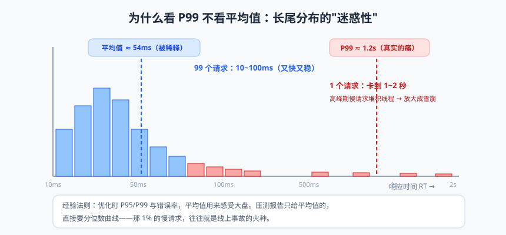
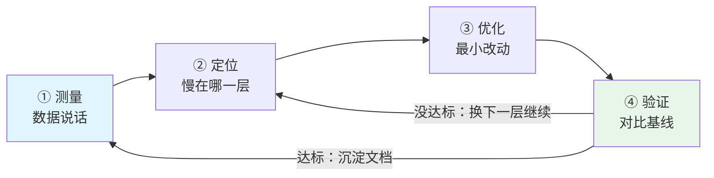
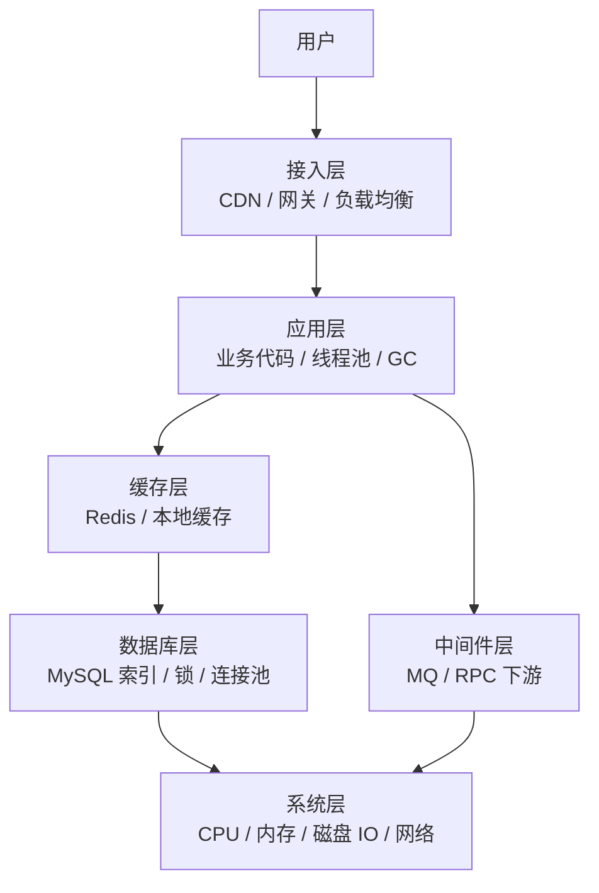

# 性能优化方法论：从慢 SQL 到全链路

先立个案。某电商下单接口，P99 从 800ms 涨到 2 秒，运营要炸，老板要疯。团队里的小 A 提议："咱们换个新框架吧！"小 B 说："上 Kubernetes 弹性扩容！"老 C 默默打开监控看了十分钟，说了三个字："慢 SQL。"

一小时后问题定位：一次订单列表查询没走索引，全表扫描 40 万行。加了个联合索引，P99 回到 300ms。框架没换，机器没加，一行 DDL 解决战斗。

这个故事是性能优化世界的缩影：**大多数性能问题不是技术不够新，而是不知道慢在哪。** 这篇讲的是方法论——一套"无论什么系统都能套用"的排查与优化流程，外加各层的实战清单和一个完整的案例复盘。

---

## 一、优化的三大前提


> 🖼️ **图解**：长尾分布：平均值被稀释，P99 才是用户真实的痛

### 前提一：先定义"慢"——没有指标就没有优化

| 指标 | 含义 | 关键点 |
|------|------|--------|
| RT（Response Time） | 响应时间 | **看 P95/P99 而不是平均值**：平均值会被少量快请求稀释，而用户抱怨的恰恰是那 1% 的慢请求 |
| QPS / TPS | 每秒查询/事务数 | 吞吐量，压测的核心产出 |
| 并发数 | 同时活跃的请求数 | Little 定律：并发数 ≈ QPS × 平均 RT |
| 错误率 | 失败请求占比 | 性能优化常常顺手把错误率也治了 |

**为什么 P99 比 RT 平均值重要？** 平均 RT 50ms 的接口，P99 可能是 2 秒——100 个用户里有 1 个在忍受 2 秒。而根据经验，P99 慢的接口在流量高峰时会像雪崩一样放大（慢→线程堆积→更慢）。

### 前提二：要有基线（Baseline）

"优化后快了 30%"——快了 30% 是从多少到多少？没有优化前的测量数据，一切"感觉变快了"都是玄学。**动手改任何东西之前，先记录当前指标**：压测一遍、留档曲线、保存 GC 日志。

### 前提三：优化的黄金闭环



> 📌 **划重点**：**测量驱动，而不是直觉驱动**。"我觉得是 GC 的问题"和"数据显示 70% 时间耗在 SQL 上"，是业余和专业的分水岭。还有一条纪律：**一次只改一个变量**——同时改三个地方，指标变好了你也不知道是谁的功劳，变坏了更懵。

---

## 二、分层排查地图：慢可能在哪一层

一次请求的完整旅程，每一层都可能是凶手：



**排查顺序有讲究：从外到内、从上游到下游。** 先看监控大盘定层（网关耗时 vs 服务耗时 vs DB 耗时，谁占了 RT 的大头），再进层细查。链路追踪（SkyWalking/OpenTelemetry）是定层神器：一次请求的瀑布图直接显示每段耗时。

| 层 | 典型症状 | 定位工具 |
|----|---------|---------|
| 网关/接入 | 全部接口慢、静态资源慢 | CDN 命中率、网关日志 |
| 应用层 | 个别接口慢、线程池打满 | Arthas trace、jstack、链路追踪 |
| 数据库 | 慢查询日志暴增、连接池等待 | 慢日志、explain、连接池监控 |
| 缓存 | 命中率下跌、大 Key 卡顿 | redis 监控、--bigkeys |
| 系统层 | CPU/IO 饱和、网络重传 | top、iostat、sar |

---

## 三、压测：主动制造"案发现场"

被动等生产出事再排查，不如主动压出瓶颈。JMeter 快速上手：

```bash
# ① 新建线程组：模拟 50 并发、持续 3 分钟、1 秒内均匀拉起（Ramp-up=1）
# ② 加 HTTP 采样器：GET http://host:8080/api/books?page=1&size=10
# ③ 加聚合报告监听器，跑完看核心数据
```

聚合报告读法（重点列）：

| 列 | 含义 | 健康信号 |
|----|------|---------|
| Average / Median / 99% Line | 平均/中位/P99 耗时 | P99 是否达标 |
| Throughput | QPS | 是否随并发线性上涨（涨不动=到瓶颈了） |
| Error % | 错误率 | 压出 5xx 常是线程池/连接池满 |

**压测三板斧姿势**：基准压测（单接口摸底）→ 阶梯压测（并发 10→50→100，找吞吐拐点）→ 稳定性压测（中等负载跑 4 小时，抓内存泄漏、连接泄漏这类慢性病）。**压测环境数据量要贴近生产**——10 条数据的压测报告毫无意义（实践篇建的那 10 万条测试数据就是为这准备的）。命令行党用 `wrk -t8 -c200 -d60s http://host/api` 更轻快。

---

## 四、各层优化清单

### 4.1 数据库层（80% 的问题在这）

- **慢 SQL 定位与 explain**：实践篇讲透的四板斧（慢日志→explain→索引→改写），这是数据库优化的全部入口；
- **索引清单**：联合索引最左前缀、覆盖索引避免回表、避开索引失效十大场景（函数包裹/隐式转换/前导模糊…）；
- **深分页**：延迟关联或游标（`WHERE id > lastId`）；
- **锁与事务**：事务尽量短（别在 @Transactional 里调 RPC）、批量操作分批、热点行更新合并（攒批更新）；
- **连接池**：maximum-pool-size 按公式（核数×2~4）与压测共同定，监控 active/pending。

### 4.2 缓存层

- 命中率是命根子（>90% 及格），未命中率突增先查 TTL 策略与 key 设计；
- 大 Key（value >10KB）拆分、热 Key 本地缓存（Caffeine）挡一层；
- 三大问题防护（穿透/击穿/雪崩）与一致性方案——实践篇 Redis 篇的完整地图。

### 4.3 应用层

- **线程模型**：Tomcat 线程打满的表现是"请求排队 RT 上涨但 CPU 不高"——上游慢操作（同步调第三方、大文件）占着线程不放。解法：超时收紧 + 异步化 + 熔断降级；
- **同步转异步**：非主流程操作（短信/积分/日志）走 MQ（实践篇 Async/MQ 的地图）；
- **批量化**：N+1 查询（循环里查库）合并为一次 IN 查询或 JOIN；循环调下游接口改为批量接口；
- **池化复用**：对象复用、连接复用；避免大对象频繁创建（序列化结果缓存）；
- **JVM 层**：Young GC 频繁（Eden 偏小或流量激增）、Full GC 卡顿（内存泄漏/大对象/元空间）——进阶篇 JVM 调优的完整工具箱（jstat/jmap/Arthas/MAT）。

### 4.4 接入层与架构层

- 静态资源 CDN、Gzip/Brotli 压缩、HTTP keep-alive 连接复用；
- 读多写少加缓存、写多读少削峰（MQ）、超大表分库分表（垂直拆业务/水平拆数据）；
- **升级硬件永远是最后一张牌**——它是"用钱买时间"，问题没找到，加机器只是推迟爆炸时间。

> 💡 **老鸟忠告**：两个优化界的经典误区。**误区一"过度优化"**：给 QPS 只有 10 的内部系统做毫秒级极致优化，优化的是寂寞（维护成本远大于收益）。**误区二"错把量级当问题"**：接口慢就怀疑 Java 慢、想换语言——99% 的情况是你的代码和 SQL 慢，不是语言慢。

---

## 五、全链路追踪：慢在哪一环，一眼看穿

单机时代看日志排障，微服务时代必须有**分布式链路追踪（Distributed Tracing）**。核心概念：

- **Trace**：一次完整请求的全链路（贯穿所有服务）；
- **Span**：链路中的一段工作（一次 RPC、一次 SQL），带开始/结束时间；
- Span 之间父子关系构成瀑布图：**每个服务的每段耗时一目了然**。

```xml
<!-- SkyWalking Java Agent 接入：不改一行代码，加个启动参数 -->
<dependency>
    <groupId>org.apache.skywalking</groupId>
    <artifactId>apm-toolkit-trace</artifactId>
    <scope>provided</scope>
</dependency>
```

```bash
java -javaagent:/path/skywalking-agent.jar \
     -Dskywalking.agent.service_name=library-app \
     -Dskywalking.collector.backend_service=oap:11800 \
     -jar app.jar
```

实践篇手写的 TraceId+MDC 是链路追踪的"民间版"，SkyWalking 是"正规军"：自动埋点（HTTP/MySQL/Redis/MQ 全覆盖）、拓扑图、慢接口下钻。OpenTelemetry 是厂商中立的标准（想换后端不用改代码），新项目建议直接 OTel。

---

## 六、案例复盘：下单接口从 2s 到 200ms

完整走一遍黄金闭环，感受方法论的威力（真实项目简化版，指标为压测环境数据）：

**背景**：下单接口 P99 = 2s，目标 < 500ms。基线：压测 QPS 50，平均 RT 1.2s。

**第一轮定位（测量→定层）**：链路追踪瀑布图显示：创建订单 60ms + **查询用户优惠券 900ms** + **查询商品信息 600ms** + 计算价格 100ms + 落库 140ms。——凶手两个下游查询。

**第一轮优化（缓存）**：商品信息读多写少 → 加 Redis 缓存（TTL 10 分钟 + 随机），优惠券查询改走本地库冗余表（活动开始前同步）。**P99 降到 700ms。**

**第二轮定位**：剩下的 700ms 里，链路显示"计算价格"段 300ms。Arthas `trace` 下钻：价格计算里有 8 次串行的促销规则查询（N+1）。

**第二轮优化（批量化 + 并行）**：促销规则一次性 IN 查询加载；两段无依赖的校验用 CompletableFuture 并行。**P99 降到 400ms。**

**第三轮定位**：GC 日志显示 Young GC 每 2 秒一次、单次 40ms，偶发 Full GC 200ms。jmap 发现大量订单临时对象晋升老年代（Survivor 太小）。

**第三轮优化（JVM）**：`-Xmn` 调大新生代 + 对象预分配复用。**P99 稳定在 380ms，Full GC 消失。**

**第四轮（兜底架构）**：短信通知从同步调用改 MQ 异步（这步其实影响的是"下单成功"的返回速度感知）+ 对下游加 500ms 超时与降级开关。**最终 P99 = 260ms，达标收工。**

复盘要点：**四轮优化用了四种武器（缓存、批量化并行、JVM、异步化），每一轮都先测量再动手，每轮结束都对比基线**。没有任何一轮是"拍脑袋换框架"。

> ⚠️ **踩坑实录**：第一轮优化后曾出现"缓存与库存不同步"的短暂超卖——教训：**性能优化的每一步都要重新过一遍正确性**（并发、一致性），别把系统优化快了，但优化错了。

---

## 七、性能优化 CheckList（打印贴墙版）

- [ ] 有 P95/P99 指标与告警吗？（没有指标先补指标，别谈优化）
- [ ] 有基线数据吗？（优化前压测留档）
- [ ] 链路追踪能看到每段耗时吗？（定层神器）
- [ ] 慢 SQL 日志开启并定期治理吗？
- [ ] 高频读路径有缓存吗？命中率多少？
- [ ] 有 N+1 查询、循环远程调用吗？（链路图上密集小格是信号）
- [ ] 下游调用都有超时 + 降级吗？（防雪崩的保命锁）
- [ ] 线程池/连接池有监控、参数有依据吗？
- [ ] GC 频率与停顿正常吗？（Young GC 频繁/Full GC 出现都要查）
- [ ] 一次只改一个变量，改完对比基线验证了吗？

---

## 本篇小结

- 性能优化三前提：定义慢（看 P99 不是平均值）、有基线、测量驱动的黄金闭环（测量→定位→优化→验证）；
- 排查按层推进：网关→应用→缓存/DB/中间件→系统，链路追踪定层，Arthas/explain 入层；
- 压测三板斧：基准、阶梯（找拐点）、稳定性（抓慢性病），数据量要贴近生产；
- 80% 的问题在数据库（慢 SQL 四板斧）；应用层三招：异步化、批量化、池化；加机器是最后一张牌；
- 全链路追踪：Trace/Span 瀑布图一眼定位慢环节，SkyWalking 无侵入接入，新项目上 OpenTelemetry；
- 案例复盘心法：每一轮先测量再动手、只改一个变量、每轮验证、最后回归正确性。

## 课后思考 & 动手练习

1. （概念）为什么性能指标看 P99 而不是平均 RT？用"100 个请求里 99 个 10ms、1 个 2s"算给平均值的迷惑性。
2. （概念）"Tomcat 线程打满但 CPU 不高"和"CPU 100%"分别指向什么类型的问题？
3. （动手）给图书系统的列表接口做一次完整压测：阶梯加并发（10/50/100），记录 QPS 与 P99 拐点，画出吞吐曲线，判断瓶颈大概率在哪一层；
4. （动手）给详情接口加 Redis 缓存前后各压一轮，对比 P99 与数据库 QPS；再用链路视角（Arthas trace）看一次未命中时的完整调用栈；
5. （动手·进阶）完整复刻本文案例的思路：给自己的"借书"接口做四轮优化（查询批量化 → 缓存 → 并行化 → 异步通知），每轮记录基线与结果，写一份 500 字的优化复盘报告——这份报告比优化本身更有价值，它是你简历上"性能优化"四个字的底气。

> 下一篇预告（也是全系列最后一篇）：《从码农到专家：Java 工程师成长指南》——技术讲完了，聊聊人：四阶段成长地图、源码阅读方法论、面试心法、35 岁焦虑的解药。最后一杯咖啡，咱们慢慢喝。
