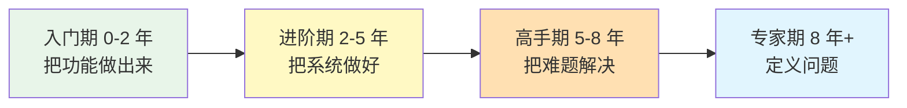
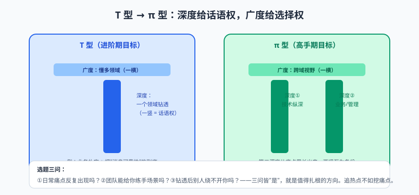

# 从码农到专家：Java 工程师成长指南

全系列最后一篇，不聊技术，聊人。

先来一个灵魂拷问：**工作五年，你的经验是"五年"，还是"一年经验重复用了五年"？** 前者五年后是团队顶梁柱，后者五年后正在被新人卷、被 AI 卷、深夜刷着"35 岁程序员去哪了"焦虑失眠。区别不在智商，不在运气，而在**成长的路径是不是有意识的**。

这篇是这个系列的"毕业典礼"，也是一份成长地图：四阶段怎么看、深度广度怎么配、源码怎么读、面试怎么打、焦虑怎么破。全是我在培训行业十余年，看着几千个学员起起落落后沉淀的话。有点长，泡杯咖啡，慢慢看。

---

## 一、四阶段成长地图



| 阶段 | 核心目标 | 关键能力 | 最常见瓶颈 | 突破建议 |
|------|---------|---------|-----------|---------|
| 入门期<br/>0-2 年 | 功能实现 | 语法熟练、CRUD、会用框架、会查报错 | "只会照着做，不知道为什么" | 系列基础+进阶篇的系统学习；每个"会用"的技术问三个为什么 |
| 进阶期<br/>2-5 年 | 质量与效率 | 原理（JVM/并发/Spring）、稳定性意识、测试与监控、带小模块 | "业务代码写了好几年，感觉在重复" | 啃透 1~2 个组件的原理与源码；主导一次性能优化或故障复盘 |
| 高手期<br/>5-8 年 | 攻坚与设计 | 疑杂症排查（线上问题秒级定位）、架构设计权衡、技术方案评审、带人 | "技术到了天花板，管理又不想做" | 从"实现者"转"决策者"：方案设计练习、跨团队项目、建立技术影响力 |
| 专家期<br/>8 年+ | 定义问题 | 技术战略、团队赋能、行业影响力（分享/开源/专利） | "高处不胜寒，方向选择压力巨大" | 找到自己的"标签"（某领域公认的 go-to person）；影响力输出成习惯 |

**三个阶段的醒悟**（对号入座）：

- 入门期的醒悟：原来"代码能跑"和"代码能维护"是两回事——本系列实践篇讲的全是后者；
- 进阶期的醒悟：原来框架不是黑魔法，IoC/AOP/自动配置不过如此——原理篇祛魅之后，你看任何新技术都是"套路重演"；
- 高手期的醒悟：原来最难的不是技术，是**权衡**——CAP 取舍、一致性成本、复杂度预算，每个方案都是在"多个都不完美的选项里挑一个最不坏的"。

---

## 二、深度与广度：T 型 → π 型


> 🖼️ **图解**：T 型→π 型：先扎一竖，再长第二竖

**先深后广，深度给你话语权，广度给你选择权。**

只广不深（每样都会一点，样样三脚猫）的工程师，讨论方案时永远说不出"这个方案在 X 场景下会崩"；只深不广（某一点世界级，出了这点寸步难行）的工程师，视野受限，容易把铁锤当万能工具。

**怎么选深入的方向？从你日常工作的痛点里挖，别追热点。** 比如你天天写 MQ 消费者，那就把"消息可靠性 + 幂等"这条线吃透：读 RocketMQ 消费者源码、搞清重试与死信机制、写一套幂等框架组件——半年后，你就是团队里这块的"权威"。**热点（今年的 AI、明年的某某）会过时，痛点不会。**

> ⚠️ **踩坑实录**：成长路上最大的坑是"虚假的深耕"——在一家公司用同一种姿势写了五年的 CRUD，把"熟练"错当"深度"。自查标准很简单：**这一年你有没有写过一篇让同事"哇"的技术方案？有没有定位过一次没人能定位的线上问题？** 如果连续两年的答案都是"没有"，你不是在深耕，是在原地打转。别慌，出路就是这一节说的：挑一个痛点，钻下去。

> 📌 **划重点**：深度的一个隐性收益：**一个领域钻到底的人，第二个领域上手极快**——因为你有了一整套"怎么搞懂一个复杂系统"的元能力。这也是为什么本系列逼你读源码、写手写 Demo：练的不是 HashMap，是"拆解复杂系统"这块肌肉。


---

## 三、源码阅读方法论

读源码是进阶期性价比最高的投资，但 90% 的人读法是错的：从第一个类开始逐行读，三天后卒。正确姿势五条：

**① 功利性读码：带着问题去。** "HashMap 扩容时元素怎么迁移？""@Transactional 为什么同类调用失效？"——带着明确问题，答案往往就几十行代码，读完即走。

**② 先抓主线，再扣细节。** 先画主干流程图（比如 Spring refresh 的十二步、线程池 execute 的判断链），主线上每个环节干什么搞清楚，细节（边界处理、异常分支）按需再看。

**③ 断点 + 画图 + 写博客三件套。** 光看不跑等于没读：断点跟一遍真实执行路径；随手画时序图（画不出来的地方就是你没懂的地方）；读完后写篇博客——**能讲清楚才算读懂**（费曼学习法）。

**④ 一条推荐路线**（本系列知识点的源码版）：

```
ArrayList/HashMap（热身，练习读"数据结构+扩容"）
→ 线程池 ThreadPoolExecutor（练习读"状态机+队列"）
→ ReentrantLock/AQS（练习读"框架设计+模板方法"）
→ Spring：refresh() → Bean 生命周期 → 三级缓存（练习读"大流程"）
→ Spring Boot：SpringApplication.run + 自动配置（练习"体系化阅读"）
```

**⑤ 别通读。** 一个成熟框架几十万行代码，其中一半是边缘场景兼容和注释。通读就像为了认识一个城市把每条巷子都走一遍——你需要的是地图，不是脚印。

> 💡 **老鸟忠告**：读源码最大的敌人是"挫败感"。读不懂不是你菜，是缺前置知识——卡住了就退一层补基础（比如读 AQS 卡住，先回去把 CAS、模板方法模式搞熟），再回来豁然开朗。本系列每篇的"原理"部分，就是在给你铺这些前置台阶。

---

## 四、知识体系：把碎片砌成墙

公众号、短视频、掘金热榜……信息过载时代，最大的陷阱是**"收藏 = 学会"的错觉**。三个对抗武器：

**① 费曼输出法**：任何知识，用自己的话（不带术语）讲给一个外行听，讲不下去的地方就是没懂的地方。每学完本系列一篇，写 100 字总结——这个系列每篇末尾的思考题就是为这个设计的。

**② 主题式学习，而非碎片式吸收**：与其收藏 50 篇"Redis 技巧"，不如系统过一遍"Redis 专题"（数据结构 → 持久化 → 主从集群 → 缓存三大问题 → 分布式锁），碎片文章只做查漏补缺。

**③ 双链笔记**：用 Obsidian 之类工具，把知识点连成网（"ThreadLocal → 内存泄漏 → 弱引用 → GC 可达性"）。孤立的知识会忘，连成网的知识互相拉扯着就记住了。**每月一篇技术博客**是复利起点——三年后你的博客就是你最好的简历。

---

## 五、软技能：被严重低估的另一半

技术能力决定下限，软技能决定上限。三件最值钱的软技能：

**① 把技术方案讲给产品听的能力。** "这个要做最终一致性，因为强一致的同步锁会把下单 TPS 从 500 打到 80" vs "这个技术上做不了"——前者让产品经理觉得你在帮他解决问题，后者让他下次绕开你。沟通的本质是**翻译**：把技术权衡翻译成业务影响。

**② 文档能力。** 设计文档（为什么这么做、放弃了什么方案）、故障复盘（时间线、根因、Action Items）、接口文档。好文档是"未来的你"和"队友"的最大善意。

**③ 向上管理与跨团队协作。** 定期同步进展（别等老板来问）、风险提前暴露（坏消息越早说越便宜）、学会说"这个需求我可以做，但需要砍掉那两个小需求"（用优先级谈判代替硬扛或硬接）。

---

## 六、面试心法

**关于八股文**：辩证看。背题不理解的，面试官三个追问就现形；但**基础不牢的人连被追问的资格都没有**。八股是必要的，但正确用法是"以题带面"——把每个高频题（HashMap 原理、JVM 分代、@Transactional 失效）当成知识树的根，把整个体系带出来。

**项目介绍 STAR 法则**：Situation（背景：业务量级、技术栈）→ Task（你负责什么）→ Action（关键决策与取舍，**这是灵魂**）→ Result（量化结果：P99 从 2s 降到 300ms、故障率下降 70%）。没有量化的项目描述像白开水："我做了订单模块"——面试官心里：哦，然后呢。

**加分三连**：① 讲得出"为什么不用 B 方案"（体现权衡）；② 讲得出踩过的坑和复盘（体现真实经历）；③ 反问环节问团队技术挑战/成长路径（体现你在选择团队，而不只是被选择）。

**被问倒时**：诚实 + 展示思维路径。"这块我没深入研究过，但基于我对 X 的理解，我猜测可能是……回去我会验证一下"——比硬编值钱一百倍。

---

## 七、职业路线与 35 岁焦虑

三条路（没有高低，只有适配）：

| 路线 | 日常 | 适配人格 |
|------|------|---------|
| 技术专家线 | 攻关疑难、架构设计、技术选型、带技术团队 | 热爱技术本身，享受深度 |
| 管理线 | 目标拆解、人员培养、资源协调、向上汇报 | 对"人"和"事"都有兴趣，能接受写代码变少 |
| 独立/自由职业 | 接项目、做产品、咨询、培训 | 自驱力极强、能扛不确定性 |

**关于 35 岁焦虑**，说三句大实话：

1. **焦虑的根源不是年龄，是"可替代性"**。不可替代性 ≈ 解决问题的稀缺度 × 领域理解深度 × 信任资产。前两项靠积累，第三项（同事和业务方"有事先找他"的信任）靠长期的靠谱交付——它恰恰是最复利的东西；
2. **AI 不会淘汰工程师，会淘汰"只会照着做"的工程师**。工具越强，"定义问题、做权衡、担责任"的部分越值钱——这些恰恰是这篇讲的成长方向；
3. **对抗焦虑最好的方式是把今天的功课做掉**。职业是长跑，节奏乱的人（一会儿追热点、一会儿躺平）最累。找到自己的节奏，跑自己的配速。

---

## 八、终身学习的操作系统

最后送一套"学习 OS"：

**信息源分级**（信任度从高到低）：官方文档 > 经典书 > 源码 > 高质量博客/会议分享 > 教程视频 > 碎片文章。重大技术决策往上靠，日常查漏往下用。

**精力管理**：每天保证 1~1.5 小时"高质量学习时间"（比周末狂学 8 小时更有效——记忆的巩固靠的是重复，不是时长）。困了别硬撑，睡一觉起来看，往往就会了（大脑在睡眠里整理记忆，这是认知科学，不是玄学）。

**把学习当工程做**：目标（三个月吃透 Redis）→ 拆解（每周一个主题）→ 产出（四篇博客 + 一个 Demo）→ 复盘（哪里偏了）。跟做项目一样管理学习，你已经是专家了：

```
// 一份学习计划就该像个工程 Backlog
Sprint 0（第 1 周）: 搭环境 + 通读官方文档 Quickstart → 产出：一篇入门笔记
Sprint 1（第 2-3 周）: 数据结构与持久化 → 产出：Demo + 博客《Redis 存储结构》
Sprint 2（第 4-5 周）: 主从/哨兵/集群 → 产出：本地三节点集群 + 故障演练记录
Sprint 3（第 6-7 周）: 缓存三大问题 + 分布式锁 → 产出：压测对比报告
Sprint 4（第 8 周）: 主题串讲 + 团队内部分享 → 产出：分享 PPT（影响力 +1）
验收标准: 团队 Redis 相关问题，你是第一响应人
```

---

## 九、写给读者的最后一封信

同学，如果你从头读到了这里——恭喜你，也谢谢你。

三十六篇，从一杯咖啡（Hello World）走到分布式与成长指南，你跨过的每一个知识点，背后都有人曾卡在那儿半宿睡不着。现在它们都是你的了。

但我得说句实话：**这个系列只是地图，路要你自己走。** 每篇结尾那些"动手练习"，如果你真的做了，你已经领先 90% 只看不练的人；如果你还没做——现在回去做，什么时候都不晚。

技术这条路，说苦也苦：永远学不完的新框架、半夜的告警电话、改不完的祖传代码。但说值也真值：这个世界上很少有一种职业，能让你**凭逻辑和双手，把想法变成千万人使用的东西**，还持续有人为你的成长付钱。保持好奇，保持手感，保持善良（对队友、对新人、对未来的自己）。

若干年后，也许你也会站在讲台上、出现在某个技术大会的分享里、或者带出自己的徒弟。到那时，希望你也愿意把这条路讲得深入浅出、幽默风趣——就像这个系列试图做的那样。

**码农会敲代码，专家会定义问题，而真正的高手，在把这些问题讲给下一个人听。**

江湖路远，咱们代码里见。☕

---

## 本篇小结

- 四阶段：入门（做出来）→ 进阶（做好）→ 高手（解决难题）→ 专家（定义问题）；每个阶段有明确的瓶颈与突破点；
- 深度给话语权、广度给选择权；深入方向从工作痛点里挖，不追热点；钻透过一个领域后，第二个领域上手极快；
- 源码五诀：带着问题、先主线后细节、断点+画图+博客、按推荐路线循序渐进、绝不通读；
- 对抗碎片学习：费曼输出、主题式学习、双链笔记、每月一篇博客；
- 软技能三件套：把技术翻译成业务影响、文档能力、优先级谈判；
- 面试：以题带面、STAR + 量化结果、讲权衡与踩坑；被问倒时诚实展示思维路径；
- 35 岁焦虑的解药是不可替代性（稀缺度 × 领域深度 × 信任资产），以及把今天的功课做掉。

## 课后思考 & 动手练习（毕业论文级）

1. 对照四阶段地图，标出你现在的位置、你未来两年的目标位置，写下"当前位置 → 目标位置"差的三个关键能力，以及每个能力的一个具体行动。
2. 给自己选一个"未来半年深入的方向"（从工作痛点出发），按"目标→拆解→产出→复盘"写一份三个月的学习计划。
3. 把本系列你印象最深的一篇，用自己的话写一篇 500 字的费曼式总结，发到你的博客或朋友圈——这是你的第一份"影响力产出"。
4. 用 STAR 法则写下你当前项目最有含金量的一段经历，必须包含量化结果；如果暂时没有数字，列出"接下来三个月可以埋点收集哪些数字"。
5. **终极练习**：回到系列第一篇的"学生管理系统"，用你现在全部的能力重写它——分层架构、缓存、事务、测试、监控、Docker 部署。写完对比第一篇时的你。**那个对比，就是这整个系列的意义。**

> 全系列完。感谢你读到这里。如果有缘，评论区或下一门课见——记住，深呼吸，然后开始写代码。🚀
