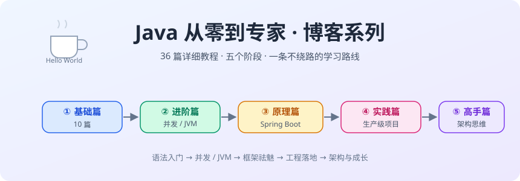
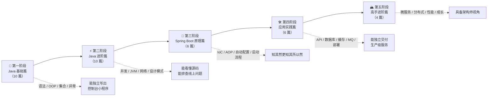

# 🚀 从零到Java技术专家：一条不打瞎忙仗的进阶之路



> "Hello World 只要一行，Hello Expert 要好几年。但方向对了，每一步都算数。"

你好，我是这个系列的作者——一个在 IT 培训教育行业深耕十余年的 Java 老兵。这些年被学员问得最多的问题不是"这个知识点怎么学"，而是：

- "Java 要学的东西太多了，到底先学哪个后学哪个？"
- "看完教程还是不会写项目，怎么办？"
- "学 Spring Boot 一定要先啃完 JVM 吗？"

这些问题背后其实是同一个诉求：**要一张靠谱的地图，而不是一堆散落的知识点。** 这个系列就是那张地图，外加沿途的详细导游词。

---

## 一、这个系列是给谁的？

| 读者画像 | 你会得到什么 |
|---------|-------------|
| 🌱 零基础 / 转行小白 | 从 Hello World 到面向对象的完整入门路径，不再"收藏等于学会" |
| 🎓 学过语法、做不出项目的"半吊子" | 集合、并发、JVM 的原理深挖，补上"知其所以然"的断层 |
| 🔧 天天写 CRUD 的业务工程师 | Spring Boot 源码级原理 + 生产级实践，从"会用"到"会修" |
| 🏔️ 想冲击高级/架构岗的工程师 | 微服务、分布式、性能优化的系统方法论 + 成长心法 |

---

## 二、学习路线总览

先上全景图。整个系列分五个阶段，环环相扣：**基础打底 → 进阶练内功 → 框架懂原理 → 实践出真知 → 架构见天地**。



### 五阶段速览

| 阶段 | 核心目标 | 篇数 | 建议周期 | 阶段验收标准（自测） |
|------|---------|:----:|:-------:|---------------------|
| ① 基础篇 | 掌握 Java 语法与面向对象思想，玩转核心类库 | 10 | 4~6 周 | 不查资料能实现一个控制台版"学生管理系统"（含增删改查 + 集合存储 + 异常处理） |
| ② 进阶篇 | 吃透并发与 JVM，具备源码阅读能力和问题排查能力 | 10 | 6~8 周 | 能手写线程安全的单例；能独立排查一次 OOM / CPU 飙高的模拟案例 |
| ③ Spring Boot 原理篇 | 理解 IoC/AOP/自动配置/启动流程，告别"配置搬运工" | 6 | 3~4 周 | 能给别人讲清楚 `@SpringBootApplication` 启动后发生了什么；能写一个自定义 Starter |
| ④ 应用实践篇 | 完整走一遍企业级服务的开发、测试、部署、监控全流程 | 6 | 4~5 周 | 独立交付一个带缓存、消息、监控的 RESTful 服务并部署上线 |
| ⑤ 高手进阶篇 | 建立分布式与架构思维，形成自己的技术成长方法论 | 4 | 4 周+ | 能设计一个中小型微服务系统的拆分方案，并说清楚每个技术选型的 trade-off |

> 📌 **划重点**：周期仅供参考，按每天 1.5~2 小时有效学习时间估算。**宁慢勿假**——每篇的"动手练习"必须真的动手，看会的都是幻觉。

---

## 三、完整文章目录

### 📖 第一阶段：Java 基础篇（`01-java-basics/`）

> 目标：把语法练成肌肉记忆，把面向对象刻进 DNA。

| # | 文章 | 核心内容 |
|---|------|---------|
| 01 | [Hello Java：从一杯咖啡到一个世界](01-java-basics/01-hello-java.md) | JVM/JDK/JRE 三兄弟、跨平台原理、Hello World 逐行解剖、开发环境搭建 |
| 02 | [变量与数据类型：8 大基本类型排排坐](01-java-basics/02-data-types.md) | 基本类型 vs 引用类型、自动装箱拆箱的坑、运算符陷阱、浮点数为什么不算钱 |
| 03 | [流程控制与数组：程序的岔路口](01-java-basics/03-control-flow-arrays.md) | if/switch/for/while、switch 的进化史、数组内存布局、Arrays 工具类 |
| 04 | [面向对象（上）：封装、继承、多态三巨头](01-java-basics/04-oop-part1.md) | 类与对象、构造器、封装思想、继承的得与失、多态的运行时绑定、Object 方法 |
| 05 | [面向对象（下）：接口、抽象类与内部类的爱恨情仇](01-java-basics/05-oop-part2.md) | 抽象类 vs 接口、函数式接口与 Lambda、内部类家族、面向对象设计原则入门 |
| 06 | [String 全解析：最熟悉的陌生人](01-java-basics/06-string-deep-dive.md) | 不可变性、字符串常量池、`+` 拼接的真相、StringBuilder、equals 与 == |
| 07 | [集合框架（上）：容器选型地图](01-java-basics/07-collections-part1.md) | Collection 与 Map 两大体系、List/Set/Queue/Map 全家对比、选型决策树 |
| 08 | [集合框架（下）：HashMap 源码炖着吃](01-java-basics/08-collections-part2.md) | ArrayList 扩容、HashMap 的 put 全流程、哈希冲突、树化、ConcurrentHashMap 概览 |
| 09 | [异常处理：优雅地搞砸事情](01-java-basics/09-exceptions.md) | 异常体系树、try-catch-finally 执行细节、try-with-resources、异常最佳实践 |
| 10 | [泛型与反射：类型的编译期与运行时](01-java-basics/10-generics-reflection.md) | 泛型擦除、通配符 PECS、Class 对象、反射 API、框架为什么离不开反射 |

### ⚡ 第二阶段：Java 进阶篇（`02-java-advanced/`）

> 目标：并发与 JVM 是 Java 工程师的分水岭，也是面试的修罗场。

| # | 文章 | 核心内容 |
|---|------|---------|
| 01 | [多线程（一）：万物皆可 Thread](02-java-advanced/01-thread-basics.md) | 进程与线程、Thread 的创建方式、线程生命周期、线程安全问题入门、synchronized 初见 |
| 02 | [多线程（二）：JMM、volatile 与锁升级](02-java-advanced/02-jmm-volatile.md) | Java 内存模型、happens-before、volatile 三板斧、synchronized 锁升级、CAS 与 ABA |
| 03 | [多线程（三）：AQS、显式锁与线程池](02-java-advanced/03-aqs-threadpool.md) | AQS 设计思想、ReentrantLock、线程池七大参数与执行流程、拒绝策略、ThreadLocal |
| 04 | [并发工具箱：JUC 全家桶](02-java-advanced/04-juc-toolbox.md) | CountDownLatch/CyclicBarrier/Semaphore、BlockingQueue、CompletableFuture、并发容器 |
| 05 | [JVM 内存结构：运行时数据区巡礼](02-java-advanced/05-jvm-memory.md) | 程序计数器、虚拟机栈、本地方法栈、堆、方法区（元空间）、栈帧与局部变量表、OOM 演示 |
| 06 | [垃圾回收：对象的生与死](02-java-advanced/06-garbage-collection.md) | 可达性分析、引用类型、三大 GC 算法、分代思想、CMS/G1/ZGC 演进 |
| 07 | [类加载机制：双亲委派与字节码](02-java-advanced/07-class-loading.md) | 类加载过程、双亲委派模型、破坏双亲委派的场景、字节码初探、SPI 与线程上下文类加载器 |
| 08 | [JVM 调优实战：工具箱与真实案例](02-java-advanced/08-jvm-tuning.md) | jps/jstat/jmap/jstack、Arthas、MAT、GC 日志解读、OOM 与 CPU 100% 排查实录 |
| 09 | [网络编程：从 Socket 到 HTTP](02-java-advanced/09-network-programming.md) | TCP/UDP、BIO 编程模型、NIO 三大件、HTTP 协议要点、Netty 入门 |
| 10 | [设计模式：高频模式实战](02-java-advanced/10-design-patterns.md) | 单例/工厂/策略/模板方法/责任链/代理/观察者，每个模式配 Spring 源码中的真实出场 |

### 🌸 第三阶段：Spring Boot 原理篇（`03-spring-boot/`）

> 目标：不只当"注解程序员"，把框架的黑盒拆开看个明白。

| # | 文章 | 核心内容 |
|---|------|---------|
| 01 | [Spring IoC：控制反转的前世今生](03-spring-boot/01-spring-ioc.md) | 为什么需要 IoC、BeanFactory vs ApplicationContext、BeanDefinition、容器启动脉络 |
| 02 | [Bean 生命周期与循环依赖](03-spring-boot/02-bean-lifecycle.md) | 实例化→属性填充→初始化→销毁全流程、BeanPostProcessor、三级缓存解决循环依赖 |
| 03 | [Spring AOP：动态代理的魔法](03-spring-boot/03-spring-aop.md) | JDK 动态代理 vs CGLIB、切点/通知/切面、AOP 失效的坑、手写迷你 AOP |
| 04 | [Spring Boot 自动配置：@SpringBootApplication 拆解](03-spring-boot/04-auto-configuration.md) | @EnableAutoConfiguration 原理、条件注解、Starter 机制、手写自定义 Starter |
| 05 | [Spring Boot 启动流程：从 main 到 Tomcat 就绪](03-spring-boot/05-boot-startup.md) | SpringApplication.run 十大步骤、事件与监听器、环境与配置加载、内嵌 Web 服务器 |
| 06 | [事务与数据访问：@Transactional 的秘密](03-spring-boot/06-transaction.md) | 声明式事务原理、七大传播行为、事务失效的八大场景、MyBatis/JPA 集成要点 |

### 🛠️ 第四阶段：应用实践篇（`04-practice/`）

> 目标：把前三阶段攒的内力，打出一套生产级组合拳。

| # | 文章 | 核心内容 |
|---|------|---------|
| 01 | [从零搭建一个 RESTful API 服务](04-practice/01-restful-api.md) | 项目初始化、分层架构、参数校验、统一响应与全局异常处理、接口文档 |
| 02 | [数据库实战：MySQL 与 MyBatis-Plus](04-practice/02-database.md) | 集成配置、CRUD 与分页、慢 SQL 定位、索引优化、深分页问题 |
| 03 | [缓存实战：Redis 三板斧](04-practice/03-redis-cache.md) | Spring Cache 集成、缓存穿透/击穿/雪崩三连防、分布式锁、缓存与数据库双写一致性 |
| 04 | [异步与消息：从 @Async 到 RocketMQ](04-practice/04-async-mq.md) | 线程池异步化、@Async 的坑、MQ 集成、可靠投递、幂等消费 |
| 05 | [测试与质量守护](04-practice/05-testing.md) | JUnit 5、Mockito、@SpringBootTest 分层测试策略、Testcontainers、覆盖率 |
| 06 | [日志、监控与上线部署](04-practice/06-logging-monitoring.md) | logback 实践、Actuator、Prometheus + Grafana、打包部署、Docker 化 |

### 🏔️ 第五阶段：高手进阶篇（`05-architecture/`）

> 目标：从"实现功能"进化到"定义系统"。

| # | 文章 | 核心内容 |
|---|------|---------|
| 01 | [微服务拆分与 Spring Cloud 实战](05-architecture/01-microservices.md) | 拆分原则与方法、Nacos 注册与配置中心、OpenFeign、Gateway、Sentinel 熔断限流 |
| 02 | [分布式疑难杂症门诊](05-architecture/02-distributed.md) | CAP 与 BASE、分布式事务五种方案对比、幂等设计、分布式锁选型、分布式 ID |
| 03 | [性能优化方法论：从慢 SQL 到全链路](05-architecture/03-performance.md) | 优化的正确姿势、指标与压测、各层优化清单、全链路追踪、真实优化案例复盘 |
| 04 | [从码农到专家：Java 工程师成长指南](05-architecture/04-growth-guide.md) | 技术深度与广度、源码阅读方法、知识体系构建、面试心法、职业路线选择 |

---

## 四、这套路线为什么这么排？（路线设计逻辑）

很多同学的学习路径是"哪里火学哪里"：今天追新框架，明天背面试题，结果知识像一堆没拧紧的螺丝。这条路线的编排遵循三条原则：

**1. 依赖关系优先：先有地基，再起高楼。**
- 为什么集合（基础篇 07/08）排在泛型（基础篇 10）前面还能学？因为用法可以先会、原理后补。但进阶篇的并发必须排在基础篇之后——线程安全问题的最小复现单位就是集合与共享变量。
- Spring Boot 原理篇必须排在进阶篇之后：自动配置靠的是**反射 + 条件判断**，IoC 里到处是**Map 容器**，AOP 的本质是**动态代理 + 设计模式**。没有前两阶段，读源码就像没学过拼音直接读文言文。

**2. "用法 → 原理 → 生产" 三遍学习法：**
- 第一遍（基础篇/实践篇）：会用了，建立成就感；
- 第二遍（进阶篇/原理篇）：知其所以然，建立深度；
- 第三遍（实践篇/高手篇）：在生产场景里闭环，建立判断力。
- 所以实践篇放在原理篇**之后**——你带着"自动配置是怎么生效的"这类疑问去写项目，每个注解都不再是咒语。

**3. 输出倒逼输入：**
- 每篇都有"课后思考 & 动手练习"，阶段末有验收标准；
- 建议每学完一篇，用自己的话写一段 100 字总结（能讲清楚才算学会，这叫费曼学习法）。

---

## 五、学习方法论：老学员亲测有效的五条军规

1. **代码必须亲手敲。** 复制粘贴的学习留存率约等于零。看懂 ≠ 会写，会写 ≠ 写对，写对 ≠ 写熟。
2. **报错是礼物。** 每一个 `NullPointerException`、`ClassCastException` 都是最好的老师。遇到报错先自己读堆栈，再查资料，最后再问人——这个顺序不能乱。
3. **用 Git 管理你的练习代码。** 从第一天就养成版本管理习惯，每篇的练习提交一次，半年后回看 commit 记录，你会被自己感动。
4. **不要在工具书上恋战。** 一本书读到 80% 就换下一本比死磕 100% 更划算——剩下的 20% 会在后续学习中自然补全。
5. **建立"问题笔记本"。** 把每个踩过的坑记下来（现象 → 原因 → 解法），三个月后它就是你最值钱的私房资料。

---

## 六、快速开始

```bash
# 建议：把本仓库 clone 到本地，配合每篇的练习题边读边写
git clone <你的仓库地址>
cd java-blog-series

# 从第一篇开始：先通读 → 再敲代码 → 最后做练习
open 01-java-basics/01-hello-java.md
```

> 💡 **老鸟忠告**：这个系列一共 36 篇，别想着一口吃成胖子。真正的学习曲线不是线性的，是"平台期 → 突然开窍"的阶梯状。卡住的时候别自我怀疑，那是你的大脑正在砌台阶。

**现在，深呼吸，让我们从那杯经典的咖啡开始 ☕ → [01-Hello Java：从一杯咖啡到一个世界](01-java-basics/01-hello-java.md)**
